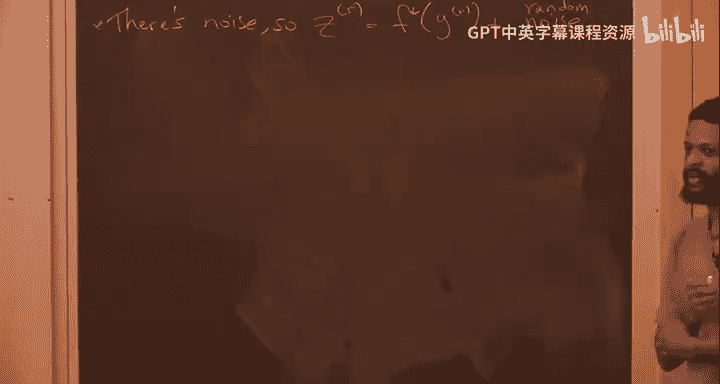

# 哈佛大学《大数据算法》课程笔记 - 第16讲：子空间嵌入 🧮


在本节课中，我们将要学习**子空间嵌入**的概念。这是一种强大的降维技术，能够高效地近似高维矩阵的运算，并应用于诸如最小二乘回归等问题。我们将探讨其定义、存在性、应用以及两种高效的构造方法：采样法和随机投影法。

---

## 子空间嵌入的定义 📖

上一节我们介绍了近似矩阵乘法的概念，本节中我们来看看一个更强大的工具：子空间嵌入。

给定一个 **RN** 中的线性子空间 **E**，以及一个 **M x N** 的矩阵 **π**。如果对于所有属于 **E** 的向量 **x**，矩阵 **π** 都能保持其范数，即满足以下条件，则称 **π** 是 **E** 的一个 **ε-子空间嵌入**：

```
对于所有 x ∈ E，有：
(1 - ε) ||x||² ≤ ||πx||² ≤ (1 + ε) ||x||²
```


这可以看作是 Johnson-Lindenstrauss 引理在特定子空间上的应用。对我们而言，子空间 **E** 通常是某个矩阵 **A** 的列空间。这意味着对于所有向量 **z**（它可以表示为 **Ax**），其范数都能被 **π** 近似保持。

---

## 子空间嵌入的存在性与维度 🎯

一个自然的问题是：我们需要多少行（即 **M** 多大）才能构造一个子空间嵌入？



以下是关于子空间嵌入维度的两个关键事实：
1.  **不存在性**：对于任何 ε < 1，如果 **M < D**（其中 **D** 是子空间 **E** 的维度），则不存在 **ε-子空间嵌入**。
2.  **存在性**：总存在一个完美的（误差为0的）子空间嵌入，其行数 **M** 恰好等于 **D**。

**证明概要**：
*   对于（1），如果 **M < D**，则矩阵 **π** 的秩小于 **D**。其核空间与子空间 **E** 的交集中必然存在非零向量，该向量被 **π** 映射为零，无法保持范数。
*   对于（2），我们可以通过奇异值分解（SVD）来构造。对于任意矩阵 **A**，其 SVD 为 **A = U Σ Vᵀ**，其中 **U** 的列构成了 **A** 列空间的一组标准正交基。此时，令 **π = Uᵀ**，即可得到一个具有 **D** 行且零误差的完美子空间嵌入。

然而，通过 SVD 计算 **Uᵀ** 需要 **O(ND²)** 的时间，这在大数据场景下可能过于昂贵。因此，我们的目标是寻找能**快速计算和应用的**子空间嵌入。

---

## 子空间嵌入的应用：最小二乘回归 📉

在了解了子空间嵌入的基本概念后，我们来看看它的一个核心应用：加速最小二乘回归。

我们面临的问题如下：
给定一个高大的 **N x D** 矩阵 **A**（N 很大）和一个向量 **b ∈ Rᴺ**，我们希望找到：
```
x_ls = argmin over x ∈ Rᴰ ||Ax - b||²
```
传统的解法（如计算 SVD 或 **AᵀA**）需要 **O(ND²)** 的时间。

**使用子空间嵌入进行加速**：
假设我们有一个对于 **A** 的列空间以及向量 **b** 所张成子空间的 **ε-子空间嵌入 π**（一个 **M x N** 的矩阵，且 **M ≈ D**）。我们可以转而求解一个维度小得多的问题：
```
x_tilde = argmin over x ∈ Rᴰ ||πAx - πb||²
```
由于 **πA** 只是一个 **M x D** 的矩阵，求解这个新的回归问题只需要 **O(MD²) ≈ O(D³)** 的时间。

**关键结论**：
可以证明，这样得到的近似解 **x_tilde** 的质量是有保证的：
```
||A x_tilde - b||² ≤ (1+ε)/(1-ε) * ||A x_ls - b||²
```
也就是说，近似解的目标函数值在最坏情况下也不会比最优解差太多。

现在，整个算法的耗时取决于三部分：
1.  找到子空间嵌入 **π** 的时间。
2.  计算 **πA** 和 **πb** 的时间。
3.  求解降维后回归问题的时间（**O(D³)**）。

我们的目标是让前两步也非常高效。

---

## 构造子空间嵌入的方法 🔧

接下来，我们将探讨两种构造子空间嵌入的方法，它们分别对应于我们上节课介绍的两种近似矩阵乘法技术。

### 方法一：基于杠杆得分的采样法

这种方法的思想是对矩阵 **A** 的行进行非均匀采样。

**杠杆得分**：
首先，我们定义矩阵 **A** 第 **i** 行的**杠杆得分** **lᵢ** 为：
```
lᵢ = aᵢᵀ (AᵀA)⁻¹ aᵢ
```
其中 **aᵢ** 是 **A** 的第 **i** 行（视为列向量）。杠杆得分具有重要的几何意义：它等于将 **A** 的列空间正交化后，第 **i** 行范数的平方。所有行的杠杆得分之和等于矩阵 **A** 的秩 **D**。

**采样过程**：
我们独立地采样矩阵的行。采样第 **i** 行的概率 **pᵢ** 被设置为与 **lᵢ** 成正比（但需进行截断和缩放，具体公式涉及 **log D** 和 **1/ε²** 因子）。被采样的行会被一个权重因子 **1/√pᵢ** 进行缩放，以确保无偏性。

**理论保证**：
通过精心设置采样概率，可以证明，如果我们采样大约 **O(D log D / ε²)** 行，那么所得到的采样矩阵 **π** 以高概率是一个 **ε-子空间嵌入**。

**挑战**：
计算精确的杠杆得分本身需要 **A** 的 SVD，这又回到了我们最初想要避免的昂贵计算。不过，存在方法可以快速**近似**杠杆得分（例如，使用接下来要介绍的随机投影法进行预处理），这可以作为习题进行探索。

### 方法二：基于随机投影的JL法

这种方法利用随机投影来构造子空间嵌入，其灵感来源于 Johnson-Lindenstrauss 引理。

**核心思想**：
如果我们使用一个随机高斯矩阵或随机符号矩阵作为 **π**，那么根据 Gordon 定理的分析，只需要 **M = O(D/ε²)** 行，就能以高概率保证 **π** 是任意一个 **D** 维子空间的 **ε-子空间嵌入**。

**优势与问题**：
*   **优势**：**M** 很小（约 **D/ε²**），且构造 **π** 完全不需要查看数据 **A**，速度极快。
*   **问题**：计算 **πA** 是稠密矩阵乘法，需要 **O(MND) ≈ O(ND²/ε²)** 时间，这可能比原问题更慢。

**解决方案：快速 oblivious 子空间嵌入**
我们需要一个既能快速生成，又能快速与 **A** 相乘的 **π**。这引出了 **oblivious 子空间嵌入** 的概念。

**定义**：
一个 **OSED** 是一个矩阵分布 **D**，使得对于任意具有标准正交列的 **N x D** 矩阵 **U**，从 **D** 中随机抽取的矩阵 **π** 满足：
```
Pr[ || (πU)ᵀ(πU) - I || > ε ] ≤ δ
```
关键在于，这个分布 **D** 不依赖于具体的 **U**（或 **A**）。

研究表明，我们可以使用**稀疏的JL变换**或**快速JL变换**来实例化这样的分布 **D**。这些变换矩阵 **π** 非常稀疏或具有快速算法结构（如傅里叶变换），使得计算 **πA** 的时间可以接近 **O(nnz(A))**，即矩阵 **A** 中非零元素的数量，这对于稀疏矩阵是极大的加速。

---

## 总结与前瞻 🚀

本节课中我们一起学习了：
1.  **子空间嵌入**的定义：它是一种能保持某个子空间内所有向量范数的降维变换。
2.  子空间嵌入的**存在性**与**最小维度要求**（至少为子空间维度 **D**）。
3.  子空间嵌入在**最小二乘回归**中的应用，可将计算复杂度从 **O(ND²)** 降至近 **O(D³)**，前提是能快速获得嵌入矩阵。
4.  构造子空间嵌入的两种主要方法：
    *   **基于杠杆得分的采样法**：需要采样约 **O(D log D / ε²)** 行，但计算精确杠杆得分成本高。
    *   **基于随机投影的JL法**：需要约 **O(D/ε²)** 行，使用稠密随机矩阵时乘法成本高，但可通过**稀疏或快速的 oblivious 子空间嵌入**（如稀疏JL）来解决，实现近乎线性的计算时间。

在下节课中，我们将更深入地探讨 **oblivious 子空间嵌入**，并介绍使用子空间嵌入加速回归的其他技巧（例如，仅使用常数精度嵌入配合迭代优化）。我们还将看到子空间嵌入在其他问题（如主成分分析PCA）中的应用。