# 17：获取与使用子空间嵌入 🧮

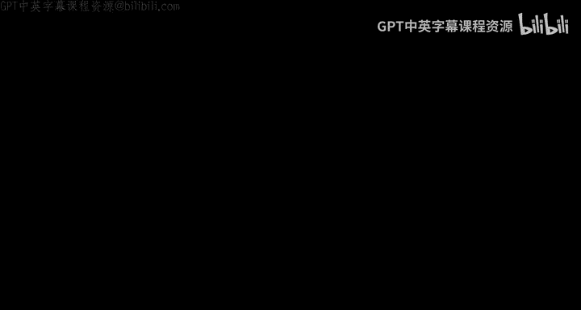

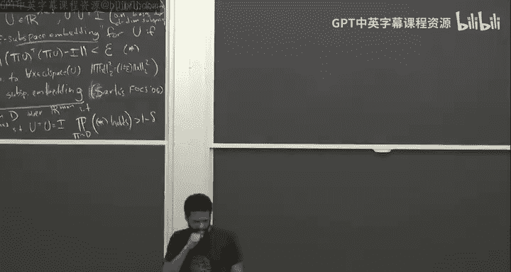

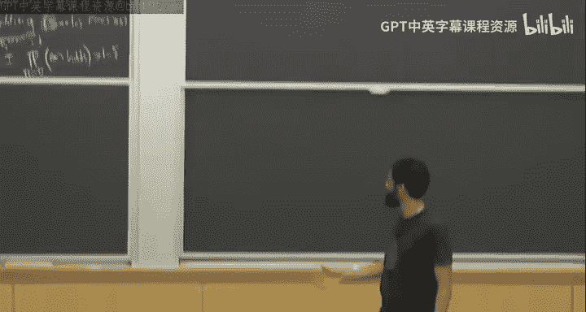

在本节课中，我们将继续探讨无意识子空间嵌入。我们将学习获取它们的方法，以及如何利用子空间嵌入进行回归分析。此外，我们还将简要介绍低秩近似。

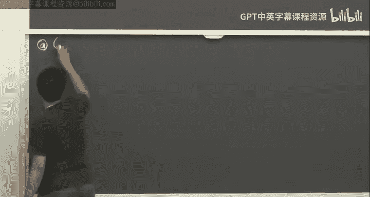

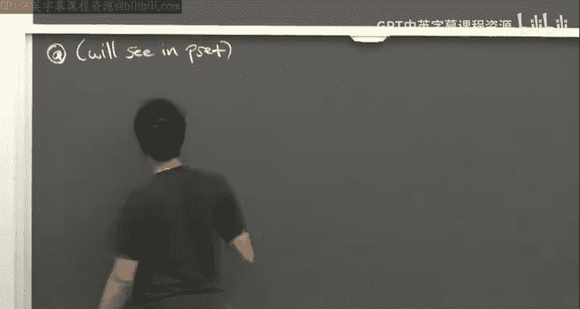

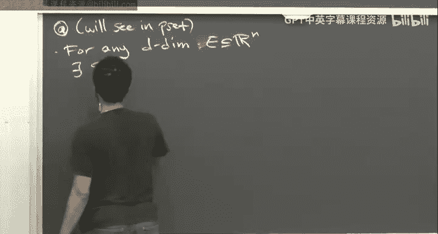

---

## 获取OSE的方法 🔍

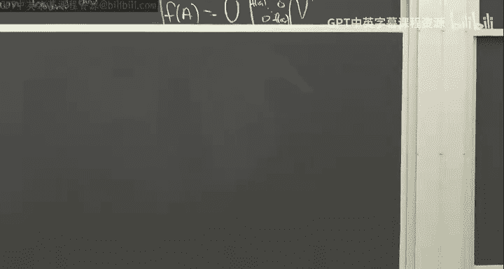

上一讲我们提到了一种方法，实际上还有多种其他方法可以获取无意识子空间嵌入。以下是五种主要方法：

1.  **网论证**
2.  **使用非交换Khintchine不等式**
3.  **矩方法**
4.  **使用具有Frobenius误差的近似矩阵乘法**
5.  **链化方法**

接下来，我们将逐一简要介绍这些方法。

### 1. 网论证

网论证的基本思想是：对于RN中的任意d维子空间E，存在一个单位范数向量子集T，其大小为O(1)^d。如果投影Π能将T中所有向量的范数保持到(1 ± O(ε))以内，那么它就能将整个子空间E的范数保持到(1 ± ε)以内。

这意味着，分布式的Johnson-Lindenstrauss引理可以自动推导出无意识子空间嵌入。通过设置失败概率δ为1/|T|，并利用联合界，我们可以确保保留T中的所有向量，从而保留整个E。

**公式表示：**
分布JL（失败概率δ' = δ/|T|） ⇒ OSE（失败概率δ）

### 2. 非交换Khintchine不等式方法

此方法利用矩阵集中不等式。我们希望以下不等式以高概率成立：
\[ \|\Pi U^T \Pi U - I\| > \epsilon \]
通过马尔可夫不等式，这最多是(1/ε^p)乘以该算子范数p次方的期望。通过选择p至少为log d，我们可以利用霍尔德不等式将Schatten p范数与算子范数联系起来。

核心技巧是对称化：引入独立同分布的副本Y_i，并利用行的独立性，将问题转化为可以应用非交换Khintchine不等式的形式。这种方法已被多篇论文使用，能够获得接近最优的行数m和稀疏度s。

**近似结果示例（独立条目）：**
*   m ≈ d * polylog(d/(δ)) / ε²
*   s ≈ polylog(d/(δ)) / ε

### 3. 矩方法

矩方法从基本原理出发，计算以下概率：
\[ P(\|\Pi U^T \Pi U - I\| > \epsilon) \leq \frac{1}{\epsilon^p} E[\|\Pi U^T \Pi U - I\|^p] \]
对于偶数p，矩阵的p次幂的迹可以展开为所有环路上矩阵元素乘积的和。通过计算这个期望，并进行组合计数，可以得到界。这是经典随机矩阵理论的方法，虽然计算量大，但技术复杂性较低。

**历史应用：**
此方法被Wigner、Freddie Comossh等人用于分析随机矩阵的算子范数。对于稀疏JL，早期通过矩方法得到的结果在log因子数量上不如后来的方法优化。

### 4. 近似矩阵乘法（AMM）方法

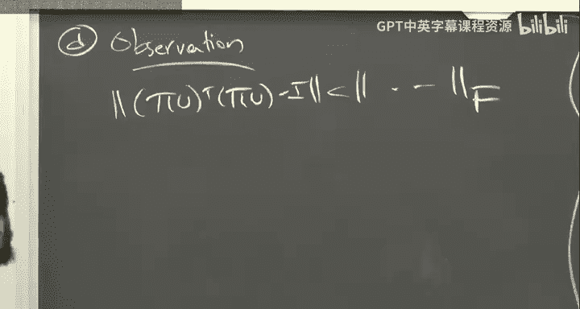

此方法基于一个关键观察：如果矩阵的Frobenius范数小于ε，那么其算子范数也小于ε。
\[ \|\Pi U^T \Pi U - I\|_{op} \leq \|\Pi U^T \Pi U - I\|_F \]
因此，我们希望：
\[ P(\|\Pi U^T \Pi U - I\|_F > \epsilon) \leq \delta \]
注意到，ΠU^TΠU 接近 U^TU 正是具有Frobenius误差的近似矩阵乘法问题。我们已知，满足JL矩性质的分布都能实现AMM。通过设置ε' = ε/d，我们最终需要 m = O(d²/(ε²δ)) 行。

**优势：**
此方法允许我们使用任何满足JL矩性质的分布（例如，稀疏JL）来获得OSE，且分析相对直接。

### 5. 链化方法

链化是比朴素网论证更精细的技术。对于稀疏度s=1的情况，直接对指数级多的向量进行联合界要求m非常大。Clarkson和Woodruff观察到，子空间中的向量可以分解为“集中”向量和“分散”向量。分散向量即使s=1也有很好的尾界，而集中向量的数量很少。结合链化技术，他们得到了 m ≈ d² * polylog(d/ε) / ε² 且 s=1 的结果。

---

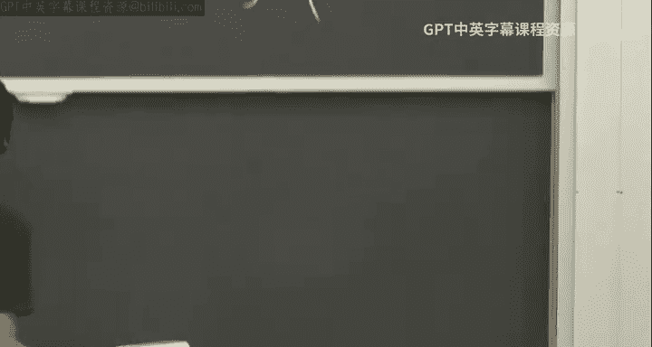

## 子空间嵌入在回归中的应用 📈

上一节我们介绍了获取OSE的各种方法，本节我们来看看如何利用OSE来解决回归问题。除了上节课提到的“素描后求解”方法，还有两种更高效的使用方式。

### 方法二：基于常数OSE的梯度下降加速

梯度下降是一种迭代优化方法。对于最小二乘问题，目标函数是 f(x) = \|Ax - b\|₂²。梯度下降的更新公式为：
\[ x_{t+1} = x_t - \eta \nabla f(x_t) \]
其中，梯度 ∇f(x) = 2A^T(Ax - b)。

**定理：** 设κ(A)为A的条件数（最大奇异值/最小奇异值）。经过 L = O(κ(A) log(1/ε)) 次迭代后，误差 \|A x_L - A x^*\|₂² 可以降至初始误差的ε倍以内。

问题在于，κ(A)可能很大。解决方案是使用一个常数（如1/6）子空间嵌入Π。计算ΠA的SVD：ΠA = UΣV^T。令 R = VΣ^{-1}。由于Π是子空间嵌入，对于所有x，有：
\[ \|x\|₂ ≈ \|ΠARx\|₂ ≈ \|ARx\|₂ \]
因此，AR是一个条件数为常数的良态矩阵。我们在AR上运行梯度下降，迭代次数仅为 O(log(1/ε))。

**计算复杂度：**
1.  计算ΠA的SVD：O(m d²) ≈ O(d³) （若m≈d）
2.  每次迭代计算AR和(AR)^T：O(nnz(A) + d²)
3.  总复杂度：O(nnz(A) log(1/ε) + d³)

为了获得最终(1+ε)倍的近似解，可以先使用方法一（素描求解）获得一个常数近似解作为初始点x0，然后使用此方法进行精炼。

### 方法三：改进的素描求解分析

此方法表明，即使Π不是ε-OSE，只要满足以下两个稍弱的性质，素描求解方法仍然有效：
1.  **常数子空间嵌入**（例如，因子为1/6）。
2.  **具有Frobenius误差的近似矩阵乘法**，其中误差参数ε' = √(ε/d)。

**证明思路：**
设x*是原问题最优解，x̃是素描问题最优解。目标证明 \|A x̃ - b\|₂² ≤ (1+O(ε)) \|A x* - b\|₂²。
将误差分解为：
\[ \|A x̃ - b\|₂² = \|A(x̃ - x*)\|₂² + \|A x* - b\|₂² \]
利用正交性，只需证明第一项 ≤ ε \|A x* - b\|₂²。
通过引入A的SVD和常数嵌入性质，可以将问题转化为评估项 \|U^T Π^T Π w\|₂²。这正好是近似矩阵乘法的形式，利用性质2可得其界为 (ε/d) * d * opt² = ε * opt²。

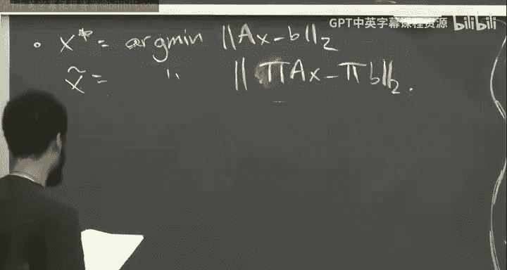

**优势：**
此分析允许使用更少的行数m。例如，对于稀疏JL（s=1），使用方法一需要 m = O(d²/ε²)，而使用方法三只需要 m = O(d² + d/ε)。

---

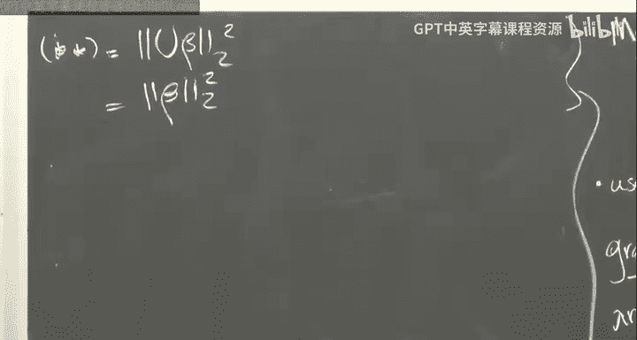

## 总结 🎯

本节课我们一起深入探讨了无意识子空间嵌入。

*   我们回顾了五种获取OSE的主要方法：网论证、非交换Khintchine不等式、矩方法、近似矩阵乘法以及链化方法，了解了它们的基本思路和相对优劣。
*   在回归应用方面，我们学习了三种利用OSE的策略：
    1.  直接的ε-OSE用于“素描后求解”。
    2.  常数OSE用于预处理矩阵，从而加速梯度下降，将迭代次数依赖从多项式级(1/ε)降低到对数级log(1/ε)。
    3.  结合常数OSE和特定精度的AMM性质，为“素描后求解”提供了更宽松且高效的分析框架，有时能用更少的测量数达到目的。

这些工具和分析技巧是构建高效大数据算法的核心。在下节课中，我们将看到类似的证明思路如何应用于低秩近似问题，并随后进入压缩感知的主题。