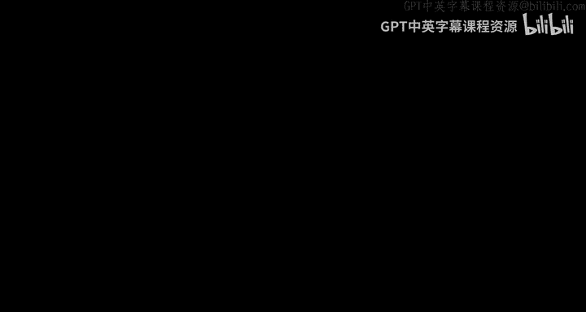
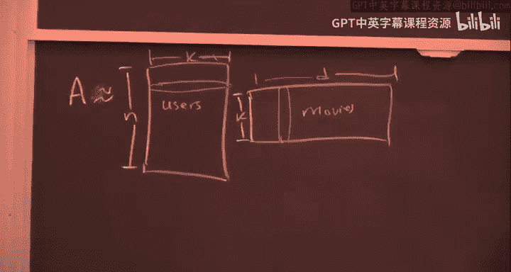
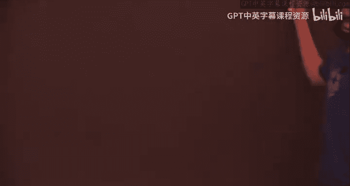
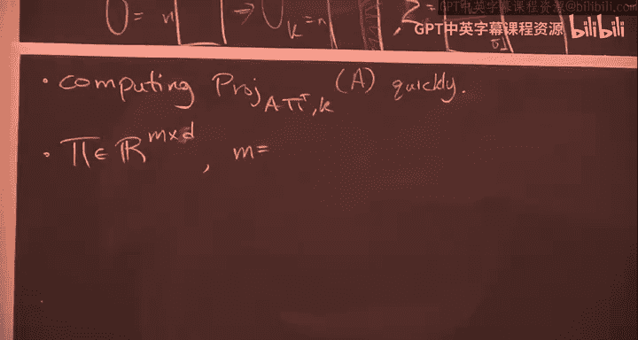
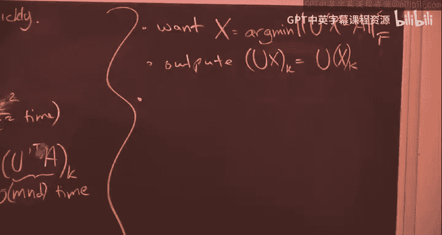
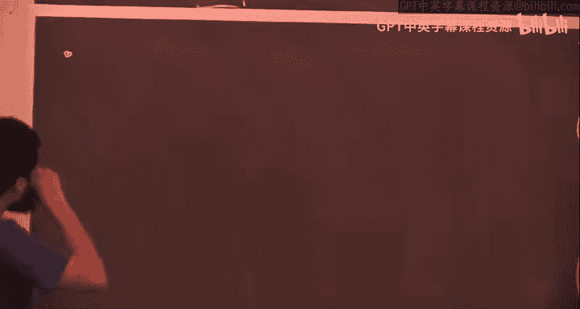
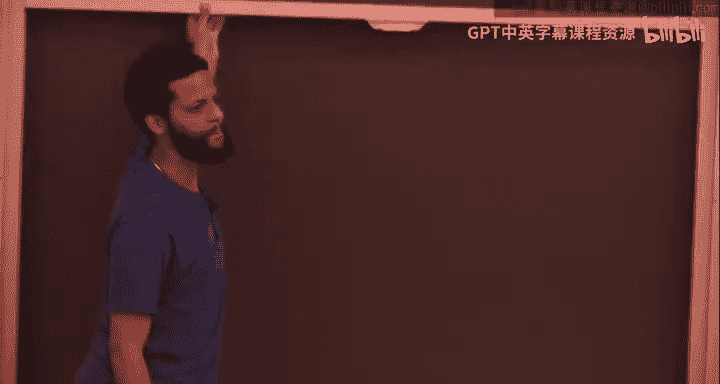
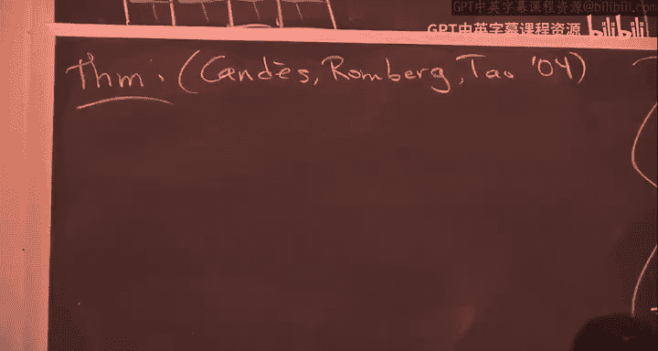

# 课程18：大数据算法中的压缩感知 🎯

在本节课中，我们将学习如何利用子空间嵌入进行低秩矩阵近似，并初步介绍压缩感知的基本概念。我们将看到，这些主题虽然看似不同，但在核心思想上紧密相连。

## 低秩近似与子空间嵌入 📉

上一节我们介绍了利用子空间嵌入解决回归问题的三种方法。本节中，我们来看看如何将类似的思想应用于低秩矩阵近似问题。

### 低秩近似的动机

低秩近近似的基本思想是，我们有一个巨大的矩阵 **A**（例如，用户对电影的评分矩阵），其维度为 **n × d**。我们假设矩阵的行（例如，用户）实际上存在于一个低维空间中。这意味着，尽管矩阵有 **d** 个显式属性（例如，电影评分），但只有少数几个隐藏属性真正决定了所有数据。

用公式表示，我们希望找到一个秩至多为 **k** 的矩阵 **B**，使得 **A ≈ B**。更具体地说，我们希望找到矩阵 **U**（n × k）和 **V**（k × d），使得 **A ≈ U V**。

根据Eckart-Young定理，矩阵 **A** 的最佳秩 **k** 近似可以通过其奇异值分解（SVD）获得。设 **A = U Σ V^T**，则最佳近似 **A_k = U_k Σ_k V_k^T**，其中下标 **k** 表示仅保留前 **k** 个奇异值和对应的奇异向量。

然而，计算完整的SVD需要 **O(n d^2)** 时间，对于大规模矩阵来说代价高昂。我们的目标是利用随机化技术来加速这一过程。

### 基于子空间嵌入的快速算法

以下定理为我们提供了加速的可能性。

**定理**：定义矩阵 **Ã_k = Proj_{AΠ^T, k} (A)**，即先将矩阵 **A** 的列投影到 **AΠ^T** 的列空间，然后取该投影矩阵的最佳秩 **k** 近似。那么，只要投影矩阵 **Π** 满足以下两个条件，就有：
**||A - Ã_k||_F ≤ (1 + O(ε)) * ||A - A_k||_F**

1.  **Π** 是矩阵 **V_k**（**A** 的右奇异向量矩阵的前 **k** 列）列空间的 **(1/2)**-子空间嵌入。
2.  **Π** 满足关于矩阵 **V_k^T** 和 **A - A_k** 的 **√(ε/k)**-近似矩阵乘法保证（在Frobenius范数下）。

这个定理的证明思路与回归问题的“方法三”非常相似。核心在于，我们可以将低秩近似问题中的误差项，转化为一个类似于回归问题的形式，并利用之前为回归问题建立的分析框架进行误差控制。

### 算法效率分析

现在，我们来分析为什么基于此定理的算法比直接计算SVD更快。

首先，为了满足定理的条件，我们需要选择 **Π** 的维度 **m**。条件1要求 **m = O(k)**，条件2要求 **m = O(k/ε)**。因此，**m** 可以取为 **O(k/ε)**。

以下是算法的关键步骤及其时间复杂度：

1.  **计算 AΠ^T**： 利用快速子空间嵌入（如稀疏嵌入或基于Hadamard/FFT的方法），可以在接近 **O(nnz(A))** 的时间内完成，其中 **nnz(A)** 是 **A** 的非零元数量。
2.  **计算 AΠ^T 的SVD**： 设 **AΠ^T = U‘ Σ’ V‘^T**。由于 **AΠ^T** 是 **n × m** 矩阵，计算其SVD的时间为 **O(n m^2) = O(n k^2 / ε^2)**。
3.  **近似求解回归问题**： 我们不需要精确计算 **U‘^T A**。相反，我们可以求解一个广义回归问题：**min_{X, rank(X)≤k} ||U‘ X - A||_F**。利用上一讲关于回归的快速算法，我们可以得到一个近似解 **X̃**，满足 **||U‘ X̃ - A||_F^2 ≤ (1+ε) * min_{X, rank(X)≤k} ||U‘ X - A||_F^2**。这一步的时间复杂度可以控制在 **O((nnz(A) + poly(k/ε)) * log(1/ε))** 量级。
4.  **输出分解**： 计算 **X̃** 的SVD，得到 **X̃ = U_x Σ_x V_x^T**。最终输出的低秩近似分解为 **(U‘ U_x) Σ_x V_x^T**。计算 **X̃** 的SVD需要 **O(m d^2) = O((k/ε) d^2)** 时间，但通常 **d** 很大，我们可以利用 **X̃** 是通过回归得到的这一事实，有时可以避免显式计算其SVD。

总体而言，当 **k/ε** 远小于 **d** 时，该算法的时间复杂度 **O(n k^2 / ε^2 + (k/ε) d^2)** 优于直接计算SVD的 **O(n d^2)**。通过进一步的优化（如近似求解回归），甚至可以将依赖 **d** 的部分从 **d^2** 降低到 **d * poly(k/ε)**。

### 与K-Means聚类的联系

低秩近似的思想与其他问题密切相关，例如K-Means聚类。可以将数据点矩阵 **A**（每行是一个点）的K-Means目标函数，重新表述为寻找一个特定形式的秩 **k** 近似矩阵的问题。这种联系使得我们可以利用降维技术（如Johnson-Lindenstrauss变换）来加速K-Means算法。研究表明，将数据维度降至 **O(k/ε^2)**，然后求解降维后的K-Means问题，可以得到原始问题 **(1+ε)** 近似的解。

## 压缩感知初步 🔍

接下来，我们将转向一个新的主题——压缩感知，它将占据接下来几讲的内容。压缩感知的核心思想是，利用信号的“可压缩性”，以远少于信号维度（奈奎斯特采样定理要求）的测量次数来恢复信号。

### 基本问题设定

假设我们有一个高维信号向量 **x ∈ R^n**，它是“可压缩的”。可压缩性通常意味着 **x** 是近似稀疏的。我们固定一个参数 **k**，定义 **x_{tail(k)}** 为将 **x** 中幅度最大的 **k** 个分量（头部）置零后得到的向量。如果 **||x_{tail(k)}||** 很小，我们就说 **x** 是高度可压缩的。

压缩感知的目标是，通过少数 **m** 个线性测量值来近似恢复 **x**。测量过程表示为 **y = Π x**，其中 **Π** 是一个 **m × n** 的测量矩阵（**m << n**）。我们希望找到一个高效算法，能够从 **y** 中计算出一个估计值 **x̃**，使得恢复误差 **||x - x̃||** 以 **x_{tail(k)}** 的范数为上界。

### 为什么关注稀疏性？

信号在某个变换域（而非标准基）下稀疏的现象非常普遍。一个经典的例子是自然图像。

图像在像素域（标准基）下并不稀疏，但在某些变换基（如小波基）下是近似稀疏的。以小波变换为例，它通过递归地计算图像局部块的平均值和差值，将图像能量集中到少数系数上。在得到的变换系数中，大部分系数（对应于平滑区域）接近于零，只有少数系数（对应于边缘和纹理）具有较大值。这就是JPEG等图像压缩标准能够有效工作的基础。

在压缩感知框架下，如果 **x = Ψ α**，其中 **Ψ** 是稀疏变换基（如小波基），**α** 是稀疏或近似稀疏的系数向量，那么我们的测量就变为 **y = Π x = (Π Ψ) α**。此时，问题转化为从测量值 **y** 中恢复稀疏向量 **α**。

### 主要理论结果

一个里程碑式的结论由Candès、Romberg、Tao以及Donoho等人给出：

**定理**：存在 **m × n** 的测量矩阵 **Π**（例如，随机高斯矩阵或随机符号矩阵），其中 **m = O(k log(n/k))**，以及一个多项式时间恢复算法。该算法以 **y = Π x** 为输入，输出 **x̃**，并保证以下误差界：
**||x - x̃||_2 ≤ (C / √k) * ||x_{tail(k)}||_1**
其中 **C** 是一个常数。

这个定理意味着，所需的测量次数 **m** 主要取决于信号的稀疏度 **k**，并带有一个对数因子 **log(n/k)**。如果信号是严格 **k**-稀疏的，则恢复是精确的。如果是近似稀疏的，则恢复误差由信号“尾部”的能量控制。

值得注意的是，如果事先知道信号是严格 **k**-稀疏的，并且不考虑噪声，那么理论上 **2k** 次测量就是必要且充分的，这可以通过诸如Prony方法等更古老的技巧来实现。然而，为了对近似稀疏性和测量噪声具有鲁棒性，引入额外的对数因子是必要的。

## 总结 📝

本节课中，我们一起学习了两个重要主题。

首先，我们探讨了如何将子空间嵌入技术应用于低秩矩阵近似问题。通过构造满足特定条件的随机投影矩阵，我们可以显著加速寻找最佳低秩近似的进程，其核心思想与之前解决的回归问题一脉相承。

其次，我们初步介绍了压缩感知的基本框架。它旨在利用信号在某个域中的稀疏性或可压缩性，以远低于信号维度的测量次数来恢复信号。我们了解了其问题设定、实际应用背景（如图像处理），以及一个关键的理论结果，该结果指出了所需测量次数与信号稀疏度之间的基本关系。

从下节课开始，我们将深入压缩感知的理论核心，证明上述主要定理，并探索更多相关的算法与概念。