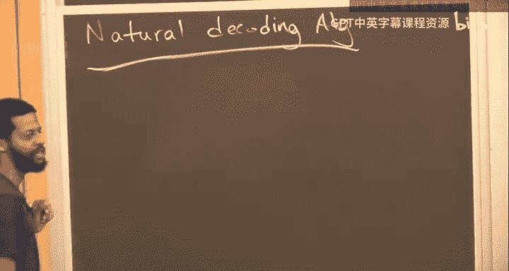
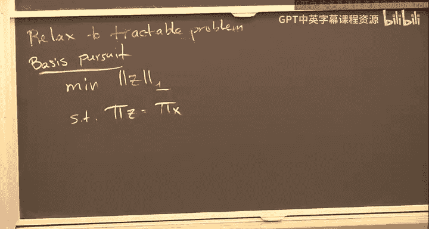
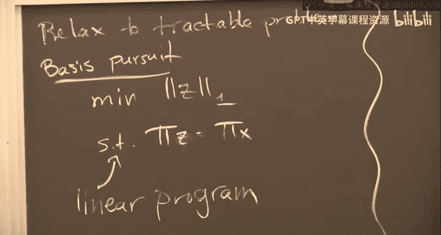
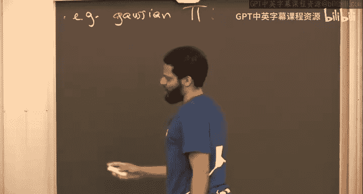
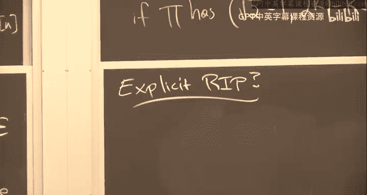
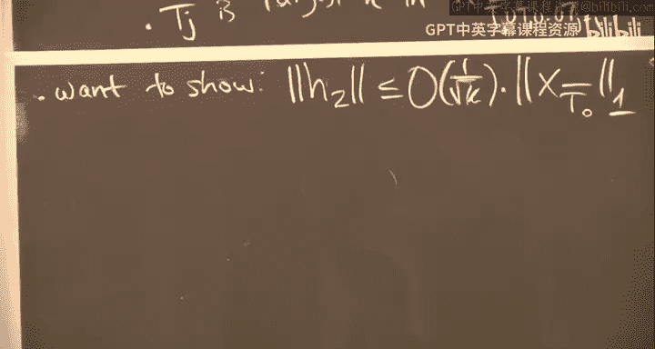

# 哈佛大学《大数据算法》课程笔记 - P19：压缩感知与恢复算法 🧠

在本节课中，我们将学习压缩感知的核心定理，并探讨如何通过一个称为“基追踪”的算法，从少量测量中高效地恢复稀疏或近似稀疏的信号。我们将看到，这一过程与之前学习的约翰逊-林登斯特劳斯引理密切相关。

---

## 从压缩感知定理开始

上一节我们开始了压缩感知这一新章节。我陈述了由Candès、Romberg、Tao以及Donoho提出的定理，该定理指出：

存在一个矩阵和一个在多项式时间内运行的算法，使得对于任意向量 `x`（可将其视为 `k`-稀疏向量），如果你仅向算法提供 `πx`，它就能高效地恢复出一个接近 `x` 的向量 `x̃`。

具体来说，如果 `x` 确实是 `k`-稀疏的（即尾部范数为0），那么你将精确地恢复出 `x`。我们将在习题中看到，对于精确稀疏的情况，你可以仅用 `2k` 次测量，这既是必要的也是充分的。

然而，如果你希望对近似稀疏的向量实现这种近似恢复（即恢复误差取决于向量与真正稀疏状态的距离），那么你确实需要更多的测量次数。实际上存在一个下界，表明要实现这种保证，测量次数确实需要达到这个数量级（相差一个常数因子）。

---

## 证明定理与算法设计

今天我想要证明这个定理。你将看到，这个 `π` 矩阵与约翰逊-林登斯特劳斯引理密切相关。事实上，一旦我们完成设定，JL引理将意味着这样的 `π` 矩阵存在。

在本节课末，我还将展示一个逆命题：如果一个 `π` 矩阵满足我们在此所需的条件，那么你可以将其转化为一个JL映射。它们在某种意义上几乎是等价的，尽管在另一个方向上会存在一些损失。

---

### 自然的解码算法及其困难

让我们暂时忘记 `π`。假设 `π` 具有某种神奇的特性，允许我们进行解压缩。那么，一个自然的解码算法是什么呢？

一个自然的解码算法是：假设 `x` 确实是 `k`-稀疏的，那么存在唯一的 `k`-稀疏解。也就是说，存在唯一的 `k`-稀疏向量能产生我们得到的测量值 `πx`。

因此，一个自然的算法将是：
**最小化向量 `z` 的支撑集大小（即 `l₀` “范数”）**，约束条件为 `πz = πx`。

算法知道 `πx`，因此我们可以写出这个优化问题。不幸的是，一般来说，这是一个NP难问题。这可以追溯到Gary Johnson的NP难问题目录。这是一个计算上困难的问题，但它是针对任意输入求解时的困难。而我们并不需要解决任意输入的问题。

---

### 松弛到可处理的问题：基追踪

因此，我们将把问题松弛为一个非NP难的问题，即一个可处理的问题。我们将使用一个称为“基追踪”的算法。

基追踪算法表述为：
**最小化向量 `z` 的 `l₁` 范数**，约束条件为 `πz = πx`。

这个优化问题可以写成一个线性规划问题，而线性规划可以在多项式时间内求解。这里的变量是向量 `z` 的各个条目。

那么问题就变成了：**这种松弛何时能给出一个好的解？** 例如，如果 `x` 确实是 `k`-稀疏的，求解这个何时能精确地给出 `x`？或者如果 `x` 不是 `k`-稀疏但接近稀疏，何时能给出那种保证？

基本上，我们需要让这个方法奏效。我们必须说明，如果 `π` 具有某些良好的性质，那么求解这个松弛问题就会成功。

---

### 矩阵 π 所需的关键性质

“良好”意味着什么？如果 `x` 确实是精确 `k`-稀疏的，那么我们至少需要能够恢复任何 `k`-稀疏向量 `x`。

注意，我们需要的条件是：对于所有不同的 `k`-稀疏向量 `x` 和 `y`，有 `πx ≠ πy`。这等价于说，对于所有 `2k`-稀疏向量，`π(x - y) ≠ 0`。换句话说，**没有 `2k`-稀疏向量位于 `π` 的零空间中**。因为如果发生这种情况，我们就无法恢复了。

更形式化地说，令 `I_S` 为一个矩阵，其列是集合 `S` 对应的标准基向量。我们希望对于所有大小为 `2k` 的集合 `S`，矩阵 `π I_S` 是列满秩的。`π I_S` 就是取出 `π` 中属于集合 `S` 的那些列所构成的矩阵。我们希望说，如果你查看 `π` 的任何 `2k` 列，它们都是满秩的。如果不是，那么存在某个列集不是满秩的，就意味着零空间中存在我们不希望出现的向量。

因此，我们需要 `(π I_S)ᵀ (π I_S)` 是可逆的（没有零奇异值）。

---

### 更强的保证与限制等距性质

事实证明，如习题所示，存在一种构造此类 `π` 矩阵的方法，可以让你高效地（多项式时间内）恢复任何 `k`-稀疏向量。这是来自1700年代的Prony方法。

然而，如果我们想要更强的保证（即你总是拥有这种误差界），我们将要求 `π` 不仅非奇异，而且是良态的。我们将证明，如果 `π` 的每个 `2k` 列子集都是良态的，那么通过求解基追踪，你实际上可以获得那种保证。

**定义**：矩阵 `π` 满足 `(ε, k)`-限制等距性质，通常称为RIP，如果对于所有 `k`-稀疏向量 `x`，有：
`(1 - ε) ||x||₂² ≤ ||πx||₂² ≤ (1 + ε) ||x||₂²`

这看起来很像约翰逊-林登斯特劳斯引理，它基本上是作用于所有 `k`-稀疏向量集合的JL性质。这也等价于：对于所有大小为 `k` 的集合 `S`，`π` 中对应于 `S`（即 `x` 的支撑集）的那些列应该是良态的。这意味着所有奇异值都在 `(1 - ε)` 和 `(1 + ε)` 之间。

我们之前写过类似的东西：`|| (π I_S)ᵀ (π I_S) - I || ≤ ε`。这回到了子空间嵌入领域。基本上，我们希望 `π` 是 `(ε, k)`-子空间嵌入，作用于 `C(n, k)` 个不同的 `k` 维子空间。

如果你有一个高斯矩阵或随机符号矩阵，要使一个 `k` 维子空间以失败概率 `δ` 工作，你需要行数 `m` 至少为 `(k + log(1/δ)) / ε²`。如果你希望同时对所有这些不同的子空间都成立，设 `δ < 1 / C(n, k)`，然后通过并集界限，你将同时对所有子空间都成立。这意味着 `m` 至少为 `(k + k log(n/k)) / ε²`。`k log(n/k)` 是主导项，这就是所需行数来源的原因。

基本上，那些论文（Candès等人和Donoho）表明，如果你满足某个固定常数 `ε`（例如0.1）的 `(ε, O(k))`-RIP，那么如果算法是基追踪，你就能得到这种保证。

我们将在课堂上证明这一点。实际上，在那篇论文之后，还有其他论文加强了常数。今天我在课堂上要展示的是Candès后来的一个版本，它指出：为了得到那里的 `l₂/l₁` 保证，只要 `π` 满足 `(√2 - 1, 2k)`-RIP 就足够了。这个 `2k` 显然是最优的，原因与我们之前说过的相同：你至少需要对 `2k`-稀疏向量非奇异。

---

### 确定性构造与公开问题

关于RIP的定义，请注意与JL不同，这里没有随机性。它是一个固定对象。如果你给我 `ε` 和 `k`，并要求给出一个 `(ε, k)`-RIP矩阵，你可能希望存在一个确定性构造，就像非相干矩阵和里德-所罗门码一样，没有随机性。

那么，是否存在RIP矩阵的显式构造呢？这是一个随机事物，随机符号矩阵以高概率是RIP的。然后你就使用那个矩阵，希望它是RIP的。你实际上并不知道你得到的是否是RIP。检查它是否RIP的最朴素方法就是检查这个条件，但你必须检查 `C(n, k)` 个不同的算子范数，这是一个指数级的数量，因此高效地检查RIP是不可行的。事实上，在某些情况下，检查RIP是NP难的。

如今，你必须这样做：如果你想要那么多行，只需随机选择一个矩阵，然后祈祷它实际上是RIP的。

那么显式RIP呢？我们将证明，如果你有一组向量，假设 `π` 是 `(ε/k)`-非相干的，那么它意味着 `(ε, k)`-RIP。如果你还记得我们需要多少行来获得 `ε`-非相干性，大约是 `(1/ε²) log n`。这意味着，使用里德-所罗门码（来自某次习题集），我们大致需要 `O(k²/ε² * (log n / log log n + log k/ε))` 行。注意是 `k²`，这并不理想。它比 `k` 差。

实际上，这是一个重大的公开问题：是否存在一个确定性构造，其行数类似于 `k * polylog(n)`？目前无人知晓如何做到。最好的确定性构造是由Bourgain等人在2011年提出的。它说，对于 `k` 大约为 `n^0.4999`，可以得到行数最多为 `k^1.999 * polylog(n)` 的确定性构造。这也不容易，它使用了解析数论。

在组合数学和计算机科学中，这种情况经常发生：存在某个对象，通过概率方法可知其存在。如果你从某个均匀分布中随机取一个对象，它以高概率拥有你想要的属性，比如扩展图。但如果你要求我明确列出一个具有此属性的对象族，没人知道怎么做。我认为这就是我能给出的最好答案：没人知道。

---

### 非相干性蕴含RIP的证明

在证明那个界限之前，我想先证明另一个定理：**Gershgorin圆盘定理**。

该定理说，对于一个矩阵 `A`（元素为 `a_ij`），`A` 的所有特征值都位于以每个对角线元素 `a_ii` 为中心，半径为 `∑_{j≠i} |a_ij|` 的复圆盘的并集中。对于我们而言，我们只处理具有实特征值的情况，所以它们就在这些区间内。

简单来说，如果你看 `A` 作为一个方阵，查看其对角线元素，每个特征值大致是这个值加上或减去该行其他元素的 `l₁` 范数。所有特征值位于所有这些区间的并集中。

证明非常简单，基本上遵循特征值的定义。假设 `x` 是特征向量，特征值为 `λ`，那么 `Ax = λx` 意味着 `λ x_i = ∑_j a_ij x_j`。你可以由此推导出界限。如果需要，可以查阅在线资料。

现在，**定理**：`(ε/k)`-非相干性蕴含 `(ε, k)`-RIP。

我们关心什么特征值？我们关心矩阵 `(π I_S)ᵀ (π I_S)` 的特征值，其中 `S` 的大小最多为 `k`。`π` 的列是这些非相干向量，它们范数为1，且内积最多为 `ε`。

那么这个矩阵看起来像什么？对角线元素是1，非对角线元素基本上是 `±α`，其中 `α` 大约是 `ε/k`。所有特征值都是 `1 ±` 该行所有其他元素的和。该行其他元素每个最多为 `ε/k`，且该行其他元素的数量是 `k-1`。因此，实际上 `(ε/(k-1))`-非相干性就蕴含 `(ε, k)`-RIP。这由Gershgorin圆盘定理可得。

---

### 证明基追踪的误差界

现在我想证明那个界限。为了得到 `l₂/l₁` 保证，只要具有那种程度的RIP就足够了。

我将定义 `x̃ = x + h`，所以 `h` 定义为 `x̃ - x`。注意，基追踪（写在黑板上）是最小化 `x̃` 的 `l₁` 范数，即最小化 `x + h` 的 `l₁` 范数，约束条件为 `π x̃ = π x`。这意味着 `π (x + h) = π x`，所以 `h` 在 `π` 的零空间中。

因此，最终我们需要的是一个矩阵 `π`，使得其零空间中的任何向量都是“平滑的”，即其 `l₂` 范数最多是 `(1/√k)` 乘以其 `l₁` 范数。为什么称之为平滑？因为如果一个向量全部集中在一个点上（比如向量 `e1`），那么它的 `l₂` 范数和 `l₁` 范数是相同的。但如果你想要在 `l₂` 和 `l₁` 范数之间有一个大的差距，你必须将质量分散开。

让我们证明这个定理。我将建立一些符号。

定义 `h`。令 `T₀` 是 `x` 中幅度最大的 `k` 个坐标的集合（按绝对值）。令 `T₁` 是 `h` 在 `T₀` 补集中最大的 `k` 个坐标的集合。也就是说，查看 `h`，将 `T₀` 中的元素置零，然后保留其余部分，`T₁` 是这个向量中最大的 `k` 个坐标。以此类推，`T_j` 是 `h` 在 `T₀ ∪ T₁ ∪ ... ∪ T_{j-1}` 补集中最大的 `k` 个坐标。

`T₀` 是特殊的，它是 `x` 中最大的 `k` 个坐标。然后，你不断剥离 `h` 中下一个最大的 `k` 个坐标，但限制在 `T₀` 的补集中。

我们想要证明的是：`||h||₂ ≤ O(1/√k) * ||x_{T₀^c}||₁`。`T₀` 是幅度最大的 `k` 个坐标，所以 `T₀^c` 是尾部。

注意，`||h||₂ ≤ ||h_{T₀ ∪ T₁}||₂ + ||h_{(T₀ ∪ T₁)^c}||₂`。我们将分别界定这两项。一旦我们证明了这两项，我们就完成了，因为根据三角不等式。

我们首先需要证明一个引理来处理第二项。

**引理**：`∑_{j≥2} ||h_{T_j}||₂ ≤ (1/√k) * ||h_{T₀^c}||₁`。

一旦有了这个引理，注意 `h_{(T₀ ∪ T₁)^c}` 这个向量正好是 `h_{T₂} + h_{T₃} + h_{T₄} + ...`。因此，它的范数由这个和界定，而根据引理，这正是我们想要的界定方式。所以，一旦我们证明了这个引理，第一项就由三角不等式完成了。

现在证明这个引理。注意，`h_{T_j}` 是一个 `k`-稀疏向量，因为我们投影到一个大小为 `k` 的集合上。对于一个 `k`-稀疏向量，其 `l₂` 范数最多是 `√k` 乘以其 `l_∞` 范数。最坏情况是所有 `k` 个条目都和最大的一样大，那么你就得到 `√k` 乘以 `l_∞` 范数。

所以，`∑_{j≥2} ||h_{T_j}||₂ ≤ √k * ∑_{j≥2} ||h_{T_j}||_∞`。

现在注意，`h_{T_j}` 中的最大条目小于 `h_{T_{j-1}}` 中的每个条目，因为 `j ≥ 2`。`T₂` 是什么？`T₂` 是到目前为止已移除部分中剩余的最大坐标。但在 `T₁` 中，我们已经抽出了 `h` 中最大的坐标。实际上，更具体地说，`T₂` 中没有任何坐标能大于 `T₁` 中的任何坐标，否则我们就会把它放在 `T₁` 中了。

因此，`||h_{T_j}||_∞ ≤ (1/k) * ||h_{T_{j-1}}||₁`。因为 `T_j` 中的最大项小于 `T_{j-1}` 中的平均项，而平均项是 `l₁` 范数除以 `k`。

所以，这最多是 `(1/√k) * ∑_{j≥2} ||h_{T_{j-1}}||₁`。而这个和正好是 `||h_{T₀^c}||₁`。

现在，我将使用基追踪这一事实。基追踪告诉我，在所有满足 `πh = 0` 的向量 `h` 中，这个 `h` 是使 `||x + h||₁` 最小化的那个。这就是基追踪所做的：它最小化 `l₁` 范数。

特别地，根据 `l₁` 最小化，我们有 `||x||₁ ≥ ||x + h||₁`。因为 `x` 本身是基追踪的一个可行解，但基追踪选择了 `x + h` 而不是 `x`，所以它的范数必须更小。

将 `||x + h||₁` 写成 `||(x + h)_{T₀}||₁ + ||(x + h)_{T₀^c}||₁`。根据三角不等式，这至少是 `||x_{T₀}||₁ - ||h_{T₀}||₁ + ||h_{T₀^c}||₁ - ||x_{T₀^c}||₁`。

现在重新排列这个不等式。它意味着 `||h_{T₀^c}||₁ ≤ ||x_{T₀^c}||₁ + ||x_{T₀^c}||₁ + ||h_{T₀}||₁ = 2||x_{T₀^c}||₁ + ||h_{T₀}||₁`。

现在，`h_{T₀}` 是一个 `k`-稀疏向量，所以根据柯西-施瓦茨不等式，其 `l₁` 范数最多是 `√k` 乘以其 `l