# 21：压缩感知与01恢复 🎯


在本节课中，我们将学习压缩感知领域的最后一个核心主题：**01恢复**。我们将探讨如何利用一种称为**稀疏图**的结构，在保证快速计算的同时，实现最优的测量次数和L1-L1误差保证。


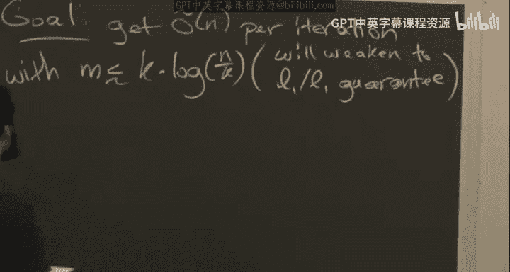

---

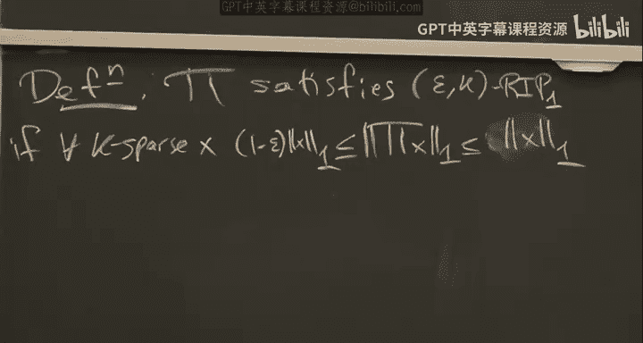

## 背景回顾与目标设定 📋

上一讲我们介绍了**迭代硬阈值算法**。只要我们的测量矩阵 **Π** 具有良好的RIP常数（例如小于0.1或某个固定常数），我们就能获得L2-L1误差保证。该算法每次迭代的时间取决于矩阵 **Π** 的矩阵-向量乘法速度。

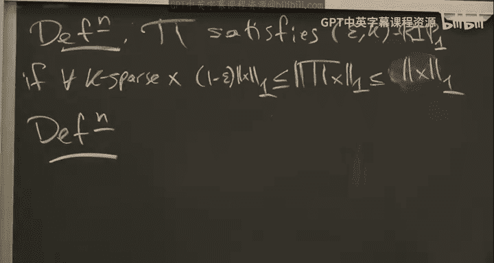

如果我们能自由选择测量矩阵，通常会选择从离散傅里叶变换中采样行向量。这样，应用 **Π** 到任意输入向量大致是线性时间。然而，这种方法存在一个缺点：我们无法通过傅里叶采样获得**最优的测量次数**。已知的最佳边界大约是 **k * log n * log² k**，而不是像随机高斯矩阵那样的 **k * log(n/k)**。

在许多实际应用中，**k** 与 **n** 处于同一数量级（例如 k = n/100）。我们希望将向量压缩50倍，此时常数因子至关重要。当 k 与 n 相当时，log n 是一个较大的值，而 log(n/k) 则接近常数。因此，我们希望能获得 **k * log(n/k)** 量级的最优测量次数。

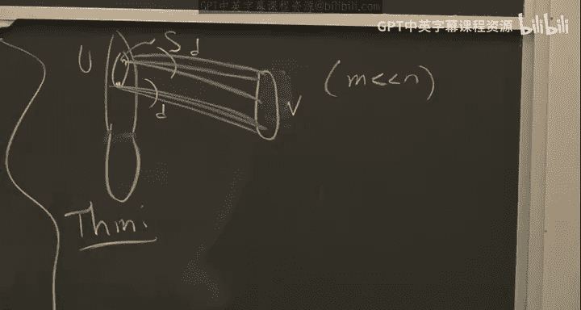

我们将看到，如果我们将误差保证从 **L2-L1** 放宽到 **L1-L1**，我们就能实现这一目标，同时保持快速的迭代时间。

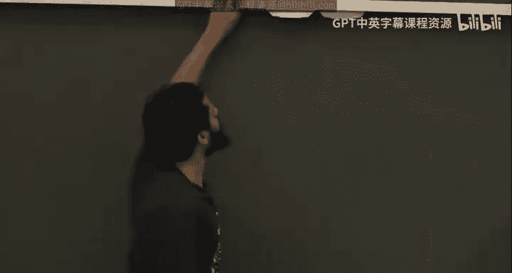

**L1-L1 误差保证** 定义为：我们恢复出的向量 **x̃** 满足：
```
||x - x̃||₁ ≤ C * ||x - x_k||₁
```
其中 **x_k** 是 **x** 的最佳k项近似（尾部）。这是一个比L2-L1更弱的保证，因此更容易实现。

---

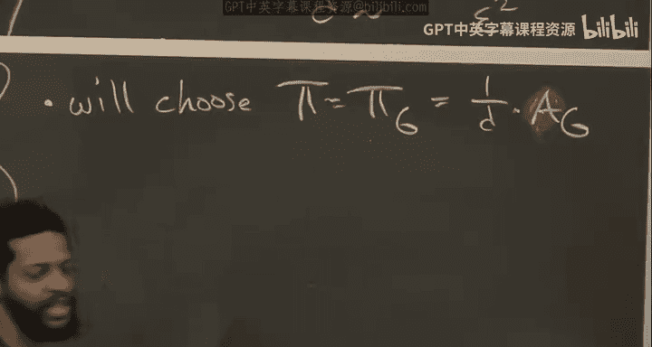

## RIP1 矩阵与扩展图 🌉

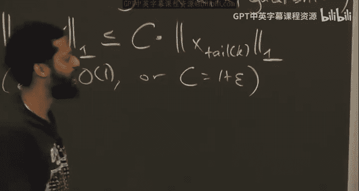

为了实现上述目标，我们将使用一种称为 **RIP1** 矩阵的工具。

### RIP1 矩阵定义
矩阵 **Π** 满足 (k, ε)-RIP1，如果对于所有k稀疏向量 **x**，都有：
```
(1 - ε) ||x||₁ ≤ ||Πx||₁ ≤ (1 + ε) ||x||₁
```
为方便起见，我们通常假设 **Π** 不会过度放大或缩小L1范数。

### 扩展图
RIP1矩阵可以通过一种称为**非平衡扩展图**的结构来构造。

**定义**：一个二分图 **G = (U, V, E)** 是一个 **(N, M, D, k, ε)** 扩展器，如果：
*   |U| = n, |V| = m。
*   图是**左D-正则**的（U中每个顶点恰好连接到V中的D个顶点）。
*   对于任意大小不超过k的子集 **S ⊆ U**，其邻居集合 **N(S)** 的大小满足：
    ```
    |N(S)| ≥ (1 - ε) * D * |S|
    ```
直观上，这意味着对于任意不大的顶点集合S，其在右侧的邻居数量几乎达到了最大值（D * |S|），碰撞损失不超过ε比例。


**定理**：存在这样的扩展图，其参数为：
*   **M** ≈ **k * log(n/k) / ε²** （这正是我们想要的测量次数）
*   **D** ≈ **log(n/k) / ε²**

该定理可以通过概率方法证明：随机生成一个左D-正则的二分图，并以高概率满足扩展性条件。

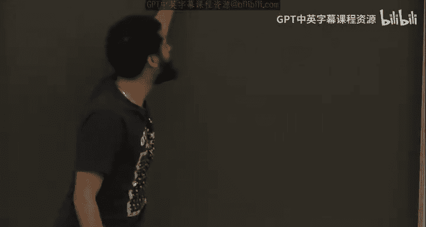

### 从扩展图到测量矩阵
我们定义测量矩阵 **Π** 为：
```
Π = (1/D) * A_G
```
其中 **A_G** 是扩展图G的邻接矩阵（一个 m×n 的矩阵，每列有D个1，表示该左顶点连接的右顶点）。

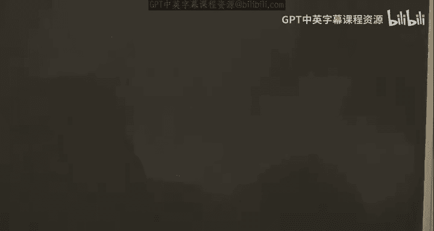


这个矩阵具有**快速矩阵-向量乘法**的特性。因为每列大约有 D ≈ log n 个非零元，所以应用 **Π** 或 **Π^T** 到一个向量的时间复杂度约为 **O(n log n)**。


**定理**：如果G是一个 (k, ε) 扩展器，那么按上述方式构造的 **Π** 满足 (k, 2ε)-RIP1。

---


## 恢复算法：SSMP 🚀

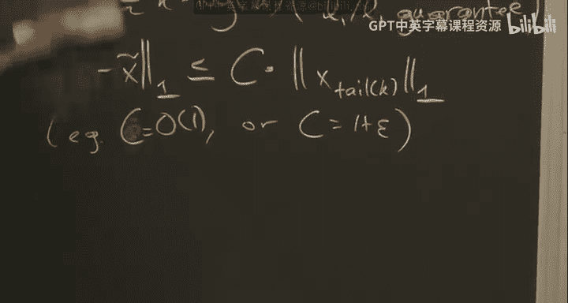

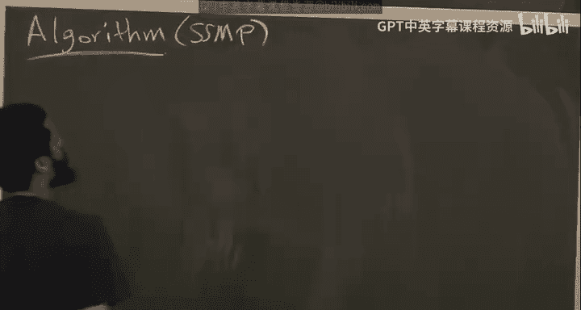

虽然存在基于扩展图直接分析的算法（如扩展图匹配追踪EMP和稀疏匹配追踪SP），但我们将介绍一个仅依赖于**RIP1抽象性质**的算法及其分析：**顺序稀疏匹配追踪**。

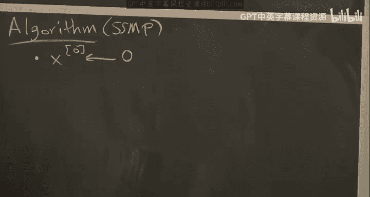

SSMP算法是一个迭代算法，其伪代码如下：

```
初始化: x^0 = 0
参数: 迭代次数 T
for j = 1 to T:
    x^{j,0} = x^{j-1}
    for a = 1 to (C-1)k:
        // 找到最优的1-稀疏向量 z 来添加到当前估计中
        z = argmin_{1-sparse z} ||b - Π(x^{j,a-1} + z)||₁
        x^{j,a} = x^{j,a-1} + z
    // 通过硬阈值化保持解的稀疏性
    x^j = H_k(x^{j, (C-1)k})
```
其中，**b = Πx + e** 是观测向量（含噪声e），**H_k** 是保留最大k个分量的硬阈值算子。

算法的核心思想是：在每轮外层迭代中，我们通过内层循环多次添加一个最优的1-稀疏向量，逐步改进当前估计，最后通过阈值化保持解的稀疏性。


### 算法分析概要

为了分析算法，我们假设信号 **x** 本身就是k稀疏的（通过将尾部误差归入噪声项，该假设不失一般性）。我们的目标是证明，每轮外层迭代都能将误差减少一个常数因子。

定义第j步的残差为 **y^j = x - x^j**。分析将分为四个关键步骤：

1.  **内层循环的渐进改进**：证明每次内层迭代都能将残差的观测范数减少一个因子。
    ```
    ||b - Πx^{j,a}||₁ ≤ (1 - 1/(2k+a))^{1/2} * ||b - Πx^{j,a-1}||₁
    ```

2.  **内层循环的累积效果**：经过 (C-1)k 次内层迭代后，观测残差显著减小。
    ```
    ||b - Πx^{j, (C-1)k}||₁ ≤ (1/8) * ||b - Πx^{j-1}||₁
    ```


3.  **从观测误差到真实误差**：利用RIP1性质，将观测误差的减小转化为真实L1误差的减小。
    ```
    ||x - x^{j, (C-1)k}||₁ ≤ (1/4)||x - x^{j-1}||₁ + O(||e||₁)
    ```

4.  **硬阈值化的影响**：证明最后的硬阈值化步骤不会显著增大误差。
    ```
    ||x - x^j||₁ ≤ (1/2)||x - x^{j-1}||₁ + O(||e||₁)
    ```

通过归纳法，上述不等式意味着经过T轮迭代后，最终误差为：
```
||x - x^T||₁ ≤ (1/2)^T * ||x||₁ + O(||e||₁)
```

**步骤1的证明**是整个分析中最巧妙的部分，它依赖于几个关于RIP1矩阵和向量对齐性质的引理，而不需要深入扩展图的具体结构。这正是该分析方法的优势所在——它仅依赖于RIP1这一抽象性质。

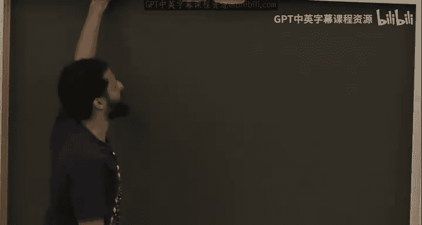

关于算法的**效率**：虽然内层循环需要寻找“最优的1-稀疏向量”，这看似需要O(n)时间，但可以通过维护优先队列等数据结构，将每次内层迭代的时间复杂度降低到O(log n)，从而使整个算法保持高效。

---

## 总结 📝

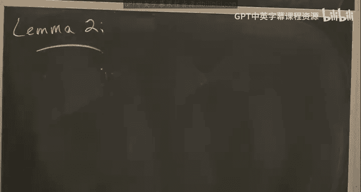

本节课我们一起学习了压缩感知中实现**01恢复**的高级方法。我们主要探讨了：

1.  **目标**：在保证快速迭代（近线性时间）的前提下，获得最优测量次数 **m = O(k log(n/k))** 和 **L1-L1** 误差保证。
2.  **工具**：引入了 **RIP1** 矩阵和**非平衡扩展图**。扩展图可以构造出满足RIP1且支持快速运算的测量矩阵。
3.  **算法**：介绍了**顺序稀疏匹配追踪**算法。该算法通过迭代地添加1-稀疏向量来逼近信号，并利用硬阈值化保持稀疏性。
4.  **分析核心**：算法的分析（特别是关键的步骤1）仅依赖于测量矩阵的RIP1性质，而不依赖于扩展图的具体结构，体现了抽象分析的威力。

通过本讲内容，我们看到了如何通过巧妙的算法设计和分析，在压缩感知中同时优化测量次数、计算复杂度和恢复精度，这也是大数据算法研究的核心魅力所在。