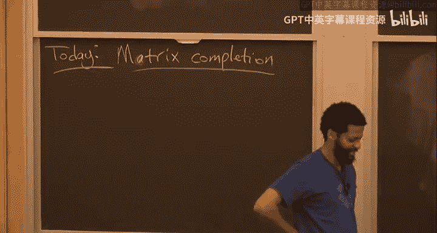
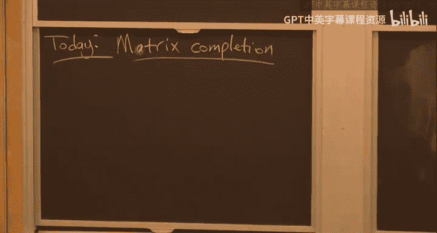
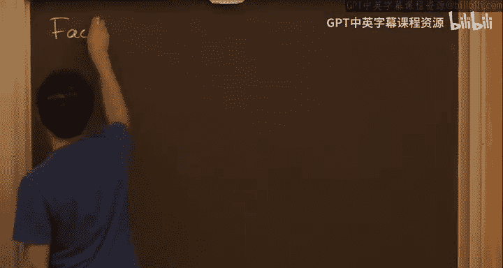
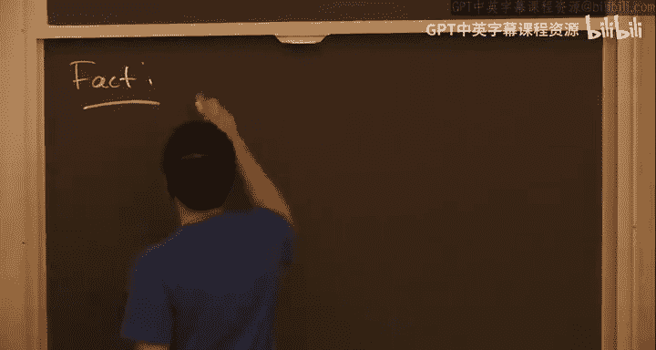
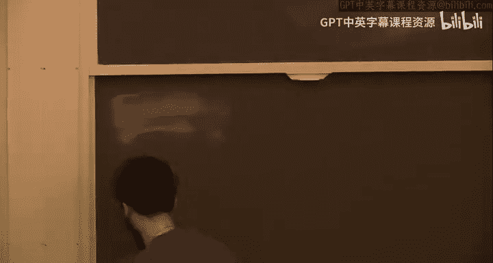
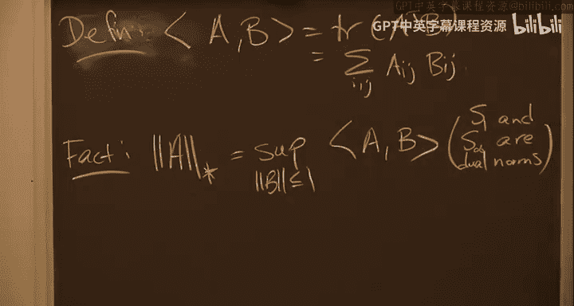
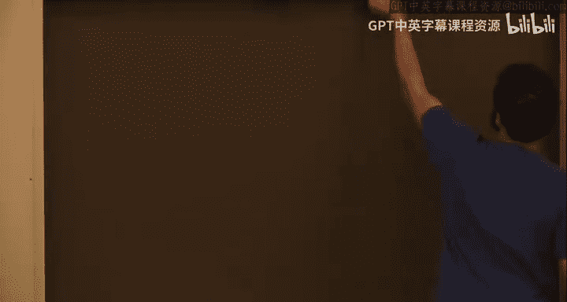

# 课程名称：大数据算法 (COMPSCI 229r) - 第22讲：矩阵补全 🧩






在本节课中，我们将要学习矩阵补全问题，有时也被称为Netflix问题。我们将探讨其核心思想、算法以及理论分析。

## 概述

矩阵补全问题的核心是：给定一个巨大矩阵 **M** 的一部分随机观测条目，我们如何恢复整个矩阵？我们假设矩阵 **M** 是低秩的，这意味着它可以分解为两个较小矩阵的乘积。这个假设在许多实际应用中（如用户-电影评分矩阵）是合理的，因为用户偏好通常可以由少数几个“用户类型”的线性组合来解释。

## 问题定义与算法

我们假设矩阵 **M** 的维度是 **n × n**（为简化讨论），并且其真实秩为 **r**。我们观测到的是 **M** 中一个随机子集 **Ω** 上的条目，观测数量为 **m**。

理想情况下，我们希望找到与观测值一致且秩最小的矩阵。然而，最小化秩是一个NP难问题。因此，类似于压缩感知中将L0范数松弛为L1范数，我们将矩阵的秩松弛为其核范数（即奇异值之和）。

**核范数最小化 (NNM)** 算法公式如下：
```
minimize ||X||_*
subject to R_Ω(X) = R_Ω(M)
```
其中，`||X||_*` 表示矩阵 **X** 的核范数，`R_Ω` 是一个线性算子，它将矩阵限制在索引集 **Ω** 上，其他位置置零。

这个优化问题可以表述为一个半定规划问题，因此存在多项式时间算法求解。







## 理论分析的关键条件





上一节我们介绍了NNM算法，本节中我们来看看保证该算法成功恢复原始矩阵 **M** 所需满足的关键条件。这些条件是确定性的，如果成立，则恢复成功。随后我们将说明，当观测数量 **m** 足够大时，这些条件以高概率成立。

以下是三个关键条件：

1.  **近似矩阵乘法条件**：`|| (n²/m) * P_T R_Ω P_T - (m/n²) P_T || < 1/2`
    这个条件确保了在子空间 **T**（与 **M** 的行列空间相关的子空间）上，随机采样算子 `R_Ω` 的行为类似于恒等算子的缩放版本。这本质上是近似矩阵乘法性质的应用。

2.  **算子范数边界条件**：`|| R_Ω || ≤ C * log n`
    这个条件表明采样矩阵 `R_Ω` 的算子范数（最大奇异值）不会太大，这可以通过切尔诺夫界等概率工具来证明。

3.  **对偶证书存在性条件**：存在一个矩阵 **Y** 位于 `R_Ω` 的值域中，使得：
    *   `|| P_T(Y) - UV^T ||_F ≤ √r / (2n)`
    *   `|| P_{T^⊥}(Y) || ≤ 1/2`
    这个条件是为了构造一个“对偶证书”，用于证明 **M** 是核范数最小化问题的唯一解。其证明涉及更多层的近似矩阵乘法论证。

## 其他算法简介

除了核范数最小化，还存在其他更快的迭代算法用于矩阵补全，特别是在处理含噪声数据时。


以下是两种常见的迭代方法：

*   **软阈值迭代算法**：这种算法类似于基追踪去噪中的迭代方法。它通过梯度下降步骤更新当前矩阵估计，然后对奇异值进行软阈值操作以促进低秩性。其更新步骤涉及计算SVD，但可以尝试使用本课程中学到的子空间嵌入技术来加速低秩近似步骤。
*   **交替最小化算法**：该算法假设 **M ≈ XY^T**，并交替地优化 **X** 和 **Y**。每一步都是一个回归问题，同样可以考虑使用快速近似回归技术来加速。


## 总结

本节课中我们一起学习了矩阵补全问题。我们从问题定义出发，介绍了基于核范数最小化的主流算法。我们深入探讨了保证算法成功所需的理论条件，特别是近似矩阵乘法在分析中扮演的核心角色。最后，我们简要了解了其他更快速的迭代算法。矩阵补全是一个连接了低秩近似、压缩感知和随机采样理论的丰富领域。