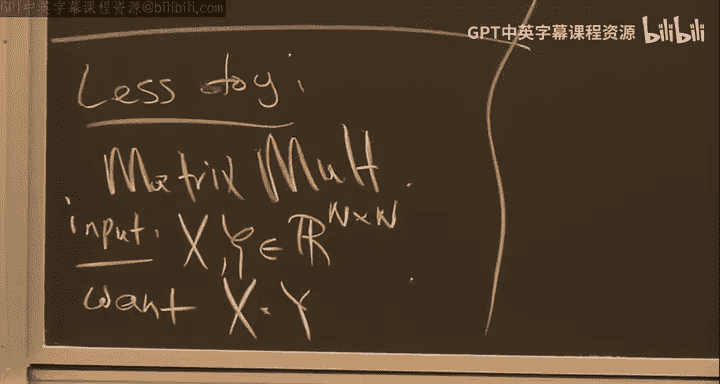
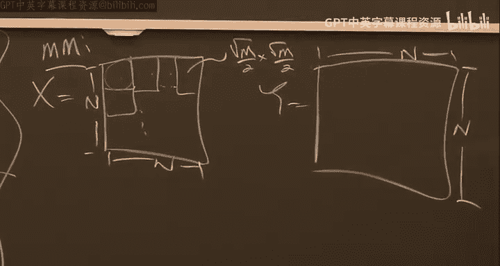
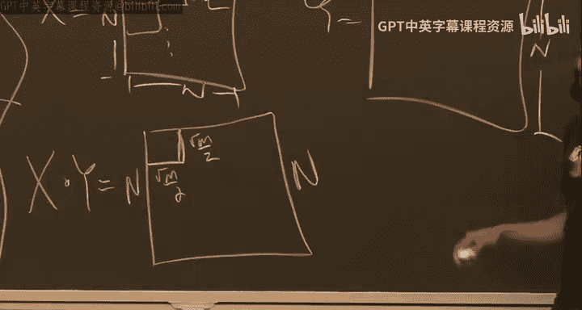
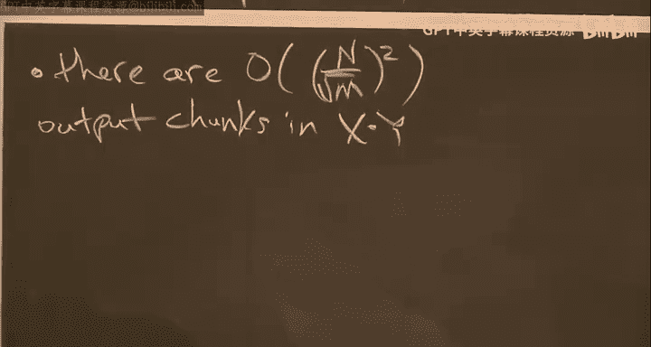
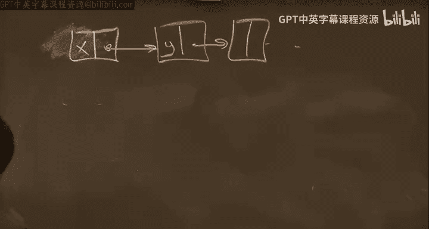
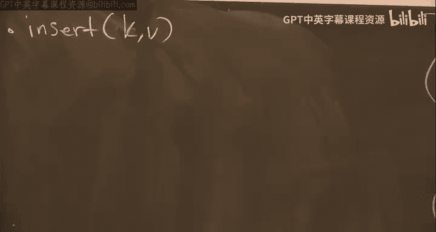

# 23：外部存储模型 🗂️


在本节课中，我们将要学习一种新的计算模型——外部存储模型。这个模型也被称为磁盘访问模型，由Hder和Bitter提出。我们将探讨当数据量过大，无法全部装入内存（RAM）时，如何设计高效的算法和数据结构来处理存储在磁盘上的数据。


---

## 模型介绍与基本原理


上一节我们提到了大数据处理的不同场景，例如流式处理。本节中，我们来看看当数据可以存储但无法全部放入内存时的情况。

外部存储模型的基本思想是，系统包含一个容量无限的磁盘和一个容量有限的内存。内存被划分为多个“页”，每个页的大小为 `B`，可以容纳 `B` 个元素。磁盘上的数据也被划分为大小为 `B` 的块。

*   **内存操作**：如果所需数据已经在内存中，读写操作是免费的。
*   **磁盘操作**：如果数据不在内存中，则需要从磁盘读取相应的块到内存中。这个操作的成本记为 **1次I/O**。如果内存已满，还需要决定将哪个内存页的内容写回磁盘。

我们的目标是**最小化总的I/O操作次数**。

### 模型合理性


为什么这个模型是合理的？因为读写磁盘（尤其是随机读写）的速度远慢于读写内存。以下是基于传统机械硬盘（HDD）的一些近似数据对比：


*   **顺序读写**：速度可达约 **140 MB/s**。
*   **随机读写**：速度约为 **140次 I/O/s**（每次读写4KB数据块）。
*   **内存（RAM）读写**：速度可达 **5-10 GB/s**。




随机读写和顺序读写之间的速度差异巨大（超过六个数量级）。因此，模型假设每次I/O能读取一个大小为 `B` 的块是合理的，因为进行一次磁盘寻址（随机访问）的耗时，足以让我们顺带读取 `B` 个元素，从而分摊了寻址成本。





---


## 基础问题示例



在理解了模型之后，我们来看几个基础问题在这个模型下的表现。

### 顺序读取

读取 `N` 个连续存储的元素非常简单：进行一次线性扫描即可。所需的I/O次数为 `O(N/B + 1)`。

### 矩阵乘法 🧮

接下来，我们讨论一个稍微复杂的问题：矩阵乘法。这是本课程中唯一涉及线性代数的部分。



**问题**：给定两个 `N x N` 的矩阵 `X` 和 `Y`，计算它们的乘积 `Z = X * Y`。

**假设**：作为算法设计者，我们可以决定数据在磁盘上的存储格式。这里我们假设矩阵以块的形式存储。

**算法思路**：
1.  将矩阵 `X` 和 `Y` 分别划分为大小为 `√(M/2) x √(M/2)` 的块。
2.  结果矩阵 `Z` 的每个块，可以通过 `X` 和 `Y` 中对应行和列的块进行矩阵乘法再求和得到。例如，`Z` 的左上角块等于 `X` 的第一行块与 `Y` 的第一列块的点积之和。
3.  计算时，一次将参与计算的一对块（来自 `X` 和 `Y`）读入内存。由于每个块的大小约为 `M/2` 个元素，一对块可以同时放入内存。
4.  在内存中使用任何矩阵乘法算法进行计算。

**I/O复杂度分析**：
*   输出矩阵 `Z` 有 `O((N/√M)^2)` 个块。
*   对于 `Z` 的每个块，需要计算 `O(N/√M)` 对块的乘积。
*   读取每一对块需要 `O(M/B)` 次I/O。
*   因此，总I/O次数约为 `O((N/√M)^3 * (M/B)) = O(N^3 / (B√M))`。

**注意**：使用更高效的矩阵乘法算法（如Strassen算法）可以进一步改进这个指数。

---

## 外部存储模型下的数据结构

现在，让我们看看如何在外部存储模型中实现一些常见的数据结构。

### 链表 🔗

在内部内存中，链表支持 `O(1)` 时间的插入/删除和 `O(K)` 时间的遍历（访问连续 `K` 个元素）。在外部存储模型中，如果简单地将每个节点随机存储在磁盘块中，遍历 `K` 个元素可能需要 `O(K)` 次I/O，这非常低效。

**优化思路**：将连续的链表节点分组到大小为 `B` 的“组”中，并维护一个不变式：除了最后一个组，每个组至少半满（即包含至少 `B/2` 个节点）。

**操作**：
*   **插入**：找到对应组，插入节点。如果组已满（超过 `B` 个节点），则将其分裂成两个组。
*   **删除**：从组中删除节点。如果组变得少于 `B/2` 个节点，则将其与相邻组合并，必要时再进行分裂以保持组大小在 `[B/2, B]` 之间。
*   **遍历**：由于每个组至少半满，要访问 `K` 个元素，最多需要读取 `O(1 + K/(B/2)) = O(1 + K/B)` 个组（即I/O次数）。

这样，插入和删除的**摊销I/O复杂度为 `O(1)`**，而遍历的I/O复杂度优化为 `O(1 + K/B)`。

---

### 前驱查询与B树 🌳

前驱查询是一个经典的数据结构问题：维护一个包含 `N` 个可比较键值对的集合，支持查询给定键 `K` 的前驱（即集合中小于等于 `K` 的最大键）。




在内部内存的比较模型中，有序数组+二分查找可以达到 `O(log N)` 查询时间。在更强大的Word RAM模型中，存在更高效的算法（如vEB树）。

在外部存储模型中，对应的经典数据结构是 **B树**。

**B树本质**：B树是一种 `(a, b)`-树，其中每个节点（页）的大小对应于磁盘块大小 `B`。通常设置 `a = B/2`, `b = B`。这意味着：
*   每个内部节点至少有 `B/2` 个子节点（根节点除外）。
*   每个节点（页）可以一次性读入内存。

**性能**：由于树的高度为 `O(log_B N)`，且每次访问一个节点只需一次I/O，因此B树的查询、插入、删除操作的**I/O复杂度均为 `O(log_B N)`**。

**思考**：B树的插入复杂度是 `O(log_B N) = O((log N) / (log B))`。有没有可能获得接近日志文件（`O(1/B)` 摊销插入）的插入效率，同时保持近似B树的查询效率？

---

## 更高效的数据结构变体

答案是肯定的。以下是两种改进的数据结构。

### 缓冲存储树 (BRT)

BRT是对 `(2,4)`-树（即2-3-4树）的简单修改。

**结构**：
*   每个内部节点关联一个大小为 `B` 的缓冲区。
*   所有数据项要么存储在叶子节点（叶子节点大小在 `[B/2, B]` 之间），要么存储在某个内部节点的缓冲区中。

**操作**：
*   **插入**：新元素直接插入根节点的缓冲区。如果根缓冲区满，则将其中的元素“冲刷”到合适的子节点缓冲区。这个过程可能递归进行，直到元素到达叶子节点，可能引发叶子分裂。
*   **查询**：像普通B树一样搜索，但同时检查路径上每个节点的缓冲区。


**性能**：
*   **查询**：`O(log N)` 次I/O（树高）。
*   **插入（摊销）**：`O((log N) / B)` 次I/O。分析思路是，每次冲刷涉及 `Θ(B)` 个元素，但只产生常数次I/O，因此每个元素每次被冲刷只需分摊 `O(1/B)` 的成本。一个元素最多被冲刷树高次。
*   **插入（最坏情况）**：通过每次只向接收元素最多的一个子节点进行冲刷，可以限制为 `O(log N)` 次I/O。


### 缓冲B^ε树

这是BRT思想的一个泛化，使用 `(B^ε, 2B^ε)`-树作为底层结构，其中 `ε` 是一个常数（如0.5）。


**性能**：
*   **查询**：`O((1/ε) * log_B N)` 次I/O。
*   **插入（摊销）**：`O((1/(εB^(1-ε))) * log_B N)` 次I/O。
*   **插入（最坏情况）**：`O((1/ε) * log_B N)` 次I/O。

当 `ε` 为常数时，查询复杂度与B树同量级（仅常数因子更大），但摊销插入复杂度远优于B树（除以 `B` 的多项式级而非对数级）。


---

## 外部排序

排序是算法的基础问题。在外部存储模型中，最优的基于比较的排序算法是 **`(M/B)`-路归并排序**。

**算法步骤**：
1.  如果数据量 `N ≤ B`，直接读入内存排序。
2.  否则，将数据分成 `M/B` 个组。
3.  递归地对每个组排序。
4.  合并这 `M/B` 个有序组。合并时，我们可以在内存中为每个组维护一个当前数据块（大小 `B`），因此内存足以同时容纳所有组的当前块。

**递归式**：设 `T(N)` 为排序 `N` 个元素所需的I/O次数。
```
T(N) = O(N/B) + (M/B) * T(N / (M/B))，当 N > B
T(N) = O(1)，当 N ≤ B
```
解此递归式，得到 **`T(N) = Θ((N/B) * log_{M/B} (N/B))`**。

**最优性证明**（基于比较模型）：
1.  考虑所有满足“每个大小为 `B` 的块内部已排序”的输入排列。这样的排列总数约为 `N! / (B!)^(N/B)`。
2.  算法需要识别出具体是哪种排列，信息量约为 `N log(N/B)` 比特。
3.  每次I/O最多能带来 `B log(M/B)` 比特的新信息（因为I/O引入的 `B` 个新元素与内存中已有的 `M` 个元素交织的可能方式最多为 `(M+B choose B)` 种）。
4.  因此，至少需要 `(N log(N/B)) / (B log(M/B)) = (N/B) * log_{M/B} (N/B)` 次I/O。

这证明了该归并排序算法的I/O复杂度在比较模型下是最优的。

---

## 总结


本节课中，我们一起学习了外部存储模型（磁盘访问模型）。我们从模型的基本定义和合理性出发，探讨了在该模型下如何分析基础操作（如顺序读取）和经典问题（如矩阵乘法）。接着，我们深入研究了如何为链表和前驱查询设计高效的外部存储数据结构，重点介绍了B树及其两种更高效的变体——缓冲存储树和缓冲B^ε树。最后，我们分析了外部排序问题，并得出了基于比较的最优算法及其复杂度。

**核心要点**：
*   模型核心：最小化慢速磁盘的I/O次数，利用块访问（大小 `B`）来分摊成本。
*   数据结构设计关键：利用数据的局部性，将相关元素组织在同一磁盘块中。
*   性能衡量：操作复杂度通常表示为 `N`（数据量）、`M`（内存大小）、`B`（块大小）的函数。

在下节课中，我们将探讨一个更高级的话题：**缓存无关算法**。这些算法无需预先知道参数 `M` 和 `B`，就能自动达到接近知晓这些参数时的最优性能。