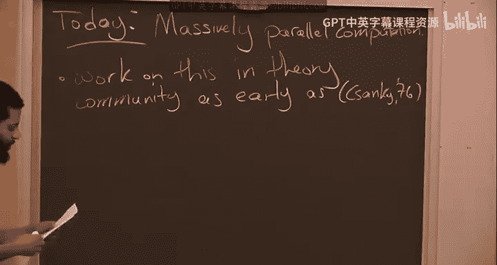
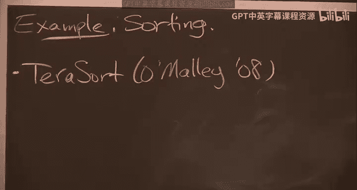
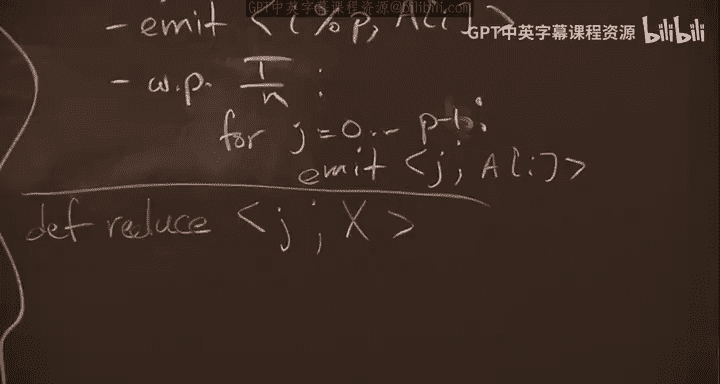
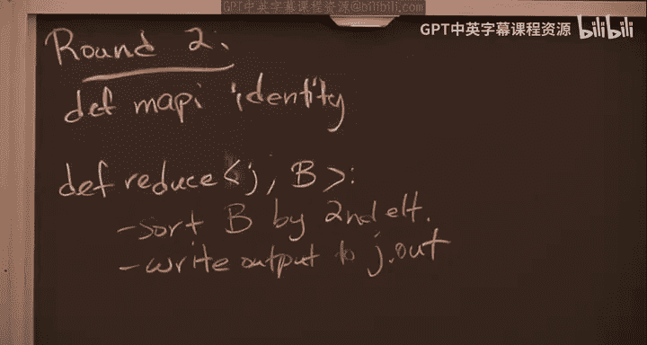
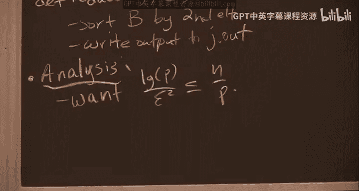

# 25：大规模并行计算 🚀




在本节课中，我们将要学习大规模并行计算模型，特别是MapReduce模型。我们将探讨如何在此模型下设计高效算法，并分析其资源使用情况。课程将涵盖排序、最小生成树和三角形计数等经典问题的MapReduce解决方案。

---


## 模型介绍：MapReduce


上一节我们介绍了大规模并行计算的背景，本节中我们来看看一个具体且广泛应用的模型——MapReduce。

MapReduce是一个用于处理海量数据集的编程模型。计算被分解为多轮进行。

以下是MapReduce一轮计算中的三个阶段：

1.  **Map阶段**：每个输入项由一个映射函数处理。映射函数接收一个键值对 `<k, v>` 作为输入，并输出一组新的键值对。
    ```python
    # 伪代码示例
    def map_function(key, value):
        # 处理逻辑
        emit(new_key, new_value)
    ```


2.  **Shuffle阶段**：此阶段对程序员透明，由系统内部处理。系统将所有在Map阶段输出的项，根据其键进行分组。具有相同键的项会被发送到同一个Reducer。



3.  **Reduce阶段**：每个Reducer接收一个键 `K` 和与该键关联的一系列值 `[V1, V2, ..., Vr]`。Reducer对这些值进行计算，并输出一组新的项。

在这个模型中，我们的设计目标包括：
*   使用较少的计算轮数。
*   每个Reducer使用的内存远小于总数据量 `n`。
*   所有机器的总内存使用量远小于 `n^2`，理想情况下接近线性。
*   总工作量或最大单机工作量较小。



---


## 算法示例一：排序 (TeraSort)

现在，我们来看如何在MapReduce模型中解决排序问题。我们将介绍一个名为TeraSort的两轮算法。

该算法的核心思想是，如果我们有 `P` 台机器，我们希望将最小的 `n/P` 个元素发送到机器1，第二小的 `n/P` 个元素发送到机器2，依此类推。每台机器在本地对自己的数据进行排序，最后将所有结果串联起来。



问题在于我们不知道这些分界点具体是哪些元素。解决方案是通过采样来近似地找到这些分界点。



以下是TeraSort算法的两轮伪代码描述：

**第一轮**
*   **Map函数**：对于每个输入元素 `(i, a_i)`。
    1.  将其发送到由 `i mod P` 决定的Reducer，以便初步分区。
    2.  以概率 `T/n` 对该元素进行采样（`T` 是一个参数，例如 `T = log(P)/ε^2`）。如果被采样，则将该元素的值发送给 **所有** `P` 个Reducer。
*   **Reduce函数**：每个Reducer `j` 收到两类数据：初步分到本机的元素 `B`，以及所有采样元素 `S`。
    1.  对采样集合 `S` 进行排序。
    2.  以排序后的 `S` 作为参考，为 `B` 中的每个元素 `a_i` 确定其最终应归属的Reducer（例如，通过二分查找确定 `a_i` 在 `S` 中的排名区间）。
    3.  输出新的键值对 `(r, (i, a_i))`，其中 `r` 是计算出的目标Reducer编号。

**第二轮**
*   **Map函数**：恒等函数，直接传递 `(r, (i, a_i))`。
*   **Reduce函数**：Reducer `j` 收到所有标记为 `j` 的元素，在本地对这些元素进行排序，并输出结果。

**算法分析**
通过设置参数 `ε = 1/P` 和 `T = log(P)/ε^2`，并利用切尔诺夫界限进行概率分析，可以证明：
*   每台机器在第二轮需要排序的元素数量最多为 `O(n/P)`。
*   当机器数量 `P` 约为 `n^(1/3)` 时，每台机器所需内存约为 `n^(2/3)`，实现了亚线性的内存使用和并行时间。

实际的TeraSort实现针对整数键进行了优化（例如使用Trie树加速查找），但上述简化版本揭示了算法的核心思想。

---


## 算法示例二：最小生成树 (MST)

接下来，我们探讨一个图论问题：在边数 `m = n^(1+c)`（`c>0`，即非稀疏图）的图中寻找最小生成树。目标是使每台机器的内存使用远小于 `m`。

该算法由Karloff和Vassilvitskii提出，其核心思想是随机划分顶点，然后在所有顶点子集的诱导子图上并行计算最小生成森林。

**算法描述**
1.  选择一个参数 `k`（例如 `k = n^(c/2)`）。
2.  使用哈希函数 `h` 将顶点随机划分到 `k` 个组中：`V1, V2, ..., Vk`。
3.  对于每一对 `(i, j)`，其中 `1 ≤ i, j ≤ k`，考虑由 `Vi ∪ Vj` 诱导的子图 `Gij`。
4.  为每个 `Gij` 分配一个Reducer，计算其最小生成森林 `Mij`。
5.  最后，一个中心Reducer收集所有 `Mij` 中的边，并在这个边的集合上计算整个图的最小生成树。

**MapReduce实现**
*   **第一轮 Map**：对于每条边 `(u, v)`，将其发送到键为 `(h(u), h(v))` 的Reducer。如果 `h(u) == h(v) = i`，则需要将该边发送给所有形如 `(i, *)` 和 `(*, i)` 的Reducer，以确保子图 `Gij` 包含 `Vi` 和 `Vj` 内部的所有边。
*   **第一轮 Reduce**：Reducer `(i, j)` 收到子图 `Gij` 的所有边，计算其最小生成森林 `Mij`，并将 `Mij` 中的所有边输出到一个公共键（如 `$`）下。
*   **第二轮**：Map阶段传递数据，一个Reducer收集所有 `Mij` 的边，并计算最终的全图MST。

**资源分析**
*   **每机内存**：每个 `Gij` 的期望边数为 `O(m/k^2)`。通过更精细的度分组分析，可以高概率保证每机内存为 `O~(n^(1+c/2))`，远小于 `m`。
*   **总内存**：所有 `Mij` 的边数总和约为 `O(k^2 * (n/k)) = O(kn)`，当 `k = n^(c/2)` 时，总内存约为 `O(n^(1+c/2))`，虽然小于 `m^2`，但并非显著优于简单方法。后续有更优的算法进一步降低了总内存消耗。

---

## 算法示例三：三角形计数

最后，我们看一个更复杂的图问题：计算图中三角形的数量。一个简单的顺序算法可以在 `O(m^(3/2))` 时间内完成。

**顺序算法思路**
1.  为顶点定义一个全序（例如，按度排序，度相同则按ID排序）。
2.  遍历每个顶点 `v`，只考虑其邻接点中序大于 `v` 的点 `u` 和 `w`，然后检查边 `(u, w)` 是否存在。通过设置度阈值进行平衡，可得 `O(m^(3/2))` 的运行时间。

**MapReduce实现**
该算法可以自然地映射到MapReduce框架：
*   **第一轮**：Mapper发送每条边 `(u, v)`（确保 `u` 在序中大于 `v`）到以 `v` 为键的Reducer。Reducer收到顶点 `v` 及其“高阶”邻居列表 `S`，然后检查 `S` 中是否存在边（可通过将边列表也发送到相应键来实现或预加载），并为每个找到的三角形候选 `(v, u, w)` 发出信号。
*   **第二轮**：Mapper对不同类型的中间结果（边或三角形候选）进行标记和路由。Reducer收集信息，确认三角形并去重计数。
*   最终可能需要一轮聚合来求和。


通过精心设计键和数据的路由，可以在保证每机内存较小的前提下，在常数轮内完成三角形计数。

---

## 总结

本节课中我们一起学习了大规模并行计算中的MapReduce模型。
*   我们首先了解了MapReduce的三阶段计算模型和设计目标。
*   接着，我们深入分析了三个经典问题的MapReduce算法：用于排序的**TeraSort**算法，它通过采样近似分界点来实现负载均衡；用于稠密图的**最小生成树**算法，它通过随机顶点划分实现并行子图计算；以及**三角形计数**算法，它将顺序算法巧妙转化为多轮MapReduce作业。
*   这些案例展示了如何在限制每机内存、控制通信轮数的前提下，设计高效的大规模并行算法。MapReduce及其开源实现（如Hadoop）已成为工业界处理大数据的重要工具，其背后的算法思想对分布式计算至关重要。