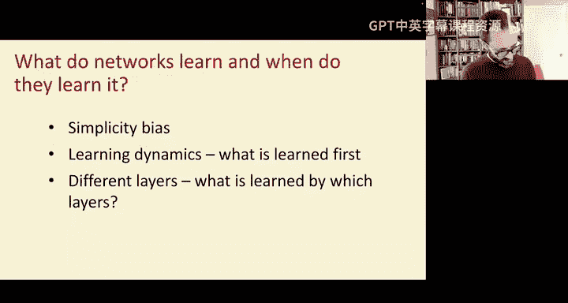
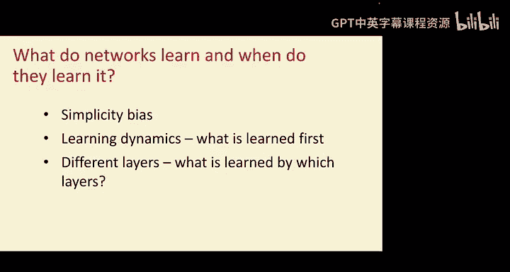
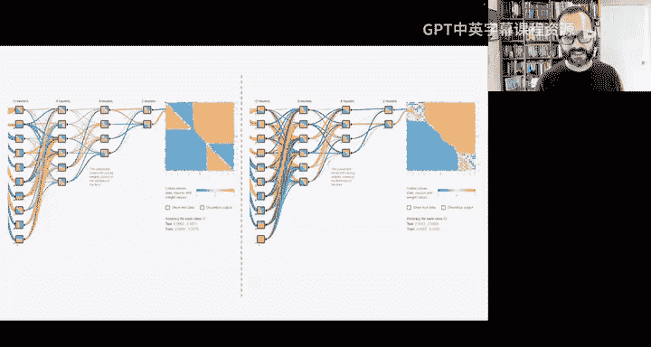
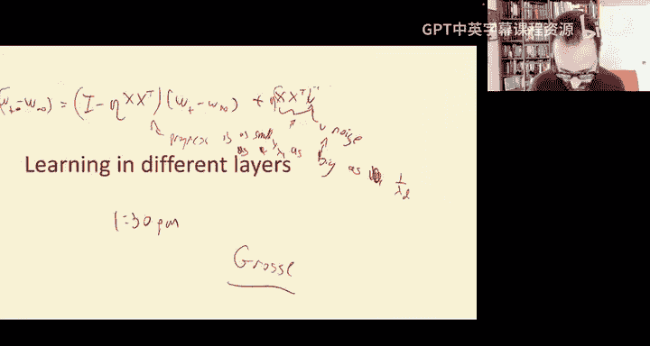
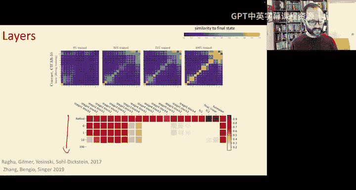
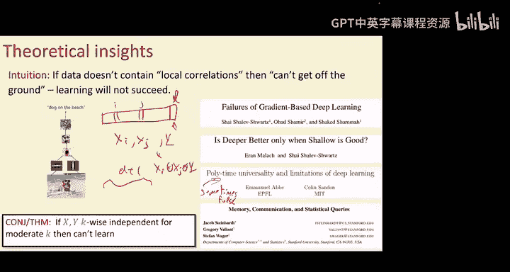
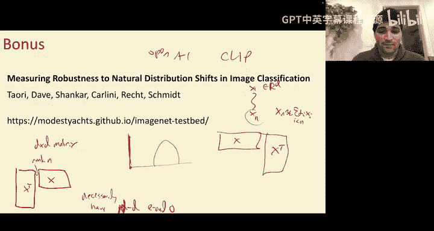

# 2：深度神经网络 🧠

## 课程概述

在本节课中，我们将探讨深度神经网络学习的内容以及它们何时学习这些内容。核心主题是**简单性偏好**——深度网络倾向于首先学习简单的概念，并且通常更偏好简单的概念而非复杂的。我们将通过实验证据和理论分析来理解这一现象，并探讨其带来的好处与潜在问题。

---

## 1. 网络学习什么？—— 简单性偏好

上一节我们介绍了课程的基本框架，本节中我们来看看神经网络在学习过程中表现出的一个关键特性。

观察一个在简单分布上训练的小型网络。输入是二维点（橙色为+1，蓝色为-1），网络试图学习一个分类器。在训练过程中，最靠近输入层（第一层）学习到的特征通常与输入数据高度相关，例如，许多线性分类器的方向与输入数据的角度相关。权重较弱的特征对最终分类的贡献较小。

**核心观察**：网络在底层首先学习非常简单的特征（如线性特征），然后组合这些简单特征以形成更复杂的特征。这与直觉相符：网络从底层开始，学习简单特征，然后逐步构建更复杂的表示。

在更深的视觉网络中，这一模式更加明显：
*   **底层**：学习检测边缘、颜色对比等简单特征。
*   **中层**：学习更复杂的纹理和图案。
*   **高层**：学习检测眼睛、头部、曲线等高级语义特征。

直觉上，网络不仅先学习简单特征，而且在整个学习过程中都表现出对简单概念的偏好。

---

## 2. 简单性偏好的实验证据

以下是关于简单性偏好的实验观察：

*   **学习顺序**：在一项研究中，训练一个深度卷积网络时，线性特征首先被学习并解释了大部分分类性能。直到线性特征的性能达到瓶颈，网络才开始学习更复杂的深度特征。
*   **偏好简单概念**：梯度下降等算法普遍倾向于简单的解决方案。这通常是一件好事，因为它有助于泛化。如果算法输出一个恰好拟合训练数据的随机函数，它在新数据上的表现将是随机的，无法泛化。
*   **简单性偏好的陷阱**：然而，简单性偏好也可能导致问题。如果存在一个简单但次优的概念，算法可能会“锁定”在这个概念上，而忽略更优但更复杂的概念。例如，在一个数据集中，如果存在一个非常强的简单线性特征，网络可能会被其吸引，导致训练速度变慢，甚至难以发现更优的复杂分类器。另一个例子是，在存在简单线性分类器和更鲁棒的复杂分类器之间，SGD很可能找到前者，即使后者更优。

---

## 3. 线性回归中的隐式正则化

为了从理论上理解简单性偏好，我们首先分析一个更简单的模型：过参数化线性回归。

**问题定义**：
我们有输入-输出对 `(x1, y1), ..., (xn, yn)`，其中 `xi` 是 `D` 维向量，`yi` 是标量。我们考虑过参数化情况，即 `D > n`。目标是找到一个权重向量 `w`，使得 `Xw ≈ y`，其中 `X` 是 `n x D` 的输入矩阵。

**梯度下降动态**：
如果我们使用零初始化（或接近零的小随机初始化）运行梯度下降（或随机梯度下降）来最小化平方损失 `||Xw - y||^2`，可以证明：

**定理**：梯度下降会收敛到方程 `Xw = y` 的**最小L2范数解**。

**直观解释（几何视角）**：
1.  从 `w=0` 开始。
2.  梯度下降的每一步更新都位于输入向量 `x1, ..., xn` 张成的子空间内。
3.  方程 `Xw = y` 的解构成一个 `(D - n)` 维的子空间（绿色线）。
4.  从原点（0）出发，到达该解子空间上距离原点最近的点，正是最小范数解。

**公式描述**：
梯度下降的更新规则为：
`w_{t+1} = w_t - η * ∇_w Loss(w_t)`
其中 `∇_w Loss(w) = 2X^T(Xw - y)`。可以证明，最终解 `w_∞` 满足 `X w_∞ = y` 且 `w_∞` 在 `X` 的行空间中，这保证了其范数最小。

这种现象被称为**隐式正则化**：尽管我们没有在损失函数中显式添加正则化项（如 `λ||w||^2`），但优化算法本身引导我们找到了一个具有小范数的“简单”解。

**收敛速度与条件数**：
收敛速度取决于矩阵 `X^T X` 的条件数（最大与最小特征值之比）。在过参数化 (`D >> n`) 和欠参数化 (`D < n`) 情况下，条件数通常较好，收敛快。在临界区域 (`D ≈ n`)，最小特征值可能接近零，导致条件数很差，收敛缓慢或不稳定，这对应于**双重下降**现象中风险上升的区域。

---

## 4. 表示空间的重要性：深度线性网络

上一节我们看到了线性回归中的隐式正则化，本节中我们来看看当使用不同的参数化表示同一函数时会发生什么。

考虑一个深度为2的线性网络：`f(x) = A2 * A1 * x`，其中 `A1` 和 `A2` 是权重矩阵。忽略非线性激活函数，这个网络计算的是一个线性函数 `Bx`，其中 `B = A2 A1`。

**关键点**：
虽然线性模型 `Bx` 和深度线性网络 `A2 A1 x` 在函数空间上是等价的（能表示相同的函数集），但它们的**参数空间**不同。线性模型的参数是矩阵 `B`，而深度线性网络的参数是 `(A1, A2)`。

**优化动态的差异**：
*   最小化损失 `L(B)` 可能是一个凸问题。
*   最小化等价的损失 `L̃(A1, A2) = L(A2 A1)` 则是一个非凸问题。
*   因此，在这两种参数化上运行梯度下降，即使从同一函数开始，也可能会收敛到不同的解，因为优化轨迹受参数空间几何形状的影响。

**梯度流分析（简化对称情况）**：
为了理解深度参数化如何改变动态，我们分析梯度流（学习率趋于0时的梯度下降）。假设 `A1 = A2^T = A`（对称简化），则 `B = A^2`。损失函数为 `L̃(A) = L(A^2)`。

通过链式法则，`A` 的梯度流为：
`dA/dt = -∇_A L̃(A) = -A * ∇_B L(B)`
而 `B` 的梯度流为：
`dB/dt = -∇_B L(B)`

比较两者，深度线性网络中 `B` 的演化方程为：
`dB/dt = -A * ∇_B L(B) * A = -√B * ∇_B L(B) * √B`
（因为 `A` 是 `B` 的平方根）。

**直观解释**：
与直接对 `B` 做梯度下降相比，深度线性网络的更新多了一个从两侧乘以 `√B` 的操作。这相当于根据 `B` 当前特征值的大小对梯度方向进行了重新缩放：大特征值方向上的更新被放大，小特征值方向上的更新被缩小。这促使 `B` 的解决方案趋向于**低秩**（即少数特征值很大，其余很小），这是一种不同于L2范数最小化的简单性偏好。

**更一般的结论**：
深度线性网络的梯度流等价于在参数空间的某个**黎曼流形**上进行梯度下降，其度量由网络结构决定。这种隐式偏差无法通过向损失函数添加简单的显式正则化项来复制。表示空间的选择确实会影响学习结果。

---

## 5. 不同层的学习时机与特征演化

回到非线性深度网络，人们普遍认为学习是按层次进行的：

**直觉（生成视角）**：
自然数据（如图像）的生成过程可以看作：高级语义（如“猫”） -> 中级属性（如“毛皮纹理”） -> 低级像素。深度网络的学习过程则相反：从像素中提取低级特征（边缘、颜色） -> 组合成中级特征（纹理、部件） -> 最终形成高级语义概念。

**实验观察**：
1.  **层间相似性**：训练过程中，底层和顶层通常更早地接近其最终状态，而中间层需要更长时间来稳定。
2.  **对称性破缺与专业化**：初始化时，神经元是随机的。由于初始随机性和数据中的统计规律，神经元逐渐“专业化”：一些变成水平边缘检测器，一些变成垂直边缘检测器，等等。这种专业化在训练早期就开始发生。
3.  **线性模式连接**：如果两个网络从相同的随机初始化开始，即使之后用不同的数据顺序训练，最终得到的网络权重可能位于同一个“盆地”中。对它们的权重进行线性插值，得到的网络性能仍然很好。这表明，初始化在很大程度上决定了对称性如何被打破，训练过程则是在此基础上进行优化。
4.  **重新初始化的启示**：一项有趣的实验发现，在训练好的网络中，如果将某些中间层的权重**重置为它们初始的随机值**，网络性能下降不大。这表明，对于这些层，其初始随机值的主要作用可能在于为前后层提供对称性破缺的“信号”，而其训练过程中学到的具体权重值对最终功能的贡献相对次要。但这不适用于底层或顶层。

---

## 6. 理论极限：学习奇偶性函数

为了更严格地理解何时学习会发生，我们考察一个经典例子：学习**奇偶性函数**。

**问题定义**：
对于输入 `x ∈ {-1, +1}^D`，和秘密子集 `I ⊆ {1,..., D}`，定义标签 `y = Π_{i∈I} x_i`（即子集 `I` 中对应位相乘）。任务是从样本中学习 `I` 或预测 `y`。

**可学习性**：
*   **计算上**：这是一个简单问题。通过将 `-1/+1` 映射到 `0/1`，问题转化为模2下的线性方程组，可用高斯消元法在多项式时间内求解。
*   **可表示性**：奇偶函数可以用一个规模不大的深度网络精确表示（例如，使用指示“和为k”的阈值函数组合）。

**梯度下降的失败**：
尽管问题简单且可表示，但实验和理论表明，使用**标准梯度下降方法**（如SGD）学习一个随机的奇偶函数需要**指数级**的样本或步骤。

**理论洞察（核心思想）**：
对于大多数权重 `w`，损失函数关于随机样本和随机秘密子集 `I` 的梯度 `g(w)` 可以分解为两部分：
`g(w) = g_indep(w) + g_dep(w)`
其中 `g_indep` 与秘密子集 `I` 无关，`g_dep` 依赖于 `I`。关键结论是，`g_dep` 的方差（或范数）非常小，大约是 `O(1/2^D)`。

**后果**：
梯度更新中真正包含关于 `I` 的信息的部分（`g_dep`）是指数级小的。因此，梯度下降的每一步在揭示秘密子集 `I` 的方向上进展微乎其微，需要指数步才能积累足够信号。这解释了为什么基于梯度的学习在缺乏局部相关性的问题上举步维艰。

**更广泛的框架**：
这一分析可纳入**统计查询模型** 或 **相关统计查询模型**。在这些模型中，算法只能通过有噪声的Oracle访问数据分布的统计量（如 `E_{x,y}[y * φ(x)]`）。可以证明，学习奇偶函数在这些模型下需要指数次查询。由于梯度下降的更新可以近似为这种查询，因此它也受此下界约束。

---

## 7. 模型泛化与测试平台

最后，我们简要介绍一个评估模型泛化能力的实验框架。

**直觉**：如果神经网络学习的是通用特征而非特定数据集的过拟合，那么在一个任务上表现好的模型，在另一个相似任务上也应表现良好。

**ImageNet 变体测试**：
研究者创建了多个与ImageNet相似但略有不同的数据集（如ImageNet-V2，包含分布偏移的版本）。
*   在非常相似的变体上，模型性能高度相关（呈线性关系），表明没有严重过拟合。
*   在更具挑战性的变体（如包含常见损坏、对抗性扰动）上，情况更复杂：
    *   使用更多数据训练的模型，可能在原始ImageNet上提升不大，但在这些挑战性变体上泛化更好。
    *   专门针对鲁棒性训练的模型，在相应的损坏类型上表现更优。

**启示**：
这提供了一个测试平台，用于评估模型是否学习了真正通用的特征，还是仅仅记忆了特定数据集的模式。例如，像CLIP这样在大规模多模态数据上训练的模型，在各种分布偏移测试中表现出色，体现了其强大的泛化能力。

---

## 课程总结

本节课中我们一起学习了：
1.  **简单性偏好**：深度网络倾向于首先并主要学习简单的特征和概念，这既有助于泛化，也可能导致陷入次优解。
2.  **理论模型中的隐式正则化**：在线性回归中，梯度下降隐式地找到最小范数解。在深度线性网络中，参数化方式引入了趋向低秩解的隐式偏差。
3.  **表示空间的重要性**：优化动态和最终解深受网络参数化方式（即表示空间几何）的影响。
4.  **分层学习**：证据表明网络底层和顶层的特征较早稳定，神经元通过对称性破缺实现专业化。
5.  **学习的计算极限**：以奇偶函数为例，我们看到了当目标函数缺乏局部相关性时，基于梯度的学习方法可能会失败，这从理论上说明了数据中局部结构的重要性。
6.  **评估泛化**：通过在不同但相关的数据集上测试模型，我们可以洞察其是否学习了通用特征。

这些见解帮助我们理解深度学习为何有效，以及其潜在的局限性，为设计和改进学习算法提供了指导。