# 3：无监督与生成模型 🧠

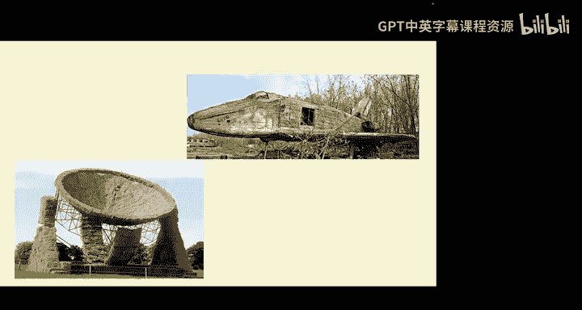

在本节课中，我们将要学习无监督学习和生成模型的核心概念。我们将探讨如何在没有明确标签的情况下理解数据分布，并学习几种主流的生成模型方法。

---

## 概述

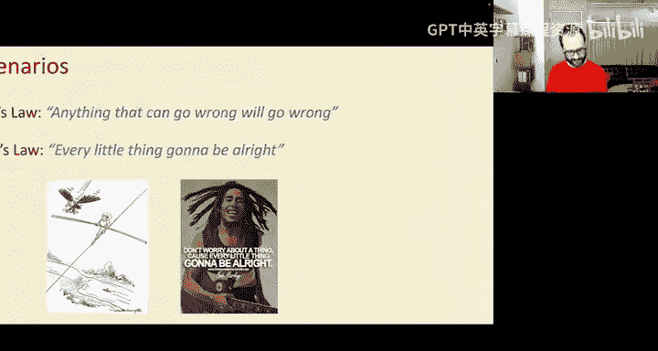

无监督学习意味着我们不再将输入数据的最后一个坐标（即标签）视为特殊部分。我们只是将数据视为来自某个分布 **P** 的样本，我们的目标是理解这个分布 **P**。

理解可以采取多种形式：
*   计算或近似分布 **P** 的概率密度函数。
*   获得一个采样算法，可以从 **P** 或接近 **P** 的分布中生成新样本。
*   给定一个样本 **x**，预测其缺失的部分 **x_B**，这类似于监督学习。
*   找到一个好的表示方法，将输入 **x** 映射到某个表示空间（或潜在空间），使得语义相近的输入（如两张猫的图片）在表示空间中也彼此接近。

---

## 技术预备知识：分布之间的距离 📏

在深入讨论生成模型之前，我们先回顾两个衡量概率分布之间距离的重要工具。

### 总变差距离

对于定义在域 **D** 上的两个概率分布 **P** 和 **Q**，总变差距离定义为：
```
TV(P, Q) = (1/2) * Σ_x |P(x) - Q(x)|
```
（对于连续分布，求和应替换为积分。）

直观上，它可以理解为区分样本来自 **P** 还是 **Q** 的最佳分类器所能获得的最大优势（超过一半正确率的概率）。

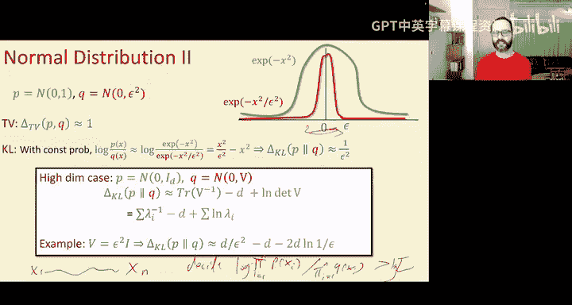

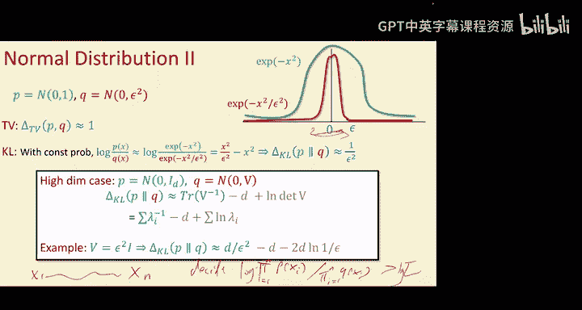

### KL散度

KL散度定义为：
```
KL(P || Q) = E_{x~P} [ log( P(x) / Q(x) ) ]
```
KL散度是非负的。如果KL散度很小（例如为 δ），则大致需要 **1/δ** 个样本来区分 **P** 和 **Q**。如果KL散度很大（例如为 K），则可以理解为从 **Q** 中采样一次，大约能获得关于 **P** 的 **K** 比特信息。

---

## 生成模型的目标 🎯

在生成模型问题中，我们给定一个分布 **P**（通常通过样本访问），目标是生成一个分布 **G**，使其尽可能接近 **P**。

KL散度是一个很好的度量指标。**P** 和 **G** 之间的KL散度可以分解为：
```
KL(P || G) = E_{x~P}[log P(x)] - E_{x~P}[log G(x)]
```
第一项是 **P** 的负熵（与 **G** 无关），第二项是 **P** 和 **G** 的交叉熵。因此，最小化KL散度等价于最小化交叉熵，也就是最大化在 **P** 下 **G** 的对数似然期望：
```
Maximize: E_{x~P}[log G(x)]
```
这是一个我们可以评估的量，前提是我们可以从 **P** 中采样并计算 **G** 的密度。

然而，这里存在严重的过拟合风险。一个极端的“记忆”模型 **G** 可以简单地是训练集上的均匀分布。对于训练样本，其概率为 **1/n**，这可能远大于真实世界分布中该图像的概率，从而导致训练对数似然虚高，但模型对于新样本完全无用。

---

## 处理多目标优化 ⚖️

在构建模型时，我们常常希望同时优化多个目标（例如，重构误差小且潜在空间规整）。

一种常见方法是优化这些目标的线性组合。如果目标函数是凸的，那么帕累托前沿（即无法在不损害一个目标的情况下改进另一个目标的解集）上的每个点都可以通过最小化某个线性组合来达到。

然而，在深度学习的非凸设置中，情况可能复杂得多：可能存在无法通过线性组合达到的帕累托点，算法可能陷入局部最优而非全局最优。尽管如此，在实践中，最小化线性组合的目标函数有时（但并不总是）能奏效，这可以被视为另一种“货物崇拜科学”现象。

---

## 自编码器

自编码器是一种通过限制潜在空间维度来迫使模型学习数据表示的架构。

### 基本架构与目标

我们有一个编码器 **E** 将输入 **x** 映射到低维潜在表示 **z**，以及一个解码器 **D** 将 **z** 映射回重构的 **x̂**。目标是最小化重构误差：
```
Minimize: ||x - D(E(x))||^2
```
当 **E** 和 **D** 都是线性函数时，这等价于主成分分析（PCA）。非线性自编码器可以看作是PCA的非线性扩展，通常能获得更好的重构效果。

### 局限性

单纯限制潜在空间维度可能迫使编码器学习到类似JPEG压缩的低级特征，但这种表示对于生成新样本或高级语义任务（如分类）通常没有帮助，也无法提供一个易于采样的潜在分布。

---

## 变分自编码器

VAE通过明确约束潜在空间的分布来改进自编码器，旨在获得一个可用于生成的规整潜在空间。

### 双重目标

VAE优化两个目标：
1.  **重构损失**：使解码输出接近原始输入。
2.  **KL散度损失**：使编码器输出的分布 **q(z|x)** 接近标准正态分布 **N(0, I)**。

总损失是这两项的加权和。编码器 **E** 是随机的，它为每个 **x** 输出一个分布（通常是高斯分布，参数由神经网络预测）。

### 证据下界视角

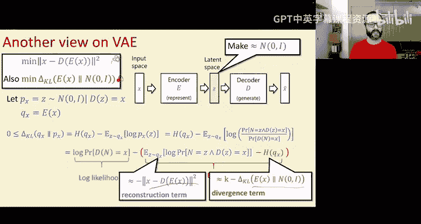

VAE也可以从最大化对数似然的证据下界（ELBO）的角度来理解。ELBO可以分解为：
```
ELBO = E_{z~q(z|x)}[log p(x|z)] - KL( q(z|x) || p(z) )
```
其中 **p(z)** 是先验分布（标准正态），**p(x|z)** 是解码器定义的条件似然。最大化ELBO即同时最大化重构似然（第一项）并最小化后验分布与先验的KL散度（第二项），这与双重目标的观点一致。

### 优势与挑战

VAE能产生比普通自编码器更规整的潜在空间，并且支持生成（从 **N(0, I)** 采样 **z**，然后通过 **D** 解码）。潜在空间的维度有时会对应有意义的语义方向（如添加眼镜、改变发色）。

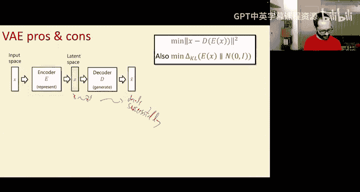

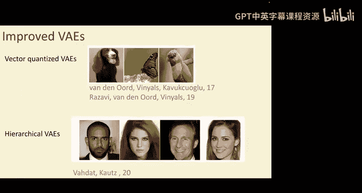

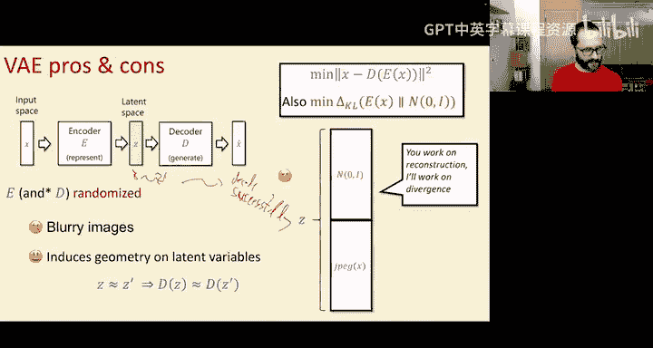

然而，VAE也存在一些挑战：
*   随机性可能导致输出图像模糊。
*   可能存在“后验坍塌”，即编码器忽略输入，始终输出接近先验的分布，从而轻易满足KL散度目标，但未能学习有用表示。
*   学到的特征对于判别任务的有效性仍有待证实。

改进的VAE（如矢量量化VAE、层次化VAE）在某些方面（如图像清晰度）表现更好。

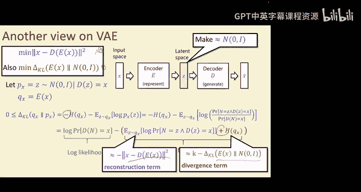

---

## 流模型

流模型通过构建一个可逆且可微的变换，直接将简单分布（如标准正态）映射到复杂数据分布。

### 核心思想

我们学习一个可逆解码器 **D: Z -> X**，并强制潜在变量 **z** 服从标准正态分布 **N(0, I)**。根据变量变换公式，生成数据 **x = D(z)** 的密度可以精确计算：
```
p_X(x) = p_Z( D^{-1}(x) ) * | det( J_{D^{-1}}(x) ) |
```
其中 **J** 是雅可比矩阵。这使得我们可以精确计算数据的对数似然，并直接以此为目标进行训练。

### 构建可逆变换

通过组合一系列简单的可逆变换来构建复杂的可逆函数。一种常见的构建块是“仿射耦合层”：将输入分成两部分 **(a, b)**，输出为 **(a', b') = (a, f(a) * b + g(a))**，其中 **f** 和 **g** 可以是任意复杂函数，只要 **f(a)** 可逆即可。该变换的逆很容易计算。

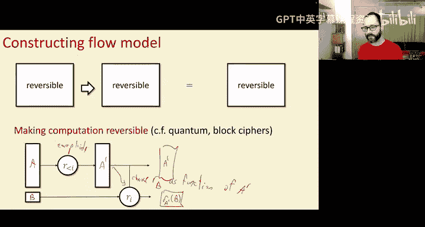

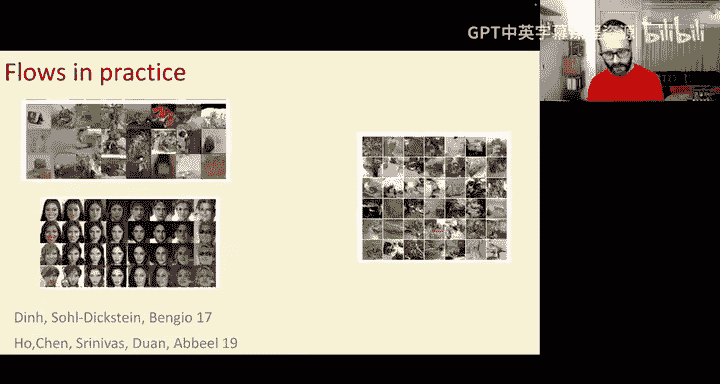

流模型能产生质量不错的样本，并允许精确密度估计，但其潜在空间的语义可解释性通常不如VAE，在分类任务中的应用也不广泛。

---

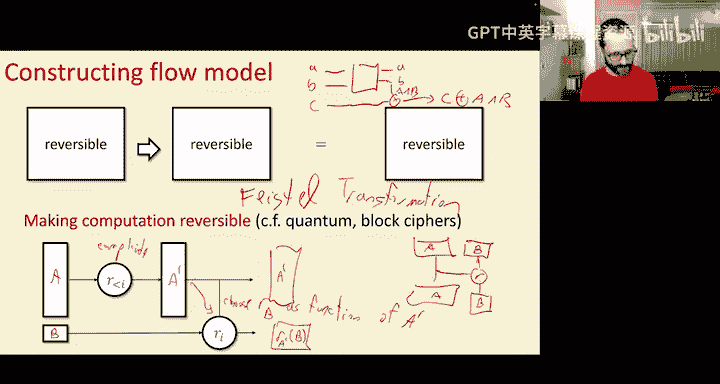


## 对比学习

对比学习放弃了生成能力，专注于学习高质量的输入表示。

### 基本理念

我们希望相似的对象在表示空间中具有相似的表示。具体做法是：构造正样本对（例如，同一图像的不同增强版本、配对的文本和图像），以及负样本对（不相关的样本）。然后训练编码器，使正样本对的表示向量点积尽可能大，负样本对的点积尽可能小。

一个常见的损失函数是InfoNCE损失或其变体，其本质是最大化正样本对的相似度与所有样本对相似度的对比度。

### 应用与效果

像SimCLR、CLIP这样的模型使用了对比学习。它们学到的表示在后续的判别任务（如图像分类）上表现优异，通常只需要少量标注数据进行微调即可达到与全监督学习相近的性能。这证明了其在利用无标签数据学习通用表示方面的强大能力。

---

## 生成对抗网络

GAN专注于生成高质量样本，而放弃了显式密度估计和表示学习。

### 对抗博弈

GAN框架包含一个生成器 **G** 和一个判别器 **D**。**G** 试图从随机噪声生成逼真的数据，**D** 试图区分真实数据和生成数据。这形成了一个二人零和博弈，目标函数通常形式为：
```
Min_G Max_D [ E_{x~P_real}[log D(x)] + E_{z~P_noise}[log(1 - D(G(z)))] ]
```
生成器 **G** 试图最小化这个值，而判别器 **D** 试图最大化它。

### 优势与挑战

GAN能生成视觉上非常逼真的图像。然而，其训练过程不稳定，难以收敛（模式坍塌、梯度消失等问题）。理论上，如果达到纳什均衡，生成器将完美复制真实分布。但在实践中，由于策略空间非凸、优化算法等原因，达到均衡非常困难。

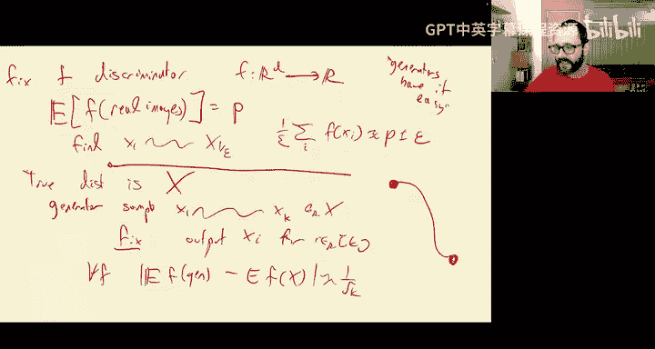

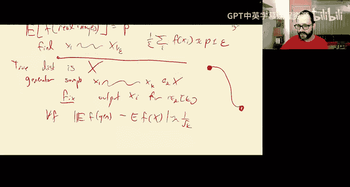

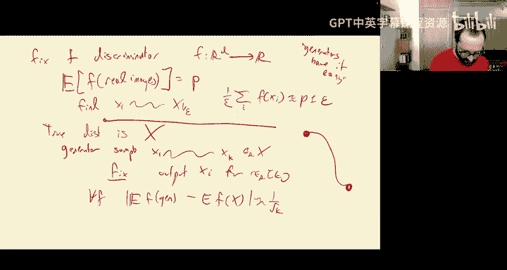

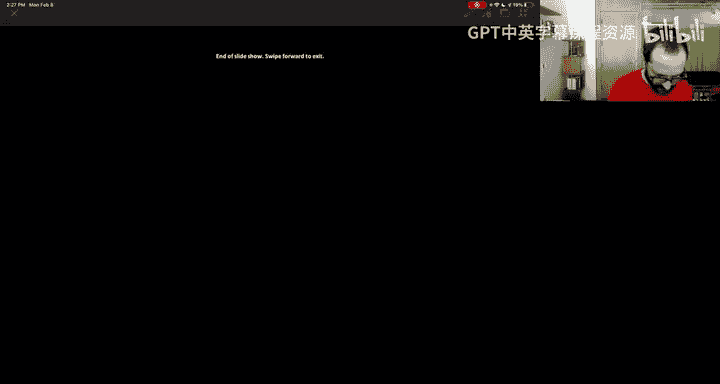

此外，评估GAN的生成质量也是一大挑战。像“初始分数”这样的指标可能不可靠，因为生成器可能只学会了欺骗特定的判别网络（如Inception），而生成的分布并未完全覆盖真实数据分布（熵不足）。用GAN生成的图像训练分类器，其性能通常远低于用真实数据训练的分类器。

---

## 总结

本节课我们一起探索了无监督学习和生成模型的广阔领域。我们从衡量分布距离的基础概念出发，了解了生成模型的核心目标与挑战。随后，我们深入探讨了几种重要的模型：

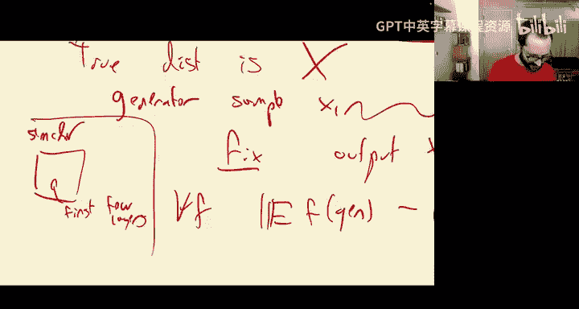

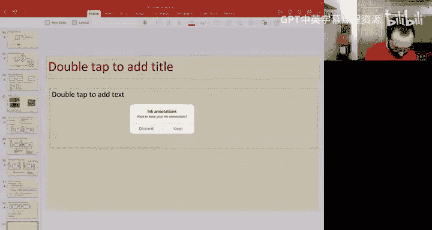

*   **自编码器**通过压缩维度学习表示，但生成和语义能力有限。
*   **变分自编码器**通过约束潜在空间为正态分布，实现了可生成的规整空间，但可能面临后验坍塌和输出模糊的问题。
*   **流模型**通过可逆变换实现精确的密度估计和生成。
*   **对比学习**放弃了生成，专注于学习强大的语义表示，在少样本学习上效果显著。
*   **生成对抗网络**专注于生成高质量样本，但训练不稳定且评估困难。

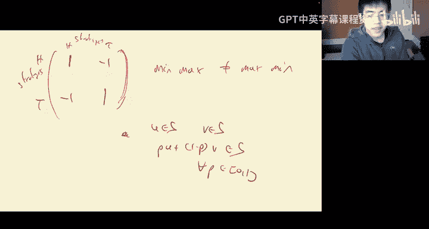

目前，还没有一个单一的模型能完美实现高质量生成、精确密度估计和强大语义表示的所有目标。像CLIP和DALL·E这样的工作通过将任务分解（一个模型学习表示，另一个模型学习生成）取得了显著进展。理解这些不同模型的原理、优势与局限，是构建和选择合适解决方案的关键。