# 5：机器学习与统计物理的关系 🧠⚛️

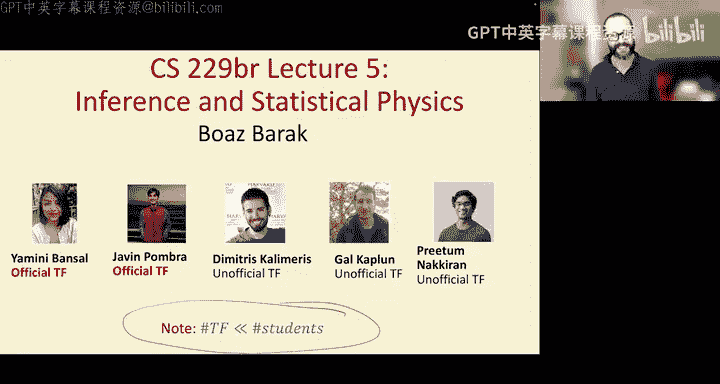

在本节课中，我们将探讨机器学习与统计物理之间的深刻联系。我们将从统计学中的频率主义与贝叶斯主义之争开始，然后深入统计物理的核心概念，如玻尔兹曼分布和变分原理。最后，我们将看到这些物理概念如何为机器学习中的推理和优化问题提供强大的框架和工具。

---

## 频率主义 vs. 贝叶斯主义

在深入统计物理之前，我们先简要回顾统计学中长期存在的频率主义与贝叶斯主义之争。这两种观点对概率的本质持有不同看法。

频率主义者认为，概率只有在可以无限重复的实验背景下才有意义。概率是事件在大量重复实验中发生的频率。因此，谈论像“拜登赢得选举的概率”这样的一次性事件，在频率主义者看来是没有意义的。

贝叶斯主义者则认为，概率是逻辑的延伸，它表示对某个陈述的信念程度。概率可以量化我们对不确定事件的置信度，即使该事件只发生一次。

在技术层面上，这两种观点在处理推断问题时也会导致不同的方法。

上一节我们介绍了两种统计学派的哲学差异，本节中我们来看看它们在具体问题上的技术表现。

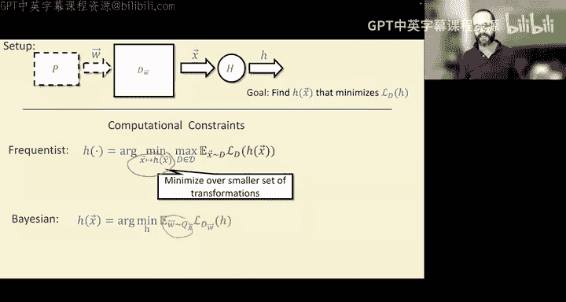

### 技术层面的对比

假设我们有以下设置：我们有一个可以从中采样的概率分布，其中 `x` 是样本向量。我们想要根据这些样本决定关于该分布的某个假设 `h`。这个假设可能涉及假设检验、预测或回归等任务。存在一个衡量 `h` 相对于分布 `D` 好坏的期望损失 `L`，我们的目标是最小化这个损失。

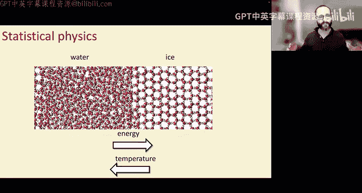

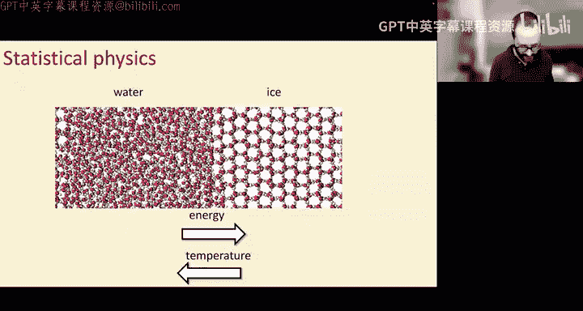

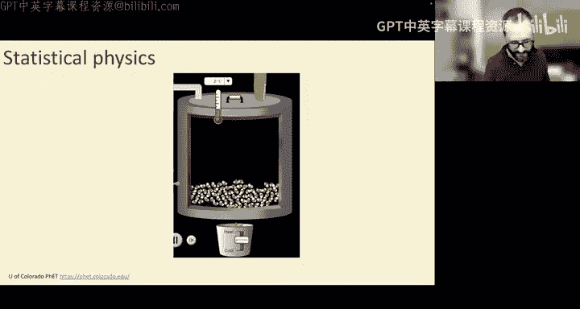

频率主义者会这样看待这个任务：他们假设分布 `D` 来自一个潜在的分布集合。目标是找到一个将样本向量 `x` 映射到假设 `h` 的变换，该变换能最小化当 `D` 来自该分布集合时的最坏情况成本。这里的概率仅与未来的 `D` 有关。

贝叶斯主义者则有不同的思考方式：他们认为这个分布族源于一些潜在的隐变量 `w`。存在一个先验分布，从中选取了隐变量 `w`，而 `D` 依赖于 `w`。在观察到样本 `x` 后，我们根据贝叶斯规则定义后验分布 `P(w|x)`。然后，我们希望找到能最小化根据此后验分布计算的期望损失的假设。这里的概率是关于那些我们无法观察到的隐变量 `w` 的。

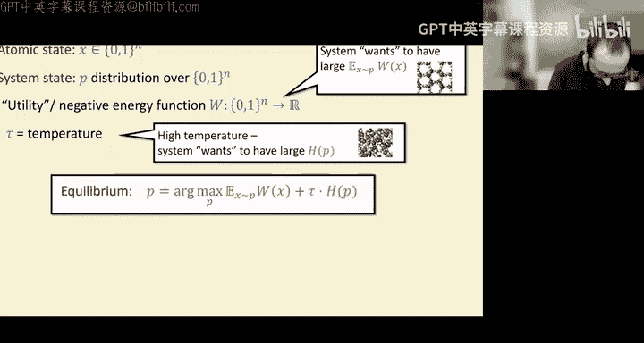

在某些设置下，两种方法会得出相同的结论（例如在线性最小二乘回归中）。但在其他情况下，它们会导致不同的做法。贝叶斯方法的一个有用之处在于，如果你能得到后验分布，你不仅可以最小化损失，还可以进行其他操作，例如从后验中采样。

贝叶斯统计的一个关键问题是：如何选择先验？一个核心方法是最大熵原理，即选择具有最大熵的先验（如均匀分布），这可以被视为信息量最少的先验。

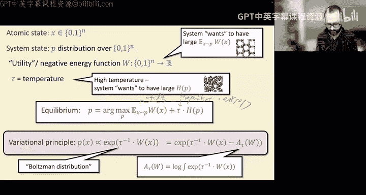

---

## 统计物理简介

现在让我们转向统计物理。它与贝叶斯观点有着非常自然的类比和联系。

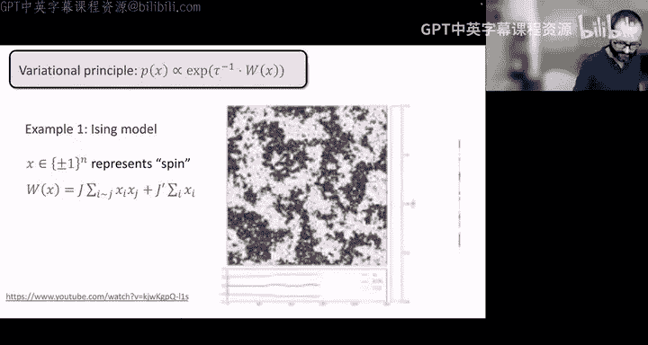

我们可以将物理系统（如水或冰）的状态看作是由原子配置组成的。在统计物理中，我们不是确定性地理解系统，而是将其视为一个整体分布。系统状态实际上是一个概率分布。

系统倾向于处于高“效用”（或低能量）的状态，但同时也受到温度的影响。在高温下，系统也倾向于具有高熵。系统通过解决一个优化问题来达到平衡：最大化效用减去温度乘以熵（在适当单位下）。如果温度为零，系统只关心最大化效用。如果温度无限高，系统将完全忽略效用，处于均匀分布（最大熵分布）。

统计物理的一个核心观点是，我们可以用两种等价的方式来描述这个概率分布。

### 变分原理与玻尔兹曼分布

变分原理指出，系统所处的概率分布 `P`，是以下优化问题的解：在所有概率分布 `Q` 中，最大化期望效用 `E_Q[W(x)]` 加上温度参数 `τ` 乘以熵 `H(Q)`。

这个分布有一个美丽的替代表征，即玻尔兹曼分布：`P(x) ∝ exp(τ^{-1} * W(x))`。当温度 `τ` 趋近于0时，分布集中在使 `W(x)` 最大化的 `x` 上。当 `τ` 趋近于无穷大时，分布变为均匀分布。

玻尔兹曼分布的形式为：
`P(x) = exp(τ^{-1} * W(x) - A_τ(W))`
其中 `A_τ(W) = log(∑_x exp(τ^{-1} * W(x)))` 是归一化常数，也称为对数配分函数或自由能。

---

## 例子与应用

以下是玻尔兹曼分布的几个经典例子：

*   **伊辛模型**：描述磁性材料中自旋的模型。效用函数是自旋间相互作用的和。随着温度降低，系统会经历相变，形成一致的自旋区域。
*   **谢林顿-柯克帕特里克模型**：一个平均场无序模型，其中相互作用是随机的。该模型在统计物理中得到了深入研究。
*   **贝叶斯推断**：在机器学习中，给定观测数据后，隐变量的后验分布正比于似然函数。这可以写成玻尔兹曼分布的形式，其中效用函数是对数似然，温度可以类比于学习率。

---

## 变分原理的证明

变分原理是连接两种表征的关键。我们来简要证明它。

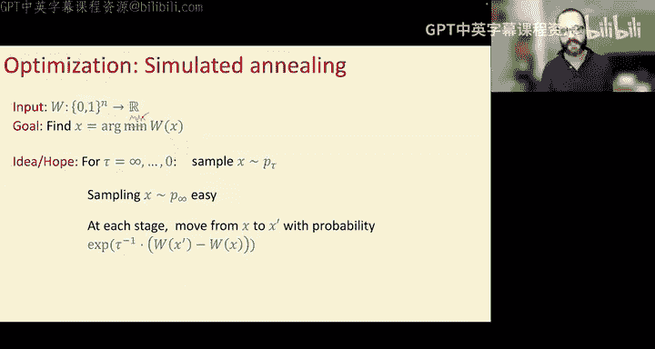

**定理**：令 `P` 为玻尔兹曼分布，即 `P(x) ∝ exp(τ^{-1} * W(x))`。则 `P` 是以下优化问题的解：
`max_Q { E_Q[W(x)] + τ * H(Q) }`
其中 `H(Q)` 是分布 `Q` 的熵。

**证明概要**：
1.  对于玻尔兹曼分布 `P`，计算其熵 `H(P)` 和期望效用 `E_P[W(x)]`。
2.  利用 `A_τ(W)` 的定义，可以得出等式：`τ * A_τ(W) = τ * H(P) + E_P[W(x)]`。
3.  对于任意其他分布 `Q`，计算 `P` 和 `Q` 之间的KL散度 `D_KL(Q||P)`，它总是非负的。
4.  将KL散度展开，并利用步骤2中的等式，可以证明 `τ * A_τ(W) ≥ E_Q[W(x)] + τ * H(Q)`，且等号成立当且仅当 `Q = P`。
5.  因此，`P` 确实最大化了 `E_Q[W(x)] + τ * H(Q)`。

这个原理直观上很自然：我们寻找一个分布，在保持高熵（不确定性）的同时，偏向于高效用（或低能量）的状态。玻尔兹曼分布正是通过指数加权 (`exp(W(x))`) 来实现这种权衡的。

---

## 采样与优化

从玻尔兹曼分布中采样通常是计算困难的，因为配分函数 `A_τ(W)` 难以计算。然而，我们可以计算概率比 `P(x‘)/P(x) = exp(τ^{-1} * (W(x') - W(x)))`。

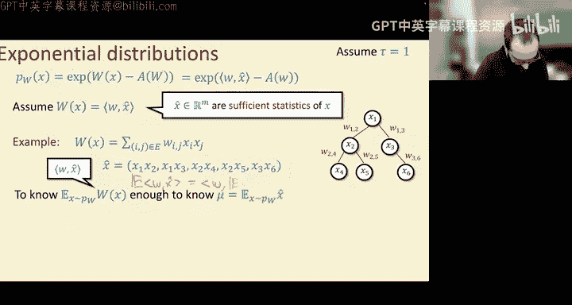

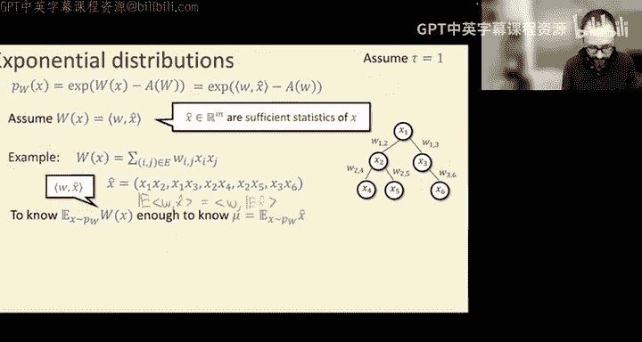

### 马尔可夫链蒙特卡洛方法

基于概率比，我们可以使用MCMC方法（如Metropolis-Hastings或Gibbs采样）进行采样。算法从初始状态 `x_0` 开始，然后重复以下步骤：
1.  从当前状态 `x` 的邻域中提议一个新状态 `x‘`。
2.  以概率 `min(1, P(x’)/P(x))` 接受新状态，否则保持原状态。

在温和条件下，该链的平稳分布就是目标玻尔兹曼分布。但收敛到平稳分布可能需要很长时间，特别是在存在“能垒”或“玻璃态”时。

### 模拟退火

对于优化问题（寻找最大化 `W(x)` 的 `x`），我们可以使用模拟退火算法：
1.  从高温（均匀分布）开始。
2.  缓慢降低温度。
3.  在每一温度下，使用MCMC采样，但倾向于接受更优的状态。

如果冷却速度足够慢，算法有可能找到全局最优解。但如果冷却太快，系统可能陷入局部最优（类似玻璃态）。

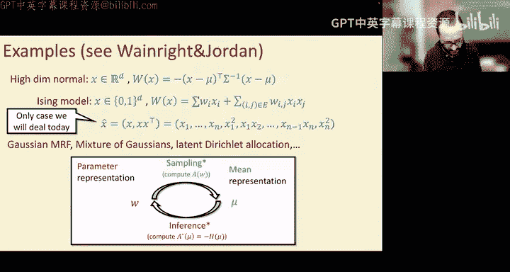

---

## 指数族与平均场近似

在机器学习中，许多分布属于指数族。对于指数族分布，效用函数是参数 `w` 与充分统计量 `T(x)` 的点积：`W(x) = w · T(x)`。

在这种情况下，期望效用只依赖于充分统计量的期望值 `μ = E_P[T(x)]`。变分原理告诉我们，在具有相同期望统计量 `μ` 的所有分布中，玻尔兹曼分布具有最大熵。

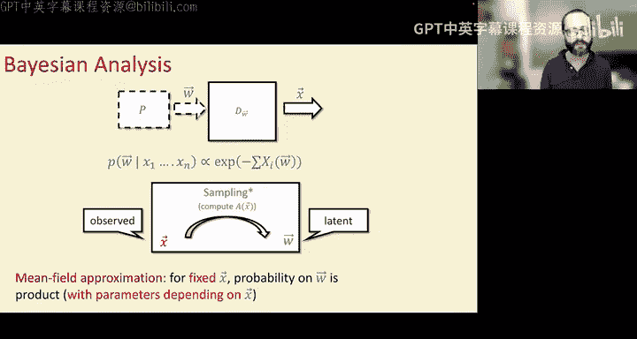

我们有两种等价的表示方式：
*   **参数表示**：`w`
*   **矩表示**：`μ`
从 `w` 计算 `μ`（推断）和从 `μ` 计算 `w`（学习）通常是计算困难的，都涉及计算自由能 `A(w)`。

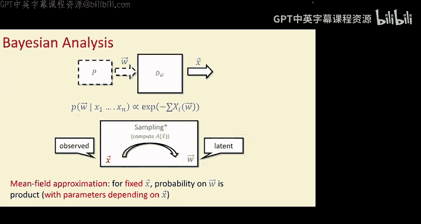

### 平均场近似

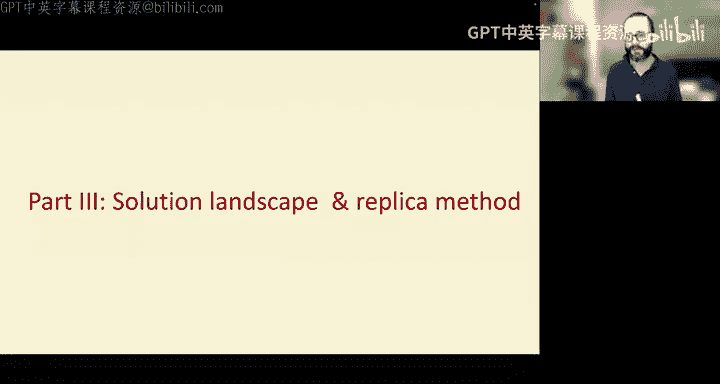

由于精确计算困难，我们常用近似方法。平均场近似是一种变分方法，它将难以处理的分布 `P` 近似为一个更简单的分布族 `Q`（通常是因子化分布，即各变量独立）。

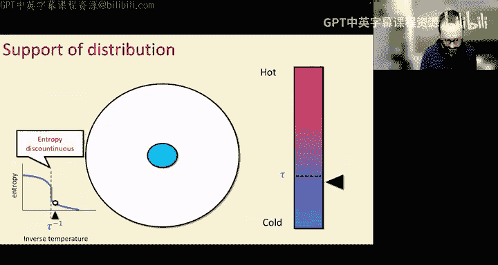

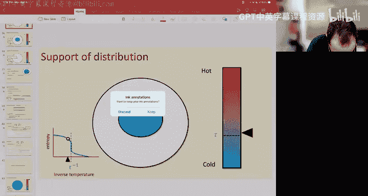

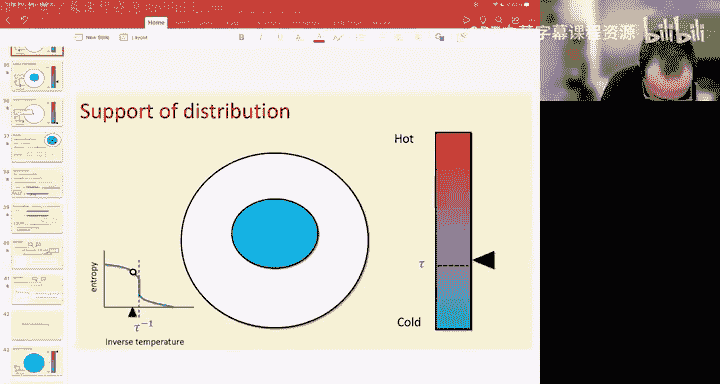

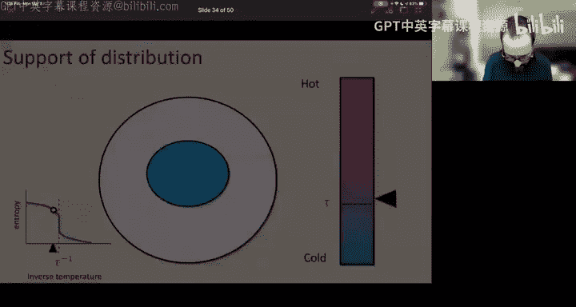

我们最大化“证据下界”：
`max_Q { E_Q[W(x)] + H(Q) }`
其中 `Q` 被限制在因子化分布族中。这等价于最小化 `Q` 与真实后验 `P` 之间的KL散度。

对于因子化分布 `Q`，其熵是各变量熵的和，期望统计量 `μ` 也分解为各变量边际的乘积。这简化了优化问题，通常可以通过坐标上升等算法求解。

平均场近似可以推广到更复杂的可处理分布族（如树结构分布），形成了变分推断方法的基础。

---

## 复本方法与解空间景观

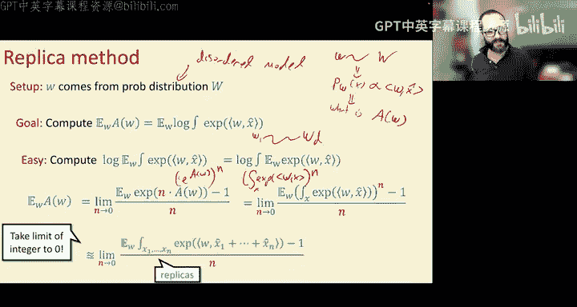

最后，我们简要介绍统计物理中分析复杂系统（如无序系统）的强大但非严格的方法——复本方法，以及它对解空间景观的描述。

### 复本方法

复本方法用于计算随机系统（如随机相互作用 `W`）的平均自由能 `E_W[A(W)]`。直接计算期望对数很困难，但计算对数的期望（即配分函数的矩）相对容易。

复本技巧利用了一个数学等式：`E[log Z] = lim_{n→0} (E[Z^n] - 1)/n`。
对于整数 `n`，`E[Z^n]` 可以解释为 `n` 个独立复制系统（复本）的配分函数。物理学家假设这个表达式可以解析延拓到 `n=0` 附近，并通过假设复本之间的重叠矩阵具有某种简单形式（如所有非对角元相等，称为复本对称假设）来估算极限值。

通过变分计算，可以得到自由能的近似表达式。这种方法虽然数学上不严格，但在许多模型中给出了与实验和数值模拟吻合的极好预测。

### 解空间景观与相变

玻尔兹曼分布的“解空间”结构可以非常复杂：
*   **复本对称**：解空间像一个连通的高维“球”，所有配置彼此接近。采样相对容易。
*   **复本对称破缺**：解空间分裂成许多互不相连的簇或子簇。系统可能被困在其中一个簇中（类似玻璃态），导致采样和优化极其困难。这对应于动态相变。

在机器学习中，这种分析有助于理解为什么某些学习问题（如带有噪声的矩阵或张量恢复）存在尖锐的阈值：当信噪比低于阈值时，无法恢复信号；高于阈值时，则可以恢复。复本方法可以精确预测这些阈值。

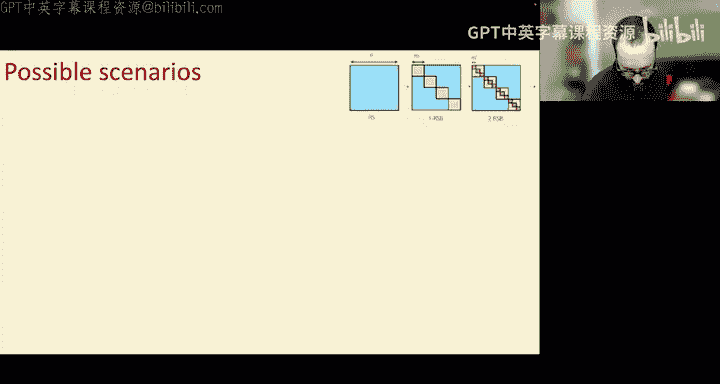

---

## 总结

本节课中，我们一起学习了机器学习与统计物理之间的深刻联系。

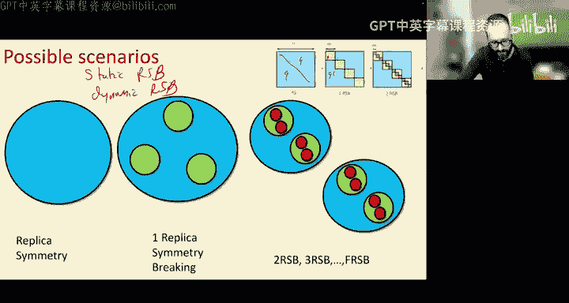

我们首先回顾了频率主义和贝叶斯主义对概率的不同诠释，并看到贝叶斯推断的后验分布自然地表现为统计物理中的玻尔兹曼分布。

我们深入探讨了统计物理的核心——变分原理和玻尔兹曼分布，它描述了系统在能量最小化与熵最大化之间的平衡。我们看到了它在伊辛模型、贝叶斯推断等例子中的应用。

接着，我们讨论了从这些分布中采样的方法（如MCMC）和用于优化的模拟退火算法，并指出了其可能陷入局部最优（玻璃态）的挑战。

然后，我们探讨了指数族分布和平均场近似，这是一种通过限制在简单分布族（如因子化分布）中来近似复杂后验的变分方法。

最后，我们简要介绍了复本方法这一强大的理论工具，它被用于分析随机系统的平均行为和解空间的复杂结构（如复本对称破缺），并解释了计算困难性与相变之间的关系。

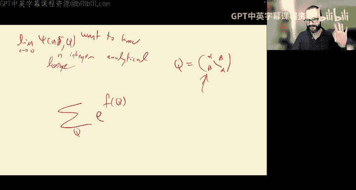

这些统计物理的概念和方法，为理解机器学习中的推理、优化和计算复杂性提供了丰富的视角和强大的工具。