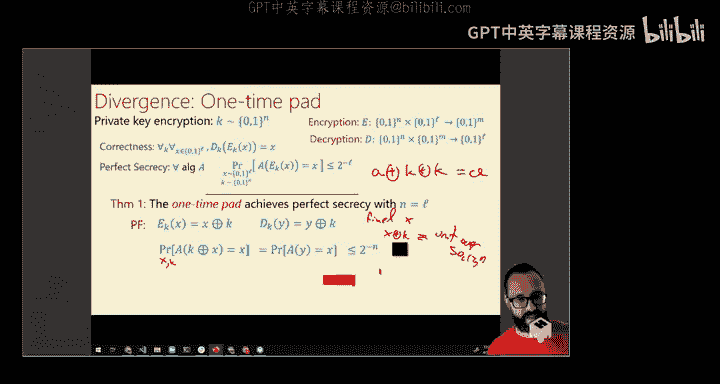
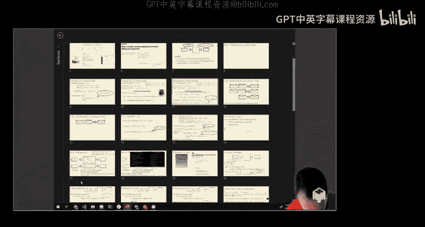
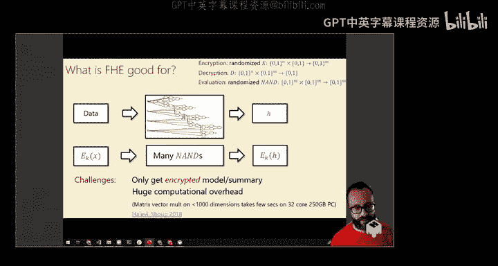
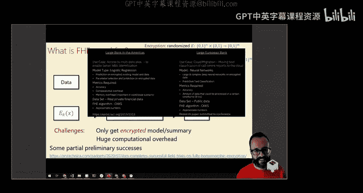
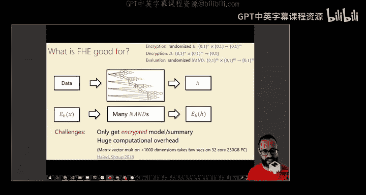
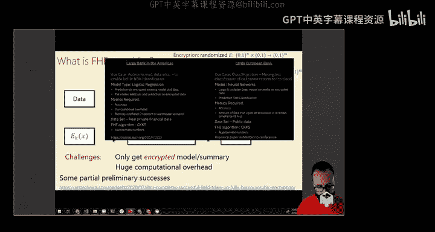
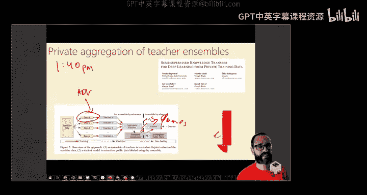
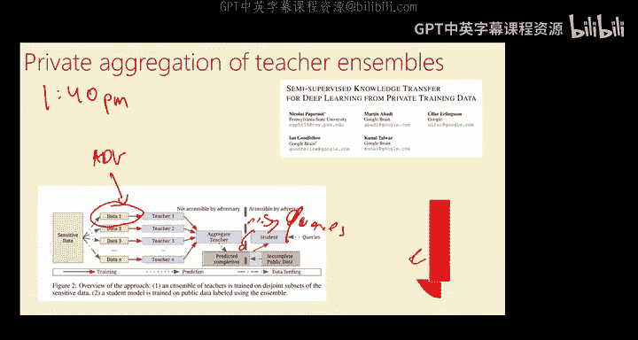
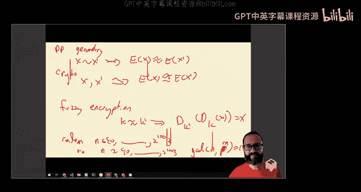

# 7：机器学习中的隐私保护 🛡️

在本节课中，我们将探讨机器学习中的隐私问题。当算法从训练数据中学习时，这些数据（如患者记录、客户信息）通常是私密的。然而，训练好的模型有时会“记住”并泄露更多关于其训练数据的信息，这超出了我们的预期。我们将介绍三种主要的隐私保护方法：密码学、差分隐私和启发式方法，并分析它们的优缺点。

---

## 一、 密码学方法：全同态加密 🔐

上一节我们介绍了隐私问题的背景，本节中我们来看看如何使用密码学来保护机器学习中的隐私。

### 1.1 一次性密码本与完美保密性

为了理解现代密码学工具，我们先回顾一个基础概念：一次性密码本。它是一种私钥加密方案，由加密算法和解密算法组成，两者都使用一个长度为 `n` 的私钥 `K`。

加密算法 `Enc(K, M)` 接收密钥 `K` 和明文消息 `M`，输出密文 `C`。
解密算法 `Dec(K, C)` 接收密钥 `K` 和密文 `C`，输出原始明文 `M`。

一次性密码本的核心特性是**完美保密性**。其定义是：即使攻击者观察到密文 `C`，他猜测出原始明文 `M` 的概率，最多也不会超过随机猜测的概率（即 `2^{-L}`，其中 `L` 是消息长度）。这意味着密文不会泄露关于明文的任何额外信息。

香农证明，要实现完美保密性，密钥的长度 `n` 必须至少与消息的长度 `L` 相等。这就是“一次性”的含义——每个密钥最多只能使用一次，否则会破坏安全性。

一次性密码本的构造非常简单：如果消息 `x` 和密钥 `k` 都是 `n` 比特的字符串，则加密过程就是逐比特进行异或运算：`C = x ⊕ k`。解密过程完全相同：`x = C ⊕ k`。

### 1.2 全同态加密

一次性密码本虽然安全，但密钥管理成本极高。全同态加密是一种更实用的密码学工具，它允许在密文上直接进行计算。

一个（秘密密钥）全同态加密方案包含以下算法：
*   **加密算法 `Enc(K, M)`**：一个随机化算法，接收密钥 `K` 和（单比特）消息 `M`，输出密文 `C`。
*   **解密算法 `Dec(K, C)`**：接收密钥 `K` 和密文 `C`，输出消息 `M`。
*   **评估算法 `Eval(C1, C2)`**：一个核心算法。它接收两个密文 `C1`（`x` 的加密）和 `C2`（`x‘` 的加密），在**不知道密钥 `K`** 的情况下，输出一个新的密文 `C‘`。这个 `C‘` 解密后得到的结果，应该与直接对明文 `x` 和 `x‘` 进行“与非”运算 `NAND(x, x‘)` 后再加密的结果，在概率分布上不可区分。

由于“与非”门是通用逻辑门，任何计算都可以通过组合多个“与非”操作来完成。因此，理论上我们可以对加密数据执行任意复杂的计算（例如整个训练算法），并最终得到一个加密的模型。

**挑战与现状**：
全同态加密提供了强大的、近乎完美的隐私保证。然而，其主要瓶颈在于**巨大的计算和存储开销**。目前，即使经过高度优化，对加密数据执行简单操作（如矩阵乘法）也比在明文数据上慢数个数量级，并且需要极大的内存。尽管已有一些在逻辑回归和神经网络上的实验性应用，但它目前还无法用于大规模机器学习任务。

---

## 二、 差分隐私方法：在隐私与效用间权衡 ⚖️

上一节我们看到了密码学方法虽然安全但效率低下，本节中我们来看看差分隐私，它提供了一种可量化的隐私与效用权衡。

### 2.1 差分隐私的定义

差分隐私的核心思想是：算法的输出对于数据集中任何单个记录的存在与否不敏感。

形式化定义如下：
一个随机化算法 `A` 是 `(ε, δ)`-差分隐私的，如果对于所有仅在一条记录上不同的数据集 `X` 和 `X‘`，以及所有可能的输出子集 `S`，都有：
`Pr[ A(X) ∈ S ] ≤ e^ε * Pr[ A(X‘) ∈ S ] + δ`
当 `δ = 0` 时，我们称之为 `ε`-差分隐私。

**直观理解**：假设你考虑是否将个人数据加入某个数据集。如果数据处理机制是差分隐私的，那么你因加入数据集而遭受某种不利后果（例如，你的个人信息被推断出来）的概率，最多只会比你不加入数据集时高出约 `(1+ε)` 倍。这为你提供了可量化的风险上限。

**为什么是乘性而非加性保证？**
加性保证（`Pr[A(X) ∈ S] ≤ Pr[A(X‘) ∈ S] + ε`）是较弱的。例如，一个算法随机泄露 `k` 个人的全部数据，只要 `k/n` 很小，它就能满足加性隐私，但这显然是严重侵犯隐私的。乘性保证则能防止这种“牺牲少数人”的策略。

### 2.2 实现差分隐私：拉普拉斯机制

差分隐私的一个经典实现方法是拉普拉斯机制，适用于发布数值型查询（如计数、求和）的结果。

假设我们有一个查询函数 `f`，其输出是一个实数。定义函数 `f` 在数据集 `X` 上的**敏感度**为：`Δf = max |f(X) - f(X‘)|`，其中 `X` 和 `X‘` 是仅相差一条记录的相邻数据集。

拉普拉斯机制的工作方式很简单：在真实的查询结果 `f(X)` 上，添加一个服从拉普拉斯分布的噪声。拉普拉斯分布 `Lap(b)` 的概率密度与 `exp(-|x|/b)` 成正比，尺度参数 `b` 决定了噪声大小。

具体操作如下：要发布 `f(X)` 的差分隐私版本，我们输出：`A(X) = f(X) + Y`，其中 `Y ~ Lap(Δf / ε)`。

**定理**：拉普拉斯机制满足 `ε`-差分隐私。

### 2.3 差分隐私深度学习

在深度学习中应用差分隐私，一个代表性的工作是将噪声注入随机梯度下降过程。

其核心思想是：
1.  **梯度裁剪**：在计算小批量梯度后，将每个样本的梯度向量裁剪到最大范数 `C` 以内。这控制了单个样本对整体更新的影响，从而限制了敏感度。
2.  **添加噪声**：在聚合小批量梯度后，添加适当大小的拉普拉斯或高斯噪声。
3.  **隐私累计**：通过“矩会计”等技术，跟踪多次梯度更新步骤所累积的隐私预算 `(ε, δ)`。

**效果与挑战**：
这种方法（如Abadi等人提出的DP-SGD）能够在MNIST、CIFAR-10等数据集上实现有意义的准确率，同时提供差分隐私保证。然而，隐私与效用的权衡依然严峻：为了获得更强的隐私保护（更小的 `ε`），需要添加更多噪声，这会导致模型准确率显著下降。此外，训练步骤越多，累积的隐私消耗也越大。

尽管存在挑战，差分隐私是目前工业界（如苹果、谷歌）采用的主要严格隐私框架，它提供了坚实的理论保障，防止成员推断和重构等攻击。

---

## 三、 启发式方法：InstaHide的尝试与失败 🚧

上一节我们介绍了有严格理论保证的差分隐私，本节中我们来看看一些试图兼顾效率与隐私的启发式方法，以InstaHide为例。

### 3.1 InstaHide的设计思路

InstaHide的动机是结合数据增强技术（如MixUp）和类似一次性密码本的混淆操作，希望在不显著降低模型性能的前提下保护隐私。

其加密过程分为两步，对于一个私有图像 `x_priv`：
1.  **混合**：随机选取两个私有图像和两个公共图像，用随机系数（和为1）进行凸组合，得到一个混合图像 `x_mix`。
2.  **符号翻转**：将 `x_mix` 的每个像素值（假设已归一化到[-1, 1]区间）乘以一个随机的 `±1` 符号，得到最终编码图像 `x_enc`。

其希望是：编码后的图像集可以用于训练出性能尚可的模型，但攻击者难以从中恢复原始私有图像。

### 3.2 InstaHide的破解

然而，Carlini等人很快提出了对InstaHide的有效攻击，完全恢复了原始私有图像。攻击步骤如下：

1.  **消除符号翻转**：观察到第二步的 `±1` 符号翻转不改变像素的绝对值。因此，攻击者可以从 `x_enc` 直接得到 `|x_mix|`。
2.  **构建关联图**：训练一个分类器，判断两个编码图像是否共享同一个原始私有图像（基于它们的 `|x_mix|` 的相似性）。利用此分类器，可以将所有编码图像聚类，每个聚类对应一个原始私有图像。
3.  **求解方程组**：每个编码图像 `x_enc_i` 都提供了关于其关联的原始私有图像 `x_j` 的一个方程（形式为 `x_enc_i ≈ Σ λ_{i,j} * x_j`，其中 `λ` 已知，`x_j` 未知）。整个数据集构成了一个超定非线性方程组。
4.  **梯度下降求解**：使用梯度下降法直接求解这个方程组，可以高精度地恢复出所有原始私有图像。

### 3.3 教训与启示

InstaHide的失败表明，缺乏形式化隐私定义的启发式方法是危险的。它看似结合了密码学和数据增强的思想，但由于像素值是连续实数而非离散比特，其“混淆”操作远未达到一次性密码本的安全强度。

**核心教训**：在设计隐私保护机器学习方案时，首要任务不是构造一个看似巧妙的算法，而是**建立一个清晰、严谨的安全目标（定义）**，并在此框架下证明或验证方案的安全性。否则，方案很可能存在未知的漏洞。

---

## 总结

本节课中我们一起学习了机器学习中隐私保护的三种主要途径：

1.  **密码学方法（全同态加密）**：提供最强的、近乎完美的隐私保证，但当前计算开销极大，难以实用。
2.  **差分隐私**：提供了严谨的、可量化的隐私定义，通过添加噪声在隐私和效用间进行权衡。它是目前最主流且有工业应用的严格隐私框架，但在深度学习中，要达到高精度仍需牺牲较多的隐私预算。
3.  **启发式方法（以InstaHide为例）**：试图以高效的方式获得隐私保护，但缺乏形式化保证，容易被攻破。这提醒我们，没有严格定义和论证的“隐私”方案是不可靠的。

机器学习中的隐私保护仍然是一个活跃且充满挑战的研究领域，尚未有完美的解决方案。在实际应用中，需要根据具体场景对隐私、效用和效率的需求进行权衡和选择。