# 8：强化学习

## 概述

在本节课中，我们将要学习强化学习与赌博机问题中的泛化性质。我们将探讨为什么在强化学习中思考泛化的方式与监督学习有根本性的不同，并回顾一些关于泛化的基本概念。

## 强化学习基础回顾

上一节我们介绍了课程概述，本节中我们来看看强化学习的基本设定。

我们假设大家对动态规划和马尔可夫决策过程有基本的了解。让我们快速回顾一下标准设定。

我们有一个智能体。智能体将采取某个动作 `A_t`，该动作会影响环境。当它影响环境时，状态会向前推进。我们会看到状态，选择一个动作，并获得一个奖励。

在术语上，我们说一个策略或行为策略只是一个从状态到动作的映射。

我们考虑一个片段式设定，我们从某个分布中的某个状态 `S_0` 开始，行动 `H` 步。我们的轨迹就是我们看到的东西，即我们看到的状态，然后我们采取一个动作，观察一个奖励，得到下一个状态，采取一个动作，观察一个奖励，依此类推。

我们的目标是在 `H` 步内最大化累积奖励。这就是这个价值函数 `V^π(S)`。其语义是：我从状态 `S` 开始，遵循策略 `π`，这就是我的累积奖励。

另一个方便的概念有时被称为状态-动作价值或 `Q` 值。它表示，与其在第一步遵循 `π`，我选择偏离，在第一步遵循动作 `A`，然后遵循 `π`。这就像一个一步前瞻的价值函数。

我们的目标是找到一个策略 `π`，最大化从 `S_0` 开始的未来奖励。

我们将在这种片段式设定中工作，我们从 `S_0` 开始，行动 `H` 步，然后重复。

在某些设定中，我们可能不知道世界的模型。

## 强化学习中的挑战

上一节我们回顾了强化学习的基本设定，本节中我们来看看强化学习面临哪些挑战。

以下是强化学习面临的挑战：

*   **探索问题**：因为环境可能是未知的。
*   **信用分配问题**：假设我们以某种方式得到了一个 `-1` 的奖励。那么，过去哪些动作导致了我们得到这个负奖励？因为我们得到的反馈不是有人立即告诉我们：“嘿，在这个位置，在这个状态下，你做了这个错误的动作，这才是正确的动作。”这不是我们得到的反馈。
*   **维度灾难**：状态和动作空间可能非常大。

如何用机器学习处理这个问题？我们将其视为一个泛化问题。我们不会看到每个可能的立方体配置或每个可能的手部配置并尝试每个可能的动作，我们希望以某种方式从少量数据中泛化，解决这个交互式问题。

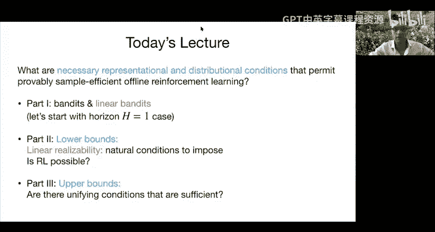

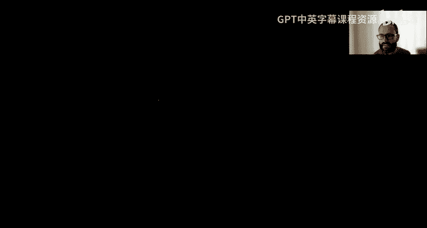

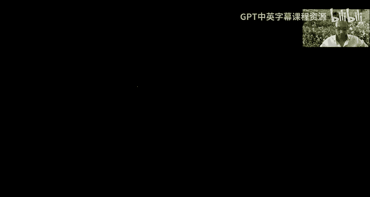

## 监督学习中的泛化回顾

在深入探讨强化学习的泛化之前，让我们先快速回顾一下监督学习中的泛化是如何思考的。

监督学习在最基本的设定中，是独立同分布监督学习设定。这意味着如果你有一个假设类（分类器、回归器等），在不可知论意义上，有可能找到与该类中最佳者相差 `ε` 的东西，且对假设类的复杂度依赖很温和。这就是所谓的 Azuma-Hoeffding 界，有时人们在学习理论中称之为这个。

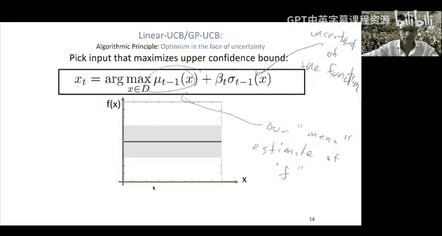

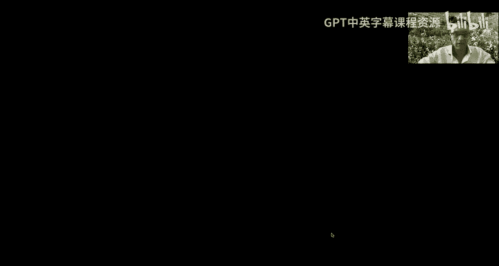

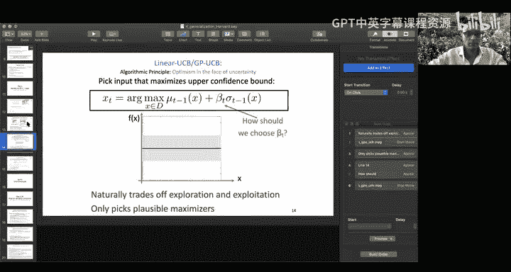

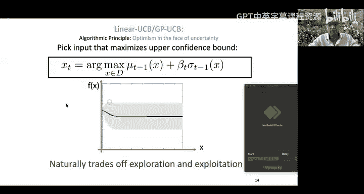

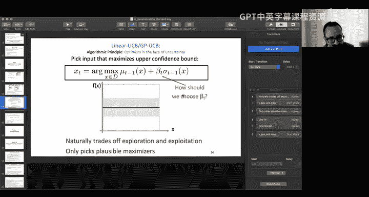

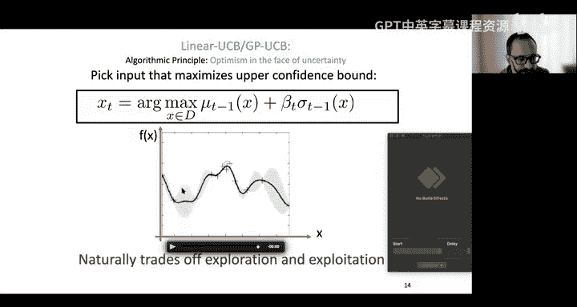

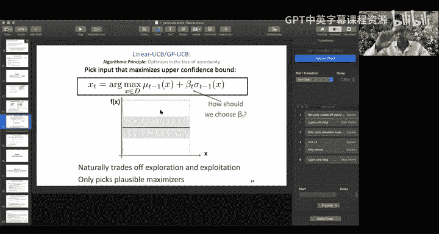

基本上，如果我们想要类中 `ε` 最优，我们只对数依赖于类的大小。为什么这很重要？因为这意味着你可以在数据上尝试很多东西，看看哪个是最好的或 `ε` 最优的。然后，基于更精细的复杂度概念（如 VC 维）有各种改进。在线性回归中，我们通常有依赖于维度的样本量，而不是基数的对数，但它们基本上是类似的。即使在深度学习中，我们也在理解算法如何决定我们的复杂度控制方面取得了很大进展。

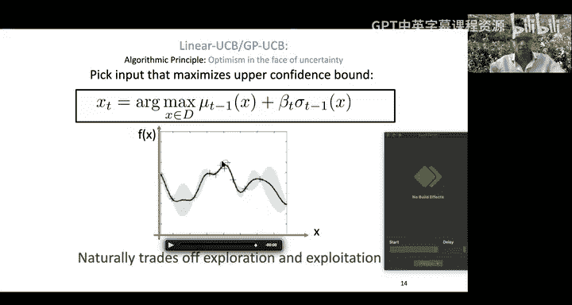

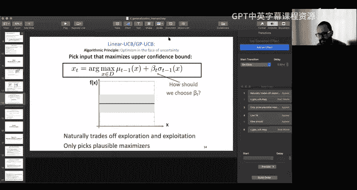

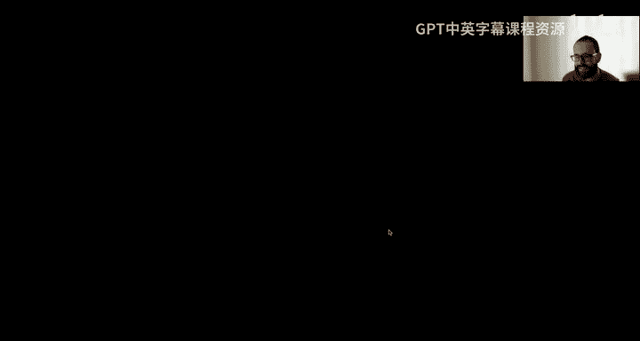

当然，深度学习中还有许多开放性问题，但我们在监督学习中确实对正在发生的事情有相当好的理解，它似乎有效。

这里的关键思想是数据重用。当你得到一个训练集时，你可以同时评估我们类中每个假设的损失。这是监督学习的关键方面。对于任何假设类，你都可以评估你在这个固定数据集上的表现。

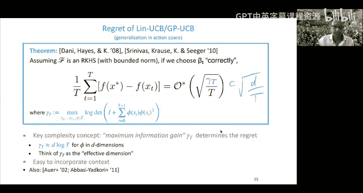

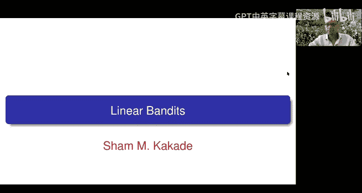

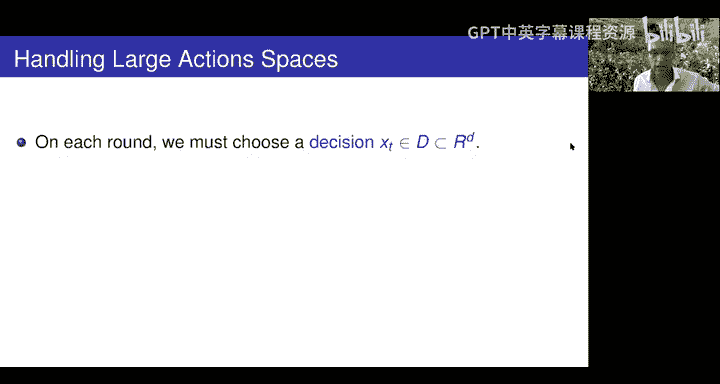

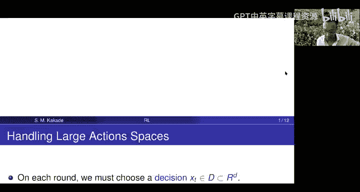

## 强化学习中的泛化挑战

现在让我们转向强化学习，为什么强化学习设定不同？我们没有这个独立同分布的训练集。那么，从过去看到的数据中借用信息来评估新策略意味着什么？也许你可以根据过去看到的数据来评估这个新策略。

让我们从简单开始，实际上看看强化学习问题，即使是在这个简单的表格情况下，我们甚至不需要担心泛化。也许让人们理解这一点很好，基本上，原则上，在强化学习中，如果状态空间足够小，你可以观察到所有东西，那么它就不是关于泛化的。

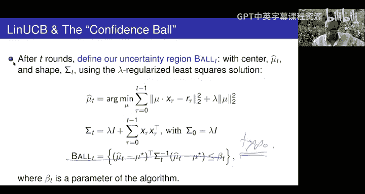

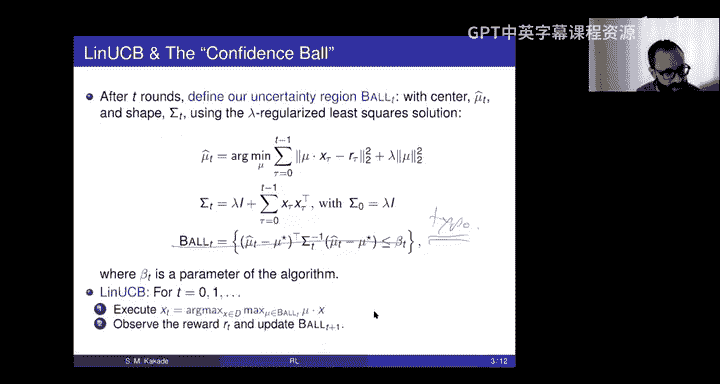

但在有趣的现实世界应用中，你永远不会观察到所有东西，然后你就有了泛化问题，而且你是在比监督学习更复杂的设定中遇到它，因为你的动作有后果。当然，在真实系统中，动作的后果涉及安全性或鲁棒性等各种其他因素。

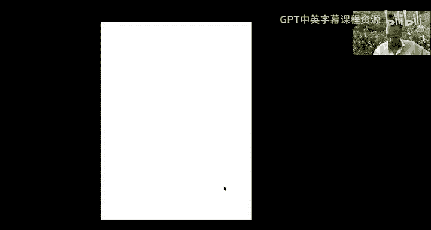

让我们看看这个例子。这里，世界的状态只是这 25 个位置，也许是 21 个，因为这些墙不是可行的状态。如果你设法访问所有状态并尝试那里的所有动作，你基本上就了解了世界。这可能是一个随机情况，但这是一个没有泛化的情况。

但即使在这种情况下，如果你只是随机驱动你的系统，假设有四个动作，你没问题，你了解了世界。但很容易修改一个设定，如果你随机驱动你的系统，需要指数时间才能到达目标状态。比如，假设你有五个动作都向左，一个向右，那么如果你随机驱动你的系统，实际上需要指数时间来探索世界。所以，即使在这个状态数很少的简单情况下，如果你与世界交互，实际上如何找到一个好的策略并不明显，因为如果你随机驱动，你可能不会发现足够多的东西。

在这个设定中，状态和动作的数量很少。假设我们的 MDP 是未知的。

我想提到的第一个结果，只是为舞台奠定基础，是 Michael Kearns 和 Satinder Singh 很久以前的一个真正了不起的结果，称为 E³ 算法。这是第一个多项式时间结果，如果你不知道 MDP，你实际上可以在样本数量上找到一个 `ε` 最优策略，该样本数量在状态数、动作数、时间范围 `H` 和 `1/ε` 上是多项式的。你不能通过随机行动来实现这一点。你实际上是给自己一个奖励，并计划去探索。

会发生的是，当你继续随机行动时，你会发现状态空间的某些部分，然后你会计划逃离它。这就是乐观主义的思想：你给自己一个奖励，试图逃离你知道的区域。既然你知道世界模型在这个空间的某些部分，你可以在那里准确地计划。这给出了一个多项式时间算法。

从那时起，实际上有大量的工作，既改进了速率，也研究了极小极大最优性。实际上，在概率分析方面，获得非渐近最优可能刚刚得到解决。如果你真的关心多项式因子，这些分析非常微妙，因为随机过程中的依赖性。然后，还有另一个有趣的结果表明，如果你随机行动，Q-learning 将遭受同样的问题，但如果你加上一个奖励，你可以让它工作。这里需要强调的第一个结果是 Jin 等人的结果，它实际上展示了如何将乐观主义与 Q-learning 结合起来并使其工作。Jane 最近的这个结果获得了最优速率，但这些思想基本上已经存在于 Jin 等人早期的结果中。

所以，即使在表格情况下，问题已经具有挑战性。

## 强化学习的目标定义

上一节我们讨论了强化学习中的挑战和早期算法，本节中我们来看看如何准确定义强化学习的目标。

有一个关于 San 的问题。实际上，这是一个好问题。我们到底在学习什么，是 `ε` 接近最优吗？这意味着基本上在之后，我们会得到一个最终奖励，最多相差 `ε` 吗？好的，这是一个好问题。

某种程度上，那里有两个概念：一个是遗憾，即你的累积奖励将接近真实值；另一个是更简单的保证，目标是找到一个策略 `π`，使得 `V^π(s_0, H)` 大于 `V^*(s_0, H) - ε`，因为 `V^*` 是所有策略中的最大值。所以，它只是从初始状态开始，与最优策略相差 `ε` 的东西。如果你在重置，你可能关心遗憾，即累积奖励，但直到多项式因子，这些是相同的，因为如果在短时间内我能找到 `ε` 接近最优的东西，那么我就可以长时间玩那个策略。

我们有很多不同的概念，但至少在最后，让我们坚持最简单的版本。我认为很清楚。

所以，我理解目标：假设类是可以学习的策略，你试图学习任何策略，其累积奖励在 `ε` 范围内接近最优策略。好的，很好。

你的问题实际上是关于假设类是什么，以及当我们有某种假设类时，我们如何思考 `ε` 最优性？是价值类还是策略类？基本上正确吗？

好的，这就是我对这个问题的解释。注意，在这种情况下，这里还没有讨论假设类，因为 `V^*` 是真正最优的。我说过，状态数很少。所以，这里有一种真正最优的行动方式，这种方式可能是这样的。可能有多个好的策略，但如果系统中没有噪声，那将是好的，但可能有移动成本，或者你可能需要去这里加油或其他什么，可能有其他类型的成本。但在这一页幻灯片中，绝对没有泛化，所以我们不需要假设类或类。你可以认为我们希望在从状态到动作的所有可能映射的空间中是最优的。

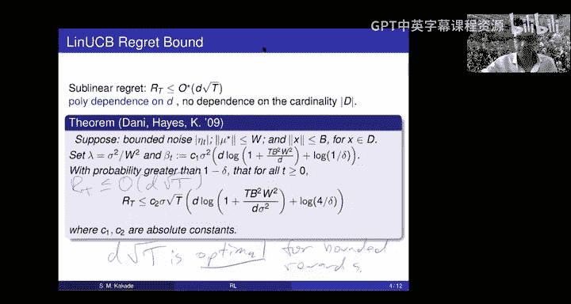

## 泛化问题的设定

现在让我们建立这个关于泛化的问题。主要观点是，即使弄清楚如何做到这一点也很微妙，因为世界是未知的。如果它是已知的，我们只需要做经典的动态规划。但这里的棘手之处在于，我们试图在一个未知的世界中表现得最优。

我们将基本上问一个与你的问题相关的问题：是否存在一种意义，我们可以找到一种方法，在某种意义上找到一个 `ε` 最优策略，而不依赖于状态数？比如，看看围棋游戏。这些是我们在机器学习中想要解决的问题。我们想在大问题上使用这些技术。

现在让我们问一个类似的问题：在强化学习中，有没有某种方法可以重用我们的数据来估计某个策略类或价值类中所有策略的所有价值？现在我们假设我们有一个参数化的策略类或价值类。我们能在那个类中做到 `ε` 最优吗？也许考虑一个策略集合。我们能找到某个策略类中的 `ε` 最优策略吗？我们能否以一种不依赖于状态数的方式做到这一点？

如果你考虑一下，我们需要以某种方式重新利用数据，所以最天真的方法是：让我们实际收集一个数据集。我们如何收集数据集？一个非常天真的做法是：让我们只是随机行动 `H` 步。所以，在片段的开始，随机行动，重复，随机行动重复，我们用随机 rollout 收集大量数据。

为什么这有点合理？因为通过重要性采样，这允许数据重用，因为现在对于类中的每个函数 `F`，我们可以评估它作为一个策略有多好。因为偶然地，你会同意策略，你会同意这个数据集中的某个路径。当然，问题是，这种一致的概率大约是 `1/(动作数)^H`。

所以，这是第一种我们可以泛化的算法，在某种意义上，我们只对数依赖于假设类中的假设数，但这里的缺点是我们依赖于时间范围 `H` 的指数级的东西。因为你随机行动，我们试图进行数据重用，所以这是根本性的。

至少我们已经表明这是可能的：我们可以得到一些不依赖于 `S` 的东西，并且在类中是最优的。通过同样的道理，就像在监督学习中一样，你可以用策略类的一些复杂度依赖（如 VC 维）来替换 `log |F|`，如果只有两个动作，这就像通常的复杂度。

但这里的根本问题是，我不打算不同意这是作弊，但我们可以问：这是根本性的吗？现在我想回到 Boaz 的观点，即这种 `A^H` 依赖在某种意义上是根本性的。

为什么它是根本性的？考虑两个动作的情况。考虑 `A=2` 的情况。考虑一个二叉树。在你的策略类中，一个节点的奖励是所有可能的确定性策略，你有 `2^H` 个策略。除非你全部尝试，否则你不可能发现奖励的叶节点。

所以，如果你想在类中做到最优，你无法击败 `A^H`。对于不可知论学习，你可以得到 `log |F|` 和 `A^H`，但那个 `A^H` 对于不可知论学习是根本性的。

这只是为我们如何思考问题奠定了基础，我们立即看到了在处理假设类和进行不可知论学习时的一个障碍。

## 线性赌博机

上一节我们看到了强化学习中泛化的根本障碍，本节中我们从更简单的设定开始，看看在什么假设下可以取得进展。

让我们从线性赌博机开始，因为为什么不从 `H=1` 的情况开始呢？所以，让我们从赌博机和线性赌博机开始，因为当时间范围 `H=1` 时，它仍然是一个交互式学习问题，但每一步都会重置。然后我们将转向更一般的情况。一旦我们理解了 `H=1` 的情况，我们就可以让事情变得更难。

现在我们将转向更一般的 `H` 情况，我们开始研究下界，试图了解什么是可能的，然后在此基础上，我们将尝试看看哪种假设风格是充分的。

我想指出的是，在强化学习领域，大约在过去五年左右，确实取得了巨大的进展。实际上，今天我认为我将涵盖我基本上视为两个相当重大的突破性结果，即使在去年，我也将这个下界视为强化学习理论和机器学习理论的一个真正突破，因为它可能是我们尝试攻击强化学习的最自然的方式之一，我们已经解决了这个问题。我将勾勒一个简化版本的证明，但它确实在很大程度上帮助我们理解了为什么强化学习在函数逼近和泛化方面是困难的。

在我们到达那里之前，让我们从简单开始，看看 `H=1` 的线性赌博机。

线性赌博机模型由 Auer 等人提出。它广泛用于调度问题、广告等许多交互式学习设置中，当你有大量动作时。

让我们看看这个模型。在这个特定例子中，我们在时间 `t` 获得的奖励。所以，在时间 `t`，我们将选择某个决策 `x_t`，这可能是一个实数。奖励将是我们观察到的奖励，它将是函数值加上噪声。假设函数值在某些已知特征中是线性的。所以，如果我说某个特征映射，并且我们相信奖励在某些未知特征中是线性的。

在这个特定情况下，一个假设类可能是一组 `F`，它可能是一组线性映射，或者是某个范数球中的函数。现在我们可以说这里有什么好的策略，但请注意，我们已经对这个问题施加了结构性假设，希望这会更容易，因为如果它是低维的，或者也许有一些低 RKHS 复杂度，也许我们可以获得低遗憾。

让我们看一个特定的算法，稍后我会展示一张图片，但思想是面对不确定性的乐观主义。我解释一下我的意思。我们已经看到了过去的一堆点，我们查询了一些东西，可以将其视为函数均值的估计。这与我们对函数的不确定性有关。

我们想要尝试决策点 `x`，不仅仅是那些不确定的点，因为如果我们知道即使它不确定，它也不可能是最优的，我们可以忽略它。所以，我们将给我们的均值一个奖励，以尝试探索那些可能最优的东西。这就是面对不确定性的乐观主义思想。我认为一张图片或一个短视频会让这一点更清楚。

这个算法类确实给出了本质上最优的遗憾。

## 线性UCB算法

上一节我们介绍了线性赌博机模型和乐观思想，本节中我们来看看具体的线性UCB算法及其分析。

我们实际上是在有限维中工作。在之前的设定中，`x` 实际上是 `φ(x)`，是一个特征化版本，但假设当我们做出决策 `x` 时，期望奖励只是线性的。所以，有一些符号变化，`w^*` 是未知的权重向量。假设期望值在 `-1` 和 `1` 之间有界。

在一维设定中，即使我们选择 `x` 为一个标量值，我们也假设奖励是特征的线性函数。

我们将会有噪声。我们观察到的是 `r_t = w^*·x_t + 噪声`。我们选择 `x` 并得到一个带有噪声的值。如果没有噪声，这个问题很容易，因为我们只需要选择线性无关的 `x`，解线性系统，我们就知道 `w^*`，然后我们玩最优的。

但问题是我们观察到的是带有噪声的。我们在这里关心的是累积遗憾，即我们得到了多少，与 hindsight 下我们能做的最好的事情相比。所以 `x^*` 是最佳可能的决策。

现在让我们指定这个线性 UCB 算法。我们将使用权重向量 `μ_hat` 的估计，这是我们根据过去数据的最佳猜测，我们将使用回归，所以我们将使用一些正则化最小二乘回归，我们看到一堆数据，函数的最佳猜测等价于指定权重的最佳猜测。所以，那就是我们的 `μ_hat`。

我们将定义 `Σ_t` 基本上是我们玩过的点的协方差矩阵的设计矩阵。如果你考虑一下，这告诉了我们一些关于不确定性的信息，因为如果它在某个方向上变大，这意味着我们玩了主要指向那个方向的 `x`，我们应该对该方向上的函数有很好的了解。

所以 `Σ_t`，如果你考虑一下，将决定我们认为我们在某个方向上对 `μ_hat` 的了解有多准确。这正是灰色区域将要指定的。

我们正在考虑整个函数的不确定性，因为现在我们的不确定性是关于 `μ_hat` 的。我们知道 `μ_hat` 接近真实值，基于我们玩过的设计矩阵的形状和一些统计常数。

注意逐点的，这将意味着我们关心的是 `μ_hat_t·x - μ^*·x`，因为当我们决定玩 `x` 时，我们关心的是我们认为的 `x` 值与其真实值有多不同。

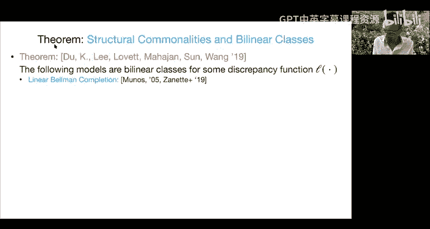

所以我们有函数 `μ^*` 的不确定性区域，这意味着在每个点上的不确定性，这产生了图片中不同的条带。

算法只是乐观主义。我们知道 `μ` 在这个集合中，所以基本上这个集合 `B_t` 就是你之前做的灰色区域。它是满足这个条件的 `μ` 的集合。它正是灰色区域，但我们将其转化为逐点的灰色区域，因为对于每个 `x`，我们检查该 `x` 的不确定性区域，并选择可能给我们最多价值的 `x`。直觉是，如果我们正确，很好，我们得到了最优值；如果我们不正确，我们学到了一些东西，我们应该能够缩小我们在那个点的不确定性。

这是一个思想，我们显然也想扩展到强化学习。它给了我们一种方式：要么我们学到一些东西，要么我们做得很好，希望我们能学得足够快以做得好。

所以我们的遗憾界基本上是，如果你正确设置参数，遗憾界是 `O(d√T)`。所以大致来说，如果你玩了大约 `d^2` 步，你将会开始做得好。因为这是一个有噪声的问题，这就是为什么我们必须多次玩东西。

这个分析实际上是一个极小极大最优速率。所以，如果我们只假设函数值有界，那么最优遗憾在维度上线性，乘以 `√T`。所以基本上在 `O(d^2)` 步数之后，它开始看起来我们接近最优值。这就是遗憾的陈述，我们除以 `T` 得到平均遗憾。

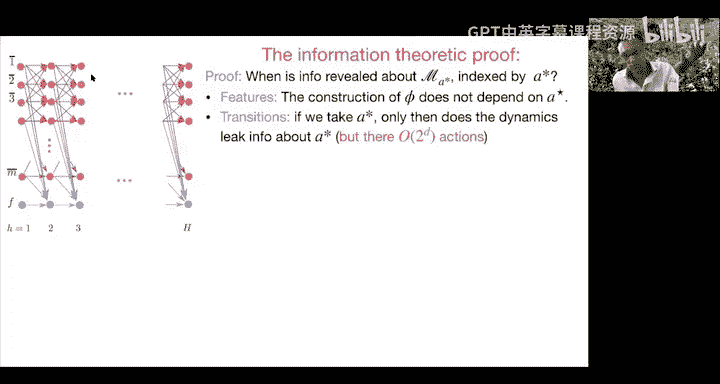

## 线性UCB算法证明概要

我将简要勾勒证明，因为它实际上与后面相关。

证明真的只有两部分：第一部分是，我们需要一些置信度分析，表明 `μ^*` 总是以高概率生活在这个球中。这实际上确实需要一些新的概率分析工具，基本上像自归一化鞅分析。

另一部分我们想展示的是，假设置信度声明成立，即 `μ^*` 总是生活在区域 `B_t` 中。那么我们想展示的是，`β