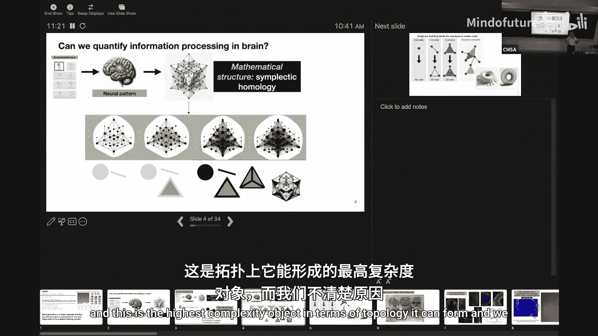
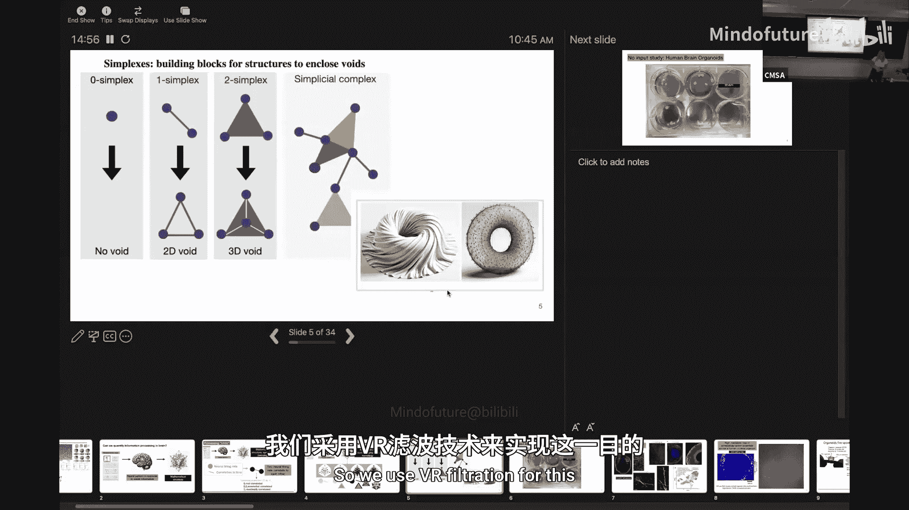
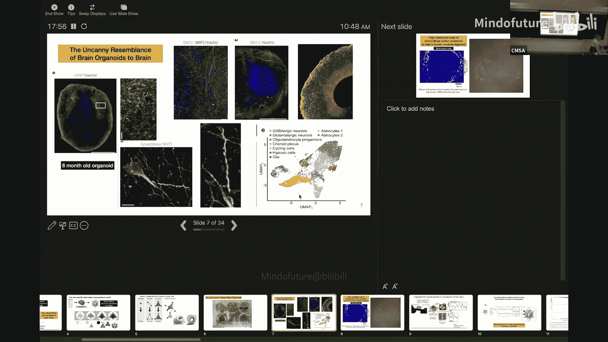

# 006：脑类器官的拓扑与网络分析

在本节课中，我们将学习如何将拓扑学（特别是持续同调）和网络分析方法应用于脑类器官的研究。脑类器官是实验室培养的微型脑组织，可作为研究大脑功能和计算原理的简化模型。我们将探讨如何从这些系统的神经活动中提取数学结构，并分析其拓扑复杂性和网络特征。


## 概述



研究始于一个核心问题：大脑如何处理信息？一种理论认为，大脑在一个高维流形中处理信息。我们的目标是探索这种高维结构，并测试在人工智能模型中是否也存在类似的结构。我们使用脑类器官作为研究真实大脑的简化模型，应用持续同调来分析其神经活动在时间域中形成的拓扑结构。

## 数据与分析方法



上一节我们介绍了研究动机，本节中我们来看看具体的数据来源和分析流程。

我们使用微电极阵列记录脑类器官中神经元的放电活动。每个电极记录到的信号经过尖峰排序算法处理，以区分真实的神经元信号和噪声，最终得到一个二进制的尖峰序列矩阵。




为了分析神经元之间的相关性，我们首先对尖峰序列应用高斯平滑核（宽度为50毫秒），以模拟突触传递的时间并便于计算交叉相关性。然后，我们计算所有神经元对之间的交叉相关性，得到一个全对全的相关性矩阵。


以下是构建相关性图的核心步骤代码描述：
```python
# 伪代码：构建相关性图
spike_matrix = load_spike_data() # 加载尖峰序列矩阵
smoothed_matrix = gaussian_smooth(spike_matrix, window=50ms) # 高斯平滑
correlation_matrix = cross_correlation(smoothed_matrix) # 计算交叉相关性
graph = construct_graph_from_correlation(correlation_matrix, threshold=50th_percentile) # 根据相关性阈值构建图
```

从这个相关性矩阵出发，我们可以构建一个图，其中节点是神经元，边的权重是它们之间的相关性强度。这个图是后续网络分析和拓扑分析的基础。

## 拓扑分析：寻找“形状”

在构建了神经活动的图表示之后，我们接下来使用持续同调来研究其拓扑结构。

我们使用 **Vietoris-Rips** 过滤方法来研究这个未知空间。此方法通过逐渐改变连接节点的相关性阈值（即“距离”参数），来观察不同尺度的拓扑特征（如连通分量、环、空洞）如何产生和消失。

分析的核心输出是持续同调图或持续图，它展示了拓扑特征（如同调群的生成元）随着相关性阈值变化的“出生”和“死亡”过程。拓扑复杂性可以通过存在的最高阶同调群来量化。

在我们的初步分析中，脑类器官并未显示出像完整大脑研究中那样明确的拓扑结构（如环面）。最高仅观察到第二同调群，其活动形成的拓扑结构类似于一个球面。

## 网络特征分析

尽管没有发现明确的全局几何形状，我们仍然可以通过分析网络特征来获取信息。以下是几个关键的网络度量指标及其含义：

*   **节点强度分布**：衡量每个神经元与其他神经元连接的总强度。我们发现，与随机对照模型相比，脑类器官中有更多具有高强度连接的“枢纽”节点，表明存在更强的放电同步性。
*   **聚类系数分布**：衡量网络的局部紧密连接程度。脑类器官显示出中到高的聚类系数，表明神经元倾向于与邻近神经元形成紧密连接的群体，这有利于稳健的信号传播。
*   **加权路径长度分布**：衡量网络中信息传播的效率。我们发现数据中存在两个重叠的长度尺度，这可能暗示了网络中存在**社区结构**，即内部连接紧密、彼此间连接稀疏的神经元群组。

## 对照模型与稳健性检验

为了确认我们观察到的特征具有统计显著性，而不仅仅是随机噪声，我们引入了两种对照模型：

1.  **约束随机化模型**：通过打乱尖峰序列矩阵中的数据，保持每个神经元的放电总数和每个时间仓的放电总数不变，从而破坏时间相关性但保留基本的统计特性。
2.  **集成自举模型**：从所有脑类器官的神经元尖峰序列中随机抽取，构建一个数据集。这个模型模拟了物理和功能上独立、互不连接的神经元集合。

此外，我们还进行了稳健性检验，通过随机移除或针对性移除参与重要拓扑特征（如H1环）的节点，来测试网络结构的鲁棒性。结果显示，针对性移除会迅速破坏拓扑复杂性，而随机移除的影响则较小。

## 研究局限与未来方向

我们的研究存在一些局限性：
*   **数据规模**：仅分析了少量（4个人类，9个小鼠）脑类器官的数据，统计效力有限。
*   **测量技术**：使用的是二维切片记录，可能无法捕获完整的三维网络结构。电极接触和信号噪声也是挑战。
*   **参数选择**：高斯平滑窗口、滞后时间、构图阈值等参数的选择会影响结果，需要进一步优化和验证。
*   **对照模型**：需要确保对照模型能准确反映随机背景，避免引入偏差。

未来的工作方向包括：
*   与其它实验室合作，分析患有早衰症、阿尔茨海默症等疾病的突变脑类器官，寻找其网络特征的差异。
*   分析拥有完全连接组图谱的简单生物模型（如秀丽隐杆线虫），以了解在完整记录下的网络特征极限。
*   探索更多网络度量指标，以更全面地刻画这些系统。

## 总结


本节课中我们一起学习了如何将拓扑和网络分析应用于脑类器官研究。虽然在这些简化模型中未发现如完整大脑中报道的明确几何形状（如环面），但我们通过节点强度、聚类系数和路径长度等网络特征，发现了它们具有超过随机网络的更高阶组织迹象。这些迹象表明，即使在这种简单的系统中，神经元也以优化信号传播效率的方式连接。这项研究为理解生物神经网络的基本组织原则提供了工具和初步见解，未来或能为人工智能的架构设计带来启发。