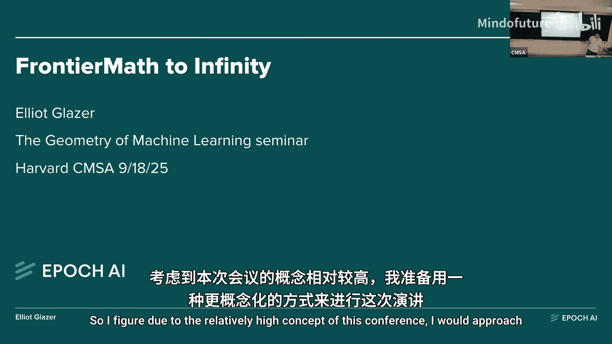
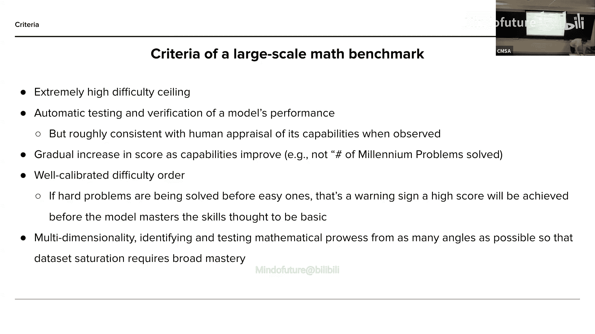
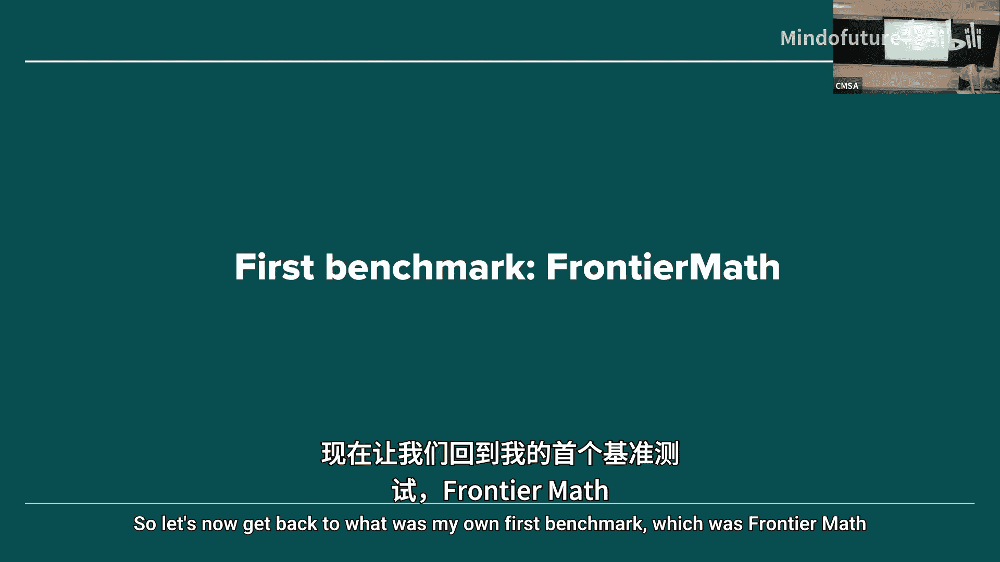
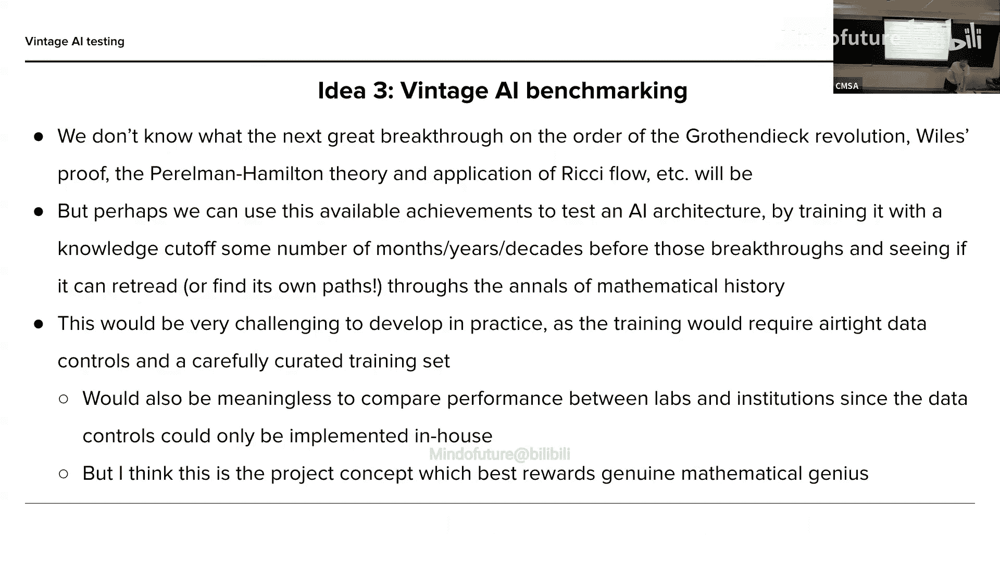

# 008：前沿数学基准测试

在本节课中，我们将探讨如何构建一个能够有效衡量人工智能数学能力的基准测试。我们将以“前沿数学”项目为例，分析其设计理念、评估方法、当前模型的性能表现，并展望未来可能的发展方向。

## 思想实验：最优数学智能

上一节我们介绍了构建数学基准测试的背景。本节中，我们来看看一个核心的思想实验。

假设我们有一个固定的存储空间，例如1PB，这远大于任何现有模型。在这个空间内，所有可能的比特组合构成了一个有限的计算机程序集合。我们的目标是：在这些程序中，找出那个在给定时间和计算资源下，能够最好地解决当今最重要数学问题的程序。

这个最优的数学智能体会是什么样子？它可能是一个大型语言模型，一个形式化证明器，一个基于能量的模型，还是更接近人类——例如，模拟历史上最伟大的数学家们协同工作？我的猜测是，我们目前对此一无所知，它的构建将涉及许多我们尚未触及的突破。但一个指导我工作的信念是：它终将被构建出来，我们将无限接近数学推理的最优架构。

然而，数学智能可能不是一维的。一个实体可能在某一个数学子领域非常出色，而在另一个领域表现不佳。要深入数学，可能需要专业化。因此，“最佳数学智能”本身可能就是一个有问题的概念。

## 量化与测量数学能力

上一节我们提出了一个理想目标。本节中我们来看看如何将其转化为可操作的测量标准。

我们首先需要一种合理的方法来量化和测量数学能力，尤其是在超越了中小学考试水平之后。专业数学研究本身没有评分等级。虽然我们可以粗略地将目标定义为“高效解决当今最著名的数学问题”，但我们不能直接在真空中优化这个目标。这就像莱特兄弟时代用“成功飞行次数”来衡量航空进步一样，在问题被解决之前，这个指标将长期为零，无法提供短期内的进展信号。

因此，我们需要比现有任何指标都复杂得多的度量标准。当我思考如何构建基准测试时，我的首要目标不是挑战今天的模型，也不在乎它是否对当前模型合理或是否会在明年被“饱和”。我希望的是，当这个基准最终被解决时，它能够证明机器在数学能力上取得了实质性进展。

以下是定义一个好的大规模数学基准的一些模糊标准：

*   **极高的难度上限**：它不应只是一堆测试标准知识的问题。我们寻找的是能够产生大量原创发现的实体。
*   **自动测试**：必须有一种无需人类逐步评分即可验证模型在数学问题上表现的方法。这对于训练和公开评估都至关重要。
*   **结果有意义**：我们不希望指标变得做作，完全偏离数学家真正关心的事情。当基准分数大幅跃升时，人类数学家审视结果时，应能认可这是优秀的工作。
*   **分数随能力渐进增长**：我们不希望像“解决的千禧年难题数量”这样的指标，它会长期卡在零，无法提供短期信号。
*   **难度校准良好**：基准通常包含从易到难的一系列问题。如果难题在简单题之前被解决，可能表明难度设定过于依赖人类理解，而非模型实际获取技能的难度。
*   **多维评估**：优秀的数学能力可能不是单一的0到100分。现实中存在多种数学推理类型（例如理论构建者与问题解决者，不同子领域的技巧）。因此，同时分析多个指标，并可能以某种方式汇总以给出总体进展的粗略分数，是有意义的。

## 前沿数学基准测试概述

上一节我们讨论了理想基准的标准。本节中，我们来具体看看“前沿数学”这个实际项目。

“前沿数学”是一个包含350个问题的基准测试，由Epoch AI与非营利研究组织Open AI在过去一年中合作开发。当我的组织最初提出这个项目并展示试点时，问题比最终版本简单得多。转向开发一个困难得多的项目，部分原因是Open AI警告：如果问题保持原有难度，可能在项目完成前就被模型“饱和”了。这个警告促使团队将目标校准为制作真正困难、甚至超出近期模型能力范围的问题。

以下是该基准测试中一个题目的示例结构：

*   **形式**：每个题目都是一个数学问题，使用自然语言描述，均为原创，无法在教科书中找到。
*   **答案类型**：通常要求一个闭式值，多为整数，有时是符号实数，偶尔是更定制化的输入，旨在测试特定的组合结构。
*   **不要求证明**：由于是自然语言基准且需要自动验证，要求提供证明是不可行的。因此，这些问题的设计使得其答案（如大整数或实数）难以猜测，模型必须真正理解底层数学才能得出。
*   **验证方式**：对于整数答案，检查是否与作者提供的答案一致。对于更复杂的答案，则通过程序计算或近似函数来验证。我们考虑了输入性质的相对约束，但有些问题会稍有变化，例如某些丢番图方程问题可能有多解，验证脚本会检查提供的整数是否满足方程。

题目由大约100名数学家（主要是研究生及以上）编写。初始数据集包含300个问题，粗略分为三个难度层级：

*   **第一级**：旨在测试刚好超出或达到我们预期模型能力范围的问题，主要是国际数学奥林匹克风格的问题和高级本科练习题。
*   **第二级**：通常是研究生课程水平的问题，涉及数学家深入研究中才会接触到的知识和思想。
*   **第三级**：粗略定义为探索性研究项目级别，类似于导师给博士生入门的小型原创性论证问题。

## 性能评估与扩展

上一节我们介绍了基准的结构。本节中，我们来看看模型在其上的表现以及我们的应对措施。

模型在这些层级上的进展比我们预期的要快。第一个重大冲击发生在去年12月，Open AI宣布其模型（在内部大量脚手架支持下）在基准测试中获得了25%的分数。当时我们认为这一成绩至少需要一两年后才能达到。如今，GPT-4o等模型也在我们的评估中公开达到了类似的分数。

超过一半的数据集问题（包括所有层级）至少被某个模型在某个评估中解决过一次。具体来说，约88%的第一级问题、约30%的第二级问题和约20%的第三级问题已被解决。这让我们意识到，我们很难提前准确预测模型能做什么。

因此，我们决定开发第四级问题——150个极其困难的问题，全部由研究数学家编写。这些数学家因项目获得了模型访问权限，并进行了实验，以了解模型的能力边界。今年五月，我们举办了一场研讨会，约30名数学家用一个周末的时间提出、编写问题，并相互测试，最终整合出了这个更困难的数据集。

第四级问题的一个示例如下（由分析师Pa Vi提供）：
> 该问题涉及将一个研究项目推广到不连续情况，其答案是一个符号实数C。验证方式是：对答案字符串施加合理的字符限制，然后要求其数值近似达到远超过字符限制所能允许的精度位数。这样设计的目的是，防止模型仅通过高精度数值逼近来“暴力”解题，迫使其必须找到正确的符号表达式。

在我们对第四级问题的初始评估中，最高性能是04-mini模型解决了3/50的问题。有趣的是，其中一个被解决的问题，被我们的评委认为是数学上最深刻、最可能抵抗AI多年的问题。然而，模型并没有遵循作者设想的推理路径，而是通过改变问题形式（从一个延迟问题变为一个恢复问题）并利用一些微妙的巧合得到了相同答案，这实际上使问题变得更容易。

截至目前，最佳成绩是GPT-4o-high模型解决了4/50的问题。在所有评估运行中，总计有9个第四级问题至少被解决过一次。来自GPT-4o、GPT-4o-mini和Gemini 2.5 Pro的多次成功，展示了远超我们预期的数学能力，并且其解决策略与作者设想的方法大致吻合。

## 当前模型的能力与局限

上一节我们看到了模型在一些难题上的突破。本节中，我们综合评估一下当前模型在数学上的整体能力与主要缺陷。

将所有这些信息汇总，根据我们在评估中的观察，当前模型能做什么，不能做什么？

**模型表现出的优势：**
*   **熟练驾驭文献**：能力强的模型在导航数学文献方面表现出色。即使在离线评估中，由于它们记忆了大量知识，也几乎相当于在线搜索。
*   **准严谨推理**：它们能够应用定理，并进行一种“准严谨”的推理。它们有时能意识到自己在进行合法的数学推导，甚至会自我检查，发现矛盾并修正错误。

**模型存在的明显局限：**
1.  **缺乏视觉直觉**：任何需要人类通过视觉或几何方式思考、而非基于明显公式进行文字推理的问题，对模型来说都是巨大的挑战。在第四级问题中，几何学/拓扑学部分的问题尚未被解决；在原始数据集中，也只有少数几何问题被解决。
2.  **推理前沿参差不齐**：模型可以解决一些涉及未发表分析技术的高深问题（需要真正的泛化能力），却无法解决一些基于巧妙视觉现象的简单平面几何问题。数学能力的前沿目前非常“锯齿状”。
3.  **缺乏探索驱动力与研究品味**：模型没有动力去探索与当前任务目标不直接相关的想法，也缺乏研究品味。即使在解决难题时，它们也只是在玩“从我已知的概念中找出最相关的一个来尝试”的游戏。虽然数学家日常也做大量类似工作，但要达到真正的超人类能力，仅靠这些是不够的。模型需要能够因为感知到某些结构最具信息量或最令人好奇，而自发、高效地发展自己的数学知识体系。

## 反思与未来方向

上一节我们总结了当前模型的优缺点。本节中，我们根据之前提出的标准来反思“前沿数学”基准，并探讨未来的研究方向。

根据我之前列出的大规模数学基准标准，对“前沿数学”项目的评估如下：

*   **高难度上限**：这无疑是该项目的优势之一，超越了大多数现有数学基准。但其上限仍不足以宣称“掌握前沿数学即成为超人类数学家”。它终究只是解决专业人士提供的已知问题和玩具案例。
*   **自动测试与验证**：这是其设计的根本，表现良好。
*   **分数渐进增长**：可以接受。除了Gemini 2.5 Pro和GPT-4o等推理架构模型带来的巨大跳跃外，此后性能进展更为平滑。
*   **难度校准良好**：并未完全达到。正如仍有多道第一级问题未被解决，而一些第四级问题被高估了难度。
*   **多维评估**：该项目涵盖了数学的主要领域，做得不错。但由于我们事先并不清楚需要测试的关键能力维度（例如，我们本应更直接地关注视觉推理成分），因此在组织上并非最优。

基于这些反思，以下是我考虑的一些自然后续项目方向：

1.  **开放问题管理基准**：在第四级之后，我们可能更希望直接测试模型解决我们真正关心答案的开放问题。
2.  **形式化数学基准测试**：“前沿数学”是非形式化的。由于当前数学库覆盖主题仍较稀疏，进行好的形式化基准测试较难。如果我要开始，可能会更关注**自动形式化测试**，即测试模型正确形式化数学论文陈述的能力，并通过验证其证明正确推论的能力来检查。
3.  **复古AI基准**：这个想法旨在真正测试AI取得天才级成就的能力。具体是：如果你声称某种架构是卓越的进步，那么就将其在有限数据集上重新训练，使其只具备截至某个时间点的知识，然后观察它在多大程度上能够重走我们祖先的步骤，甚至开辟不同的路径来获得我们今天拥有的知识。例如，模拟怀尔斯在解决费马大定理时所知的信息，或者模拟格罗滕迪克发明概形理论时的知识背景。

## 总结与问答环节

本节课中，我们一起探讨了构建前沿数学基准测试的挑战与设计思路。我们通过“前沿数学”项目实例，分析了如何设定高难度目标、实现自动验证、并多维度评估AI的数学能力。我们看到，当前最先进的模型已经在特定难题上展现出令人印象深刻的推理和文献应用能力，但在视觉直觉、自主探索和研究品味方面仍有显著不足。数学能力的前沿是参差不齐的。未来的发展可能需要新的架构和训练目标，以培养模型内在的探索驱动力和对数学结构本身的好奇心。

---
**（以下内容为演讲后问答环节的整理摘要）**

**关于基准访问与安全**：基准问题未完全公开，以防止解决方案在网络上传播导致基准失效。我们只对来自严肃实验室或有严肃数学研究证据的方运行评估，并需要严格的安全协议。

**关于训练数据泄露**：部分第四级问题基于数学家未发表的研究成果。如果这些成果的片段或思路以注释等形式存在于训练数据中（例如在arXiv源文件中），可能会影响问题的可解性。作者们声称他们的问题是“未发表”的，通常包括未在arXiv上正式发布。

**关于模型生成问题**：曾尝试让模型生成有趣的数学问题（例如涉及选择公理），但至今未得到令人印象深刻的结果。

**关于自对弈训练**：从AlphaGo/AlphaZero在棋盘游戏中的成功获得灵感。或许可以设计一个形式化的数学“竞技场”，让模型像16世纪意大利数学家那样相互挑战、设计问题，这可能适用于自对弈训练。

**关于计算资源分配**：分配给每个问题的计算资源（时间/令牌数）在第四级稍高，但主要基于预算合理性。目前分配的额度足够高，我们认为模型性能不受算力限制，且模型很少用尽所有令牌。

**关于工具使用**：模型最常用的是Python，其次是Sage。如果允许网络搜索，模型会表现得非常机敏，例如找到可用的计算机代数系统或已实现特定算法的代码库来解决问题。

**对未来AI研究的启示**：基于观察，有两个相对容易实现且可能带来改进的方向：
    1.  **增强放弃无效路径的能力**：模型如果起步不好，往往会困在错误的思路上。它们需要更好地识别并彻底重启对问题的思考。
    2.  **培养内在优化指标**：要让模型达到顶尖人类的水平，它们需要有一种内在的度量标准来优化数学工作，而不仅仅是解决眼前的任务。它们需要被训练得能够因为某些方向“富有成果”而去探索，即使这些方向与指定的最终问题不直接相关。这是实现类人研究行为的关键。