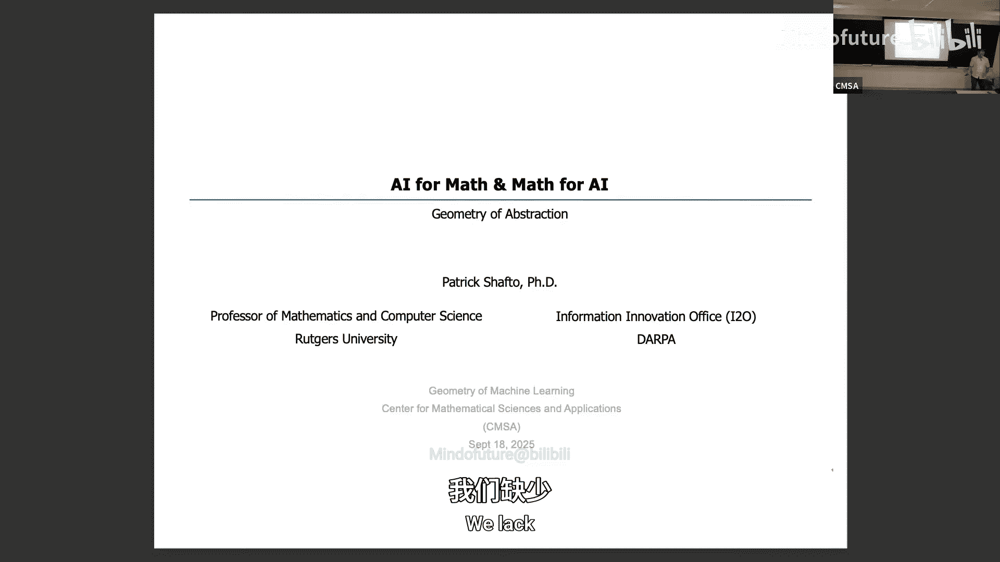
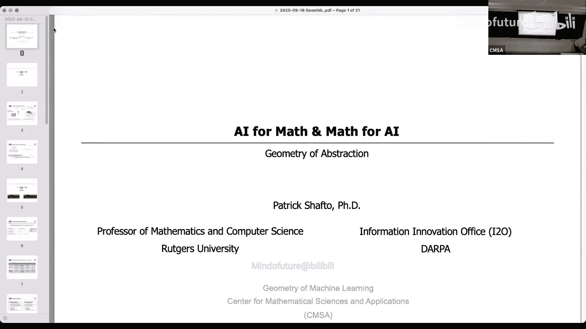
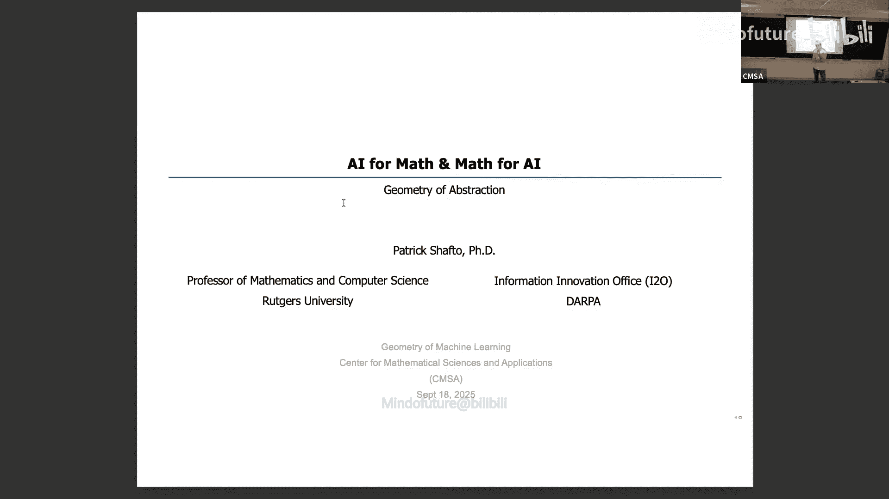

# 009：几何视角下的抽象与评估

在本节课中，我们将探讨人工智能与数学之间的双向关系。我们将从几何直觉出发，理解现代AI系统中的抽象概念，并介绍两个旨在为AI评估建立数学基础以及利用AI加速数学研究的项目。

## 抽象：连接AI与数学的统一主题

上一节我们介绍了课程的主题，本节中我们来看看其核心思想。无论是AI还是数学，其背后都贯穿着一个统一的主题：**抽象**。

在AI领域，我们希望系统具有可预测性，这可以被视为一种抽象。我们期望模型在输入空间中的某些“稳定区域”内，对相似的查询能给出稳定且一致的输出。这种稳定性构成了模型所掌握的一种“抽象”能力。

在数学领域，抽象更是其本质。数学通过提出新的定义和定理来构建抽象概念，而证明过程中的引理（lemmas）则是连接具体推导与高层结论的关键抽象层。

因此，在这两个视角之间存在着天然的协同效应。理解AI如何在数学领域成功或失败，不仅能启发我们思考数学本身，也能告诉我们如何改进AI系统，以获得我们期望的、具有规律性的行为。

## AI的几何直觉：稳定区域与评估挑战

为了更具体地理解AI中的抽象，我们可以用一种简化的几何视角来看待现代AI系统。

我们可以将诸如语言模型之类的系统视为参数化函数：`输出 = 模型(输入)`。如果我们将其嵌入到一个极低维的空间中，可以形成一种直观的图像。

*   **X轴**：代表输入的不同维度或特征。
*   **Y轴**：代表模型的输出（例如，“是/否”的回答概率）。

在这个图像中，我们期望看到**稳定的行为区域**。在这些区域内，对输入的微小扰动不会导致输出的剧烈变化。这些稳定区域就对应着模型可靠掌握的“抽象”概念（例如，“狗”或“猫”的类别，或“统计学”相关的问题域）。

然而，问题在于这些稳定区域之间可能存在**尖锐的过渡边界**。在边界附近，输入的微小变化可能导致输出从一个稳定区域跳变到另一个，或者进入一个输出不确定的“不稳定区域”。

以下是这种几何结构带来的核心挑战：

*   **点评估的局限性**：当前评估AI系统的常见方法是提出具体问题并检查答案是否正确。这相当于只在输入空间中的单个点上进行测试。
*   **缺乏泛化保证**：一个点上的正确回答，并不能保证在其邻近点（即相似的问题）上也能正确回答。如果测试点恰好位于不稳定区域附近，其评估结果对于判断模型在实际任务中的表现几乎毫无意义。
*   **期望与现实的差距**：我们期望模型的稳定区域对应我们直观理解的抽象概念（如“可用于放射学”），但这并非必然。模型内部形成的抽象可能与人类的直觉不符。

一个真实的例子是询问语言模型“R.A. Fisher是一位伟人吗？”。如果围绕该问题，在输入中引入“统计学”相关的概念，模型会稳定地给出肯定回答。但如果引入“优生学”概念，模型可能会进入一个不稳定区域，答案变得不可预测。这表明，模型对同一个“事实”的理解高度依赖于上下文，且其“知识”的边界是尖锐和不连续的。

因此，当前AI评估的艺术状态存在根本性挑战：我们缺乏数学工具来描述和预测模型在输入空间中的行为，特别是其稳定区域的范围和边界。

## AIQ项目：为AI评估建立数学基础

基于上述挑战，我们启动了一个名为 **AIQ（人工通用智能资格认证）** 的项目。其核心目标是：**为AI评估建立数学基础**，从根本上解决泛化问题。

我们考虑三个层次的能力评估：

1.  **具体问题层**：针对单个输入-输出对。我们不仅想知道“是什么”（答案是否正确），还想知道“何时”（在输入周围的多大区域内答案保持正确）和“为何”（例如，是否满足Lipschitz连续性等数学约束）。这与当前主流的、只检查点答案的评估方式（如HELM基准）有本质不同。
2.  **问题类别层**：针对一类抽象问题（如“规划”、“代数几何”）。评估目标是判断模型是否具备解决该类问题的可靠能力。这不能通过简单地堆积具体问题来回答，而需要理解模型内部表示与这类抽象概念的对应关系。
3.  **架构层**：关注如何设计或理解模型结构，以便我们能更好地预测其行为。例如，能否从小规模模型的特性推断大规模模型的行为？

AIQ项目汇集了多个团队，采用不同的数学工具来攻克这些层次的问题。以下是几个例子：

*   **统计方法团队**：采用经典的统计理论，利用连续性边界或嵌入空间的性质来提升评估的严谨性。
*   **能力涌现理论团队**：基于“技能”在文本中的分布及其组合结构，理论化语言模型中复杂能力是如何随规模涌现的，从而理解模型能掌握哪些“问题类别”。
*   **缩放律预测团队**：研究模型结构，旨在无需进行大量参数扫描的情况下，从小规模模型的性能准确预测大规模模型的最优参数配置和性能。

该项目融合了从范畴论到经典线性代数与统计学的多种数学方法，旨在推动AI评估这一兼具深刻理论意义和紧迫实践需求领域的发展。

## Exponentiating Mathematics项目：利用AI加速数学研究

上一节我们讨论了如何用数学理解AI，本节我们将视角翻转，探讨如何用AI赋能数学。第二个项目 **Exponentiating Mathematics（指数化数学）** 的核心思想是：**如果能改进数学研究中的抽象层，就能极大地加速数学进展**。

数学研究本质上是一个构建抽象层的过程。一篇论文可以看作一个**有向图**：
*   **节点**：包括定义、引理、命题、定理等。
*   **边**：表示逻辑依赖关系（例如，定理A的证明依赖于引理B和定义C）。

数学家的工作流通常包含两个关键环节，它们都以这个抽象图为中心：

1.  **分解**：从一个目标定理出发，构思一个证明草图（即规划出关键的中间引理和步骤），将大问题分解为一系列更小、更易证明的子问题。
2.  **形式化**：将用自然语言描述的数学思想，转化为Lean等形式化验证语言中的代码，以便计算机严格检查证明的正确性。反之，将形式化代码翻译回易于理解的数学语言（非形式化）也同样重要。

目前，这两个环节都非常耗时且困难。AI有潜力在这两个环节提供助力：

*   **自动分解**：AI可以协助生成证明草图或提供证明思路。虽然当前结果好坏参半，但在领域专家的指导下，这可能成为强大的工具。
*   **自动（非）形式化**：AI可以帮助在自然语言数学描述和形式化代码之间进行转换。这面临巨大挑战，包括处理数学中灵活的命名约定、隐含的上下文信息以及“不可见的数学”（那些在论文中省略的常识性步骤）。

这个抽象图结构为渐进式地训练和评估数学AI提供了完美的路径。我们可以通过以下方式逐步增加任务难度：
1.  从简单的**自动形式化**开始（给定自然语言陈述，生成形式化代码）。
2.  逐渐**遮盖图中部分节点**的内容，让AI根据上下文进行补全。
3.  最终，挑战**自动分解**：只给出定义和最终定理，要求AI自动生成整个证明图（即所有中间引理及其逻辑结构）。

这条路径最终指向我们真正渴望的目标：让AI能够提出有意义的数学猜想（本质上就是一个有待填充证明图的定理陈述）。通过这种方式，我们可以构建生态效度更高的评估基准，推动AI向更强大的数学推理能力发展。

## 总结与展望

本节课中我们一起学习了AI与数学交叉领域的两个核心方向。

首先，我们从几何视角审视了AI，认识到模型行为在输入空间中存在稳定区域与尖锐边界，这导致了当前点评估方法的局限性。**AIQ项目**正致力于为此建立数学基础，从具体问题、问题类别到模型架构，层层深入，旨在实现可证明的泛化保证。

其次，我们探讨了数学研究本身的抽象图结构。**Exponentiating Mathematics项目**旨在利用AI加速数学研究中的两个关键环节——分解与形式化。通过利用数学证明固有的图结构，我们设计了一条从基础任务到高级数学推理的渐进式发展路径。

这两个项目体现了“AI for Math”和“Math for AI”的共生关系。一方面，数学为理解和规范AI系统提供了严格的框架与语言；另一方面，AI为数学研究这个人类智慧的结晶领域带来了革命性加速的潜能。它们共同围绕“抽象”这一核心概念，推动着两个领域向更深刻、更可靠的方向发展。