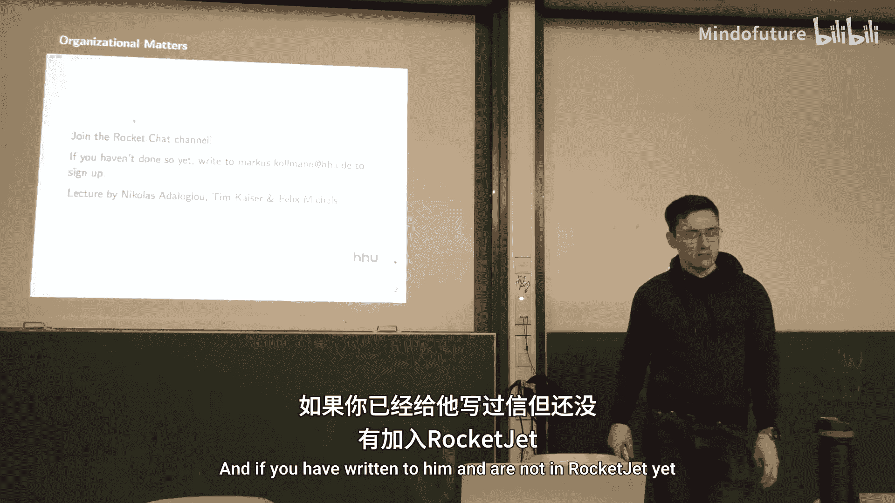
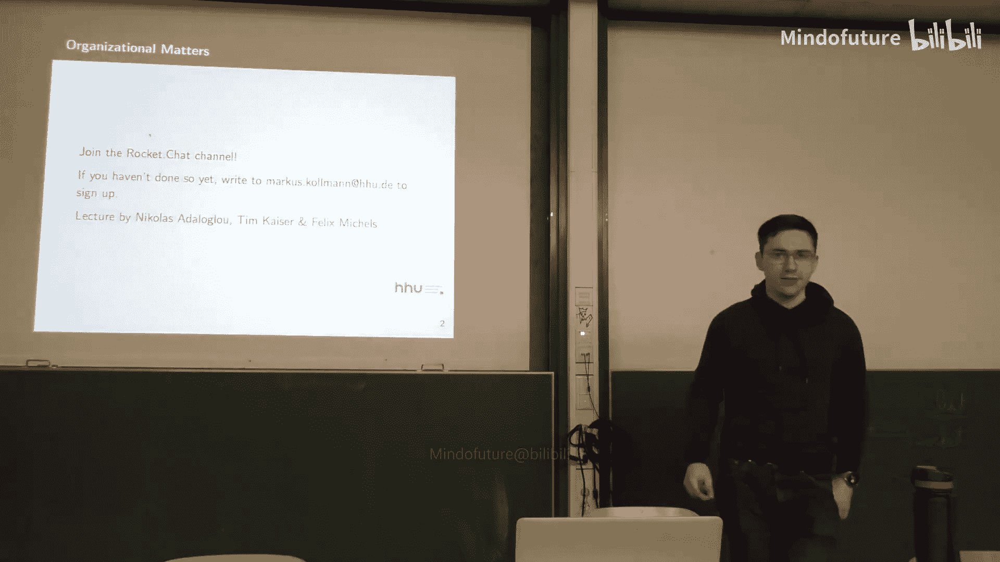
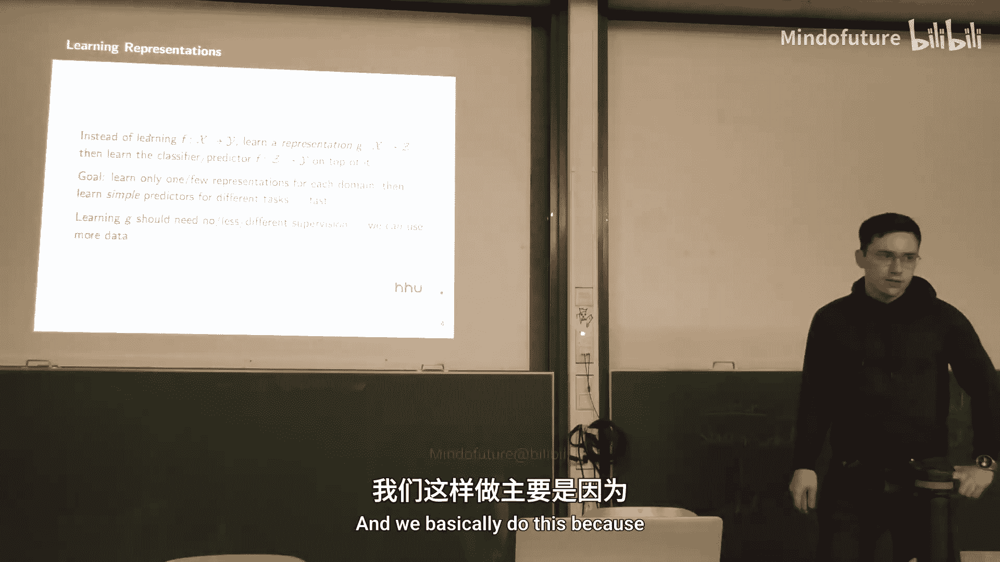
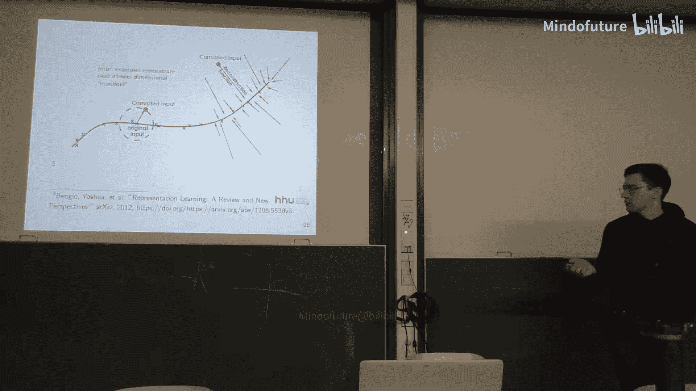

# 001：表示学习导论 🧠

在本节课中，我们将要学习表征学习的基本概念、其重要性以及一些经典方法。我们将从定义开始，探讨什么是好的表示，并介绍几种学习表示的不同视角。

## 概述

表征学习的目标是学习数据的表示，使得从数据中提取有用信息以构建分类器或预测器变得更容易。我们通常不直接从原始数据域学习预测函数，而是先学习一个表示函数，将数据映射到一个中间表示空间，然后在该空间上训练简单的模型来完成各种任务。这种方法可以利用更多数据，并加速新任务的训练过程。

## 什么是表征学习？

通常，我们有一些数据 \(X\)，例如图像、文本等。我们希望学习对这些数据的预测。预测空间 \(Y\) 可以是类别标签，例如将图像分类为猫、狗或房屋，或者对句子进行情感分析。

在传统的机器学习中，我们学习一个从数据域空间直接到预测空间的函数 \(F: X \rightarrow Y\)。

表征学习则不同。我们学习一个表示函数 \(G: X \rightarrow Z\)，将数据映射到某个中间空间 \(Z\)（也称为表示空间、嵌入空间或潜在空间）。然后，我们在该表示之上训练分类器 \(H: Z \rightarrow Y\)。整个过程可以表示为 \(H(G(x))\)。

我们这样做是因为，对于一个数据域（如图像），我们可以训练一个或多个表示函数 \(G\)。之后，对于许多不同的任务，我们只需在该表示之上训练简单的小模型即可。这加快了训练速度，并且使我们能够利用更多数据，因为表示函数可以使用无标签数据或混合标签数据来学习。

## 好的表示应具备的特性

一个好的表示函数应具备多种理想特性。以下是几个关键方面：

*   **平滑性**：如果两个输入点非常接近，那么它们的表示也应该非常接近。这是机器学习模型的一个基本先验。
*   **半监督或无监督学习能力**：一个好的表示学习方法应该能够处理无标签数据或混合数据，从而利用所有可用数据。
*   **不变性**：表示应对输入中不重要的变化保持不变。例如，对于图像，轻微的旋转或颜色变化应产生相似的表示。
*   **自然聚类**：对于与类别变量相关的数据，好的表示应能将相同类别的数据点聚集在一起，不同类别的数据点分离开。
*   **多解释因子**：每个任务不需要所有潜在的解释因子。我们希望表示能恢复许多潜在的、对下游任务可能有用的因子，同时忽略无关的噪声因子。
*   **解耦性**：理想情况下，表示向量的每个维度应对应于数据中有意义的、独立的变异因素。例如，在人脸图像表示中，一个维度可能控制头部左右转动，另一个控制是否微笑。
*   **层次性**：表示应能反映特征的层次结构，例如从低级的“是否有皮毛”到高级的“是什么动物”。不过，当前方法很少能完全实现这一点。
*   **稀疏性**：对于许多数据点，只有少数解释因子是活跃的。因此，表示向量中大多数维度应为零或接近零。
*   **简单依赖关系**：表示空间中的因子应具有简单的依赖关系，以便在其上训练的模型（通常是线性模型）能够轻松学习。

## 如何评估表示的好坏？

评估表示质量最流行的方法是线性探测。

我们首先在一个（可能无标签的）数据集上学习表示函数 \(G\)。然后，我们取另一个较小的、有标签的数据集，在其表示 \(Z = G(X)\) 之上仅训练一个简单的线性分类器（例如，使用交叉熵损失）。最后，我们在测试集上测量该分类器的准确率。准确率越高，通常认为表示越好。

重要的是，不能仅通过表示学习模型本身的训练损失来判断表示质量，因为损失低并不直接等同于在下游任务上表现好。

## 学习表示的方法

有多种不同的视角和方法来学习表示。本节我们将介绍几种经典方法。

### 1. 深度学习与迁移学习

在深度学习中，模型通常是由多个层（如 \(F_1, F_2, ..., F_L\)）堆叠而成。我们可以先在某个有标签的任务（例如 ImageNet 图像分类）上训练一个深度神经网络。训练完成后，去掉网络的最后一层（或多个层），剩下的部分就可以作为一个表示函数 \(G\)。

因为深度学习在训练过程中会为特定任务学习有用的中间表示，所以这些表示通常也包含了对其他任务有用的信息。这本质上是迁移学习。靠近输入的层学习低级特征（如边缘、颜色），而更深的层学习更抽象的特征。

### 2. 最大似然估计方法

这类方法假设数据 \(x\) 来自某个分布 \(P(x)\)，并且我们有一个固定的先验潜在分布 \(P(z)\)（例如标准正态分布）。我们通过一个参数化的解码器函数 \(P_\theta(x|z)\)，将潜在变量 \(z\) 映射回数据空间。

目标是最大化数据的边际似然：\(P_\theta(x) = \int P_\theta(x|z) P(z) dz\)。

然而，我们通常需要的是后验分布 \(P(z|x)\) 或一个能将 \(x\) 映射到 \(z\) 的编码器函数。计算后验分布通常非常困难，特别是当解码器 \(P_\theta(x|z)\) 是一个复杂的神经网络时。变分自编码器（VAE）通过引入一个近似后验 \(Q_\phi(z|x)\) 来优化边际似然的下界，从而部分解决了这个问题，并同时得到了一个编码器。

主成分分析（PCA）可以看作一个简单的概率模型特例，其中先验和后验都是高斯分布，且映射是线性的。

### 3. 自编码器

自编码器是本周练习的重点。它由两个网络组成：一个编码器 \(G_\phi: X \rightarrow Z\) 和一个解码器 \(D_\theta: Z \rightarrow X\)。目标是让解码后的输出 \(D_\theta(G_\phi(x))\) 尽可能接近原始输入 \(x\)，通过最小化重构损失（如均方误差）来实现。

为了防止编码器学习恒等映射，最常见的约束是使潜在空间 \(Z\) 的维度低于输入空间 \(X\) 的维度，这称为欠完备自编码器。PCA 可以视为使用线性编码器/解码器和均方误差损失的自编码器的最优解。

自编码器存在一个问题：它试图精确重构所有细节，包括不重要的噪声，因此可能无法学习到对微小变化（如平移、旋转）具有不变性的表示。

#### 去噪自编码器

为了解决上述问题，去噪自编码器在输入数据 \(x\) 上添加噪声（例如高斯噪声），得到 \(\tilde{x}\)，然后要求网络从 \(\tilde{x}\) 重构出干净的原始数据 \(x\)。这迫使网络学习到数据流形的结构，并将被噪声推离流形的点拉回。通过选择噪声类型（如高斯噪声、随机旋转），可以控制希望表示具有哪些不变性。

#### 稀疏自编码器

通过在损失函数中添加对表示 \(z\) 的稀疏性惩罚项（如 L1 范数 \(\|z\|_1\)），可以鼓励学习到的表示中大部分元素为零。这符合“每次只有少数因子活跃”的直觉。

#### 收缩自编码器

收缩自编码器在损失函数中添加编码器 Jacobian 矩阵的弗罗贝尼乌斯范数作为惩罚项。这鼓励编码函数是“收缩”的，即对输入的小变化不敏感，从而使得邻近的输入点映射到表示空间中更接近的点。其效果与使用特定噪声的去噪自编码器类似，但无需采样噪声数据。

### 4. 流形学习

流形假说认为，真实的高维数据实际上位于一个低维流形上。这个低维对应于有意义的解释因子数量。流形学习方法（如等距特征映射、局部线性嵌入）试图发现并学习这个低维流形结构。

在流形上，沿着切向方向移动对应于改变有意义的解释因子（如改变人脸表情），而沿着法向移动则会离开数据流形，产生无意义的数据。

然而，许多经典的流形学习方法是非参数的，它们为训练集学习一个嵌入，但难以泛化到新的数据点，因此不太适合作为通用的表示学习函数。

## 总结

本节课我们一起学习了表征学习的核心思想：学习数据的中间表示以方便下游任务。我们探讨了理想表示应具备的特性，如平滑性、不变性、解耦性等，并介绍了线性探测这一重要的评估方法。接着，我们回顾了几种经典的表示学习方法：基于深度学习的迁移学习、最大似然估计方法（以PCA和VAE为例），以及各种自编码器（标准、去噪、稀疏、收缩）。最后，我们简要提到了流形学习的理念。其中，自编码器，特别是欠完备和去噪自编码器，是理解表征学习基础的重要范例。从下周开始，我们将深入探讨更具体的现代表示学习主题。