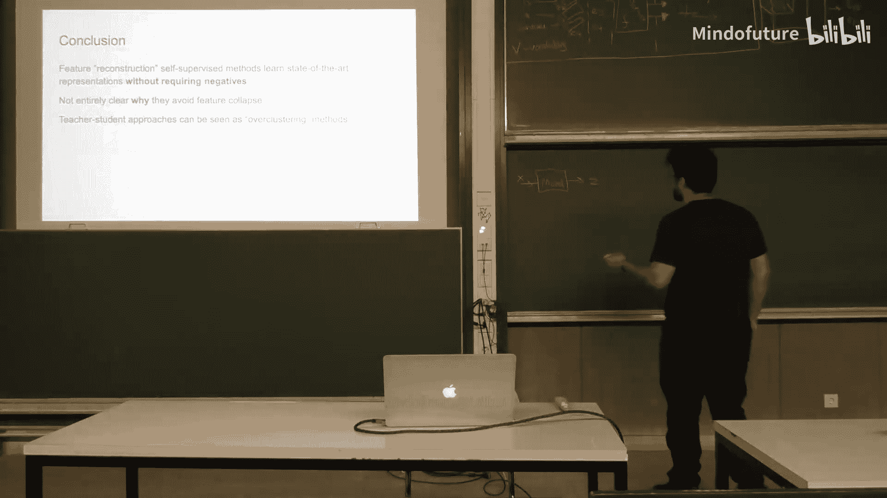
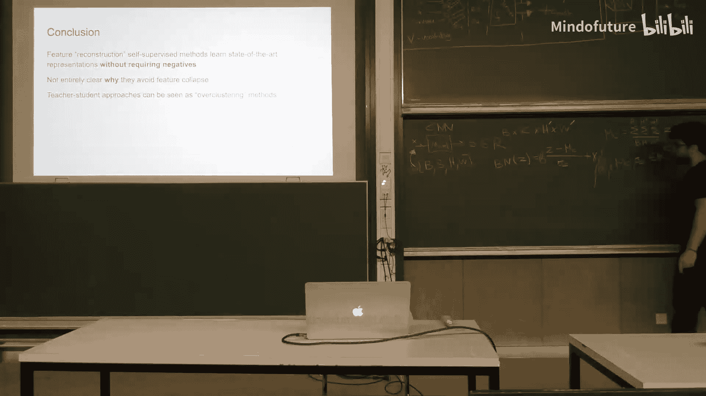

# 010：无负样本的自蒸馏视觉表示学习

## 概述
在本节课中，我们将回顾已学的自监督学习方法，并探讨如何将它们与知识蒸馏的概念相结合。我们将重点关注一种新的技术方向：无需依赖大批次或显式负样本的自监督视觉表示学习。我们将详细解析BYOL和DINO这两种代表性方法的核心思想与实现机制。

## 课程回顾与连接
上一节我们深入探讨了SimCLR及其对比损失函数、批次大小与负样本的对应关系。本节中，我们将在此基础上更进一步，看看近年来视觉领域自监督表示学习的最新进展，特别是那些不依赖于大批次和显式负样本的方法。

以下是我们在本课程中已学习过的自监督方法概览：

*   **去噪自编码器**：其直觉是编码器与解码器之间的瓶颈表示能学习到数据的压缩版本，可作为下游任务的预训练。但在实践中，模型很难区分数据中的噪声与信号，低层统计信息足以完成图像重建，因此难以学到对下游任务重要且相关的语义特征。
*   **图像修复**：这类方法要求模型完成更困难的生成任务，例如预测被遮盖部分的像素值。L2重建损失会产生模糊的预测。虽然可以通过GAN等损失使预测更真实，但无法保证所学特征与下游任务的相关性，且模型需要学习大量对表示学习无用的细节。
*   **旋转预测**：该方法通过预测应用于图像的变换来学习。虽然直觉上能学习高级概念，但缺乏理论保证。存在许多反例，例如切片橙子无论怎么旋转，预测旋转角度的任务并不一定能让模型学到关于橙子的知识。
*   **对比学习**：我们深入研究了信息论，以及如何通过对比损失最大化两个视图之间的互信息下界。我们创建来自同一图像的不同视图作为正样本对，并在特征空间中将它们拉近。这导致特征空间中图像均匀分布，且同一图像的不同视图特征对齐。其局限性在于对批次大小和负样本的依赖，我们看到了如MoCo中使用动量编码器和动态字典等技术来解决。

## 知识蒸馏简介
接下来，我们接触了另一个主题：知识蒸馏。这似乎与上一讲的内容完全不同。

知识蒸馏是指我们有一个（或多个）模型，通常是一个大模型或模型集合，我们试图将其知识提炼并转移到另一个（通常更小的）单一模型中。

我们看到了几种不同的知识蒸馏方法：

*   **基于交叉熵/KL散度的方法**：这是最通用、简单的方法，利用教师模型的软目标（soft targets）与学生模型的预测计算损失。
*   **对比式知识蒸馏**：使用对比学习目标，但不是拉近同一图像的不同视图，而是拉近学生模型与一个或多个教师模型的特征。
*   **特定于视觉Transformer的方法**：例如仅使用教师模型输出的argmax（硬目标）进行蒸馏。
*   **掩码图像建模**：这与最新的自监督学习相关，我们将在下一讲深入探讨。

## 连接知识蒸馏与自监督学习
现在，我们尝试将这两个最初看似无关的主题联系起来。

在**知识蒸馏**中：
*   假设存在一个预训练的教师模型（监督或无监督）。
*   我们尝试将教师模型的知识传递给学生模型，因此教师模型通常更大。
*   输入到两个模型的数据是相同的（无论是否使用数据增强）。

在**自监督学习**中（我们即将探讨的新方向）：
*   开始时没有预训练的教师模型。
*   我们的目标是**动态地**在训练过程中创建一个教师。
*   学生和教师模型接收不同的信息（通常教师看到的信息更完整），这为教师提供了优势。
*   通过一种动态机制，学生和教师模型在训练中共同改进，即使它们架构相同。

## 构建动态教师：指数移动平均
那么，在没有预训练教师的情况下，我们如何构建一个教师？

答案是使用学生模型参数的**指数移动平均**作为动态教师。

其更新公式为：
`ξ ← τξ + (1−τ)θ`
其中，`ξ`是教师参数，`θ`是学生参数，`τ`是一个接近1的超参数（例如0.99）。

这个动态教师不是通过梯度更新的，而是缓慢地跟随学生参数的变化。这为学生提供了一个稳定且略微滞后的监督信号。

## BYOL：引导你自己的潜在表示
基于上述思想，我们来看第一个方法：BYOL。

BYOL在SimCLR的基础上进行了几项关键改动，以实现无需负样本的学习：

1.  **引入动量教师**：使用上述指数移动平均更新一个教师网络。
2.  **不对称的信息输入**：教师网络通常接收信息更完整的视图（例如更少的图像裁剪或颜色抖动）。
3.  **停止梯度**：教师网络的参数不通过损失函数的梯度进行更新。
4.  **额外的预测头**：在学生网络的特征投影层后，增加了一个额外的MLP（称为预测器）。

BYOL的损失函数是学生预测与教师目标之间的均方误差（在L2归一化后，等价于余弦相似度）。

一个关键发现是，**不对称性**（预测头和停止梯度）对于防止模型崩溃（即所有输出坍缩为相同表示）至关重要。此外，网络中的**批归一化层**也隐式地引入了批次信息，有助于防止崩溃。

## DINO：无标签的知识蒸馏
接下来，我们看一个在BYOL之后提出的方法：DINO。

DINO进一步调整了BYOL的框架：

1.  **移除预测头**：学生网络不再需要额外的预测MLP。
2.  **使用交叉熵损失**：不再直接最大化特征相似度，而是将问题转化为一个**分类任务**。学生和教师网络都输出一个在某种“原型”或“聚类中心”上的概率分布（通过softmax实现）。学生模型的目标是使其输出分布与教师模型的输出分布相匹配（使用交叉熵损失）。

这种转变非常巧妙。教师模型的输出分布可以被视为为图像分配了软聚类标签。学生模型则学习预测相同的聚类分配。这本质上是一种**自蒸馏**过程，教师模型通过指数移动平均保持稳定，并为学生提供训练目标。

## 总结
本节课中，我们一起学习了如何将知识蒸馏的思想融入自监督学习，从而发展出不依赖于显式负样本和大批次的新方法。

我们首先回顾了知识蒸馏与自监督学习的联系，并介绍了构建动态教师的核心技术——指数移动平均。接着，我们深入分析了两个代表性工作：BYOL和DINO。BYOL通过引入动量教师、不对称结构和预测头来避免模型崩溃。DINO则进一步简化为一个自蒸馏的分类框架，让学生模型学习匹配教师模型输出的聚类概率分布。

这些方法展示了自监督学习领域的创新思路：通过精心设计的学生-教师互动架构，即使没有人工标注的负样本，也能学习到强大的视觉表示。