# 014：多模态表示学习、鲁棒性与视觉异常检测（第1-2部分）

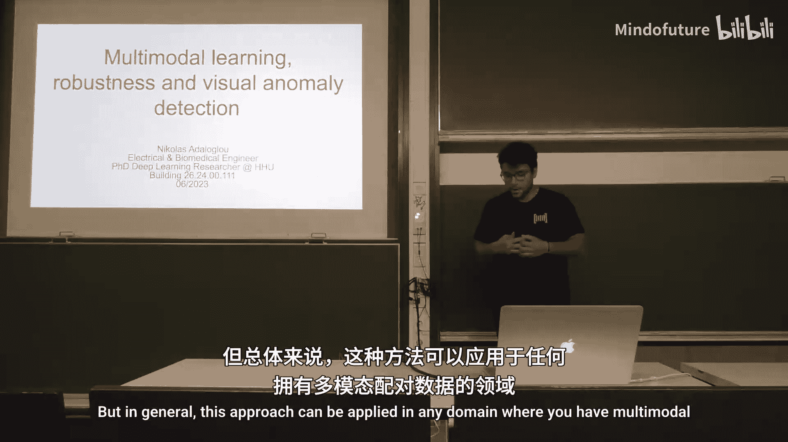

在本节课中，我们将要学习多模态表示学习的基本概念，特别是如何结合视觉与语言信息来学习更强大的特征表示。我们还将探讨模型鲁棒性的重要性，并初步了解视觉异常检测的背景。

## 概述

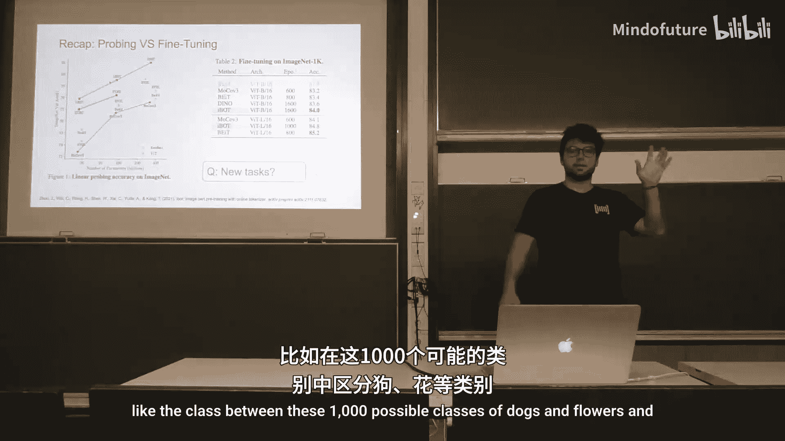

到目前为止，我们已经学习了如何从自然语言中无监督地学习表征，并重点讨论了用于自然图像的对比学习方法。这些方法能学习到相当好的表征。然而，视觉和语言并非唯一的领域，这些方法可以推广到其他领域，例如生物序列（如蛋白质和RNA）。本节课，我们将聚焦于结合不同模态信息的方法，即**多模态学习**，具体是结合自然语言和视觉信息。这种方法适用于任何拥有配对数据的领域。

## 从鲁棒性谈起

上一节我们介绍了对比学习，本节中我们来看看模型表征的**鲁棒性**。鲁棒性是衡量模型表征在数据受到扰动时是否依然有意义的重要方式。

### 什么是鲁棒性？

鲁棒性是指模型在面对数据扰动时，其性能保持稳定的能力。扰动可以有很多种形式，例如：
*   **遮挡**：图像部分被遮盖。
*   **模糊**：图像变得不清晰。
*   **分布外数据**：模型遇到与训练数据分布差异很大的新数据。
*   **对抗性攻击**：攻击者通过微调输入数据（如图像像素），使模型做出错误预测，而这些改动对人眼可能不可见。

鲁棒性总是相对于**特定类型的扰动**来定义的。我们可以定义模型对遮挡、模糊、自然扰动或对抗性攻击的鲁棒性。其衡量标准通常是：在施加扰动后，模型性能下降了多少。

### 为何关注鲁棒性？

鲁棒性对于表征学习至关重要。如今的目标是：在大量、多样的数据上训练一次大型模型（即**基础模型**），然后将其重用于成百上千个不同的下游任务。我们希望这些模型对各种扰动都具有鲁棒性。

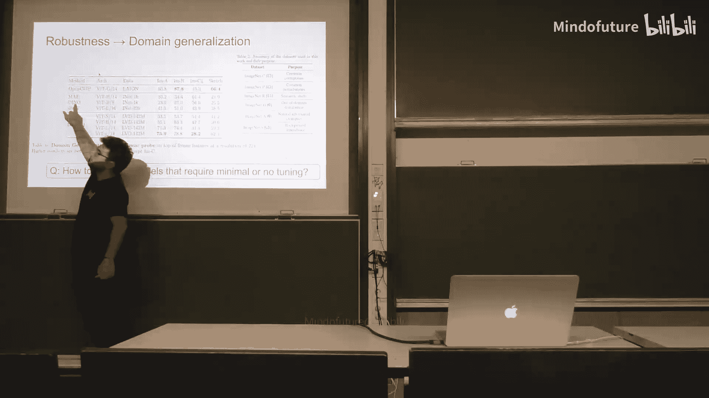

研究表明，更大的模型不仅在原始数据上表现更好，在面对数据损坏时也往往更鲁棒。然而，传统的监督式预训练模型学到的表征，在面对与训练集（如ImageNet）分布不同的新数据集时，泛化能力可能很差。这是因为模型被激励去学习数据集中所有有助于分类的特征，但这些特征可能并不通用。

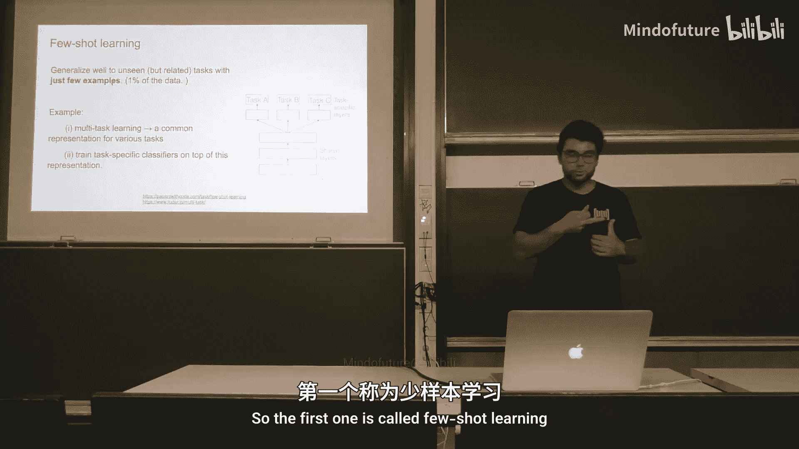

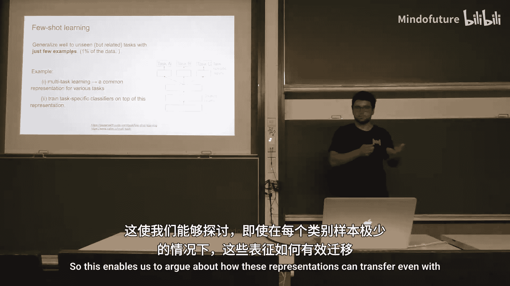

## 评估表征的通用性

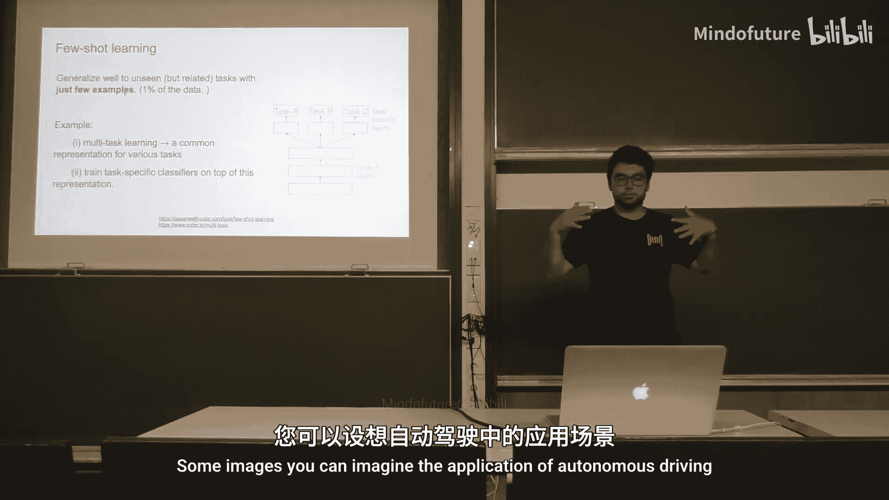

我们注意到，使用线性探测（仅训练最后一层分类器）和微调（训练整个模型）来评估预训练模型时，结果存在显著差异。这促使我们思考：为特定分类器学习的表征到底有多通用？它们能应用到其他领域吗？

为了深入探究，我们需要引入一些更细致的评估设定：

### 少样本学习

**少样本学习** 是指在下游任务中，我们只有非常有限的标注样本（例如，每个类别只有1%的数据可用）。这能帮助我们评估表征在数据极少时的迁移能力。

### 零样本学习

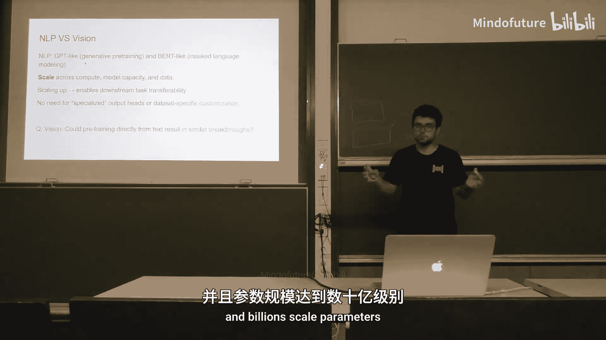

**零样本学习** 则更具挑战性。模型需要在不进行任何微调的情况下，直接对从未见过的图像类别进行分类。为此，模型需要一些额外的辅助信息（例如类别的文本描述），来建立视觉特征和语义概念之间的联系。

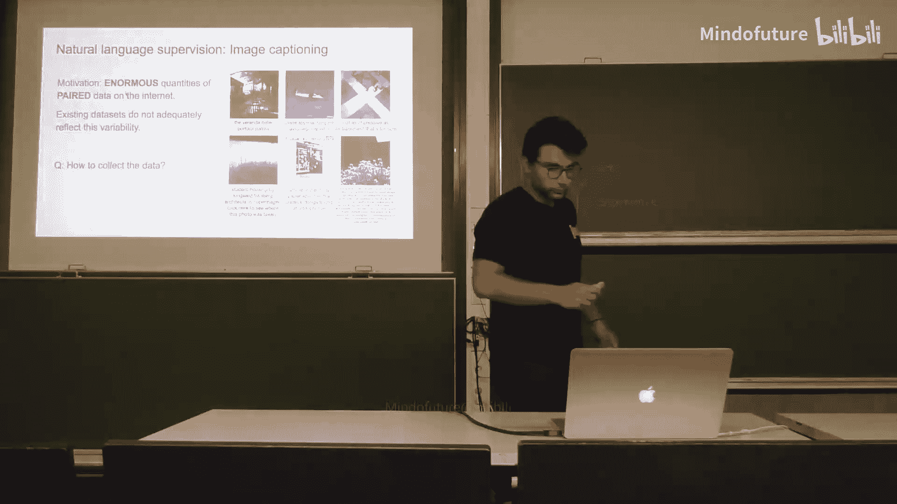

多模态学习（尤其是我们即将讨论的方法）为实现强大的零样本学习提供了天然途径。

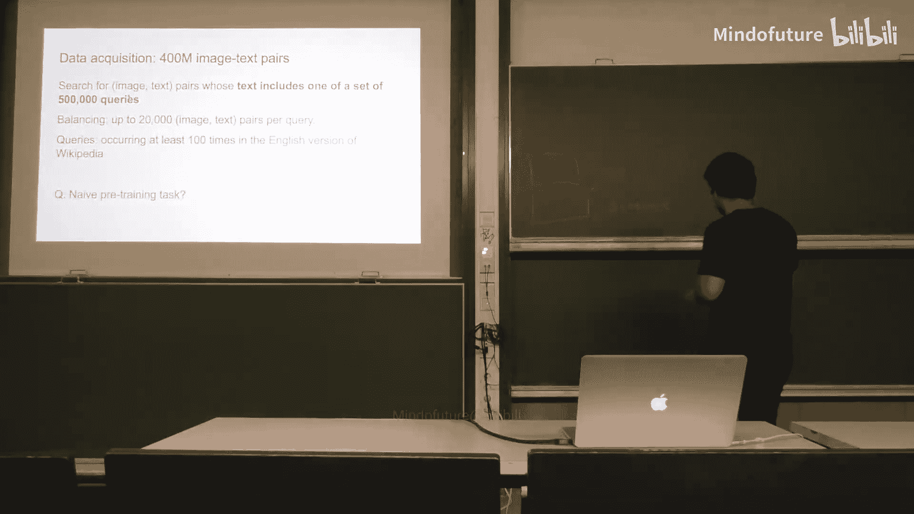

## 多模态表示学习：CLIP方法

前面我们讨论了评估需求，现在让我们看看如何利用多模态数据学习通用表征。我们将重点介绍 **CLIP** 方法。

### 动机与数据

传统的监督学习需要大量人工标注的数据集（如ImageNet），这成本高昂且类别有限。此外，模型学到的表征可能过于特定，难以迁移。

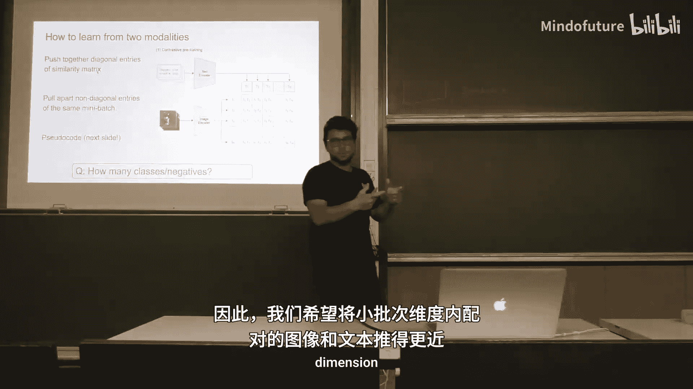

多模态学习的核心思想是利用互联网上大量**天然配对**的图文数据。例如，一张图片通常配有描述它的文本（标题、alt文本等）。这种数据是**弱监督**的，我们不知道文本具体对应图像中的哪个物体，但知道它们在语义上相关。这种数据规模巨大、多样性丰富。

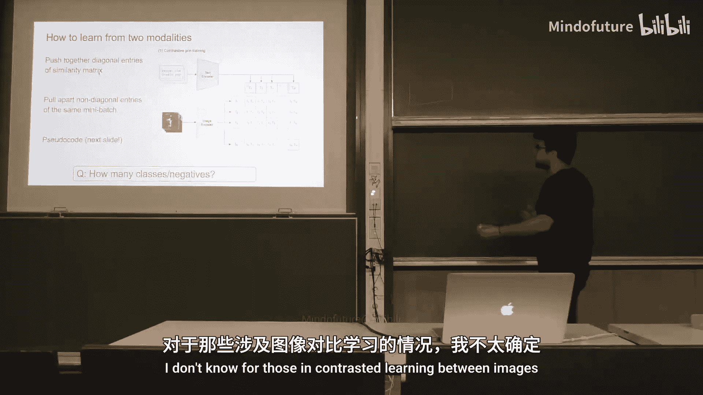

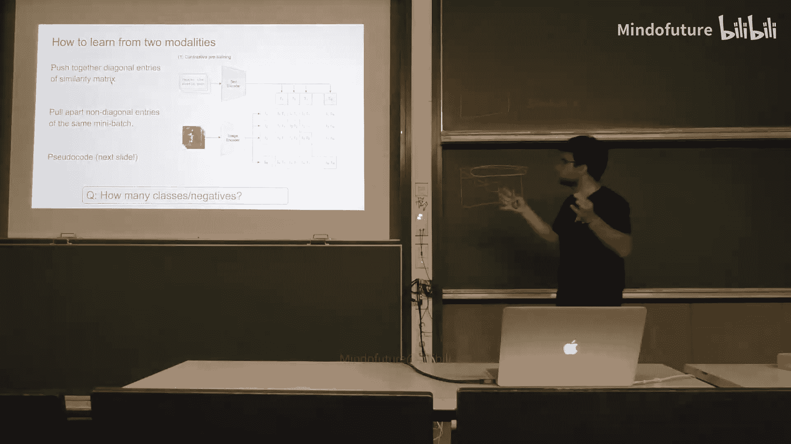

### CLIP的核心思想

CLIP 代表 **对比语言-图像预训练**。其目标是学习一个共享的特征空间，使得匹配的图像和文本对的特征彼此接近，而不匹配的则彼此远离。

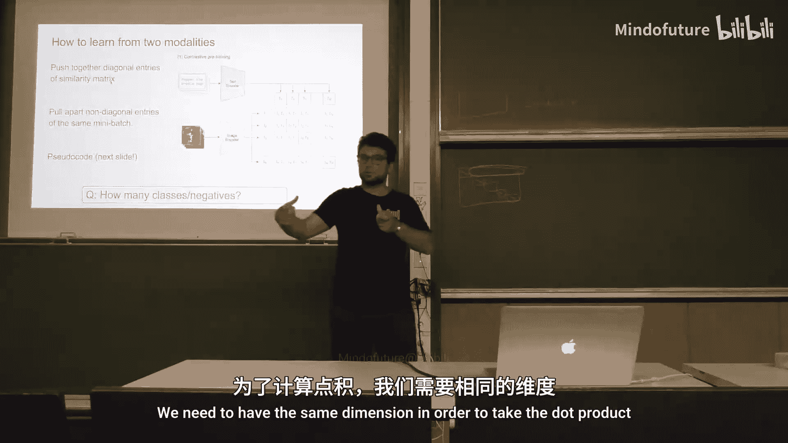

以下是其工作流程：
1.  **编码**：使用一个图像编码器（如ViT）和一个文本编码器（如Transformer）分别处理一批图像和一批文本。
2.  **特征提取**：每个图像生成一个特征向量，每个文本生成一个特征向量（通常使用[CLS]令牌的输出来聚合整个句子的信息）。
3.  **计算相似度**：计算所有图像特征和所有文本特征之间的余弦相似度，得到一个相似度矩阵。
4.  **对比损失**：训练目标是最大化**配对**的图像-文本对（矩阵对角线）的相似度，同时最小化**非配对**对（非对角线）的相似度。这本质上是一个对称的交叉熵损失。

**图像编码器损失**：对于每张图像，将其对应的文本作为正样本，该批次中所有其他文本作为负样本。
`L_i = -log(exp(sim(I_i, T_i)/τ) / Σ_{j=1}^{N} exp(sim(I_i, T_j)/τ))`

**文本编码器损失**：对于每个文本，将其对应的图像作为正样本，该批次中所有其他图像作为负样本。
`L_t = -log(exp(sim(T_i, I_i)/τ) / Σ_{j=1}^{N} exp(sim(T_i, I_j)/τ))`

总损失是图像损失和文本损失的平均值。这里，`sim` 是余弦相似度，`τ` 是可学习的温度参数。

### CLIP的优势：零样本预测

CLIP 最强大的能力之一是**零样本分类**。预训练后，文本编码器已经见过海量文本，很可能包含下游数据集的类别名称。

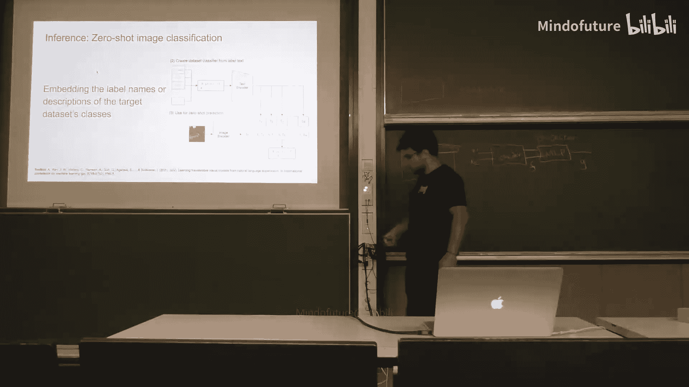

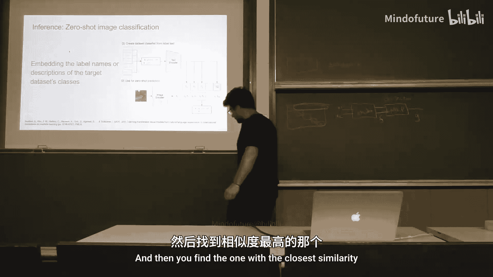

进行零样本预测的步骤如下：
1.  **构建提示**：将数据集的每个类别名称嵌入到一个提示模板中（例如，“一张`[类别]`的照片”）。
2.  **文本特征**：用文本编码器提取所有类别提示文本的特征。
3.  **图像特征**：用图像编码器提取待分类图像的特征。
4.  **计算与匹配**：计算图像特征与所有类别文本特征的相似度。
5.  **预测**：选择相似度最高的文本对应的类别作为预测结果。

通过巧妙的**提示工程**（设计更好的提示模板），可以显著提升零样本性能。这种方法无需任何下游任务训练数据，实现了真正的零样本迁移。

## 总结

本节课中我们一起学习了多模态表示学习的基础。我们首先探讨了模型**鲁棒性**的重要性，它衡量了表征在面对数据扰动时的稳定性。接着，我们了解了**少样本学习**和**零样本学习**这两种评估表征通用性的重要设定。最后，我们深入介绍了**CLIP**模型，它通过对比学习在庞大的图文配对数据上训练，将图像和文本映射到共享的特征空间。CLIP 的关键优势在于其强大的**零样本分类**能力，无需下游标注数据即可执行新任务，这为构建更通用、更灵活的人工智能系统开辟了道路。