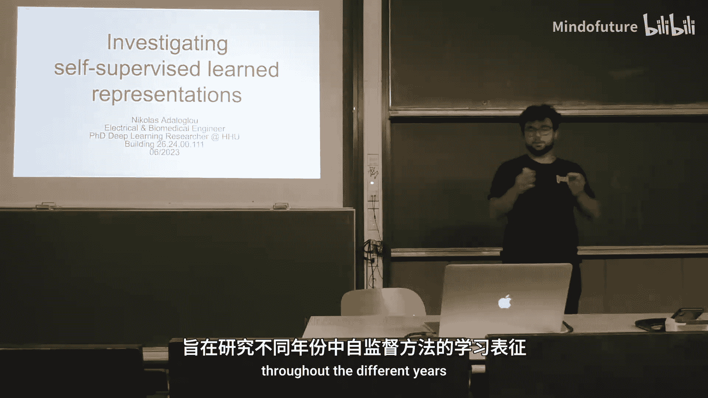

# 018：探索自监督学习获得的表示（第1-2部分）

在本节课中，我们将要学习如何分析自监督学习模型获得的表示，并探讨其在不同任务和领域（特别是医学影像领域）中的表现与局限性。

上一节我们介绍了基于对比学习的模型（如CLIP）的分析，本节中我们来看看自监督学习方法的特性。

## 自监督与监督学习的比较

我们首先需要考虑，何时应选择监督学习作为预训练方法。这主要取决于两个因素：预训练数据与下游任务数据之间的分布差异，以及下游任务数据的规模。

以下是基于2021年多项研究的结论：
*   当预训练与下游任务的分布非常相似时，监督迁移学习是很好的选择。
*   当下游任务的数据样本非常有限时，监督迁移学习仍然是一个值得考虑的选项。

接下来，我们探讨自监督预训练模型在不同下游任务上的表现。我们固定预训练数据为ImageNet，然后改变下游任务和数据。

以下是不同任务上的表现趋势：
*   **图像分类**：在ImageNet上的性能可以很好地预测模型在其他自然图像分类任务上的表现。
*   **目标检测与语义分割**：对于需要定位信息的任务（如目标检测和语义分割），自监督学习特征的表现与ImageNet分类性能的相关性较低。目标检测需要模型定位物体位置（例如用边界框的四个坐标 `(x1, y1, x2, y2)` 表示），而语义分割需要为每个像素预测一个类别标签。
*   **通用性**：目前没有一种表示方法能在所有考虑的数据集和任务规模上成为明确的赢家。尽管最新的模型（如DINOv2）通过结合多种目标在大规模数据上预训练，显示出更通用的潜力。

最后，我们比较不同方法学习到的特征本身。这是一个开放的研究领域，很难量化特征差异。现有证据表明，自监督和监督学习获得的信息是互补的。例如，有研究发现自监督特征对颜色统计信息不敏感，而监督学习特征则保留了更多此类信息。这可能是因为自监督学习中的数据增强（如颜色扰动）使模型学会了忽略颜色变化。

## 视觉Transformer的自监督学习

现在我们将焦点转向视觉Transformer，并探究其在自监督设置下学到了什么。

第一项研究将对比学习（如MoCo）应用于视觉Transformer，并发现：
*   减小**图像块尺寸**能显著提升性能，但也会急剧增加计算复杂度。因为序列长度 `N` 增加，导致自注意力层的计算复杂度变为 `O(N^2)`。
*   视觉Transformer的自监督学习可以匹配甚至超越ResNet的性能。
*   位置嵌入在视觉任务中不如在自然语言处理中那么重要。

另一项重要工作是**DINO**。它结合了视觉Transformer和一种基于交叉熵的聚类式自监督目标，产生了非常出色的结果。这些模型学到的特征在特征空间中已经形成了良好的聚类，无需为每个特定任务训练线性分类层即可直接使用（例如通过K近邻进行分类）。这对于难以获取标注数据的领域非常有用。

可视化表明，DINO模型能够无监督地学习到与物体前景相关的注意力图，这可以看作是一种无监督的分割掩码。这种行为在监督训练的视觉Transformer或卷积神经网络中并不常见。

## 自监督学习在医学影像中的应用

医学影像是自监督学习的一个重要应用领域，因为标注成本极高，数据规模无法与自然图像相比。此外，医学影像的许多假设（如物体居中）与自然图像不同。

在医学影像中应用自监督学习，我们需要思考几个问题：
1.  从自然图像预训练的模型在医学下游任务上表现如何？
2.  是使用自然图像预训练的模型更好，还是在特定医学领域（如X光片）上从头训练自监督模型更好？
3.  如何为特定医学领域设计合适的数据增强策略？

以下是相关研究的发现：
*   自监督学习特征（即使来自ResNet）在大量医学影像任务上的迁移性能优于监督学习特征。
*   如果有足够的数据，在特定医学领域（如X光片）上训练自监督模型，通常能获得比使用自然图像预训练模型更好的领域内性能。
*   必须仔细考虑数据增强策略。例如，在X光片中，随机裁剪可能会丢失关键的病理信息，因此可能需要调整或避免此类增强。

## 设计选择与可视化

对于自监督学习，核心设计选择之一是数据增强。我们需要针对每个目标领域思考合适的增强策略。例如，在X光片中，模糊可能不利于学习纹理变化；而在某些细胞图像中，固定尺寸裁剪与随机裁剪的效果可能差异不大。

可视化有助于我们理解模型所学。例如，DINO等模型产生的注意力图可以突出图像的前景区域，这为模型决策提供了一定的可解释性，甚至可以视为一种无监督的分割结果。这种特性在视觉Transformer与自监督学习结合时尤为突出。

本节课中我们一起学习了自监督学习表示的分析方法，比较了其与监督学习的异同，探讨了视觉Transformer在自监督下的特性，并深入了解了自监督学习在医学影像等专业领域中的应用挑战与设计考量。