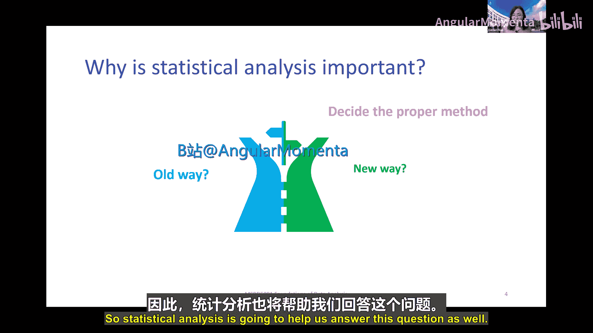

数据分析基础：01：引言与统计回顾

在本节课中，我们将回顾一些基础的统计分析知识。之所以这样做，是因为我们即将开始数据分析的学习，这通常包括描述性分析、预测性分析等。为了进行这些分析，我们需要运用多种数学工具。虽然你可能已经学过这些工具，但由于不常使用，我们需要唤醒对这些概念的回忆。因此，本节将是一次关于基础统计分析的复习。

---

### 什么是统计分析？📊

首先，我们来讨论什么是统计分析。从形式上说，**统计分析是一门收集、探索和呈现大量数据（我们通常称之为数据集）以发现其潜在模式和趋势的科学**。

我们几乎在每个领域都会收集数据。然而，仅仅收集数据是不够的。收集到的数据可能是关于某个事件、某种情况的一系列数值。仅仅拥有这些数值本身没有意义。我们需要知道如何探索数据背后隐藏的含义，理解数据向我们传递了怎样的信息。此外，数据的收集本身也需要对相关领域有所了解。

因此，为了进行统计分析，我们需要了解有哪些方法、需要注意哪些事项，以及如何分析数据、理解数据并发现其中的模式和趋势。统计分析实际上无处不在，从物理学到社会科学，它被广泛使用。我们每天听到的各种组织发布的调查报告，其发现正是通过统计分析得出的。

---

### 统计分析的主要任务

接下来，我们将讨论统计分析中的一些主要任务。

以下是三个核心任务：

1.  **描述和总结数据**：对数据进行概括性描述。
2.  **识别变量间的关系**：探究不同数据项之间的关联。
3.  **预测结果**：基于现有数据对未来进行推断。

---

### 统计分析为何重要？🤔

正如我们刚才提到的，我们周围有大量数据，日常生活中也有许多问题。我们需要答案，而统计分析正是帮助我们回答这些问题。

例如，一个典型的问题是：“如果我毕业了，我的薪水会是多少？”人们会使用历史数据或统计分析来回答这个问题。比如，基于从往届或本届毕业生收集的薪资数据，我们可以计算所有数值的平均值，从而了解毕业生的平均薪资水平。

**示例**：假设平均薪资是80000。那么，我们就可以用这个数字来回答问题，让你对平均薪资或通常的薪资水平有一个预期。

统计分析之所以重要的另一个原因是，一旦我们了解了数据，它实际上也能为我们如何做决策提供一些答案。当我们面对多种可能性和不同路径时，哪一条才是好的、合适的？统计分析也将帮助我们回答这个问题。

---

### 总结

本节课中，我们一起学习了统计分析的基本定义、核心任务及其重要性。我们了解到，统计分析是通过科学方法处理数据以发现模式和趋势的过程，它对于从数据中获取信息、解答疑问以及支持决策都至关重要。在接下来的课程中，我们将深入探讨描述数据、分析关系等具体任务。