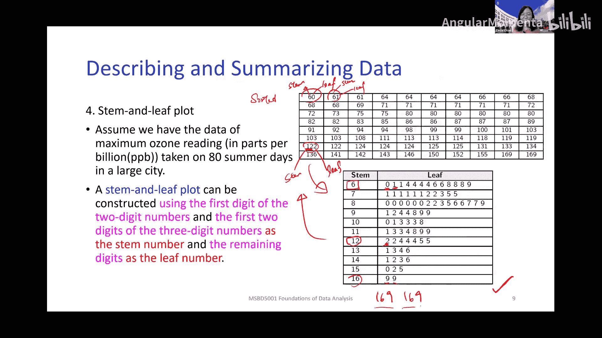
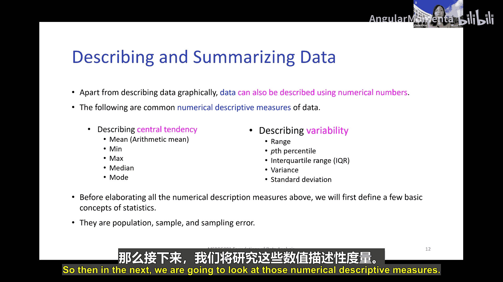
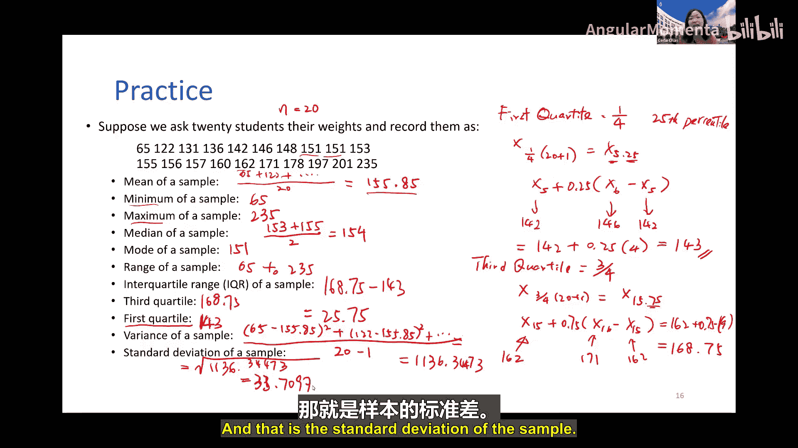

数据分析基础：P02-03-02-02：数据描述与汇总 📊


在本节课中，我们将要学习如何描述和汇总数据。我们会首先理解什么是数据集，然后探讨几种组织和呈现数据的常用方法，包括表格、图表以及一些数值描述性度量。这些工具能帮助我们更好地理解和解释收集到的信息。

---

### 什么是数据集？📁

我们经常使用“数据”或“数据集”这些术语。数据集可以看作是一系列数值的集合，但数据并不一定是数字，它也可以是一组项目。

以下是两个例子：
1.  假设我们询问20名学生的体重，并记录下这些数字。我们得到了20个数值（有些可能相同）。这20个值构成了一个包含20个观测值的数据集。
2.  我们询问这20名学生的发色，并记录下颜色名称。这次我们得到的是20个颜色名称（字符串或项目），而不是数字。

基于这两个例子，我们可以看到数据有两种主要类型：
*   **连续型数据**：例如体重数据。这些是数字，并且数值之间是连续的（例如，可以有122.5或146.1这样的值）。
*   **离散型数据**：例如发色数据。这些值通常是分类的或计数的，数值之间没有连续的中间值（例如，在“红色”和“黑色”之间没有明确的中间颜色名称）。

收集数据后，仅仅查看原始数字或项目列表并不直观。因此，我们需要使用各种方法来描述和汇总数据，以便更好地解读它们。

---

### 使用表格呈现数据 📋

组织数据的一种常见方式是使用表格。例如，下面的表格有三列，分别描述了行业分组、致残伤害人数以及相应的百分比。每一行都包含特定类别的信息。

| 行业分组 | 致残伤害人数 | 占总数的百分比 |
| :--- | :--- | :--- |
| 农业 | 130 | 3.4% |
| ... | ... | ... |
| 贸易服务 | 1100 | 28.9% |

表格能以易于管理的方式清晰地展示数据。通过扫描数字，我们可以知道哪个类别的数值最大或最小。然而，表格提供的信息可能不够直观，有时我们更倾向于使用图表来强调数据的某些方面。

---

### 使用图表呈现数据 📈

图表能更直观地展示信息，通常比原始数字更容易解读。以下是两种常见的图表：

**条形图**
将上述表格信息用条形图呈现，我们可以更容易地比较不同类别之间的差异。一眼就能看出“服务”类别的条形最高，而“农业”类别的条形最低，这比在表格中逐行扫描数字要快得多。

**饼图**
饼图用整个圆代表100%，每个扇区表示该类别在整体中所占的百分比。例如，农业占3.4%，是一个小扇区；而服务占比最大，对应的扇区也最大。饼图能直观地展示各部分相对于整体的相对大小。




表格和图表各有优势。表格适合呈现复杂或大量的数据，而图表（如条形图、饼图）则在强调数据的比较、分布或构成比例时更为有效。

---

### 茎叶图 🍃

除了常见的图表，还有其他有用的数据呈现方式。茎叶图就是其中一种，它的名字形象地体现了其结构：由“茎”和“叶”两部分组成。

假设我们有以下18个关于某城市夏季最大臭氧读数的数值（已排序）：
`60, 61, 62, ... , 122, 129, 169, 179`

存储这18个独立数字需要一定空间。为了压缩存储，我们可以使用茎叶图，其构建方法如下：
*   对于一个数字（如`60`），我们取第一位数字`6`作为**茎**，最后一位数字`0`作为**叶**。
*   对于三位数（如`122`），我们取前两位`12`作为茎，最后一位`2`作为叶。
*   将所有数字按此规则整理，得到如下茎叶图：




```
6 | 0 1 2 3 4
7 | 1 2 5 8
8 | 1 2 4
9 | 2 5 7
10 | 2
11 |
12 | 2 9
13 |
14 |
15 |
16 | 9
17 | 9
```

茎叶图有以下优点：
*   可以快速用纸笔构建。
*   可以从图中恢复每个原始数据点的值（例如，茎`16`和叶`9`对应数字`169`）。
*   数据排列紧凑，因为茎部不重复。
*   易于解读数据的分布形态。

---

### 散点图 🔍

散点图常用于展示数据集中两个变量之间的关系。例如，我们想了解57名棒球运动员的身高和体重之间是否存在关联。这里，身高和体重就是两个变量。

构建散点图时，我们将每个球员的两个变量值作为笛卡尔坐标（如`(74, 210)`），并在图表上绘制出对应的点。将所有数据点绘制出来后，就形成了散点图。

观察散点图，我们可以获取以下信息：
*   **方向**：数据点是否呈现出某种趋势（如从左下到右上）？
*   **形状**：点是否大致沿一条直线分布，还是呈现曲线或其他形状？
*   **紧密程度**：数据点是紧密聚集在一起，还是分散在各处？

这些观察能帮助我们理解两个变量之间是否存在相关性以及相关的强弱。

---

### 数值描述性度量 📏

除了用图形和表格描述数据，我们还经常使用一些数值来概括数据的特征。这些数值描述性度量主要分为两类：描述**集中趋势**和描述**变异性**。

在详细介绍这些度量之前，需要先理解几个基本统计概念：
*   **总体**：统计研究中所有个体或项目的集合。（例如，香港科技大学所有学生的身高。）
*   **样本**：从总体中选取的一部分，用于收集信息。（例如，随机询问100名港科大学生的身高。）
*   **抽样误差**：由于只测量了样本而非整个总体，导致样本结果与总体真实结果之间的差异。

---

#### 集中趋势度量

假设我们有一个大小为 `n` 的样本，其观测值为 `x1, x2, ..., xn`。

以下是描述数据集中趋势的常用度量：
*   **均值**：所有数值的平均值。
    `均值 = (x1 + x2 + ... + xn) / n`
*   **最小值**：样本中的最小数值。
*   **最大值**：样本中的最大数值。
*   **中位数**：将样本所有值按大小排序后，位于中间位置的值。如果 `n` 为奇数，中位数是中间那个数；如果 `n` 为偶数，中位数是中间两个数的平均值。
*   **众数**：样本中出现次数最多的数值。

---

#### 变异性度量

以下是描述数据变异或分散程度的常用度量：
*   **极差**：最大值与最小值之差。
    `极差 = 最大值 - 最小值`
*   **百分位数**：第 `p` 百分位数是一个值，使得大约 `p%` 的样本观测值小于或等于该值，而大约 `(100-p)%` 的观测值大于该值。例如，中位数就是第50百分位数。
*   **四分位距**：第三四分位数（第75百分位数，Q3）与第一四分位数（第25百分位数，Q1）之差。
    `IQR = Q3 - Q1`
    IQR 反映了中间50%数据的分布范围。
*   **方差**：各观测值与均值之差的平方的平均值（对于样本，通常除以 `n-1`）。
    `方差 = Σ(xi - 均值)² / (n-1)`
*   **标准差**：方差的平方根。它和方差一样衡量数据的离散程度，但单位与原始数据相同。
    `标准差 = √方差`

---

### 计算示例 🧮

让我们用一个包含20个数值的样本来演示如何计算这些度量：
`65, 122, 125, 140, 142, 146, 151, 151, 155, 157, 162, 162, 171, 176, 179, 179, 195, 235`

*   **样本大小 n**： `20`
*   **均值**： `(65+122+...+235)/20 = 155.85`
*   **最小值**： `65`
*   **最大值**： `235`
*   **中位数**： 排序后第10和第11位的值是 `155` 和 `157`，中位数为 `(155+157)/2 = 156`
*   **众数**： `151`、`162`、`179` 都出现了两次，所以这个样本是多众数的。
*   **极差**： `235 - 65 = 170`
*   **第一四分位数 (Q1)**： 计算得约为 `143`
*   **第三四分位数 (Q3)**： 计算得约为 `168.75`
*   **四分位距 (IQR)**： `168.75 - 143 = 25.75`
*   **方差**： 计算得约为 `1136.34`
*   **标准差**： `√1136.34 ≈ 33.71`

---

### 总结 📝



在本节课中，我们一起学习了数据描述与汇总的基础知识。我们首先了解了数据集和数据类型（连续与离散）。然后，探索了多种呈现数据的方法：用表格清晰组织数据，用条形图和饼图进行直观比较，用茎叶图紧凑展示分布，以及用散点图分析变量间关系。最后，我们深入探讨了关键的数值描述性度量，包括描述数据集中趋势的均值、中位数、众数，以及描述数据变异性的极差、百分位数、四分位距、方差和标准差。掌握这些工具对于理解和分析任何数据集都至关重要。