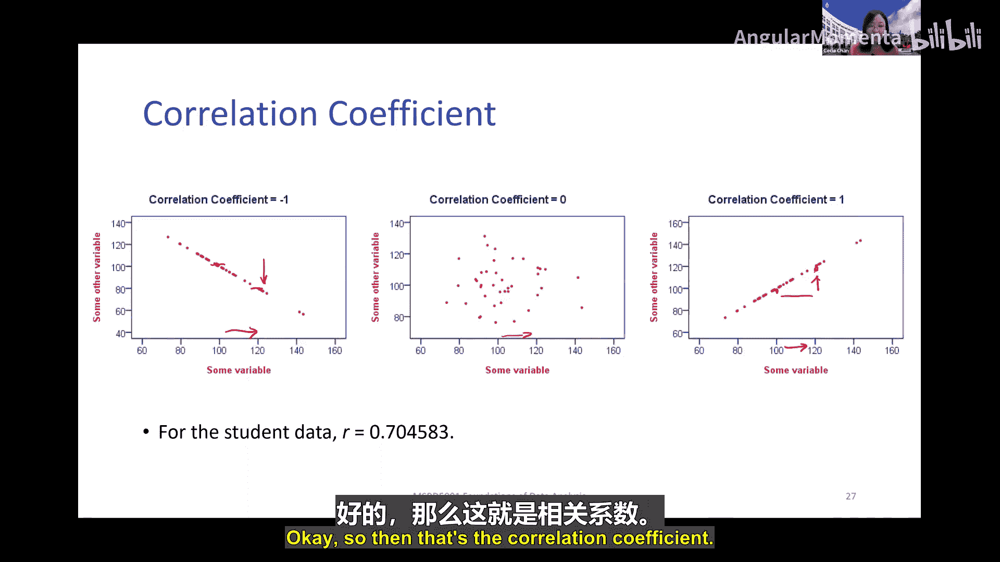

数据分析基础：03：线性模型

在本节课中，我们将要学习如何识别和描述两个变量之间的关系。我们将从理解变量本身开始，然后探讨如何通过散点图观察关系，并最终学习如何使用线性模型来量化这种关系。我们还将介绍衡量关系强度的相关系数。

---

### 变量与数据收集

当我们收集数据时，通常会记录多个特征。例如，在一项针对大学生的调查中，我们可能会收集他们的身高、体重、性别、专业和GPA等信息。每一个这样的特征都被称为一个**变量**。

对于单个变量，我们可以使用描述性统计量（如均值、最大值、标准差、四分位距等）来概括其特征。例如，我们可以计算体重的平均值或GPA的中位数。

然而，数据分析的核心目标之一是探索变量之间的关系。例如，我们可能想知道学生的身高和体重之间是否存在某种关联。

---

### 探索变量关系：散点图

为了直观地探索两个变量（例如身高 `x` 和体重 `y`）之间的关系，最有效的方法是使用**散点图**。

在散点图中，每个数据点代表一个观测对象（如一名学生）。点的横坐标 `x` 代表其身高，纵坐标 `y` 代表其体重。将所有数据点绘制在图上后，我们通过观察点的整体分布形态来初步判断关系。

观察散点图时，我们关注以下几点：
*   **形态**：点是否大致呈直线、曲线或其他特定形状分布？
*   **方向**：随着 `x` 增加，`y` 是总体增加还是减少？
*   **密集程度**：点是紧密聚集还是分散开？

如果散点图上的点大致沿一条直线分布，那么尝试用**线性模型**来描述这种关系就是合理的。

---

### 线性模型

线性模型试图用一条直线来概括散点图中所有点的趋势。其基本公式为：

`y = a + b*x + e`

其中：
*   `y` 是**因变量**（我们试图预测或解释的变量，如体重）。
*   `x` 是**自变量**（用来预测 `y` 的变量，如身高）。
*   `a` 是**截距**，表示直线与 `y` 轴的交点。
*   `b` 是**斜率**，表示直线倾斜的程度（`x` 每变化一个单位，`y` 平均变化多少）。
*   `e` 是**随机误差**，代表每个实际数据点与直线上预测值之间的偏差。因为数据点几乎不可能完全落在一条直线上，所以需要误差项 `e` 来容纳这种差异。

如果不存在误差，那么 `y` 就是 `x` 的确定性线性函数：`y = a + b*x`。

---

### 如何拟合直线？

上一节我们介绍了线性模型的概念，本节中我们来看看如何实际找到那条“最佳”直线。主要有两种方法。

#### 方法一：目测拟合

这种方法比较直观，类似于我们手动在散点图上画一条看起来最合适的直线。具体步骤如下：

以下是目测拟合的步骤：
1.  在散点图上选择两个看起来能代表整体趋势的点，例如 `(x1, y1)` 和 `(x2, y2)`。
2.  根据这两个点计算斜率 `b`：`b = (y2 - y1) / (x2 - x1)`。
3.  选择其中一个点（如 `(x1, y1)`）和计算出的斜率 `b`，代入公式 `y1 = a + b*x1`，解出截距 `a`：`a = y1 - b*x1`。

例如，选择点 `(69, 160)` 和 `(78, 225)`，计算得斜率 `b = 7.2`，截距 `a = -336.8`，从而得到直线方程。

这种方法的缺点是，不同的人可能会选择不同的点，从而得到不同的直线，结果不够客观和精确。

#### 方法二：最小二乘法拟合

为了找到一条在数学意义上“最佳”的直线，我们使用**最小二乘法**。其核心思想是：找到一条直线，使得所有数据点到这条直线的**垂直距离的平方和**最小。这个平方和就是总误差 `S`。

对于第 `i` 个数据点 `(x_i, y_i)`，其预测值为 `a + b*x_i`，误差为 `e_i = y_i - (a + b*x_i)`。最小二乘法的目标是：

最小化总误差 `S = Σ (y_i - (a + b*x_i))^2`，其中求和从 `i=1` 到 `n`。

通过分别对 `a` 和 `b` 求偏导数并令其为零，我们可以推导出计算 `a` 和 `b` 的公式：

`b = Cov(x, y) / Var(x)`
`a = mean(y) - b * mean(x)`

其中，`Cov(x, y)` 是 `x` 和 `y` 的协方差，`Var(x)` 是 `x` 的方差，`mean()` 表示平均值。

使用最小二乘法拟合出的直线（通常显示为绿色）比目测拟合的直线（橙色）更优，因为它最小化了所有点的总误差。一旦得到线性模型，我们就可以用一个新的 `x` 值（如某学生的身高）来预测其对应的 `y` 值（如体重）。

---

### 相关系数

除了用直线拟合，我们还需要一个数值指标来衡量两个变量线性关系的强度和方向。这个指标就是**相关系数**，通常记为 `r`。

相关系数的计算公式为：
`r = Cov(x, y) / (SD(x) * SD(y))`
其中，`SD()` 代表标准差。

相关系数 `r` 的取值范围在 `-1` 到 `1` 之间：
*   **`r = 1`**：完全正相关。两个变量同向等比例变化。
*   **`r = -1`**：完全负相关。两个变量反向等比例变化。
*   **`r ≈ 0`**：无线性相关。一个变量的变化不能预测另一个变量的线性变化。

例如，利用学生身高体重数据计算出的相关系数 `r = 0.7`，这表明两者之间存在较强的正相关关系。

通过观察不同 `r` 值对应的散点图，可以直观理解其含义：
*   `r = -1`：点严格落在一条向下倾斜的直线上。
*   `r = 0`：点呈随机云团状，无明确方向。
*   `r = 1`：点严格落在一条向上倾斜的直线上。

需要注意的是，相关系数仅衡量**线性**关系的强弱。即使 `r ≈ 0`，两个变量之间也可能存在其他非线性的关系（如曲线关系），这就需要借助其他分析方法来发现。

---

### 总结

本节课中我们一起学习了如何分析两个变量之间的关系。
1.  我们首先回顾了变量和描述性统计。
2.  然后学习了使用**散点图**来直观探索变量间的关系。
3.  接着，我们引入了**线性模型** (`y = a + b*x + e`) 来量化这种关系，并介绍了两种拟合直线的方法：**目测拟合**和更精确的**最小二乘法拟合**。
4.  最后，我们学习了**相关系数 `r`** 的概念，用它来衡量两个变量线性关系的强度和方向（取值范围从 `-1` 到 `1`）。

理解这些基础概念是进行更复杂数据分析的重要第一步。