# 004：概率 📊

在本节中，我们将学习概率论的基础知识。概率是衡量事件发生可能性的数学工具，在数据分析中至关重要。我们将从基本概念开始，逐步深入到概率模型和定理。

## 实验、样本空间与事件

上一节我们介绍了数据分析的框架，本节中我们来看看概率论的核心基础。首先，我们需要理解三个基本术语：实验、样本空间和事件。

*   **实验**：指结果不确定的行动。例如，抛一枚硬币。
*   **样本空间**：指实验所有可能结果的集合，通常用 **S** 表示。例如，抛一枚硬币的样本空间是 **S = {H, T}**，其中 H 代表正面，T 代表反面。
*   **事件**：指样本空间 **S** 的一个子集。例如，抛硬币得到正面是一个事件；掷一个六面骰子得到点数1或2也是一个事件。

## 概率的定义与性质

理解了基本术语后，我们可以正式定义概率。概率是衡量事件发生可能性的度量。

概率 **P(A)** 定义为事件 **A** 中期望结果的数量除以所有可能结果的数量。用公式表示为：
**P(A) = (期望结果的数量) / (所有可能结果的数量)**

关于概率，有以下重要事实：
1.  任何事件的概率都是一个介于 **0** 到 **1** 之间的数。
2.  整个样本空间的概率为 **1**，即 **P(S) = 1**。
3.  如果两个事件 **A** 和 **B** 不能同时发生（互斥），则事件 **A** 或 **B** 发生的概率是它们各自概率的和，即 **P(A 或 B) = P(A) + P(B)**。

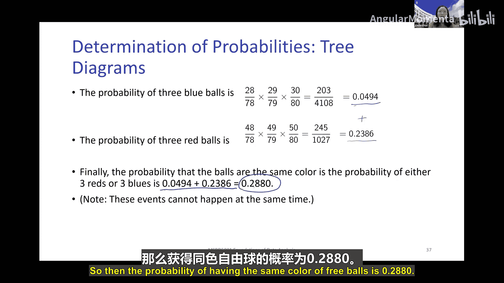

## 树状图

当事件组合变得复杂时，计算概率可能变得困难。树状图是一种有用的工具，可以直观地展示所有可能结果及其概率。

以下是构建树状图的步骤：
1.  从初始点开始，为第一次实验的每个可能结果画一个分支。
2.  在每个分支上，标注该结果发生的概率。
3.  从第一次实验的每个结果出发，重复步骤1和2，为后续实验画分支。
4.  要计算沿着特定路径（一系列结果）的概率，将路径上所有分支的概率相乘。
5.  要计算某个事件（可能对应多条路径）的概率，将所有相关路径的概率相加。

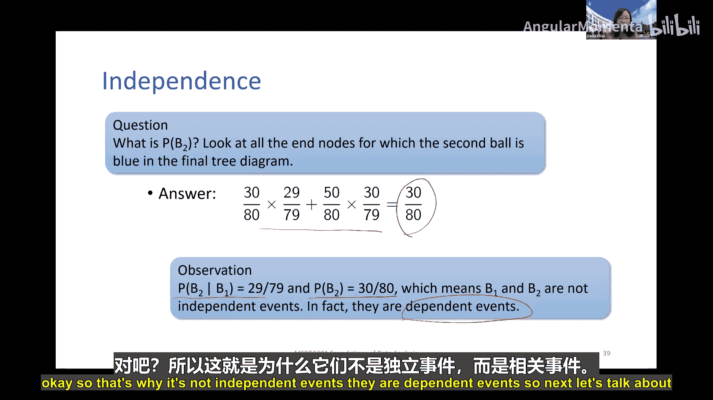

## 条件概率与独立性

在许多情况下，一个事件的发生会影响另一个事件发生的概率。这引出了条件概率的概念。

事件 **B** 在事件 **A** 已发生条件下的概率，称为条件概率，记作 **P(B|A)**。计算公式为：
**P(B|A) = P(A 且 B) / P(A)**

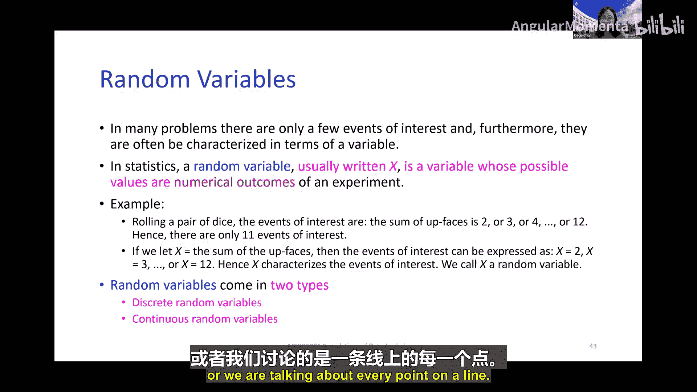

如果事件 **A** 的发生不影响事件 **B** 发生的概率，即 **P(B|A) = P(B)**，则称事件 **A** 和 **B** 是**独立**的。对于独立事件，它们同时发生的概率等于各自概率的乘积：**P(A 且 B) = P(A) * P(B)**。

## 随机变量

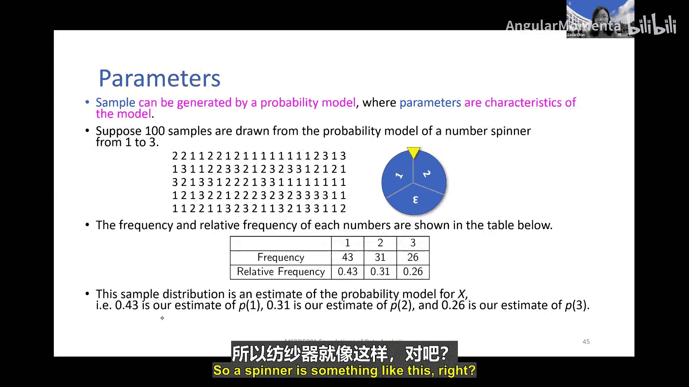

为了更方便地处理数值结果，我们引入随机变量的概念。

**随机变量**是一个变量，其可能取值是某个实验的数值结果。通常用大写字母如 **X** 表示。随机变量分为两类：
*   **离散随机变量**：取值是可数的（通常是整数）。
*   **连续随机变量**：取值是连续的（可以是某个区间内的任意实数）。

## 离散概率模型

对于离散随机变量，我们使用概率质量函数来描述其概率分布。

**概率质量函数** **p(x)** 给出了随机变量 **X** 取特定值 **x** 的概率，即 **p(x) = P(X = x)**。所有可能取值的概率之和为1。

两个重要的参数用于描述概率分布：
*   **期望（均值） μ**：衡量分布的中心趋势。计算公式为 **μ = E[X] = Σ [x * p(x)]**。
*   **方差 σ²**：衡量分布的离散程度。计算公式为 **σ² = Var(X) = E[(X - μ)²] = Σ [(x - μ)² * p(x)]**。方差的平方根称为标准差 **σ**。

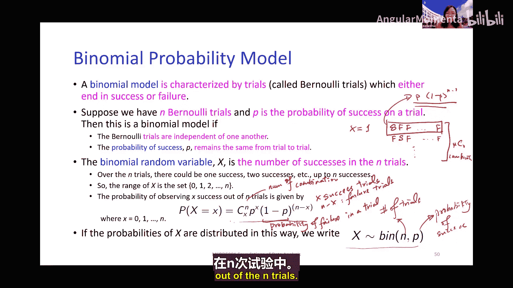

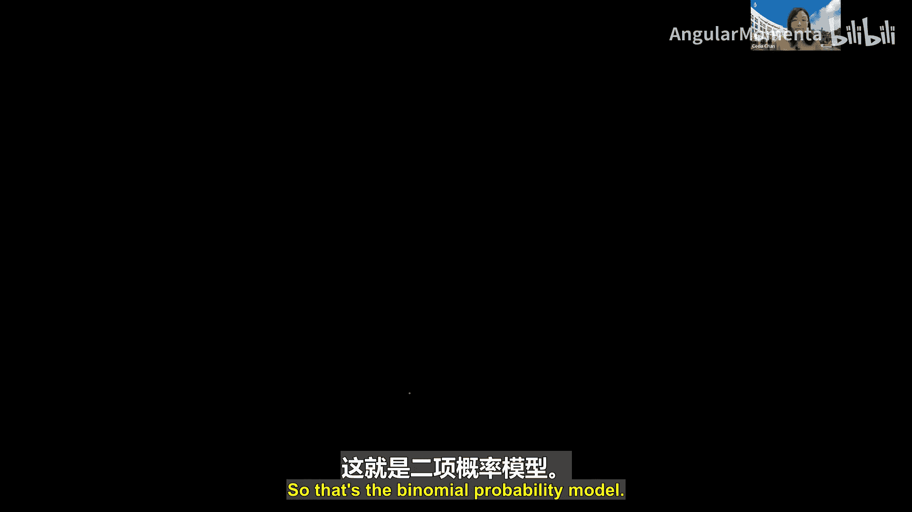

## 二项分布

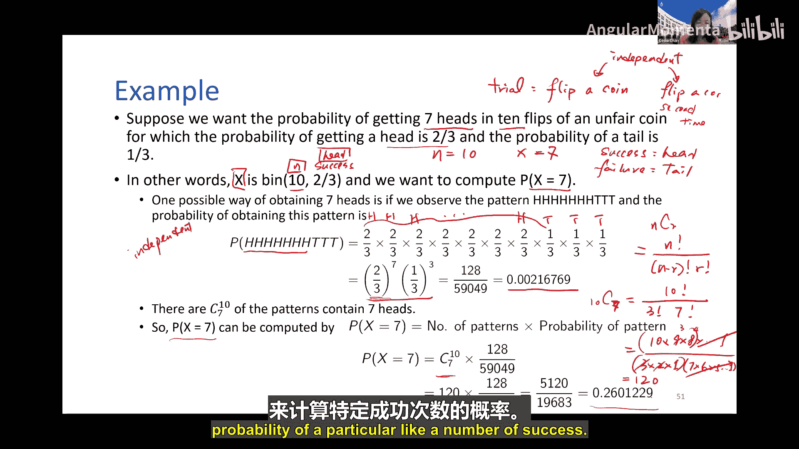

二项分布是一种常见的离散概率模型，适用于满足以下条件的“伯努利试验”：
1.  试验由 **n** 次相同的独立试验组成。
2.  每次试验只有两种可能结果：“成功”或“失败”。
3.  每次试验“成功”的概率 **p** 保持不变。

在二项分布中，随机变量 **X** 表示 **n** 次试验中“成功”的次数。**X** 的概率质量函数为：
**P(X = k) = C(n, k) * p^k * (1-p)^(n-k)**, 其中 k = 0, 1, ..., n。
这里 **C(n, k)** 是组合数。我们记作 **X ~ Binomial(n, p)**。
其期望和方差为：**μ = np**, **σ² = np(1-p)**。

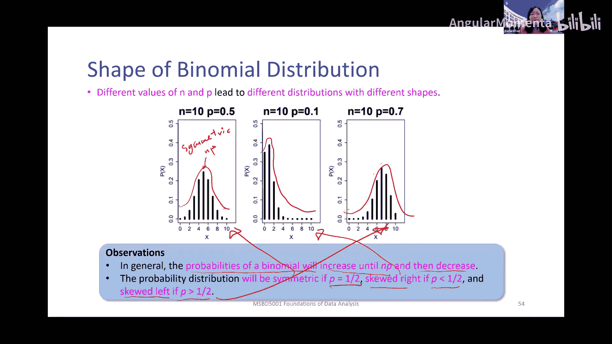

## 泊松分布

泊松分布是另一种常见的离散分布，用于描述在固定时间或空间间隔内，随机事件发生的次数。

如果随机事件在单位时间内发生的平均次数为 **λ**，那么随机变量 **X**（表示在给定间隔内事件发生的次数）服从泊松分布。其概率质量函数为：
**P(X = k) = (e^(-λ) * λ^k) / k!**, 其中 k = 0, 1, 2, ...
我们记作 **X ~ Poisson(λ)**。
其期望和方差相等：**μ = λ**, **σ² = λ**。

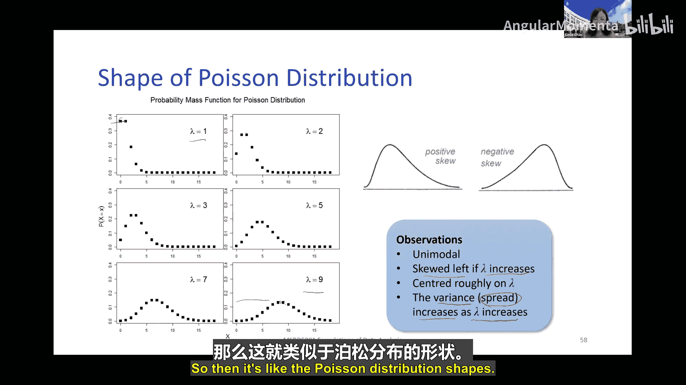

## 连续概率模型

对于连续随机变量，我们使用概率密度函数来描述其分布。

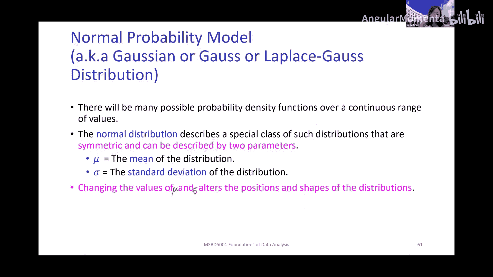

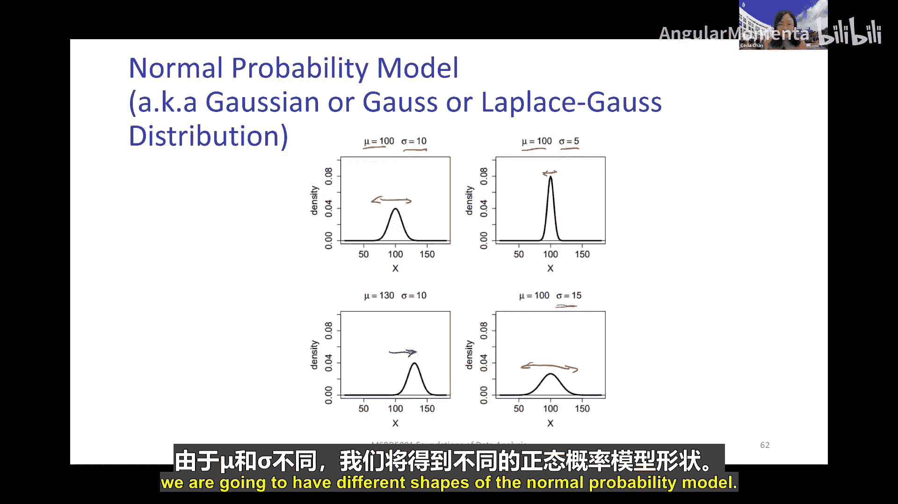

**概率密度函数 f(x)** 描述了随机变量在任意点附近取值的相对可能性。曲线下的总面积代表概率，且等于1。事件 **a < X < b** 的概率是密度函数在区间 **[a, b]** 上的积分面积。
连续随机变量的期望和方差通过积分定义：
**μ = E[X] = ∫ x * f(x) dx**
**σ² = Var(X) = ∫ (x - μ)² * f(x) dx**

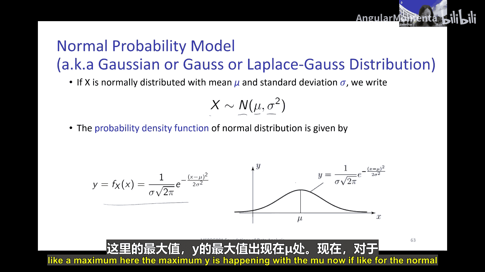

## 正态分布

正态分布（又称高斯分布）是最重要的连续分布之一，其曲线呈对称的钟形。

正态分布由两个参数完全决定：均值 **μ**（决定中心位置）和标准差 **σ**（决定分布的宽度）。记作 **X ~ N(μ, σ²)**。
当 **μ = 0** 且 **σ = 1** 时，称为标准正态分布，记作 **Z ~ N(0, 1)**。任何正态变量 **X** 都可以通过标准化转换为标准正态变量：**Z = (X - μ) / σ**。

## 均匀分布与指数分布

除了正态分布，还有其他重要的连续分布。

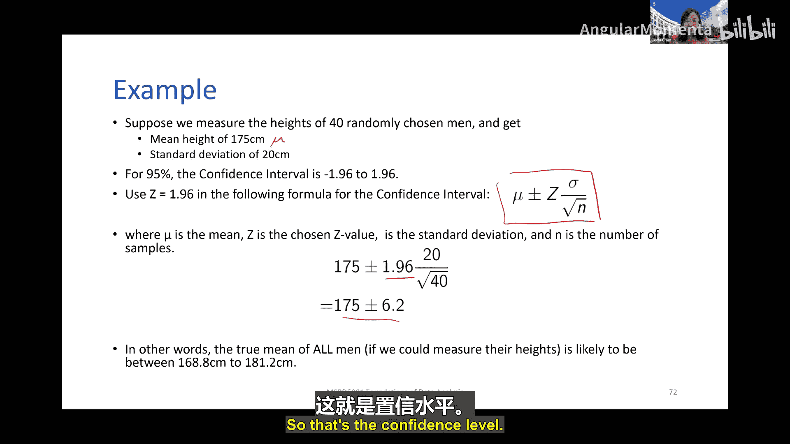

*   **均匀分布**：在区间 **[a, b]** 上，概率密度是常数。记作 **X ~ Uniform(a, b)**。其密度函数为 **f(x) = 1/(b-a)**, 当 a ≤ x ≤ b。期望和方差为：**μ = (a+b)/2**, **σ² = (b-a)²/12**。
*   **指数分布**：常用于描述独立随机事件发生的时间间隔。由一个参数 **λ**（速率）决定，记作 **X ~ Exponential(λ)**。其密度函数为 **f(x) = λe^(-λx)**, 当 x ≥ 0。期望和方差为：**μ = 1/λ**, **σ² = 1/λ²**。

## 置信区间

当我们用样本统计量（如样本均值）估计总体参数时，需要评估估计的可靠性。置信区间提供了参数可能落入的一个范围。

例如，**95% 置信区间**意味着，如果我们重复抽样多次，大约有95%的区间会包含真实的总体参数。对于总体均值的估计，当样本量较大时，95%置信区间可以近似为：**样本均值 ± 1.96 * (样本标准差 / √n)**。

## 联合概率分布

当我们同时考虑两个或多个随机变量时，需要研究它们的联合分布。

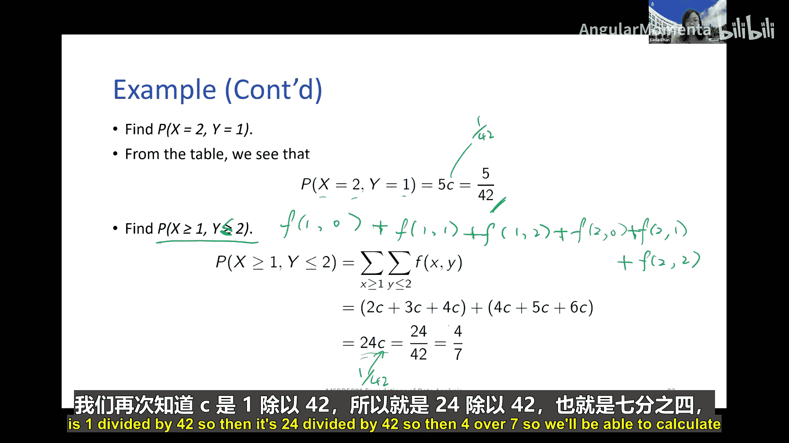

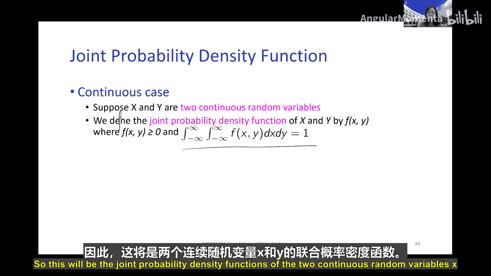

对于两个离散随机变量 **X** 和 **Y**，其**联合概率质量函数** **p(x, y)** 给出了 **X = x** 且 **Y = y** 的概率。边缘分布可以通过对联合分布求和得到，例如 **p_X(x) = Σ_y p(x, y)**。
如果 **X** 和 **Y** 独立，则联合概率等于边缘概率的乘积：**p(x, y) = p_X(x) * p_Y(y)**。
对于连续随机变量，有类似的**联合概率密度函数** **f(x, y)**，概率通过对密度函数在相应区域上二重积分得到。

## 贝叶斯定理

贝叶斯定理是概率论中一个非常强大且实用的公式，它描述了如何利用新的信息更新事件的概率。

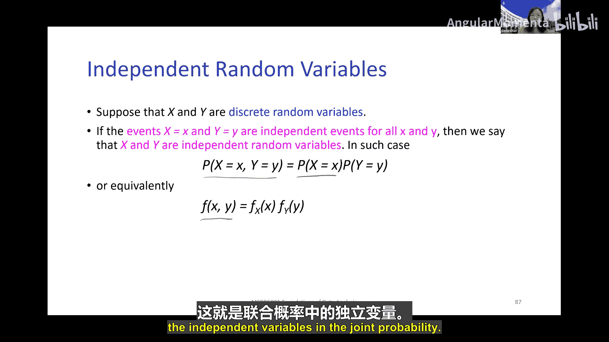

贝叶斯定理的公式如下：
**P(A|B) = [P(B|A) * P(A)] / P(B)**
其中：
*   **P(A|B)** 是后验概率，即在观察到事件 **B** 后，事件 **A** 发生的概率。
*   **P(B|A)** 是似然概率。
*   **P(A)** 是先验概率，即在观察 **B** 之前，对 **A** 发生可能性的初始判断。
*   **P(B)** 是证据或边际似然。

当样本空间由互斥事件 **A1, A2, ..., An** 构成时，全概率公式为 **P(B) = Σ_i P(B|Ai) * P(Ai)**。结合贝叶斯定理，可以计算在观察到 **B** 后，某个特定原因 **Ak** 发生的概率：
**P(Ak|B) = [P(B|Ak) * P(Ak)] / [Σ_i P(B|Ai) * P(Ai)]**

---

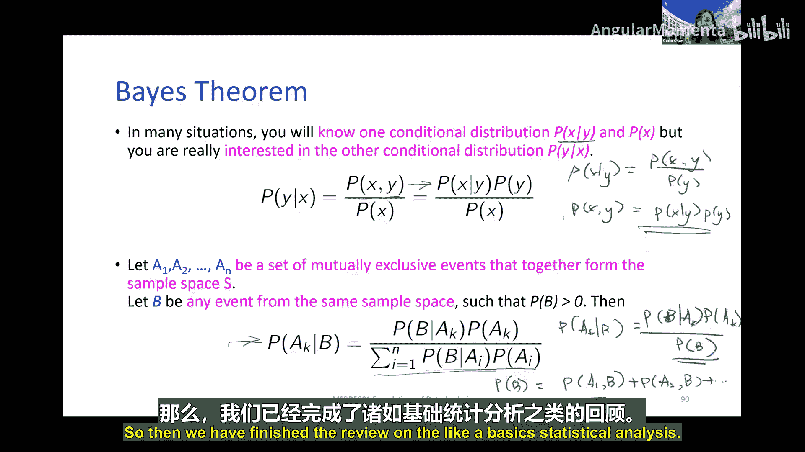

本节课中我们一起学习了概率论的核心概念，从基本的定义、性质到具体的概率模型（如二项分布、正态分布），再到高级主题如置信区间和贝叶斯定理。这些工具是进行统计推断和数据分析的基石，能够帮助我们量化不确定性并对未来结果做出预测。