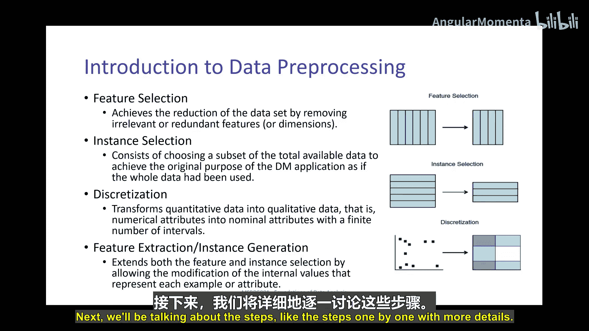
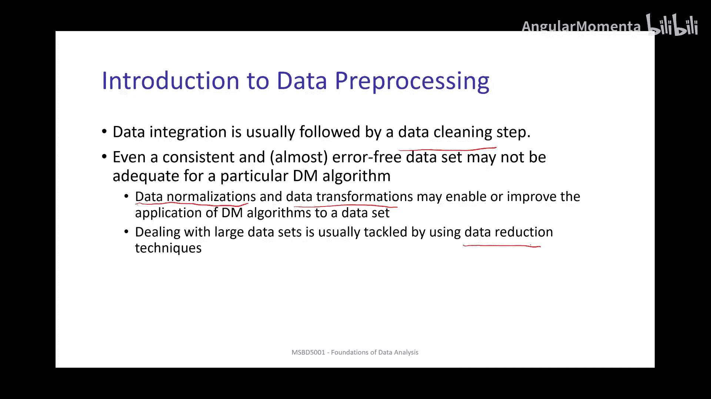

# 005：数据预处理 📊

在本节课中，我们将要学习数据预处理。数据预处理是数据分析（如数据挖掘）中至关重要的一步。只有当我们对数据进行预处理并获得高质量数据后，才能获得良好的分析性能。数据预处理正是帮助我们实现这一目标的关键环节。本节我们将探讨数据预处理面临的挑战，特别是大数据环境下的挑战，然后概述数据预处理的具体内容，接着介绍其常见步骤和一系列可用的技术。我们会提及许多不同的术语和技术，有些会详细介绍，有些可能较为高级，虽无法深入探讨，但我们希望你能对数据预处理有更全面的了解，以便在未来需要处理数据时，知道基本步骤以及可以进一步探索的方向。

## 挑战与可能性

现在，每当我们谈论大数据时，一个主要的挑战当然是可扩展性问题。我们总是在处理海量的数据和多样的数据。因此，我们需要方法来处理这些大量的数据和巨大的数据差异。与其他数据处理技术类似，我们仍在探索适用于大数据的技术。通常，当前的方法可能还不够。这意味着，对大数据的预处理也创造了新的可能性，我们正在寻找新的技术和新的方法来处理大数据的预处理。

对于新技术，近年来已有一些探索，例如在数据处理中使用分布式计算（如Hadoop、Spark），以及在特征选择、不平衡学习等方面的应用。这里最重要的问题是，我们如何能处理好数据预处理，使其能够与其他数据挖掘挑战以及数据分析问题相适应。

## 什么是数据预处理？

数据预处理是知识发现过程中的一个非常重要的步骤，也就是KDD过程。例如，你可以看到，我们首先有数据，有数据库。为了发现知识，主要的步骤包括：问题定义、问题理解、数据预处理、数据挖掘、评估和结果探索。首先，我们当然需要解决问题，需要知道约束条件是什么，需要获得什么样的结果等。这意味着我们也需要理解问题，理解我们的数据。

然后，我们需要进行数据预处理。数据预处理之后，数据就为数据挖掘做好了准备。数据挖掘之后，我们仍然需要进行评估，并需要探索结果，看看是否存在问题，是否可以进一步改进。很可能我们需要返回并重新开始这个过程，经过多次迭代，直到对结果满意，我们才能得到结果，并从中提取知识。数据预处理是一个非常重要的步骤，它将影响最终的性能和知识发现。

那么，为什么我们需要数据预处理呢？原因是，大多数时候我们的数据可能以不同的格式存在，特别是现在我们谈论的是大数据，其多样性意味着我们将看到许多不同格式的数据。例如，我们可能查看结构化数据，如表格，它表示值和属性之间的关系；或者可能是非结构化数据，如文本，它是一系列字符和单词；此外，我们可能还会查看音频、视频数据。这些非结构化数据也需要进行预处理，以便我们能够继续数据分析或数据处理的下一阶段。

因此，数据预处理可以被视为将原始数据（即我们第一步获得的数据）转换为格式良好的数据，使其适合数据挖掘分析。因为在许多数据挖掘模型或数据分析统计中，它们要求数据具有特定的格式。如果数据已经是这些格式，那么我们可以期待更好的结果。如果数据本身就不合适，那么我们当然不会得到好的结果。这就是为什么我们需要数据预处理。

## 理解数据：属性和类型

在我们进行数据预处理之前，其中一个步骤是理解问题。因此，让我们也稍微讨论一下数据到底是什么。通常，当我们谈论数据时，我们指的是数据对象及其属性的集合。例如，我们可以谈论个人信息的集合，或者关于人群的信息集合。那么，属性就是这些人的特征或属性。例如，如果我们谈论人，我们可能会用他或她的眼睛颜色来描述一个人；如果我们谈论的是人们的医疗数据，那么体温可能被包含在内。你可以看到，不同的特征会有不同类型的值，这意味着这些是不同的属性。

我们通常将它们称为属性，这些属性也会有不同的值。有时我们会使用其他术语来代替属性，如变量、字段、特征，它们都是关于对象的属性。

一旦我们设定了一组属性，那就是描述特定对象的信息。因此，有时我们将它们称为记录、点、样本、实体或实例。然后，我们有了对象的集合或记录的集合，这就是数据。

现在我们谈论属性，显然可以看到它会有许多不同类型的值。那么，让我们谈谈属性的类型。属性的类型可以像这张图一样分类：你可以看到属性可以分为两个子类别：分类属性和数值属性。让我们先谈谈分类属性。分类属性意味着它是定性的，我们谈论的是一个特定的值集合，它是一个预定义的值集合，并且可以进一步分为名义类型或序数类型。

对于名义类型，意味着这些值不能被量化，值之间没有特定的顺序。例如，性别，我们可能有男性、女性。男性和女性之间没有顺序，我们只是有两个不同的值。因此，它不能被量化，没有顺序。另一个例子是眼睛颜色。例如，眼睛颜色可以是蓝色、绿色、棕色。同样，这些值之间没有顺序，它们只是不同的值，是一个特定的集合。

除了名义值，另一个类别是序数值。序数值与名义值不同，它有一个顺序，有顺序，但值之间的距离是未知的。例如，字母等级，我们知道A比B等级高，B比C好，但我们知道A和B之间的确切差异或距离吗？我们不知道，我们无法量化它。这就是为什么序数属性是分类属性，它不能被量化，但又与名义属性不完全相同，因为它有顺序。这就是为什么我们有序数类型的值。除了字母等级，另一个例子可能是教育水平。例如，小学教育水平。

通常我们这样排序：最高的教育水平可能是大学毕业生或以上，高中通常在中间，小学在那之前。所以，你可以再次看到教育水平是有顺序的。另一个例子是李克特量表。当我们填写问卷时，经常需要在“喜欢”、“中立”、“不喜欢”之间选择。我们知道“中立”是中间点，它必须在“喜欢”和“不喜欢”之间，不会在“喜欢”之前，而“不喜欢”比“中立”更负面，比“喜欢”更负面，依此类推。

这就是名义和序数。接下来让我们谈谈数值属性。你可以看到，在数值属性下，我们也有两个子类别：离散型和连续型。

对于数值属性，与分类属性不同，数值属性是定量的。它可以被量化，这意味着数值就是数字。在数字中，我们可以进一步将它们分类为离散值和连续值。对于离散值，它是可数的。例如，人数，我们会说一个人、两个人、三个人，我们不会说有1.2个人。虽然在某些变体中可能有，但大多数时候我们会有1、2、3，所以那是离散的，并且是可数的。

除了离散型，我们还有连续型。这意味着数据可以被测量。这意味着数值可以被测量，我们指的是某个水平。例如，身高、分数，这些数字可以被测量。即使在像身高或分数这样可以被测量的值中，我们也可以进一步将它们分类为区间数据或比率数据。对于区间数据，意味着这些数值我们可以进行计算，可以做加法、减法。例如，摄氏温度，10摄氏度和20摄氏度，差异是10摄氏度。但对于摄氏度，没有零点。

那么，我们有什么例子是非区间的，即比率数据呢？开尔文温度，有一个零点。所以比率数据实际上是区间数据，数值我们可以进行计算，但有一个零点。这些是我们用来描述属性的常见类型。我们需要知道属性的类型，以便决定在数据预处理步骤中应该如何处理这些属性。这就是为什么我们必须提到数据类型。

## 为什么需要数据预处理？

除了我们看到数据的不同变化之外，另一个原因是，我们可能必须一直处理的问题是：如果我们有完美的数据就好了。这意味着没有错误，一切都如我们所愿，那么我们可以完美地使用数据与模型，并给出好的结果。但不幸的是，在现实生活中，错误无处不在。因此，我们需要处理这些情况。

那么，数据可能出现哪些不良情况呢？可能有一些缺失值，某些值缺失，某些记录不完整，某个特定记录的少数属性有缺失。想象一下问卷，有些人可能漏掉了某些问题，最终导致缺失值。有时会有噪声，例如，有人错误地输入了一个错误的数字，这个错误的数字不符合正常的数值范围，那么它就像是噪声。此外，我们可能在不同地方有数据，但来自不同来源的数据副本或数据可能存在一些冲突值。我们该如何处理？我们需要找出该怎么做。有时我们可能查看非常大的数据集，那么我们如何减少它们，使它们能够在特定情况下进行处理？这就是为什么我们现在讨论的所有这些实际上都与数据质量有关。

如果我们有低质量的数据，那么就会有低质量的性能。当然，我们希望有高质量的数据。但即使我们面对低质量的数据，我们也可以做一些事情来看看是否可以改进。那么，现在我们来谈谈数据质量。数据质量可能涉及很多方面。这些是我们在谈论数据质量时通常可以查看的方面，例如：

*   **完整性**：例如，我们可以回答数据集中是否有缺失值。对于某些记录、某些属性，是否没有提供值？如果有些值没有提供，那么数据就不完整，完整性就低。
*   **有效性**：这意味着数据是否有效。例如，如果我们希望日期数据包含日、月和年，那么数据是否以特定方式表示这三个值？因为有时我们只要求人们填写月份和年份，可能没有日数据。但如果我们想处理一个需要日数据的问题，那么数据就无效。
*   **唯一性**：我们的数据中是否存在重复的对象、重复的数据或重复的记录？如果存在重复记录，那么我们的数据就有冗余。有时也可能存在重复的属性。同样，这种冗余会影响数据的进一步处理。
*   **一致性**：例如，我们可能有一个特定数据集或表格的多个副本。人们更新并存储了不同的版本。当我们想要获取数据表时，可能需要查看它是否一致。在不同的数据存储之间是否存在任何不一致？
*   **及时性**：指的是如果我们想要某个特定时间点的数据，我们能否得到它？如果我们能在需要的时候从特定时间点获取数据，那么意味着数据是及时的，否则就有问题。
*   **准确性**：例如，我们拥有的数据是否准确？它是否真的是真实的实际数据？你可以看到，当我们获取数据时，可能通过正确的方式获得，涉及许多方面和人员，因此可能存在问题，导致数据不准确。

这些是我们在谈论数据质量时通常查看的衡量标准或方面。

## 数据预处理的主要步骤

接下来，让我们看看数据预处理的主要步骤。这里有三个主要步骤：

1.  **数据清洗**：正如我们提到的，我们的数据通常有错误。这意味着我们需要进行清洗来纠正这些错误。如果有一些不正确的数据，我们可能需要过滤掉它们；如果有冗余数据，我们可能也需要减少它们。这就是数据清洗。
2.  **数据转换**：有时，对于一些数据处理步骤或某些模型，它们需要数据具有特定的格式或表示形式。因此，如果我们原始的表示形式不同，我们可能需要将其转换为所需的表示形式，以便数据处理步骤（例如数据挖掘或数据分析步骤）能够更高效或给我们带来更好的性能。这就是数据转换，即改变数据的形态。
3.  **数据集成**：这是将来自多个数据源的数据合并。你可以看到我们这里的解释非常简单，但实际步骤并不那么简单。稍后我们会更详细地讨论，但数据集成意味着我们可能查看来自不同来源的数据，它们可能格式不同，我们需要看看是否可以将它们合并在一起。例如，如果我们查看两个关于人的不同数据集，我们需要识别两个数据集中是否有共同的人，当我们能识别出他们是共同的时，我们如何将不同的属性整合在一起。这就是数据集成，之后我们将拥有合并的数据集，然后可以用于数据处理步骤。

另外三个数据预处理步骤是数据标准化、缺失数据填补和噪声识别。

*   **数据标准化**：是将数据表达在相同的度量单位、尺度或范围内。因为对于数据，不同的数据集可能使用不同的度量单位或方式来衡量事物。例如，对于身高，我们可以用米表示值，也可以用厘米表示值。如果它们在不同的尺度、不同的单位下，如果我们把它们当作相同的来处理，就会在处理时出现问题。这就是为什么我们需要将它们转换为相同的度量单位，然后才能进一步处理。
*   **缺失数据填补**：如果我们有缺失值，那么应该怎么做？有两种主要的可能性：一是如果我们有缺失值，并且可以承受，那么我们就忽略那些记录；二是如果我们不能承受忽略那些记录，那么我们需要考虑是否有可能进行估计来填补缺失值，以使记录或对象仍然有用。
*   **噪声识别**：例如，如果数据输入时出现错误，那么一个非常奇怪的值可能被输入并存在于数据集中。那么它们就不是具有正常行为的正常值。我们需要检测它们。如果我们将其视为正确值并使用，那么当然会对我们的最终结果产生负面影响。我们希望检测这些随机错误和方差，以便决定如何处理。

除了前面的六个步骤，我们还有更多的步骤，例如特征选择、实例选择、离散化以及特征提取或实例生成。这些是关于处理数据维度问题的步骤。例如，特征选择和实例选择是关于如何减少数据集的。对于特征选择，我们希望选择相关的特征，并移除不相关或冗余的特征。我们可以这样看：我们将选择一些特征（假设每一列是一个属性或特征），那么我们将有更少的列、更少的特征，因此我们的数据可能更易于管理。类似地，对于实例选择，我们可能有很多记录（行就是记录），那么我们可能希望选择一些记录、对象、样本、实体，而不是使用整个数据集。这样做有不同的原因，但同样，选择之后，我们将查看更少的行，因此可能更易于管理。

另一种减少维度的方法可能是离散化，这意味着我们正在进行一种转换。例如，如果我们查看数值属性，那么会有很多很多值。我们可能希望将其转换为名义属性，这样我们就有更少的数值、更少的区间。这就是离散化。至于特征提取和实例生成，实际上是通过拥有新的表示形式来扩展特征和实例选择。

那么，这就是数据预处理的简要概述。接下来，我们将更详细地逐一讨论这些步骤。

## 数据预处理步骤之间的关系

但在我们逐一查看这些步骤之前，让我们也讨论一下流程或之前步骤之间的关系。我们之前提到的步骤并不是独立的步骤，意思是说我们不会只做数据清洗而不做其他步骤。很多时候，我们会根据需求组合这些步骤。例如，我们可能首先需要进行数据集成，因为我们从不同数据集、不同数据格式和不同来源收集了数据。我们需要整合它们，因为存在很多不一致性，可能是表格设计不同，我们有不同的属性，属性有不同的需求，我们需要弄清楚如何将它们放在一起，属性值也可能不同。

例如，在一个表或一个数据库中，我们可能将人的姓名（包括名、中间名和姓）放在一个属性值中，而在另一个表中，我们可能将名和姓放在两个属性中。那么，我们再次需要知道如何整合它们。此外，不同数据库之间的属性名称可能非常不同，即使相同的属性名称也可能代表不同的概念。我们将在后面的章节中讨论为什么需要数据集成以及会遇到什么问题。

那么，对于数据集成，我们可以说它是为了产生一个统一的数据集。显然，数据集成不是最后一步，它只是第一步。在我们整合了数据之后，可能仍然存在错误，比如缺失值、噪声仍然存在，而且表示形式我们可能也需要进行转换。这就是为什么它通常后面跟着一个数据清洗步骤。在数据清洗步骤之后，当我们处理了缺失值、错误后，我们可能仍然需要检查清洗后的数据集是否真的适合某些算法。如果不适合，那么我们可能需要进行数据标准化或数据转换。或者，如果清洗后的数据非常大，那么我们可能希望通过使用一些数据缩减技术来减少它。接下来，我们将开始更详细地查看数据集成，然后是数据清洗等等。

## 总结

在本节课中，我们一起学习了数据预处理的基础知识。我们首先探讨了在大数据背景下数据预处理面临的挑战和可能性。然后，我们定义了数据预处理，并理解了它在整个知识发现过程中的重要性。为了有效地进行预处理，我们深入了解了数据的构成，特别是属性和它们的类型（分类与数值，名义与序数，离散与连续）。我们还讨论了为什么需要数据预处理，核心原因在于现实世界数据的质量往往不理想，存在缺失、噪声、不一致、冗余等问题。接着，我们系统性地介绍了数据预处理的主要步骤，包括数据清洗、数据转换、数据集成、数据标准化、缺失数据填补和噪声识别，以及特征选择、实例选择等维度处理技术。最后，我们了解了这些步骤之间并非孤立，而是根据实际需求组合应用的流程。掌握这些基础知识，是进行有效数据分析的重要前提。