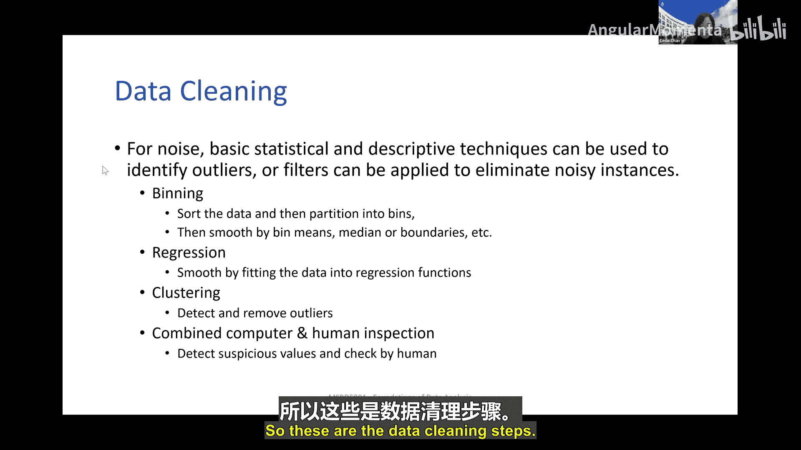

# 006：数据集成导论 📊

在本节课中，我们将要学习数据集成的基本概念、目标以及实施过程中可能遇到的挑战。数据集成是数据分析流程中至关重要的一步，它涉及将来自不同来源的数据合并成一个统一的数据集。我们将探讨如何匹配数据模式、处理冗余属性、检测重复记录，并介绍数据清洗的初步方法。

---

## 数据集成目标 🎯

数据集成的目标是明确的：收集一个单一的数据集，其中的信息来自多个不同的来源。

然而，这个过程并不简单。它实际上涉及许多步骤和处理工作。

---

## 模式与记录匹配 🔍

上一节我们介绍了数据集成的目标，本节中我们来看看实施过程中的具体挑战。例如，数据集成通常涉及模式的匹配。因为如果我们查看来自不同来源的数据，它们的设计是不同的。因此，我们需要能够查看设计上的差异，并指示属性之间的关系。

此外，我们还需要查看记录之间的关系。我们可能需要将一个来源的记录与另一个来源的记录进行匹配，然后查看是否可以将这些记录合并在一起。例如，如果我们只查看来自关系数据库的数据，那么就像是将关系数据库中的数据视为一个整体。这意味着我们收集记录，然后将相关的记录合并成一个单一的记录。

---

## 冗余与不一致性处理 ⚠️

在完成数据集成后，可能会出现冗余和不一致性问题。因为我们正在将事物合并在一起，所以可能需要识别冗余属性。当一个属性可以从另一个属性或属性组合中推导出来时，该属性就是冗余的。

我们需要避免冗余，因为这显然会增加数据量。这意味着我们需要更多的时间来处理事务。另一个问题是，冗余属性会导致过拟合。因为如果属性冗余，我们的模型将无法正确执行其任务，因为它们会受到重复或冗余属性的影响。

因此，我们可以使用相关性分析来检测冗余。以下是检测冗余的两种主要方法：

*   **对于标称属性**：我们可以使用卡方相关性检验。例如，我们可以计算卡方相关性值。然后，我们可以查看属性值的频率以及属性的期望值。当我们查看卡方值时，如果它较大，则属性（或我们这里称为变量）更可能相关。

    让我们看一个例子。假设我们正在查看两个属性，每个属性都有两个不同的值。例如，属性A有两个值：“有游戏机”和“没有游戏机”。对于属性B，我们有“科幻”和“非科幻”这两个值。然后，我们检查这些值的频率，并能够计算这些属性的期望值。你可以看到这里，“有游戏机”的总频率是300，“科幻”的总频率是10500，那么期望值是90。然后，我们按照卡方公式，使用每种属性类型的频率和期望值进行计算。计算出的卡方值是507，这表明“科幻”和“有游戏机”是相关的。因此，我们可能需要移除其中一个。

*   **对于数值属性**：我们需要另一种方法，即皮尔逊相关系数。如果皮尔逊系数接近1或-1，则意味着两个属性A和B之间存在高度相关性。你可以看到它可以用这个公式计算：
    `r_{A,B} = \frac{\sum (A - \bar{A})(B - \bar{B})}{(n-1)\sigma_A \sigma_B}`

除了相关性，协方差也被广泛使用。相关性和协方差之间的关系在这里给出。因此，我们可以使用协方差来衡量属性的冗余性。

---

## 重复记录检测 🔄

除了检测冗余属性，还可能存在重复记录。当我们有重复记录时，可能会出现不一致性。例如，如果我们识别出不同的元组（记录是相同的），那么通过使用其他属性，我们可能在不同记录之间的另一个属性上出现不一致的值。

因此，我们需要考虑如何处理不一致性。有时，检测重复记录可能不那么明显。例如，来自不同数据库或数据集、数据源的记录可能使用不同的度量系统。但是，如果我们将它们转换为特定的度量单位，那么这些记录或实例可能是相同的。例如，我们可能有使用公制系统表示的值（如米），或者有使用英制系统表示的值（如英尺）。两者都表示高度或长度，但如果两个数据集使用不同的度量单位，这意味着数值可能看起来不同，但它们实际上可能代表不同表中同一实体或对象的相同值。这就是为什么我们说有时重复的元组不那么容易识别。

现在，找到重复记录或重复属性（尤其是对于标称属性）并不容易。因为标称属性是值，如果我们想比较那些文本属性值或其他类型的非数值属性值，我们需要一些特定的距离度量。通常，我们可能需要使用某些基于字符或序列的距离或相似性度量。例如，一些基于序列或字符的相似性或距离度量可以是编辑距离、Jaccard算法等。稍后我们将在另一节中详细讨论这些字符串距离度量。

在识别了重复值之后，我们可能需要识别重复记录。之前提到的度量方法在衡量两个属性值之间的相似性时很有用，但我们需要检测重复记录。因此，我们需要诸如概率方法、监督方法、基于距离的方法或聚类算法等方法。同样，我们将在另一节中讨论这些。

---

## 数据清洗简介 🧹

在数据集成之后，我们可能需要进行数据清洗。数据清洗意味着我们正在处理包含缺失、错误、错误数据或非标准表示的“脏数据”。我们需要数据清洗来提高性能，因为如果我们处理脏数据，并且脏数据的比例很高，那么我们当然不会得到理想的结果。

脏数据的问题来源可能包括纯粹的数据输入错误。例如，我们在打字或数据输入时经常犯错误。例如，你可能已经注意到在我的笔记或幻灯片中，经常有打字错误、拼写问题。这些就是数据输入错误。那么，当你出现拼写错误时，你该如何处理？或者有些数字输入错误，可能以不正常的方式输入。那么你应该如何处理？脏数据的另一个来源可能是更新错误。例如，当你更新数据时，有时可能更新为一个错误的数字，或者更新之间存在不一致性。这意味着，如果你查看它，它是最新的数据吗？或者它是否被错误地更新了？还可能是传输错误。

通常，当我们谈论数据清洗和处理脏数据时，我们主要讨论的是缺失数据（缺失值）或错误数据（噪声数据）。为了处理这两种形式的脏数据，我们需要不同的方法。

以下是处理脏数据的主要策略：

*   **对于缺失值**：我们需要决定是否可以忽略那些包含缺失值的记录或实例，即简单地将它们从数据中移除。如果我们不能承受移除那些有缺失值的记录，那么我们需要考虑如何处理缺失值。我们是否可以替换它？是否可以用另一个值填充它？例如，我们可能需要选择一个特定的常数值，然后手动填充，而不是在记录中保留缺失值。或者我们可能想要估计数据，然后使用一些估计值来替换那些缺失值。典型的估计方法可以是属性的均值、最可能的值或全局常量（某个固定值）。

*   **对于噪声**：我们需要使用统计或描述性技术来识别错误值，这意味着这些值不正常，因此它们是异常值。或者有时我们可能应用过滤器来消除那些带有错误值的噪声实例。

这里有一些处理噪声数据的方法。其中之一是分箱，这意味着我们对数据进行排序，然后将它们分区到箱中，然后通过均值、中位数或边界等方法进行平滑处理。让我们看一个例子。假设我们正在进行分箱，我们可以进行等宽分区。这意味着我们试图将值的范围（即最小值和最大值之间的差值）分成n个等大小的区间。例如，如果a和b是属性的最低和最高值，那么区间的宽度将是 `(b-a)/n`。然后，我们根据值的范围、值的区间来划分数据。另一种分区可以是等频分区。这意味着我们查看频率。然后，我们再次将范围分成n个区间，每个区间应具有大致相同数量的数据点。

让我们看一个等频分箱的例子。你可以看到这里有12个排序后的值。对于等频，意味着我们应该有相同数量的点。这意味着前四个点在第一个箱中，接下来的四个点在下一个箱中，最后四个点在第三个箱中。然后，你可以看到我们有三个箱。K，正如我们之前提到的。在有了箱之后，我们需要进行平滑处理。例如，我们可以通过均值进行平滑。那么9是第一个箱的均值，所以我们用均值替换所有值，依此类推处理第二个箱和第三个箱。如果我们使用另一种方法进行平滑，例如，我们使用边界。那么在每个箱内，我们取边界最小值和最大值，然后尝试将它们转换为最接近的边界值。你可以看到这里，8和9比15更接近4，所以它们都被改为4，替换为4。然后我们有边界，类似地，对于21，我们将其保留为边界值，而24更接近25，所以我们得到那个值。这就是分箱的例子。

除了分箱，我们如何处理异常值（噪声）？我们可以使用回归，通过将数据拟合到回归函数中。或者进行聚类，这意味着我们将实例或点聚类在一起，这样就会检测到异常值。或者通过人工检查，我们可以检测可疑值，然后手动检查它们。这些就是数据清洗的步骤。

---

在本节课中，我们一起学习了数据集成的核心目标与流程。我们探讨了如何匹配不同数据源的模式和记录，识别并处理由集成引起的属性冗余与记录重复问题。最后，我们介绍了数据清洗的基本概念，包括处理缺失值和噪声数据的方法，如分箱、回归和聚类。掌握这些步骤是构建高质量、可用于分析的数据集的基础。