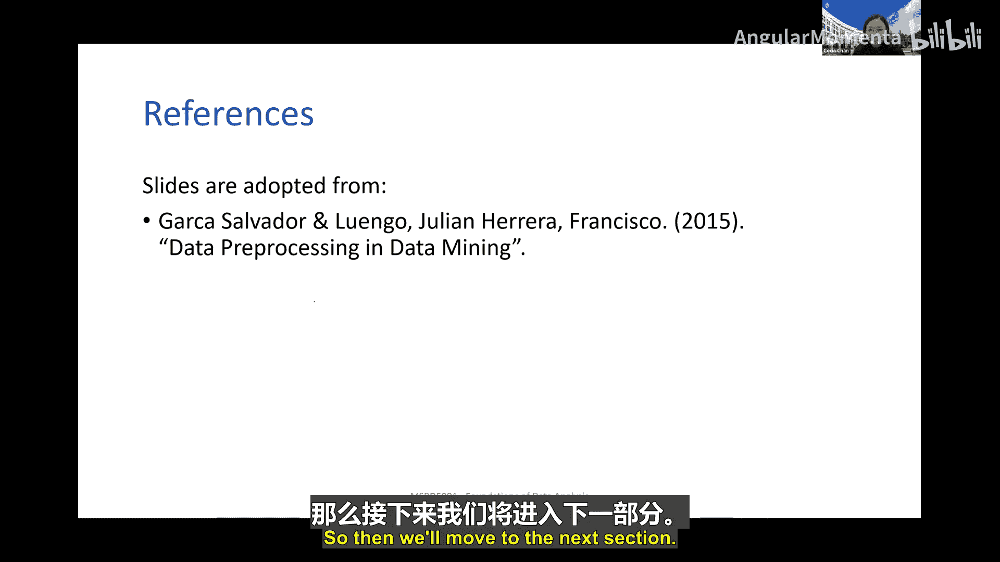

数据分析基础：P7：数据归一化与数据变换

在本节课中，我们将要学习数据归一化与数据变换。这是数据预处理的关键步骤，旨在将原始数据转换为更适合分析模型的形式，以提升模型性能。

上一节我们介绍了数据预处理的基本概念，本节中我们来看看如何通过归一化和变换来优化数据。

### 数据归一化

有时，原始属性值（如收入）的数值范围过大或过小，这种巨大的差异会影响模型的性能。因此，我们需要将原始值转换到一个特定的范围内。

以下是几种常见的归一化方法：

**均值归一化**
当已知属性的最大值和最小值时，可以使用此方法。其目标是将值缩放到一个固定范围，例如 [0, 1]。公式如下：
`新值 = (原始值 - 最小值) / (最大值 - 最小值) * (新范围最大值 - 新范围最小值) + 新范围最小值`
例如，若收入范围是 12000 到 98000，想将其映射到 0 到 1 之间，则 73000 转换后的值为 0.0716。

**Z-Score 归一化**
当不知道属性的最大值和最小值时，可以使用此方法。它将数据转换为均值为 0、标准差为 1 的标准正态分布。公式如下：
`新值 = (原始值 - 均值) / 标准差`
例如，若某属性均值为 50，标准差为 10，则原始值 60 转换后为 1.0。

**小数定标归一化**
这是一种简单的方法，通过移动小数点来缩放数值。公式如下：
`新值 = 原始值 / (10^j)`
其中，j 是使最大绝对值小于 1 的最小整数。例如，数值 1234 可以通过除以 1000 (10^3) 转换为 1.234。

### 数据变换

除了归一化，我们有时还需要通过组合原始属性来创建新的属性，这称为数据变换。

**线性变换**
这是最典型的变换方式，通过原始属性的线性组合来创建新属性。公式如下：
`新属性 = a1 * 属性1 + a2 * 属性2 + ... + an * 属性n`

**多项式变换**
如果线性变换效果不佳，可以尝试更高阶的多项式变换。例如，二次变换公式为：
`新属性 = a * 属性1^2 + b * 属性1 * 属性2 + c * 属性2^2 + ...`

**特定领域变换**
有时需要结合领域知识创建新属性。例如，在几何问题中，可以将三角形的顶点坐标 (x1, y1), (x2, y2), (x3, y3) 组合成一个新的面积属性 `a`。

**秩变换**
此方法将数值转换为正态分数。首先将属性值排序并赋予秩（排名），然后使用以下公式计算正态分数：
`正态分数 = φ^(-1)( (秩 - 0.5) / 总样本数 M )`
其中，φ 是标准正态分布的累积分布函数。

**Box-Cox 变换**
当我们不确定最佳变换形式时，可以使用 Box-Cox 变换来搜索。它通过一个参数 λ 来变换数据，使其更接近正态分布。公式如下：
`当 λ ≠ 0 时: 新值 = (x^λ - 1) / λ`
`当 λ = 0 时: 新值 = log(x)`
我们会在一系列 λ 值（如 -3 到 3）中进行搜索，选择使结果最接近正态分布的那个。对于包含负值的数据，需要引入偏移参数 C：
`新值 = ((x + C)^λ - 1) / (λ * g)`
其中 g 是缩放参数。

Box-Cox 变换有两个常用的特例：
*   **对数变换**：用于扩展直方图右侧（处理右偏数据）。
*   **幂变换**：用于扩展直方图左侧（处理左偏数据）。

**名义属性到二值属性的变换**
许多数学模型无法直接处理名义属性（如颜色：红、蓝、绿）。将其简单编码为数字（如红=1，蓝=2）会引入不存在的顺序关系。
更好的方法是“独热编码”，也称为“一到 N 变换”。对于一个有 N 个可能值的名义属性，我们创建 N 个新的二值属性（0 或 1）。对于每个实例，只有对应其原始值的那个新属性标记为 1，其余均为 0。
例如，颜色属性有 {红， 蓝， 绿}，则创建三个新属性：“是红色吗？”、“是蓝色吗？”、“是绿色吗？”。一个红色实例的编码为 [1, 0, 0]。
这种方法的缺点是会显著增加数据集的维度。

### 处理维度问题

当数据集非常大时，我们需要在减少数据规模的同时，尽可能保留原始信息。这涉及到降维技术。

**属性降维**
旨在减少属性数量，同时保留大部分信息。
*   **小波变换**
*   **主成分分析**：一种常用的线性降维技术。

**实例降维**
旨在减少实例数量。
*   **聚类技术**：将相似的实例分组，并用聚类中心代表该组。
*   **分箱与离散化技术**：将连续值分段，也可以视为一种简化。

本节课中我们一起学习了数据归一化与数据变换。我们探讨了多种将原始数据转换为更适合分析形式的方法，包括缩放数值范围的归一化、创建新属性的变换，以及处理高维数据的降维技术。理解这些预处理步骤对于构建有效的数据分析模型至关重要。