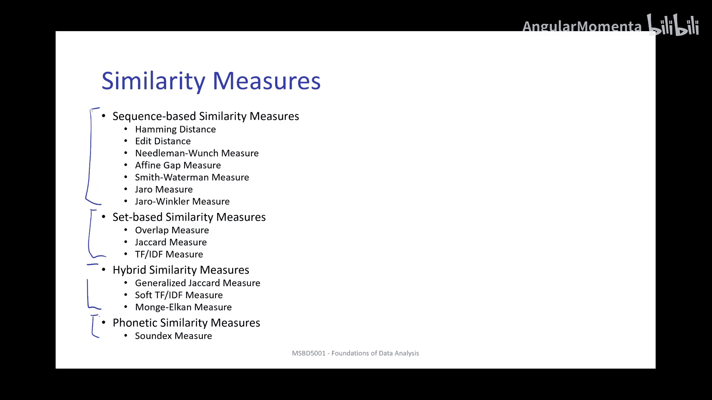

# 008：字符串相似性是什么

在本节中，我们将讨论字符串相似性。首先，我们将探讨什么是相似性。接着，我们将聚焦于本节要讨论的核心问题——字符串相似性。因此，我们将阐述该问题的定义，然后具体介绍多种相似性度量方法，特别是字符串相似性度量。最后，我们将探讨在处理字符串相似性时可能面临或需要应对的挑战。

## 什么是相似性

相似性是一个衡量两个数据对象相似程度的数值度量。相似性在数据处理中至关重要，它是许多数据处理技术（如数据集成和数据挖掘）的基本组成部分之一。

在数据集成中，我们需要处理诸如查找重复属性、冗余属性、重复记录以及识别异常值等问题。所有这些都需要我们判断是否存在相似的对象、属性或记录，或者是否存在不相似的事物。因此，我们需要相似性度量。

数据集成的另一个目标是合并来自两个数据源的数据。我们如何合并？我们需要识别哪些记录可以合并在一起。通常，我们会利用相似性来判断：如果两条记录相似，它们很可能相关，应该被放在一起。这就是相似性在数据集成中重要的原因。

对于数据挖掘，许多处理技术如分类、聚类、推荐和异常检测也需要使用相似性。例如，在分类中，我们判断一个特定数据对象的类别。我们通常会利用已知类别的数据对象：如果我们讨论的新对象与那些已有类别的对象相似，我们就可以给它赋予相同的类别。在聚类中，我们通常希望将相似的对象分组在一起，因此需要衡量一个对象是否与某个簇相似，或者是否与其他对象相似。在推荐系统中，我们希望发现相似的用户、相似的商品，以便向系统用户进行推荐。在异常检测中，我们旨在识别那些不正常、不寻常的行为，同样需要通过相似性度量来识别异常事物。

除了相似性，我们也经常讨论相异性。相异性是衡量两个对象差异程度的数值度量。你可以看到，它实际上是相似性的反面。我们想了解两个事物之间的差异程度。此外，术语“距离”更常用于指代两个对象之间的差异。在数据处理中，你经常需要处理事物有多相似或多不同，因此需要计算相似性和相异性。

实际上，我们一直在进行相似性度量。想想你每天做的事情：例如，我们经常阅读新闻或网上的帖子。当你阅读时，你常常会想：“我以前读过这个吗？有没有见过类似的内容？” 你已经在进行相似性度量了。当你看到一张图片或遇到一个人时，你也会想：“这张图片看起来很熟悉”、“这个人看起来很面熟”。你又在进行相似性判断。我们一直在这样做，这对我们来说非常自然。但当我们谈论数据时，我们应该如何处理呢？这是我们需要讨论的问题。

## 问题定义

首先，让我们来看这个问题。假设我们正在看两个对象，它们来自某个特定的属性类型或属性。例如，我们看一个属性A，以及属于该属性的两个对象X和Y，我们正在度量这两个对象的相似性或距离。

对于属性，我们可能有多种不同的属性类型，例如：标称型（即分类的）、序数型、区间型或比率型。对于不同的属性类型，我们寻找其相似性、相异性或距离的方式可能不同。

### 标称型属性

标称型属性意味着它们有类别。例如，我们之前提到的性别。性别的可能值可以是男性或女性，如今也有中性选项。我们先关注两个值的情况。假设我们有两个对象X和Y，例如，X的属性值为男性，Y的属性值也为男性。那么我们可以看到它们是相同的。当然，它们的相似性应该是1（完美相似）。这意味着当两个对象具有相同的标称属性值时，相似性应为1。

在另一种情况下，假设Y是女性。我们知道它们现在不相同。如果它们不相同，意味着X与Y不同，那么它们完全不相似，是不同的。因此，它们的相似性应为0。对于相异性则相反：当两个对象X和Y具有相同的值时，它们是相同的，因此它们的相似性应为1，而相异性应为0（完全没有相异性）。所以距离或相异性为0。相反，当对象不相同时，它们完全不同，距离为1。这就是标称型属性的处理方式。

### 序数型属性

序数型属性意味着它们的值可以排序、可以排名。例如，李克特量表，我们可以在“不喜欢”、“中立”、“喜欢”之间选择。我们为这个属性类型有两个值（实际上通常是三个或更多，但这里举例），我们可以对它们进行排名，可以有一个程度。例如，“不喜欢”可以认为小于“中立”，“中立”可以认为小于“喜欢”。这样我们就有了一个顺序。这就是序数型属性。

那么如何度量两个序数型属性值之间的相似性或距离呢？例如，X是“中立”，Y是“喜欢”。我们如何度量相似性？我们可以这样做：首先，我们给它们分配一些排名数字，例如，“不喜欢”是1，“中立”是2，“喜欢”是3。然后，我们将排名转换为0到1之间的数字。具体来说，对于X（中立，排名2），我们通过计算 `(2-1)/(3-1) = 0.5` 来转换。对于Y（喜欢，排名3），计算 `(3-1)/(3-1) = 1`。接下来，我们可以计算距离：X和Y之间的距离就是 `|0.5 - 1| = 0.5`。

用公式表示，距离 `d = |(rank(x) - 1)/(M - 1) - (rank(y) - 1)/(M - 1)|`，其中M是等级总数。要计算相似性，我们只需用1减去距离：`相似性 = 1 - d`。这就是我们计算序数型属性值的相似性和相异性的方法。

### 区间型或比率型值

对于区间型或比率型值，我们只需要使用常见的、非常流行的距离度量。例如，我们可以计算这两个区间值或比率值之间的归一化差值，并将其用作距离。如果它是归一化的，意味着它在0到1之间。然后，我们同样可以通过用1减去它来计算相应的相似性。

## 从单值到向量

在了解了如何找到两个值的相似性和相异性之后，我们通常不仅仅看两个值，还可能看两个数据向量，每个向量包含许多属性的值。例如，这里我们有两个向量V1和V2。V1代表属性的值，假设我们有n个属性x1到xn。第一个数据向量是V1，第二个数据向量是V2，其属性值为y1到yn。

对于两个向量，我们如何计算相似性度量呢？如果它们是数值型、连续数据，我们可以使用常见的、流行的距离度量，例如闵可夫斯基距离族。我们可以使用曼哈顿距离，它是对应属性值之间绝对差值的总和。我们也可能使用欧几里得距离度量，它是特定属性值之间距离平方和的平方根。此外，余弦相似性和皮尔逊相关性也经常用于计算两个向量之间的相似性或距离。

## 字符串匹配问题

我们现在要讨论的问题是字符串匹配。我们试图匹配两组字符串。假设我们有一个集合X包含许多字符串，另一个集合Y也包含许多字符串。我们想要识别出那些指向相同现实世界实体的字符串对（一个来自集合X，一个来自集合Y），并将这些对称为匹配。

例如，假设集合X有三个字符串：x1, x2, x3；集合Y有两个字符串：y1, y2。我们想要匹配所有来自X和Y的对。这意味着我们将查看x1和y1、x1和y2、x2和y1、x2和y2、x3和y1、x3和y2。这里我们正在查看来自集合X和Y的六对字符串。在这六对中，我们要识别出那些指向相同现实世界实体的对，即匹配。指向相同现实世界实体的对将是x1和y1、x3和y2。

现在让我们看看x1和y1的情况：x1是“Dave Smith”，y1是“David D. Smith”。根据我们的知识，我们知道“Dave”和“David”通常是同一个名字，“Dave”是“David”的替代名或昵称。有时我们可能会省略中间名缩写。因此，“David D. Smith”很可能与“Dave Smith”指的是同一个人。基于某些相似性度量，我们将其识别为匹配。类似地，“Dan Smith”和“Daniel Smith”也与x1和y1的情况相似，“Dan”是“Daniel”的替代形式，中间名缩写可以省略。因此，x3和y2也极有可能指向同一个现实世界实体。

因此，问题在于识别这两个匹配。在处理字符串匹配问题时，我们通常试图匹配字符串，并匹配大量的字符串对。这时我们会面临两个挑战：准确性和可扩展性。

## 挑战一：准确性

首先，准确性是什么意思？回想一下之前的内容，如果我们谈论标称属性，字符串就像标称属性。如果我们能进行精确匹配，那就完美了：如果两个字符串相同，我们说它们的相似性是1。但很多时候，我们可能无法找到完全相同的字符串来识别两个字符串是相同的，尽管它们实际上是相同的。这是因为在收集数据、处理数据时，可能会出现许多问题和错误。生活并不完美，我们经常会遇到数据质量问题。

因此，在准确匹配字符串方面会遇到问题。让我们看看可能遇到哪些问题：

1.  **打字和OCR错误（自动识别错误）**：收集数据时，通常是通过人们在表格中填写或输入信息。打字或书写时经常会出现错误。同样，自动识别字符时也可能出错。例如，尝试自动识别图片中的字符时，结果并不总是完美的。例如，我们可能看到两个字符串：“Davod Smith”和“David Smith”。我们知道“Davod”不是一个常见的名字，而“David”更常见。这可能是一个打字错误，“Davod Smith”原本应该是“David Smith”，从而与另一个字符串匹配。

2.  **不同格式**：例如，日期。不同地区的人可能以不同格式书写日期。有些人可能写成“10/8”（指10月8日），而有些人可能喜欢用缩写或单词形式书写月份，如“Oct 8”。此外，我们还有年、月、日的顺序问题。例如，我们可能指“2021年10月8日”，有些人会写成“10/8/2021”，有些人会写成“2021-10-08”，或者“8 Oct 2021”。有不同的方式来表示日期。我们如何比较它们？如何匹配它们以确定它们指的是同一个日期？

3.  **缩写或省略**：例如中间名缩写。对于缩写，例如“香港科技大学”，我们可以写成“HKUST”或经常只写“UST”。这些是缩写。我们如何匹配它们？又如何将它们与全称“Hong Kong University of Science and Technology”匹配？或者如何匹配缩写与缩写之间？这是一个问题。

4.  **名称变体**：即使是同一个英文名，也可能有不同的变体。许多人还有昵称。例如，“William Smith”和“Bill Smith”，他们指的是同一个人吗？如何匹配它们？

5.  **词序变换**：对于包含多个单词的字符串或短语，我们实际上可以打乱单词的顺序。例如，“Department of Computer Science UST”，但有些人也可能写成“Computer Science Department UST”。你可以看到单词的顺序可能不同。我们知道它们是相同的，但如果我们只是像之前提到的那样进行匹配，它们会被认为是不同的。我们该如何处理？

这就是准确性挑战。这意味着我们不能只有0或1，不能像标称属性那样，相同就是1，不同就是0。我们需要一个相似性度量，它给出一个0到1之间的数字，并具有以下行为：相似性分数越高，X和Y匹配的可能性越大。或者，如果我们看相似性度量值，如果它大于一个阈值T，那么我们就有足够的信心说它们匹配，指的是同一个实体。

对于距离度量，概念类似，只是此时距离越小，相似性越高；距离值越大，相似性越小（或差异越大）。这就是准确性挑战。

## 挑战二：可扩展性

现在让我们看看可扩展性挑战。在问题定义中，我们谈到匹配所有对。现在我们只是从一个集合中看三个字符串，从另一个集合中看两个字符串。如果我们每个数据集都有成千上万个字符串呢？你可以想象，我们将要匹配大量的对。这就是为什么我们会面临可扩展性挑战。

如今，我们经常拥有海量数据。匹配所有对，试图找到数据中每一对之间的相似性，可能是不切实际的，因为对的数量太大、太多。因此，我们需要一种解决方法。其中一个解决方案是：让我们找到最有希望的对。我们使用一种方法来找到那些有希望的对，将它们识别为候选对。然后，我们只计算这些候选对之间的相似性。我们想减少需要计算相似性分数的对的数量。

这意味着一个可能的方法是：对于集合X中的每个字符串，我们尝试在集合Y中找到一个候选子集。因为这个子集已经比原始集合小，然后我们计算字符串X与该子集中字符串Y之间的相似性分数。接着，我们按照正常的相似性度量进行：如果分数大于阈值，我们就说来自集合X的X和来自Y子集的Y是一个匹配对。这样我们就减少了候选对的数量。

## 总结与过渡

在讨论了挑战之后，接下来我们将看看字符串相似性度量，即我们可以计算相似性度量的各种方法。

现在，我们来看相似性度量。首先，让我们看看相似性度量到底是什么。这里的相似性度量意味着我们试图计算两个对象的相似性分数，它们可以是两个字符串、两个数字、两个对象或两张图片。当然，正如开头提到的，我们现在关注的是两个字符串。

相似性分数大多数时候我们希望它是一个归一化的相似性分数，意味着分数应该在0到1之间。当它是1时，我们知道是精确匹配，例如两个字符串完全相同。如果两个字符串的相似性分数是0，那么我们知道它们完全不同。对于0到1之间的任何值，意味着这两个字符串在某种程度上的相似性，我们可以说它是近似相似。

有时，除了相似性度量，我们可能想使用距离度量，或者更具体地说，距离矩阵。如果我们谈论距离矩阵，它必须具有以下属性：自反性、正定性、对称性和三角不等式性质。

正如我们之前简要提到的，我们经常可能希望将距离度量得到的距离分数转换为相似性分数。通常的转换方法可能是用1减去该分数，或者用1除以距离分数。

回到我们的问题，我们需要考虑是否可能进行精确匹配。假设我们的数据是完美的，没有打字错误，数据中没有此类差异，一切都是标准化的，数据质量完美，那么我们可以直接使用精确匹配，非常简单。这意味着假设一切都是正确的，我们看到X是“David”，Y也是“David”，那么当然，因为两个字符串完全相同，所以它们的相似性是1。

同样，假设我们看的是完美数据，那么我们知道不会有任何打字错误，所以这两个字符串是不同的，因此它们的相似性是0。

但显然，我们可能没有完美的数据，我们可能会看到变体和错误。因此，精确匹配是不够的。这就是为什么我们需要进行近似匹配。在接下来的时间里，我们将看看可以用于字符串的相似性度量。我们将研究所有这些相似性度量。

首先，我们将讨论一些基于序列的相似性度量。接下来，我们将看看基于集合的相似性度量。有时，我们希望将不同种类的相似性度量合并在一起，因此我们有了混合方法。最后，有时所有这些基于序列、基于集合的度量都不够好，我们可能需要处理一些更复杂的情况，因此我们还需要研究语音相似性度量。接下来，我们将逐一研究这些相似性度量。

---

**本节课总结**

在本节课中，我们一起学习了相似性的基本概念及其在数据处理中的重要性。我们首先定义了相似性，并探讨了不同属性类型（标称型、序数型、区间/比率型）的相似性计算方法。接着，我们引入了字符串匹配的具体问题，并详细分析了在处理该问题时面临的两大核心挑战：**准确性**（由于数据错误、格式差异、缩写、变体等导致无法简单精确匹配）和**可扩展性**（海量数据下计算所有字符串对相似性的效率问题）。最后，我们概述了解决这些挑战的总体思路，并预告了后续将深入学习的各类字符串相似性度量方法，为后续的实际应用奠定了理论基础。