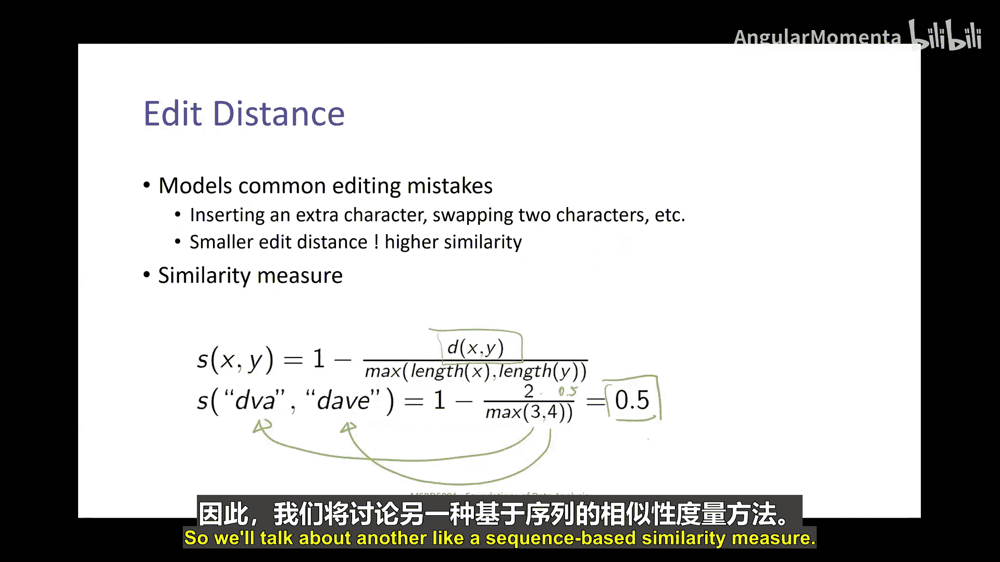
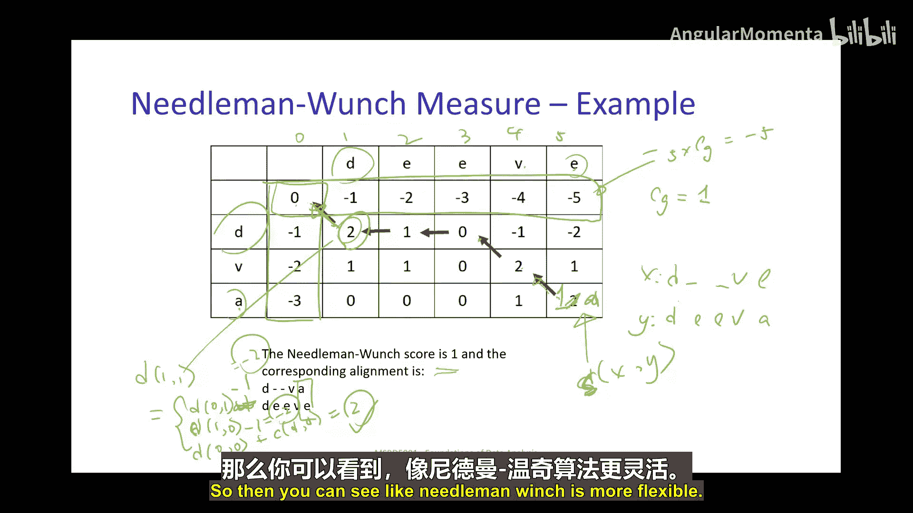
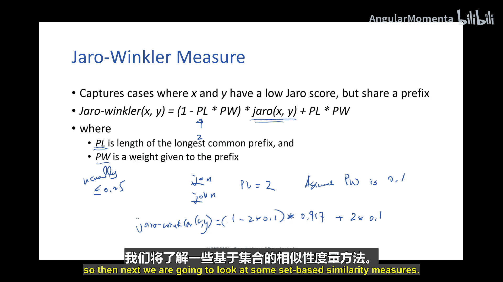
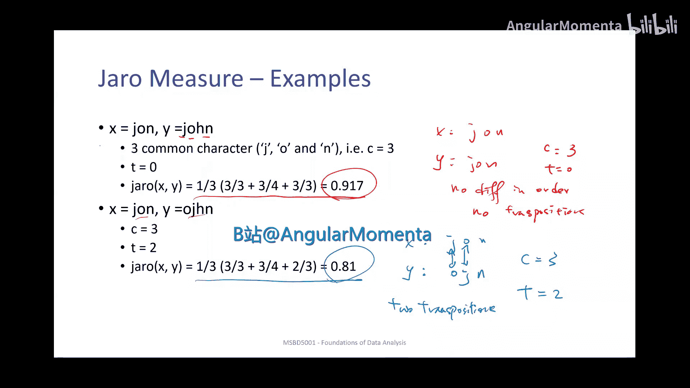

# 009：基于序列的相似性度量

在本节课中，我们将要学习一系列基于序列的相似性度量方法。这些方法将字符串视为字符序列，通过比较两个字符序列来衡量它们的相似程度。这类方法通常用于处理打字错误或拼写错误，因为它们关注的是字符的顺序。我们将逐一探讨不同的序列相似性度量，并理解它们为何适用于此类场景。

## 汉明距离

首先，我们介绍汉明距离。汉明距离非常简单，它假设两个字符串长度相等，然后计算两个字符串在对应位置上字符不同的数量。

它常用于处理二进制数字，以衡量通信错误。因为二进制数字位数相同，所以可以使用汉明距离。我们将二进制数字也视为字符序列。

现在来看一个例子。我们有两个字符串，长度均为五个字符。第一个字符串是“Peter”，第二个是“Pater”。我们可以看到前两个字符完全相同，而剩余的三个字符不同。这意味着有三个位置上的字符不同，因此汉明距离为三。

汉明距离衡量的是两个字符串的差异程度。然而，汉明距离过于简单，并且假设两个字符串长度相等。大多数情况下，我们处理的字符串长度不同，因此汉明距离并不适用。这就是我们需要其他距离或相似性度量的原因。

## 编辑距离

接下来，我们看看编辑距离。编辑距离也称为莱文斯坦距离。它试图找出将字符串X转换为字符串Y所需的最少操作次数。

这里所说的操作是指什么呢？让我们看一个例子。我们有字符串X和字符串Y。快速手动观察，我们可以识别出差异：与字符串X相比，字符串Y多了一个“D”；在字符串X中，“s”后面的字符是“M”，而这里却是“I”；接着，在X中是“I”，而在Y中是“M”；此外，字符串X末尾多了一个“S”。我们在这对字符串中识别出了四处差异，这就是莱文斯坦距离的分数。

我们手动完成了这个计算。编辑距离将问题更正式地定义为操作次数，差异被视为操作，每次操作的成本为1。如果不需要操作，则没有额外成本。

这里定义的操作包括：删除一个字符、插入一个字符或替换一个字符。

如果我们考虑这些操作，意味着字符串“Davis Smith”需要：首先，在“David”后插入一个“D”；然后，我们知道在X中这个位置是“M”，但在Y中这个位置应该是“I”，因此我们将“M”替换为“I”；接着，在这个位置原本是“I”，我们希望它是“M”，因此我们将“I”替换为“M”；最后，我们知道在Y中没有末尾的“S”，因此我们需要删除最后一个字符“S”。经过这四次操作后，得到的字符串是“David Lee Smith”，也就是字符串Y。我们将X转换成了Y，操作次数是一次插入、两次替换和一次删除，总共四次操作。因此，字符串X和Y之间的编辑距离是4。

我们了解了编辑距离的基本思想，但如何计算它呢？我们有一个使用动态规划的算法来计算编辑距离。在这个算法中，我们将字符串X定义为一个字符序列，包含n个字符，即X的长度。我们还有另一个字符串Y，长度为m。两者都被视为字符序列。对于每一对可能的位置，例如字符串X的最后一个字符和字符串Y的最后一个字符，我们计算在该特定位置对之间的编辑距离，记作D[i][j]。我们想要找到这两个字符串之间的编辑距离，这意味着我们关注的是最后的位置n和m，即在处理完字符串X和Y的所有字符后，最终位置所需的操作次数，即D[n][m]。

那么如何计算D[n][m]呢？我们需要考虑在该位置对（例如字符X[n]和Y[m]）之间所需的操作或转换。假设需要某种操作，那么除了这个操作，还需要之前序列中所需的操作。这就是动态规划的思想：它依赖于之前的位置。我们首先需要创建一个矩阵，其大小为(n+1)行(m+1)列。例如，字符串X长度为3，n=3；字符串Y长度为4，m=4。那么我们需要创建一个4行5列的矩阵。

创建矩阵后，我们需要进行初始化。例如，每一行的第一列单元格根据其行号初始化，第一行的所有列根据列号初始化。初始化矩阵后，我们就可以开始计算后续单元格的距离。例如，在D[1][1]位置，我们考虑将字符“D”与“D”对齐所需的操作。我们需要考虑如果假设了之前的操作，那么当前位置的操作是什么，然后计算总成本。因此，我们会考虑四种操作：删除、插入、替换以及无操作（即保留或复制字符）。删除或插入一个字符的成本是1。如果两个字符相同，则无操作，成本为0。

回到这个例子，我们想计算D[1][1]。如果我们考虑删除字符，则需要加1，成本为2。如果我们必须插入一个字符，成本也是2。现在，如果我们看字符对“D”和“D”，它们相同，因此没有成本，只是之前位置的编辑距离，即D[0][0]，其值为0。在这三个数字中，我们选取最小的一个，即0。因此，D[1][1]处的距离是0。

由于编辑距离是寻找最少的操作次数，而最小值来自D[0][0]，所以我们选择它，此时的距离为0。我们继续按照这个模式填充矩阵的其余单元格。例如，考虑位置D[1][2]，我们同样考虑三种可能性，并选取最小值。最终，我们计算出的矩阵将类似这样。我们知道X和Y的编辑距离是D[3][4]，即2。这就是字符串X和Y之间的编辑距离。

除了知道距离，我们通常还想知道需要哪些操作。我们可以通过追踪在每个单元格中获得最小分数时标记的箭头来做到这一点。例如，字符“A”和“E”不同，因此需要替换操作；之前的字符匹配，所以只是复制；接着，字符串X中的字符“A”对应于字符串Y中的字符“D”，字符数不同，因此需要插入操作；最后，这两个字符相同，所以不是替换而是复制。因此，需要成本的操作只有插入和替换，这就是编辑距离为2的原因。我们可以看到字符对齐的情况。

了解了使用动态规划的编辑距离后，让我们再看一些关于编辑距离的信息。编辑距离用于建模常见的错误，例如多出一个字符或两个字符位置互换。编辑距离越小，相似度越高，因为需要的操作更少。相反，编辑距离越大，两个字符串越不相似。因为它是距离度量，如果我们需要相似度，可以将其转换为相似性度量，例如通过距离进行归一化。我们可以用较长字符串的长度来归一化距离，然后用1减去它，从而得到相似性度量。例如，从“DVA”到“DAVE”的编辑距离是2，“DVA”的长度为3，“DAVE”的长度为4。将2除以4得到0.5，然后1减去0.5得到相似性分数0.5。

## 尼德曼-温施度量

我们将讨论的另一个基于序列的相似性度量是尼德曼-温施度量。它实际上是对编辑距离的修改，通过考虑几个方面来推广莱文斯坦编辑距离。在编辑距离中，所有操作的成本都是相同的：插入一个字符成本为1，删除一个字符成本为1，替换一个字符成本也为1。所有成本相同可能不是最好的表示方式，有时我们可能希望为不同的操作设置不同的分数，这就需要尼德曼-温施度量。

尼德曼-温施度量计算的是相似性而非距离。它的做法是对齐两个字符串，在字符串X和字符串Y之间给出一个对齐方式，然后根据对齐方式给出一个分数。它试图找到最佳对齐方式，即分数最高的对齐方式，并以此衡量相似性。这里的对齐是指我们试图将字符串X和字符串Y的字符对应起来，并允许一些间隙。

例如，假设X是“D V”，Y是“D E E V”。我们可以用不同的方式对齐这两个字符串，其中一种方式是包含两个间隙。在对齐“D”与“D”之后，因为下一个最佳对齐是相同的字符“V”，所以中间我们允许间隙。因此，“D E E V”与“D V”的对齐是：第一个“D”对齐，然后两个间隙，接着字符“V”对齐。然后，我们为这对对齐找到一个分数。

尼德曼-温施通过引入间隙惩罚来推广编辑距离，因为它考虑添加间隙，所以对间隙有一个惩罚成本，称为间隙惩罚。对于其他操作，如对齐“D”与“D”或对齐“A”与“E”，有一个分数。很可能，对齐“D”与“D”的分数较高，而对齐“A”与“E”不太理想，分数较低。这由分数矩阵表示。如果我们对齐“D”与“D”，分数是正2；如果对齐“A”与“E”，因为两个字符不同，所以是负分，类似于成本或惩罚。有了分数矩阵和间隙惩罚，我们将再次计算差异数量，然后根据差异得到分数。

对于之前的对齐，“D”与“D”对齐，根据分数矩阵得2分；因为有两个间隙，每个间隙惩罚为-1，所以扣除2分；接着“V”与“V”对齐得2分；最后“A”与“E”对齐得-1分。2加2减1等于3，再减去间隙惩罚2，所以这对字符串的尼德曼-温施分数是1。

尼德曼-温施在三个方面推广了莱文斯坦距离：它基于对齐计算分数，而不是寻找差异，实际上是计算相似性分数；除了所有操作成本相同外，尼德曼-温施有一个分数矩阵，允许我们进行更细粒度的分数建模，可以指定哪些字符对应什么值；它将插入和删除操作泛化为间隙成本，在编辑距离中，插入和删除操作只是在字符串X或Y中放置间隙，在尼德曼-温施中，我们将其泛化为间隙成本，并且这个成本可以由我们指定。

类似于编辑距离，我们也可以用动态规划来计算尼德曼-温施分数。动态规划算法与此类似。我们再次将字符串X和Y定义为字符序列，然后需要一个类似的矩阵，初始化略有不同，我们考虑间隙成本，并根据行索引或列索引乘以间隙成本进行初始化。然后进行递推计算。在位置S[i][j]，我们再次考虑是间隙（即将X或Y与间隙对齐）还是进行对齐（即将X[i]与Y[j]对齐）。我们查看分数矩阵，找到对应的分数C(X[i], Y[j])。然后进行计算，我们不是计算最小值，而是寻找最大值，因为我们在计算相似性，希望选择最佳对齐方式，即最大值。

如果我们想要更详细地控制如何匹配字符，例如我们希望间隙还是不希望间隙，我们可以通过设置不同的间隙成本值C_g和分数矩阵中的不同值来控制匹配，以选择最佳或首选的对齐方式。因此，尼德曼-温施更加灵活。

## 仿射间隙度量

我们将要看的下一个度量是仿射间隙度量。仿射间隙度量实际上是尼德曼-温施分数的扩展。回忆一下，尼德曼-温施分数有间隙惩罚。当我们在以下情况下使用尼德曼-温施度量时：字符串X是“David Smith”，而字符串Y是“David Richardson Smith”，如果使用尼德曼-温施对齐它们，我们会看到一个很大的间隙，长达11个字符。如果我们对所有这11个字符考虑相同的间隙成本，那么将会有很大的间隙成本，这对字符串的尼德曼-温施分数将会很小。这实际上是一个非常常见的情况。例如，在一个数据集中，名字只有名和姓，而在另一个数据集中，名字包含名、中间名和姓。这意味着在一个数据集中没有中间名。如果我们将该数据集中的所有名字与另一个数据集进行比较，它们都会有很高的差异和很低的相似性。考虑到这种情况，显然尼德曼-温施度量不适用，因为间隙通常倾向于长于一个字符。

仿射间隙度量试图将间隙成本分为两种：一种是打开间隙的成本，当我们开始添加间隙时，第一次打开间隙有一个成本，用C_o表示；打开第一个间隙后，如果我们有更多间隙，只是继续间隙、扩展间隙，那么这是继续间隙的成本，用C_r表示。这两个成本之间的关系是：打开间隙更昂贵，而一旦打开间隙，继续间隙的可能性更大，所以继续间隙的成本应小于打开间隙的成本，即C_r < C_o。对于一个有k个空格的间隙，其成本是打开间隙的成本C_o加上剩余k-1个字符的继续间隙成本C_r。

回到之前的例子，“David Smith”和“David Richardson Smith”，间隙长度为11个字符。第一个字符是打开间隙，成本为C_o加上(11-1)乘以C_r。假设C_o=1，C_r=0.5，那么成本是1 + (11-1)*0.5 = 6。对于其他对齐的字符，假设它们都对齐且每个得分为1，原本没有间隙的分数是11。现在扣除间隙惩罚后，更新后的分数是11 - 6 = 5。而如果我们使用尼德曼-温施，因为所有间隙成本相同，我们会扣除11的间隙惩罚，结果分数是0。可以看到，仿射间隙度量的分数更高，这更可取，因为我们知道在实际情况中省略中间名很常见。当然，这取决于问题设置，例如，你必须了解你的数据集和问题，需要知道我们是否要考虑间隙，或者中间名非常重要，那么就不能使用仿射间隙度量。但如果你知道中间名可以省略，那么使用仿射间隙度量比尼德曼-温施更好，后者给出的相似性很低。

由于我们现在有打开间隙和继续间隙的概念，与尼德曼-温施相比，我们需要考虑更多情况，因此仿射间隙度量的算法变得更加复杂。计算仿射间隙分数的动态规划算法如下：首先，我们为每一对位置考虑三个分数：M[i][j]表示将X[i]与Y[j]对齐的分数；I_x[i][j]表示将字符串X中的字符与间隙对齐的分数；I_y[i][j]表示将字符串Y中的字符与间隙对齐的分数。然后，动态规划算法意味着我们必须考虑之前位置的最佳分数，因此会有很多组合。

让我们看一下算法。对于位置(i, j)，有三种情况：情况一是将X[i]与Y[j]对齐，用分数M[i][j]表示；情况二是将字符串X中位置i的字符与间隙对齐，用分数I_x[i][j]表示；情况三是将字符串Y中位置j的字符与间隙对齐，用分数I_y[i][j]表示。对于每种情况，因为我们必须考虑之前位置的分数，所以它们又可以有更多的组合情况。

对于情况一（M[i][j]），我们考虑三种可能性：X[i-1]与Y[j-1]对齐（即M[i-1][j-1]分数）加上当前对齐分数C(X[i], Y[j])；或者X[i-1]与间隙对齐（即I_x[i-1][j-1]分数）加上当前对齐分数；或者Y[j-1]与间隙对齐（即I_y[i-1][j-1]分数）加上当前对齐分数。我们取这三者中的最大值作为M[i][j]。

对于情况二（I_x[i][j]），表示X[i]与间隙对齐。我们考虑两种可能性：X[i-1]与Y[j]对齐（即M[i-1][j]分数）加上打开间隙的成本-C_o；或者X[i-1]与间隙对齐（即I_x[i-1][j]分数）加上继续间隙的成本-C_r。我们取这两者中的最大值作为I_x[i][j]。

对于情况三（I_y[i][j]），表示Y[j]与间隙对齐。我们考虑两种可能性：X[i]与Y[j-1]对齐（即M[i][j-1]分数）加上打开间隙的成本-C_o；或者Y[j-1]与间隙对齐（即I_y[i][j-1]分数）加上继续间隙的成本-C_r。我们取这两者中的最大值作为I_y[i][j]。

最终，在位置(i, j)的仿射间隙分数是M[i][j]、I_x[i][j]和I_y[i][j]中的最大值。我们计算所有值，最终分数是位置(m, n)的分数。如果我们想找到对齐方式，可以从(m, n)位置开始回溯。

初始化时，M[0][0]初始化为0，I_x[0][0]初始化为打开间隙的成本-C_o，I_y[0][0]也初始化为-C_o。对于其他行和列，因为它们是继续间隙，所以用继续间隙成本-C_r进行初始化。然后进行递推计算。例如，在位置(1,1)，我们计算M[1][1]、I_x[1][1]和I_y[1][1]的值，然后取最大值。最终，我们得到整个矩阵，仿射间隙分数是M[m][n]、I_x[m][n]和I_y[m][n]中的最大值。通过追踪箭头，我们可以得到对齐方式。

仿射间隙度量考虑得更细致，它考虑了与空格匹配、与间隙对齐或与字符对齐的细粒度匹配。它倾向于继续间隙，而不是将长间隙拆分为两个打开间隙，因为那样成本更高。仿射间隙度量能够处理具有长间隙的字符串匹配。当你有长间隙时，你可能想使用仿射间隙度量。

## 史密斯-沃特曼度量

另一个基于序列的相似性度量是史密斯-沃特曼度量。它也与之前提到的尼德曼-温施度量和仿射间隙度量非常相似，但当然有区别。它实际上是尼德曼-温施度量的扩展。当我们看前两种度量（尼德曼-温施和仿射间隙）时，我们试图进行全局对齐，即尝试匹配所有字符。但有时，我们不想匹配整个字符串，只想找到最长的公共子串。那么我们应该使用史密斯-沃特曼度量，之前的度量就不适用了。

例如，有两个字符串：一个是“Professor John R Smith University of Wisconsin”，包含所有信息；另一个只有头衔和名字，没有所属机构。如果我们使用仿射间隙或尼德曼-温施度量，由于这两个字符串之间存在巨大差异，一个长一个短，分数肯定会很低，相似性分数会非常低。对于这种字符串匹配，我们试图关注“John R Smith”和“Professor”的相似性，因此需要另一种度量，即史密斯-沃特曼度量。它试图识别局部对齐，即尝试找到X和Y中最相似的两个子串，而不是考虑整个字符序列。

我们如何做到呢？史密斯-沃特曼度量与尼德曼-温施度量相比有两个变化：它允许在任何位置重新开始匹配，这意味着如果匹配或对齐不够好，分数变得太低，那么最好重新开始；它忽略后缀，意味着在某个点已经足够好，任何后续的匹配或对齐产生的分数不如我们不需要考虑的那样高。因此，我们忽略那些产生不够好匹配的后缀。

让我们看一下动态规划算法。它与尼德曼-温施度量非常相似，只是多了一种情况：0。现在，如果分数变为负数，变得太低，我们就不考虑，从0重新开始，然后考虑剩余的对齐。这是主要区别，其他几乎相同。史密斯-沃特曼相似性的分数是矩阵中的最高分，而不像之前总是查看最后一对位置的分数。对于史密斯-沃特曼度量，我们考虑整个矩阵中的最高分。

另一个区别是初始化：之前我们考虑对齐间隙，第一行和第一列有递增的惩罚，但现在我们考虑重新开始，所以第一行和第一列都初始化为0。计算过程类似。例如，对于D[1][1]，我们计算最大值。最终，我们计算完所有值后，选取整个矩阵中的最大值，然后追踪箭头得到对齐方式。这就是史密斯-沃特曼度量。

## 杰罗-温克勒度量

我们将要看的最后一个基于序列的相似性度量是杰罗-温克勒度量。它建立在杰罗分数之上，但考虑了前缀。当X和Y的杰罗分数较低，但我们想更重视公共前缀时，可以使用这种改进的杰罗-温克勒度量。杰罗-温克勒度量的公式如下：它取两个字符串之间的杰罗分数，然后加上两个值：P是最长公共前缀的长度，P_w是赋予前缀的权重。

例如，X是“J N”，Y是“J X N”。最长公共前缀是两个字符，即P=2。根据之前杰罗相似性度量的计算，我们有那个分数，然后使用这个公式。假设P_w通常小于0.25，取决于你有多重视公共前缀。假设P_w=0.1，那么杰罗-温克勒分数就是杰罗分数加上2*0.1。

我们已经看了许多基于序列的相似性度量。不同的序列相似性度量具有不同的特性，每种都适用于不同的情况。正如我们常说的，你必须很好地了解你的问题和数据集，看看你处理的数据有什么特征，你正在处理什么样的字符串。例如，如果经常有长间隙，并且忽略这些间隙部分后，它们仍然指向同一个实体，那么我们应该考虑仿射间隙度量。如果你只想识别子串，经常有很多前缀或额外信息，那么应该使用史密斯-沃特曼度量。不同的度量适用于不同的情况。这些是基于序列的相似性度量。从之前的例子可以看出，我们经常使用这些来匹配人名、组织名等。此外，这类序列相似性度量也常用于匹配生物医学信息，如基因序列、蛋白质序列等。

## 杰罗度量

在看了许多使用动态规划进行计算的度量之后，让我们看一个不同的度量：杰罗度量。杰罗度量主要用于比较短字符串，例如名和姓。杰罗度量对两个字符串的计算如下：首先尝试找到公共字符，但这些公共字符必须彼此接近。我们试图找到彼此接近的字符对，因此有一个约束：位置i和j之间的差异应小于min(|X|, |Y|)/2。我们试图识别公共字符对的数量，即两个字符串之间有多少公共字符。然后，在公共字符中，我们查看它们的顺序是否相同。例如，如果X中第一个公共字符与Y中第一个公共字符不同，那就是一次换位。杰罗度量考虑公共字符的数量C，以及公共字符中有多少次换位T，然后一起计算分数。分数由X的长度和Y的长度归一化，并考虑换位。

让我们看一个例子。我们有两个字符串“J N”和“J O X N”。我们知道这两个字符串有三个公共字符：J、O和N。对于X，这三个公共字符的顺序是J、O、N；对于Y，顺序也是J、O、N。没有换位，顺序没有差异。因此，C=3，T=0。根据公式，我们得到杰罗分数为0.917。

如果我们有两个稍有不同的字符串X和Y，例如X中三个公共字符的顺序是J、O、N，而Y中的顺序是O、J、N。C仍然是3，但顺序不同，有两次换位，T=2。计算出的杰罗分数是0.81。可以看到，如果公共字符的顺序不同，那么杰罗相似性分数会更低。相比之下，第一对字符串的公共字符顺序相同，相似性更高。这就是杰罗度量。

本节课中，我们一起学习了多种基于序列的相似性度量方法，包括汉明距离、编辑距离、尼德曼-温施度量、仿射间隙度量、史密斯-沃特曼度量、杰罗度量和杰罗-温克勒度量。每种方法都有其独特的应用场景和计算方式，理解它们的原理和适用条件对于在实际数据分析中选择合适的度量标准至关重要。