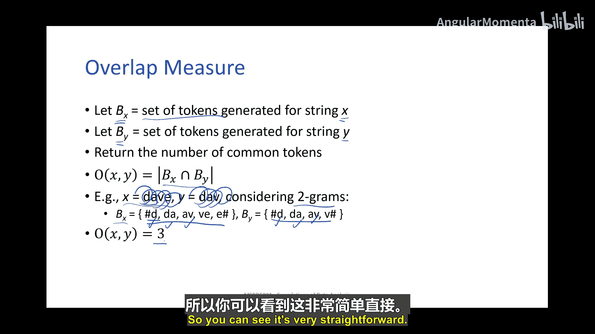
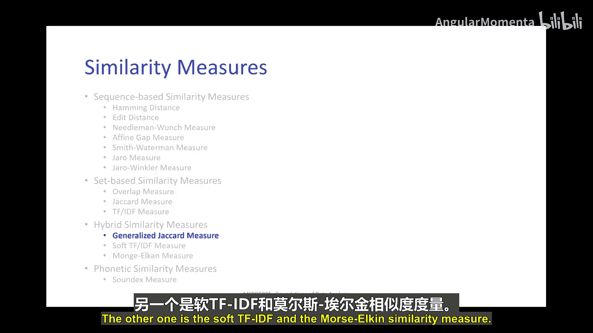
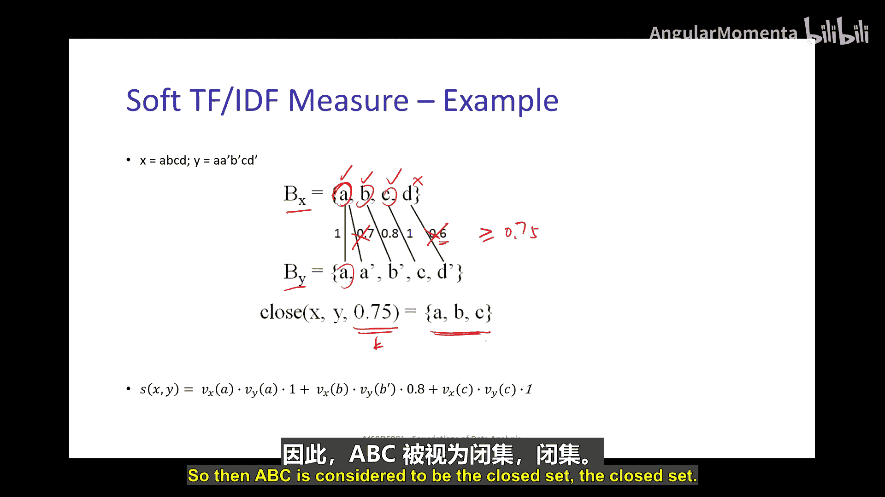
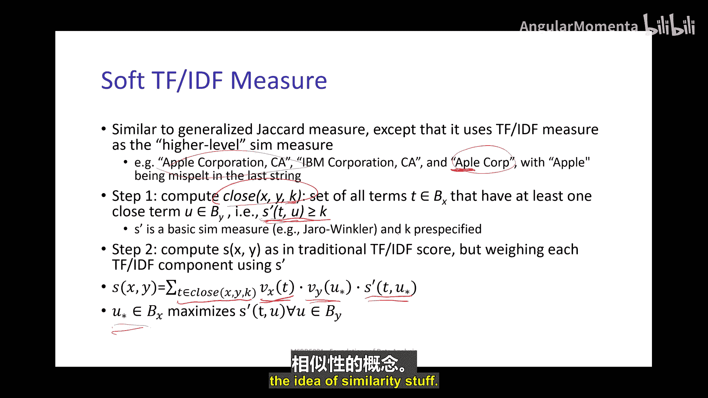
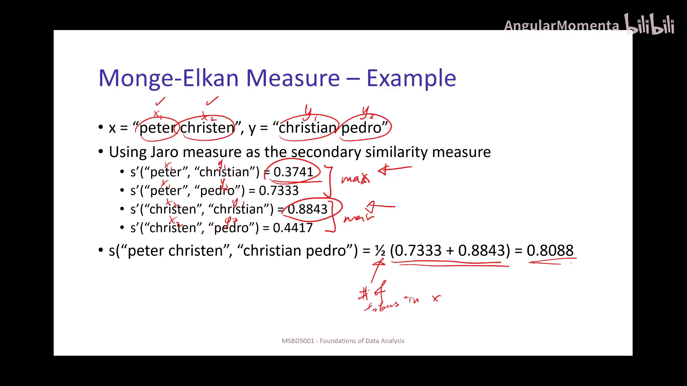

数据分析基础：10：基于集合的相似性度量

在本节课中，我们将要学习基于集合的相似性度量方法。与之前将字符串视为字符序列的度量方法不同，基于集合的方法将字符串视为由“词元”构成的集合或多重集。这种方法特别适用于处理短语或句子，能够更好地捕捉文本的语义相似性。

上一节我们介绍了基于序列的相似性度量，本节中我们来看看如何将字符串视为词元集合并进行比较。

### 词元生成方法

首先，我们需要将字符串分割成词元。以下是几种常见的词元生成方法：

*   **按单词分割**：最常见的方法是按照空格将句子分割成单词。每个单词就是一个词元。
*   **词干提取**：为了减少单词的形态变化（如“running”和“ran”），可以对单词进行词干提取，将其还原为基础形式。
*   **去除停用词**：像介词、冠词这类在文本中出现频率极高但意义不大的词（如“the”，“a”，“of”），可以考虑将其移除。
*   **使用 N-gram**：另一种方法是考虑字符的组合，即 N-gram（或 k-shingle），它是长度为 N 的连续字符子串。例如，对于字符串“David Smith”，其 3-gram 集合为：`{“Da”， “Dav”， “avi”， “vid”， “id “， “d S”， “ Sm”， “Smi”， “mit”， “ith”， “th#”}`。有时为了包含字符串起始和结束的信息，会使用特殊符号（如 `^` 表示开始，`$` 表示结束）来生成边界 N-gram。

一旦将字符串分割成词元集合，我们就可以使用基于集合的相似性度量方法了。

### 重叠度量

第一个要看的基于集合的相似性度量是重叠度量。它的计算非常简单，就是统计两个词元集合中共有词元的数量。

**公式**：
`Overlap(X, Y) = |B_X ∩ B_Y|`

其中，`B_X` 和 `B_Y` 分别是字符串 X 和 Y 生成的词元集合。

例如，字符串 X 生成的 2-gram 集合为 `{“^D”， “Da”， “av”， “id”， “d$”}`，字符串 Y 生成的集合为 `{“^D”， “Da”， “an”， “n$”}`。它们的共有词元是 `{“^D”， “Da”}`，因此重叠度量值为 2。

你可以看到，重叠度量非常直接，就是计算共有词元的数量。

### Jaccard 相似度

重叠度量没有考虑字符串的长度。如果一个字符串非常长，它自然更有可能获得较高的重叠分数。为了消除这种长度偏差，我们引入 Jaccard 相似度。

Jaccard 相似度计算的是两个集合的交集大小与并集大小的比值。

**公式**：
`Jaccard(X, Y) = |B_X ∩ B_Y| / |B_X ∪ B_Y|`

沿用上面的例子，`B_X` 和 `B_Y` 的并集大小为 7，交集大小为 2，因此 Jaccard 相似度为 `2 / 7 ≈ 0.286`。

Jaccard 相似度计算简单，应用非常广泛。

### TF-IDF 相似度

在前两种方法中，所有词元都被平等对待。但在某些情况下，我们可能希望更关注那些具有区分性的词。例如，比较“Apple Corporation”和“IBM Corporation”时，“Corporation”这个词很常见，区分度低；而“Apple”和“IBM”则是关键的区分词。TF-IDF 相似度就是为了解决这个问题。

TF-IDF 为每个词元计算一个权重分数，该分数由两部分组成：
1.  **词频**：词元在**当前文档**中出现的频率。`TF(t, d)` 表示词元 `t` 在文档 `d` 中的出现次数。
2.  **逆文档频率**：衡量词元在所有文档中的普遍程度。`IDF(t) = log(N / n_t)`，其中 `N` 是文档总数，`n_t` 是包含词元 `t` 的文档数量。

**公式**：
`TF-IDF(t, d) = TF(t, d) * IDF(t)`

对于一个文档（字符串），我们可以将其所有词元的 TF-IDF 分数组成一个特征向量。然后，通过计算两个文档特征向量之间的余弦相似度来衡量它们的相似性。

**余弦相似度公式**：
`Cosine Similarity(V_x, V_y) = (V_x · V_y) / (||V_x|| * ||V_y||)`

余弦相似度值越高，表示两个字符串共享越多的高 TF-IDF 值词元，即它们包含的区分性词汇越相似。

TF-IDF 还有一些变体，例如对 TF 或 IDF 取对数进行平滑，或对特征向量进行归一化处理。

### 混合相似性度量

我们讨论了基于集合和基于序列的相似性度量，它们适用于不同的场景。基于序列的方法能很好地处理拼写错误等字符级差异；而基于集合的方法更适合处理较长的短语或句子，关注词元级别的匹配。

但有时我们需要兼顾两者：既要处理拼写错误，又要对短语或句子进行词元级别的比较。这就需要混合相似性度量方法，将两类方法的优势结合起来。

以下是三种常见的混合方法：

#### 1. 广义 Jaccard 度量

标准的 Jaccard 度量要求词元必须完全相同才算匹配。广义 Jaccard 度量则放宽了这一要求。

**计算步骤**：
1.  对于集合 `B_X` 和 `B_Y` 中的每一对词元，使用一种基于序列的相似性度量（如编辑距离相似度）计算它们的相似度分数。
2.  设定一个阈值，只保留相似度高于阈值的词元对。
3.  将保留的词元对视为一个二分图，寻找一个最大权匹配（即找到一组匹配，使得匹配边的总相似度分数最高）。
4.  广义 Jaccard 相似度计算公式为：匹配边的总相似度分数除以 `(|B_X| + |B_Y| - |M|)`，其中 `|M|` 是匹配边的数量。

这种方法允许拼写相似的词元（如“energy”和“enrgy”）进行匹配。

#### 2. 软 TF-IDF 度量

软 TF-IDF 是对标准 TF-IDF 的软化，允许词元之间进行近似匹配。

**计算步骤**：
1.  对于 `B_X` 中的每个词元 `t`，在 `B_Y` 中寻找与其最相似的词元 `u`（相似度需超过某个阈值）。所有这样的 `t` 构成一个“闭合集”。
2.  计算软 TF-IDF 相似度时，不再要求 `t` 和 `u` 完全相等，而是将它们的 TF-IDF 向量点积，再乘以它们之间的序列相似度分数（作为权重）。
3.  最终的相似度是所有这些加权点积的总和。

这样，即使“Apple”被误拼为“Aple”，只要它们足够相似，仍然能对相似度计算产生贡献。

#### 3. Monge-Elkan 相似度

Monge-Elkan 相似度采用一种“最佳匹配”策略。

**计算步骤**：
1.  将字符串 X 和 Y 分割成词元序列 `(x1, x2, ..., xm)` 和 `(y1, y2, ..., yn)`。
2.  对于 X 中的每个词元 `xi`，计算它与 Y 中**所有**词元的相似度（使用一种次级相似性度量，如编辑距离或广义 Jaccard），并取其中的最大值 `max_sim(xi, Y)`。
3.  Monge-Elkan 相似度定义为 X 中所有词元这些最大相似度值的平均值。

**公式**：
`Monge-Elkan(X, Y) = (1/m) * Σ_{i=1 to m} [ max_{j=1 to n} sim(xi, yj) ]`

这种方法为 X 中的每个部分在 Y 中寻找最佳匹配，对局部的拼写错误或变体有较好的鲁棒性。

### 总结

本节课中我们一起学习了多种相似性度量方法。我们首先介绍了基于集合的度量，包括简单的**重叠度量**、考虑集合比例的**Jaccard相似度**以及能突出关键区分词的**TF-IDF相似度**。接着，我们探讨了结合序列与集合度量优势的**混合方法**，包括**广义Jaccard度量**、**软TF-IDF度量**和**Monge-Elkan相似度**。理解这些方法及其适用场景，对于在不同数据质量和需求下选择合适的数据匹配工具至关重要。