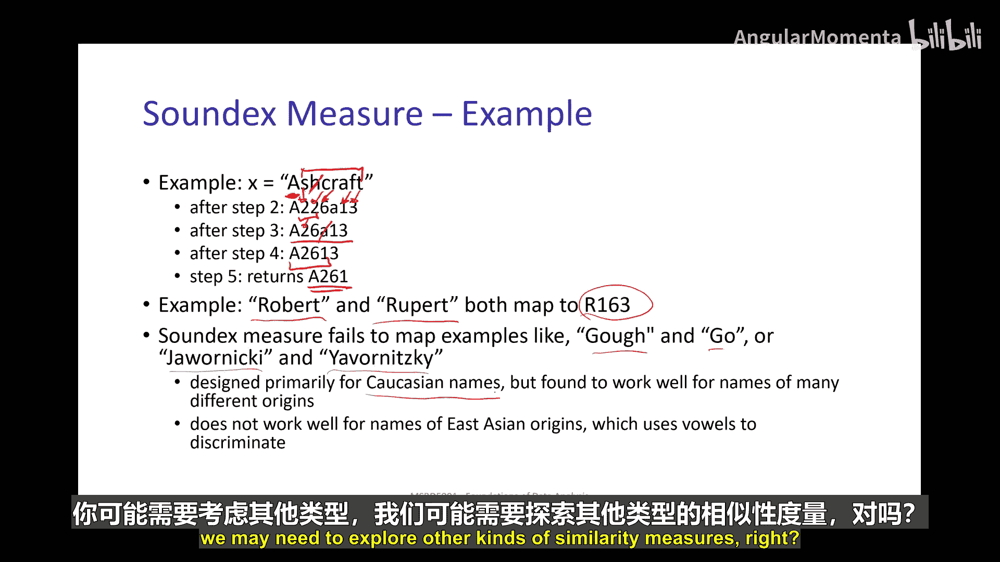

# 011：语音相似度度量 📊


在本节课中，我们将要学习相似度度量的最后一个类别：语音相似度度量。这类度量方法关注的是字符串的发音，而非其拼写或外观。它主要用于处理因口头交流、听力录入导致的数据不一致问题，例如姓氏或地址的拼写错误。

上一节我们介绍了基于编辑距离和序列的相似度度量。本节中我们来看看当数据错误源于发音相似时，应如何处理。

## 语音相似度度量的原理 🎤

语音相似度度量旨在根据字符串的发音进行匹配。有时，不同的拼写可能对应非常相似的发音。例如，“Me”和“Mee”，或者“Smith”和“Smyth”。如果直接使用基于字符的度量方法（如编辑距离），这些词会被判定为不相似，因为它们的拼写不同。因此，我们需要一种能“听懂”字符串的度量方法。

## Soundex算法详解 🔢

Soundex是语音相似度度量的一种经典算法，主要用于匹配姓氏。其核心思想是将一个姓氏映射为一个由**一个字母和三个数字**组成的四字符代码。如果两个姓氏的Soundex代码相同，则认为它们在语音上相似。

以下是Soundex算法的具体步骤：

1.  **保留首字母**：保留原始字符串的第一个字母。
2.  **处理后续字符**：对首字母之后的所有字符进行转换。
    *   移除所有出现的‘W’和‘H’。
    *   将特定的辅音字母组替换为对应的数字（1-6）。
3.  **合并连续相同数字**：将转换后序列中连续出现的相同数字合并为一个。
4.  **移除非数字字符**：移除所有非数字字符（即元音字母和‘Y’等）。
5.  **生成代码**：将首字母与处理后的数字序列组合。如果数字不足三位，用0补足；如果超过三位，则只取前三位。

以下是Soundex算法的核心映射规则（代码表示）：

```python
# Soundex 字符到数字的映射规则
mapping = {
    'B': '1', 'F': '1', 'P': '1', 'V': '1',
    'C': '2', 'G': '2', 'J': '2', 'K': '2', 'Q': '2', 'S': '2', 'X': '2', 'Z': '2',
    'D': '3', 'T': '3',
    'L': '4',
    'M': '5', 'N': '5',
    'R': '6'
}
# 字母‘A’, ‘E’, ‘I’, ‘O’, ‘U’, ‘Y’, ‘W’, ‘H’ 不编码，在步骤中被移除。
```

## 算法示例演示 📝

让我们以姓氏“Ashcraft”为例，演示Soundex代码的生成过程。

1.  **保留首字母**：`A`
2.  **处理剩余字符 “shcraft”**：
    *   移除‘H’：`scraft`
    *   应用映射规则：
        *   S -> 2
        *   C -> 2
        *   R -> 6
        *   A (元音，移除)
        *   F -> 1
        *   T -> 3
    *   得到数字序列：`2, 2, 6, 1, 3`
3.  **合并连续相同数字**：`2, 6, 1, 3`
4.  **移除非数字字符**：此步已无影响。
5.  **生成代码**：首字母`A` + 前三个数字`261` = `A261`

因此，“Ashcraft”的Soundex代码是 **A261**。

另一个例子是“Robert”和“Rupert”。
*   Robert -> R163
*   Rupert -> R163

两者的Soundex代码相同（R163），因此被判定为语音相似。

## Soundex的优缺点与适用场景 ⚖️

Soundex算法有其特定的优势和局限性。

**以下是Soundex的主要优点：**
*   能有效处理因发音相似导致的拼写变体，如“Jon”和“John”。
*   计算相对简单，效率较高。
*   在匹配英语姓氏，特别是高加索人姓氏时，效果良好。

**以下是Soundex的主要局限性：**
*   **文化局限性**：算法主要针对英语发音设计，对于东亚、非洲等不同语言起源的姓名，效果不佳。例如，中文姓氏“张”（Zhang）和“常”（Chang）发音不同，但拼写首字母规则可能无法很好区分。
*   **适用范围窄**：主要用于姓氏，对普通单词或内容的匹配效果有限，因为普通单词的拼写通常比较固定。
*   **精度有限**：它只是一个粗略的语音哈希，不同发音的单词可能产生相同的代码（例如“Gough”和“Goff”可能映射到相同代码），而有些发音相似的单词可能因首字母不同而无法匹配。

因此，在处理多元化数据时，可能需要探索其他更先进的语音相似度算法（如Metaphone, Double Metaphone等）作为补充或替代。

## 总结 📚



本节课中我们一起学习了语音相似度度量，重点剖析了Soundex算法。我们了解到，当数据错误源于听觉录入时，基于发音的匹配至关重要。Soundex通过将字符串转换为一个简化的语音代码来实现这一目标。虽然它在特定领域（如英语姓氏匹配）非常有效，但我们也必须认识到其文化局限性和适用范围。在实际数据分析工作中，需要根据数据的具体来源和特点，选择合适的相似度度量方法。