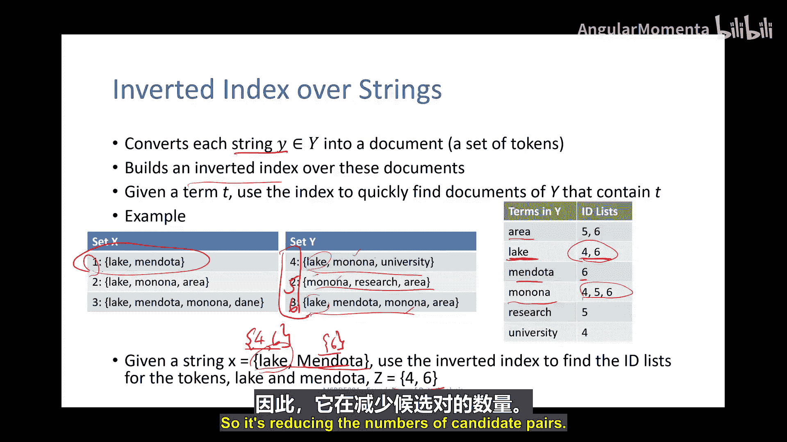
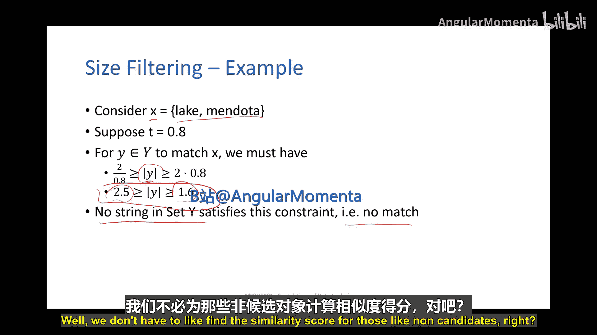
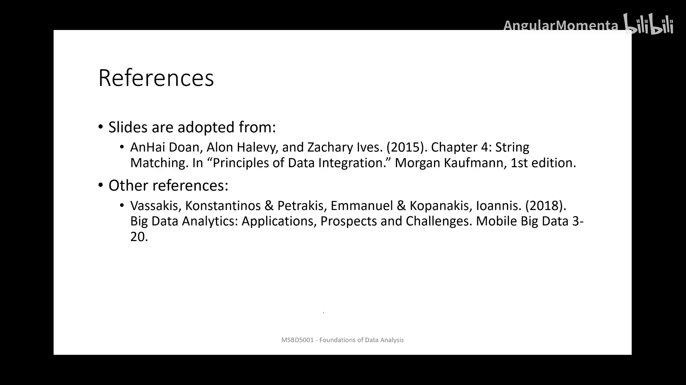

# 012：可扩展性与倒排索引筛选 📊

在本节课中，我们将要学习如何解决字符串相似度计算中的可扩展性挑战。当处理大量字符串对时，逐一计算所有可能的配对是不现实的。因此，我们需要一些方法来筛选和减少候选对的数量，从而专注于更有希望的匹配。

上一节我们介绍了各种字符串相似度度量方法，本节中我们来看看如何通过筛选技术来提升计算效率。

## 可扩展性挑战与候选集筛选

在讨论字符串相似度度量时，我们提到面临两大挑战：准确性和可扩展性。对于准确性，我们已经探讨了近似匹配、序列相似度、子串相似度、混合方法以及语音相似度度量。然而，另一个主要挑战是可扩展性问题。这意味着当处理大量字符串对时，逐一计算所有候选对的相似度得分是不可行的。

因此，我们需要一种方法来减少候选对的数量。核心思想是，对于一个给定的字符串集合X中的某个字符串x，我们尝试从另一个字符串集合Y中找到一个候选子集。这样，我们需要考虑的配对数量就大大减少了。对于筛选出的每一对x和y，我们再计算其相似度得分。如果得分超过预设阈值，则被视为匹配对。这种方法的核心是**筛选**和**减少**需要测试的配对数量，专注于更有希望的候选对。这个过程也常被称为**分块**。

以下是几种实现筛选的可能方法。

## 基于倒排索引的筛选 🔍

一种方法是基于字符串构建倒排索引。具体操作是，我们将集合Y中的每个字符串转换为一系列标记，然后基于这些标记构建一个倒排索引。

例如，假设我们有一个集合Y，包含多个文档（字符串）。我们为每个标记记录它出现在哪些文档中。假设标记“lake”出现在文档4和6中，标记“Mendota”出现在文档6中。现在，考虑集合X中的一个字符串x1，其标记为“lake”和“Mendota”。使用倒排索引，我们发现包含“lake”的Y中文档是4和6，包含“Mendota”的Y中文档是6。将这两个列表合并，我们得到需要与x1比较的候选文档是4和6。文档5不包含x1的任何标记，因此无需考虑。原本需要比较3对（x1与Y中所有文档），现在只需比较2对，从而减少了候选对的数量。

然而，基于倒排索引的筛选有其局限性。首先，某些常见标记的倒排列表可能非常长（例如，几乎出现在每个文档中），这会导致筛选效果不佳。其次，构建和维护这样的倒排索引本身是耗时且成本较高的。最后，即使经过筛选，我们仍然需要枚举和处理剩余的候选对，如果剩余数量很大，计算开销依然可观。

## 基于大小的筛选 📏

另一种处理可扩展性的筛选方法是大小筛选。其核心思想是，如果两个字符串的标记数量相差太大，那么它们达到高相似度得分的可能性就很低。

具体来说，给定一个字符串x，我们只保留那些大小（标记数量）在特定范围内的字符串y作为候选。以Jaccard相似度为例，可以证明，若希望字符串x和y的Jaccard相似度不低于一个预设阈值t，则y的标记数量必须满足以下范围：

`|y|` 必须在 `t * |x|` 和 `|x| / t` 之间。

例如，假设字符串x有5个标记，我们设定的相似度阈值为0.8。那么，任何希望与x匹配的字符串y，其标记数量必须在 `0.8 * 5 = 4` 和 `5 / 0.8 ≈ 6.25` 之间，即y必须有4、5或6个标记。如果集合Y中所有字符串的标记数都是3，那么根据大小筛选，没有字符串满足条件，我们可以立即排除所有配对，无需进行任何相似度计算，从而极大地减少了计算量。

## 基于前缀的筛选 🔤

第三种方法是前缀筛选，它通常用于重叠度量的场景。如果我们希望两个字符串的重叠得分超过一个预设值k，那么可以推断，在按某种顺序（如字典序）排序后，字符串x的前 `|x| - k + 1` 个标记中，至少有一个必须出现在字符串y中。

其原理是，如果连前缀部分都没有足够的重叠，那么整个字符串的重叠得分几乎不可能达到k。因此，我们可以利用前缀信息快速排除大量不可能的候选。

例如，假设字符串x1的标记按序为 `[lake, Mendota]`，我们希望找到与x1重叠度至少为2的字符串。这里k=2，`|x1|=2`，那么我们需要检查的前缀长度为 `|x1| - k + 1 = 1`。即，我们取x1的第一个标记“lake”。然后，我们只需要在集合Y中查找那些包含标记“lake”的文档作为候选。如果Y中的某个文档不包含“lake”，那么它不可能与x1有2个或以上的重叠标记，因此可以被安全地过滤掉。这样，我们同样减少了需要详细比较的候选对数量。

除了上述方法，还有许多其他技术可以实现相同的筛选目标，以减少候选对数量，从而应对可扩展性挑战。后续课程中，我们还将探讨其他专门处理相似度计算可扩展性问题的算法。

本节课中我们一起学习了三种应对字符串相似度计算可扩展性挑战的筛选技术：基于倒排索引的筛选、基于大小的筛选和基于前缀的筛选。这些方法的核心目标都是通过智能地减少需要详细比较的候选对数量，来提升大规模数据处理的效率。