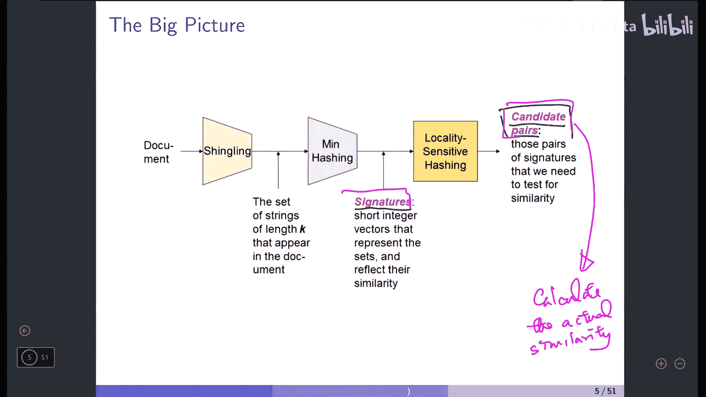

# 013：导论

在本节课中，我们将要学习一种用于高效查找相似文档的算法。该算法主要包含两个步骤：最小哈希和局部敏感哈希。我们将了解其背景、原理、具体步骤以及如何通过它们来应对海量文档比较的挑战。

## 为什么需要查找相似文档？

在数据分析和处理中，我们经常需要比较大量文档的相似性。例如，在新闻聚合、抄袭检测或网站去重等场景中，直接比较所有文档对的计算成本极高。如果有 N 个文档，两两比较的时间复杂度是 O(N²)，当文档数量巨大时，这个过程可能需要数天甚至数月，这是不可接受的。因此，我们需要一种方法来显著减少需要比较的文档对数量，同时又能准确地找到那些真正相似的文档。

## 算法概述：三步流程

该算法通过三个主要步骤来高效地查找相似文档：

1.  **分片**：将文档转换为由“片段”构成的集合。
2.  **最小哈希**：将大型的集合表示压缩成更小的“签名”表示，同时保留文档间的相似性特征。
3.  **局部敏感哈希**：基于签名，进一步减少需要详细比较的候选文档对数量。

下面，我们将详细介绍每一步。

## 第一步：分片

分片的目的是将文档转换为一个由“片段”构成的集合，以便进行基于集合的相似性度量（如杰卡德相似系数）。

**核心概念**：分片主要有两种方式：
*   **词袋模型**：不考虑单词顺序，直接将文档拆分为单词集合。
*   **K-Shingle**：考虑顺序，将文档拆分为连续的 K 个字符（或 K 个单词）序列。

例如，对于字符串 “ABCAB”，使用 2-Shingle（字符级别）会得到集合：{‘AB’， ‘BC’， ‘CA’， ‘AB’}。通常我们会去重，得到 {‘AB’， ‘BC’， ‘CA’}。

**如何选择 K 值**：
K 值的选择取决于文档长度和领域。
*   **K 值过小**（如 K=1）：会导致许多不相关的文档拥有很高的相似度（因为常见字符普遍存在），无法有效区分。
*   **K 值过大**：则难以在文档间找到共同的片段，相似度会普遍偏低。
*   **经验值**：对于短文（如推文、邮件），K=5 通常足够；对于长文（如新闻、论文），K=10 更合适。

为了进一步压缩表示，我们还可以对分片进行哈希，将其映射为数字，以减少存储开销。

## 第二步：最小哈希

在获得文档的分片集合后，我们可以用一个很长的二值向量来表示每个文档（每个维度代表一个分片是否存在）。然而，当分片总数很大时，这个向量会非常稀疏且庞大。最小哈希算法的目标就是将这些大向量压缩成更小的“签名”向量，同时确保签名之间的相似度能够近似反映原始文档之间的杰卡德相似度。

**核心思想**：
通过随机排列所有分片的顺序，对于每个文档（即每个列向量），记录其第一个值为 1 的分片所在的行索引。这个索引值就是该文档在此次排列下的一个“签名”。重复多次随机排列，就能为每个文档生成一个固定长度的签名向量。

**关键性质**：
可以证明，两个文档的签名在某一行相等的概率，等于这两个文档的杰卡德相似度。因此，签名矩阵能够很好地保留原始文档的相似性关系。

**高效的单遍算法实现**：
实际上，我们不需要真正生成所有可能的随机排列。我们可以使用一组哈希函数来模拟随机排列的过程。具体算法如下：

1.  初始化一个签名矩阵 `Sig`，其行数等于哈希函数数量 `k`，列数等于文档数量。将所有元素初始化为无穷大。
2.  遍历原始矩阵的每一行（即每个分片）：
    *   对于当前行 `i`，计算其 `k` 个哈希值：`h1(i), h2(i), ..., hk(i)`。
    *   对于每一列 `j`（即每个文档）：
        *   如果原始矩阵中 `(i, j)` 位置的值为 1，则对于每一个哈希函数 `r`（1 到 `k`），检查 `hr(i)` 是否小于 `Sig[r][j]`。如果是，则用 `hr(i)` 更新 `Sig[r][j]`。

这个算法只需扫描原始矩阵一次，即可生成签名矩阵。

## 第三步：局部敏感哈希

即使有了较小的签名矩阵，如果文档数量 `N` 很大，比较所有 `N(N-1)/2` 对签名仍然开销巨大。局部敏感哈希的目标是进一步筛选出最可能相似的文档对作为候选对，从而避免全部比较。

**核心思想**：
将签名矩阵按行划分为 `b` 个 band，每个 band 包含 `r` 行（因此总行数 `k = b * r`）。对于每个 band 和每个文档（即每一列）：
1.  将该文档在此 band 内的 `r` 行签名值拼接起来。
2.  使用一个哈希函数，将这个拼接后的值哈希到一个有大量桶的哈希表中。

**候选对识别**：
如果两个文档在**任何一个** band 中被哈希到了**同一个桶**中，它们就被视为一个候选对。

**原理分析**：
假设两个文档的杰卡德相似度为 `s`。
*   在任意一个 band 中，它们所有 `r` 行签名都相同的概率是 `s^r`。
*   它们在所有 `b` 个 band 中都不相同的概率是 `(1 - s^r)^b`。
*   因此，它们至少在某个 band 中相同的概率是 `1 - (1 - s^r)^b`。

这个概率函数是一个 S 形曲线。通过调整 `b` 和 `r`，我们可以控制曲线的形状，使其在某个相似度阈值 `t` 附近急剧上升。这样，真正相似（`s > t`）的文档对有很大概率成为候选对，而不相似（`s < t`）的文档对被误判为候选对的概率则很低。

**参数选择示例**：
如果我们希望找到相似度至少为 0.8 的文档，可以选择 `b=20`， `r=5`。此时：
*   对于相似度为 0.8 的文档对，它们在某个 band 中相同的概率非常高（接近 1），因此几乎不会被漏掉（假阴性率极低）。
*   对于相似度仅为 0.3 的文档对，它们成为候选对的概率非常低（约 4.7%），即假阳性率可控。

## 总结与工作流程

本节课我们一起学习了用于高效查找相似文档的完整流程：

1.  **预处理与分片**：将原始文档转换为分片集合。
2.  **最小哈希**：将庞大的集合表示压缩为紧凑的签名矩阵，保留相似性。
3.  **局部敏感哈希**：通过将签名矩阵分 band 哈希，快速找出潜在的相似文档对（候选对）。
4.  **最终验证**：对筛选出的候选对，使用原始的杰卡德相似度（或其他度量）进行精确计算，确认其相似性。

这个方法的核心在于，用计算代价低廉的步骤（最小哈希和LSH）过滤掉大量明显不相似的文档对，只对少数潜在的相似对进行精确而昂贵的计算，从而在大规模数据集上实现高效的相似性搜索。这个框架也可以与 MapReduce 等并行计算框架结合，以处理超大规模数据。