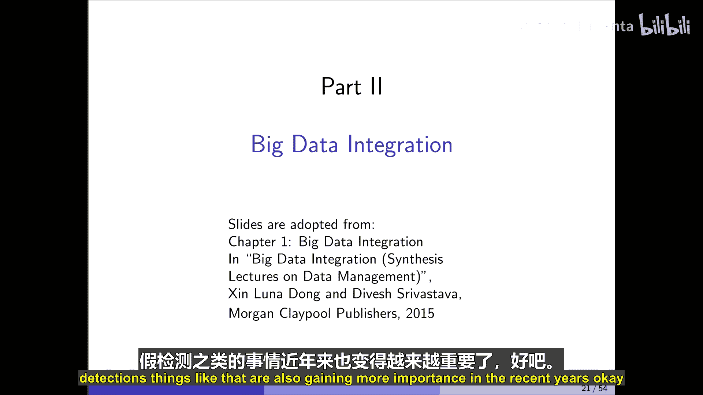

# 014：引言

在本节课中，我们将要学习数据集成的基本概念、面临的挑战以及其核心步骤。数据集成是将来自不同来源的数据组合成一个统一视图的过程，这对于大数据分析至关重要。

---

之前，当我们讨论数据预处理中的数据集成时，我们通常关注的是数据库内部或多个表之间的数据比较。这些表通常已有模式，意味着列名相似，因此我们主要进行属性值的相似性分析。

然而，这种方法基于一个假设：我们知道哪些列是相互关联的。但如何确定这些列确实相关呢？这使得整个集成过程比单纯的数值比较更为复杂。本课程强调处理大数据，当数据量巨大时，问题会变得更加复杂。

因此，我们将探讨一些传统方法，这些方法在过去十年甚至更长时间里被提出并应用于某些系统。同时，由于我们处理的是大数据，也会有一些新提出的算法、技术或观点，我们也将一并了解。

首先，让我们再次介绍数据集成。

在接下来的几讲中，我们主要使用两本教材和一些在线资料。最常用的教材是《数据集成原理》。这本教材出版已有一段时间，但它是对数据集成相关技术和主题覆盖最全面的教材之一。我们还会用到另一本名为《大数据集成》的书，我们将在下一个主题中讨论该书的一些内容。

那么，什么是数据集成？想想我们通常如何存储数据。传统上，我们常将数据存储在数据库中，结构良好，是关系型的。但如今，我们的大部分数据并非都整齐地存储在数据库中，它们无处不在。

我们有大量不同格式的数据，即使文档已经数字化，它们也可能以不同格式存在。我们有文本文档、视频、图像。即使是文本文档，也有许多不同的格式，它们可能是非结构化的（如新闻文章），也可能是半结构化的（如广告或产品目录）。

因此，我们有多种不同格式的数据，它们存储在不同的地方。有些在数据库中，有些是在线文档（如网络上的表格），有些数据隐藏在网页背后。格式、系统、来源的不一致性，所有这些都使得数据集成具有挑战性。

我们一直在讨论数据集成，有些论文甚至是二三十年前的。但直到最近几年，我们仍在讨论它，因为要实现完全自动化的完整数据集成过程，目前仍然难以实现。如今，我们实际上有一些工具可以帮助我们处理数据集成中的某些步骤，我们将会讨论这些。

那么，数据集成的简单定义就是将不同来源的数据结合在一起。问题在于为什么数据集成如此困难？因为数据通常由不同的人管理，而涉及到人，就必然会带来挑战。

我们经常需要查看来自不同来源的数据，可能包括我们提到的结构化数据库（如SQL）、其他结构化文档（如JSON、XML），以及非结构化文档（如文本）或其他类型的结构化文档（如CSV文件或Excel文件）。来源多种多样，我们的目标是将它们集成起来，形成一个统一的视图。

这里还有另一个数据集成的定义：将来自多个来源的数据组合成一个统一的视图。这意味着在拥有统一视图后，我们可以进行查询。我们不必对特定来源进行查询，而是可以对集成视图进行查询，从而从各个来源中找到所需的数据。

如果我们想做到这一点，就需要能够进行查询。这意味着我们至少需要有一个特定的模式来支持查询，并且这个模式必须是集成的。这个模式将允许我们基于不同来源的数据获取所需信息，我们称之为**中介模式**。

中介模式用于指定我们想要的查询与数据源之间的关系。它不必包含数据源中的所有内容，我们很快会看到一个例子。但可以看到，如果我们想在中介模式上进行查询并从数据源获取数据，就需要某种映射。通常，我们称之为中介模式与数据源之间的**语义映射**。

因此，数据集成的一个步骤就是讨论如何进行映射。

数据集成有很多应用。当然，除了数据预处理，一个非常典型的案例是两家公司合并。每家公司都有大量数据和数据库，合并后需要将所有数据库整合在一起，以发现是否能从中获得信息或价值，这就需要我们对数据库进行数据集成。

另一个例子是在科学领域。例如，在生物信息学领域，存在许多生物信息学知识库。如果你尝试寻找生物医学或生物信息学领域的数据集或知识库，会发现数量非常多，这里仅列出少数几个，例如基因本体、GEO、GenBank、Ensembl等。存在许多不同的知识库，有些存在已久，有些是新近创建的。因此，我们拥有许多数据源。如果我们想要有一个集成的视图，由于它们是不同的知识库，可能以不同的方式设计来处理不同的问题，集成过程就需要很多步骤或付出大量努力。

另一个可能大多数人都能理解的例子是如何找书。现在如果你想搜索一本书，同样会面临许多不同的在线书店。仅就在线书店而言，数量就已经很多了。此外，与传统书店不同，出版商通常不直接售书，但如今有了网络商店，出版商也很可能直接销售实体书或电子书。这意味着我们可以在很多地方查看或购买书籍。

因此，如果我们无法在一个地方找到某本书，就必须去另一个网站，这个过程变得越来越耗时。例如，过去如果想购买像冰箱这样的家电，我通常只会去一两家电器店，比较价格后做出决定。但现在，我们可以在很多网站上购买，每个电器店都有自己的网站，还有一些在线商店也可以购买。因此，你需要进行大量比较，整个过程非常耗时。

实际上，在近十年和上个十年，我们也需要一些元搜索引擎。但可以看到，元搜索引擎虽然存在，但并非适用于所有领域，因为还存在许多其他限制。

另一个例子是，网络上有数百万个表格。不同的组织、不同的人，由于组织的目标、职责或个人兴趣，会创建包含丰富信息的网页。因此，网络上存在大量有用或丰富的信息，我们可能希望将它们集成起来以获取信息。

再比如我之前提到的找书，那么找工作呢？同样，你需要从不同的网站搜索。对于求职网站，通常需要填写表格，输入大量详细信息，不像搜索产品只需输入名称。为了找工作，你需要反复在许多页面上填写个人信息、工作性质、领域等细节，这也会非常麻烦。

因此，如果我们能够进行数据集成，能够将它们整合在一起，无论是物理上放在一个地方，还是通过一个集成的界面虚拟地整合在一起，然后进行搜索，这两种方式都很难实现。这就是为什么数据集成实际上很困难，并不容易。

原因之一是显而易见的，即系统层面的原因。例如，我们看数据库，它们通常使用SQL。但即使如此，多年来SQL也有很多不同的变体，系统对查询的支持方式也不同。因此，仅从系统层面看，数据存储在哪里、平台是否可访问、如何访问，这些已经足够困难了。

如果我们忽略这些技术或系统层面的原因，让我们看看另外两类原因。

一类是逻辑原因，这里我们讨论的是模式和数据的异构性。那么，差异在哪里？为什么我们说模式和数据结构不同？

正如我们之前提到的，为什么需要相似性度量？我们提到了许多需要相似性度量的原因，因为存在数据异构性。你能想到哪些类型的数据异构性？

或许我们也可以想想日常生活。你每天看到什么样的数据或信息，在查看时仍然需要思考几秒钟才能理解它是什么或具体在谈论什么？你有这样的例子吗？

谢谢。是的，时间。例如，我们有AM/PM制和24小时制两种表示方式。此外，还需要考虑时区。例如，现在我们在线开会，如果你在海外与另一个地方的人开会，你们必须确保谈论的是同一个时区，否则就会产生误解。还有其他例子吗？

是的，非常好的例子。货币。例如，当我们买东西时，经常只标注金额“300”，但它是美元还是港币？你需要考虑这一点。如果你看到两个产品描述，一个说300，一个说2000，哪个更贵？它们实际上匹配吗？我们需要进行一些转换，很好。还有其他例子吗？我想有数百万个。

实际上，我认为每天都会遇到。例如，当你购买食品或饮料时，日期。我每天早上都会遇到这个问题。例如，如果我拿一包饮料、蛋糕或预包装的面包，上面有日期。是年/月/日，还是日/月/年，或是任何组合？是的，还有不同的单位。例如，度量单位，我们有米、厘米，还有英寸（这是距离和长度），有重量单位，还有体积单位等。它们可能使用不同的单位，所有这些都会使我们的集成变得非常困难，我们需要考虑转换。

那么模式呢？模式也非常困难。这里我们讨论的模式是指属性类型。你知道，当我们有一个数据库时，会有许多关系。对于每个关系，都有许多属性。通常，对于一个特定的关系，会有一个模式来描述该属性是什么，以及存储在那里的数据类型。如果我们只看两个数据库或两个表中的两个表，它们可能涉及相似的数据。例如，一家公司有一个关于其雇员的表，另一家公司有一个关于客户的表。我们谈论的是人，描述人通常有姓名、年龄和其他个人信息。人们如何写下标题？即使不看数据库，假设我们创建那些Excel表格来存储例如某个班级同学的信息，你会发现，一位老师会写下“学生ID”，而另一位老师在表格中可能只写“ID”；一位会写下“名”和“姓”，另一位可能只写“姓名”。

可以看到，标题、属性如“姓名”已经不同，那么模式相同吗？因为数据库、表、关系的模式是由不同的人设计的。它们肯定会不同，这可以说是人性使然。作为不同的个体，我们肯定有不同的思维、想法和设计，这是不可避免的，因此我们发现将事物整合在一起很困难。

我认为我们每天都会遇到数据集成的问题。我试着想一些日常生活中我们在整合、组织事物时遇到的问题，但发现所有这些例子都是旧的。例如，我经常抱怨整理书籍。过去我们购买实体教科书时，它们尺寸各异，很难整齐地摆放。另一个例子是过去我们购买CD或DVD时，它们也有不同尺寸，有些包装大，有些小，这总是令人头疼。这也是为什么我们在数据设计上存在很多差异。我们总是说，如果能有一个标准化格式就好了，但这并不总是可能。

纵观多年，我们尝试为许多不同的应用达成特定标准，但这并不总是可能。例如，如今我们仍然看到DVD的多种格式，可能是DVD、蓝光，或高清DVD等。我们仍然面对多种格式。好的。

那么，这就是本课程将要讨论的主要逻辑原因。因此，在后续描述数据集成的主题或步骤中，我们经常讨论如何处理这些逻辑原因。

数据集成困难的另一类原因实际上是社会原因，这又与人有关。这里列出的社会原因包括在企业中定位和捕获相关数据。你知道，当事物由人管理时，并不总是能找到所有东西。你可能认为它应该在那里，但就是找不到。这是可能的。另一件事是数据所有权。

当我们涉及到人，并且人们处于不同的管理级别时，你会发现人们可能并不总是愿意分享数据。因为你知道，数据也是财产，从另一个角度反映了你所拥有的权力。如果有人控制着特定的数据源或数据集，他或她可能不愿意分享，因为他或她会认为如果分享了，就可能失去对它的控制。这是一个原因。

另一件事是，人们可能担心如果与他人分享数据，就很难控制。这意味着有些人可能未经授权访问，你如何防止他人错误地访问数据或泄露给他人？这将涉及安全和隐私问题。隐私是我们在讨论数据时又一个非常重要的话题。因为现在我们访问的数据越来越多，所以在能够获取某些数据之前，必须解决隐私问题。即使我们能掌握数据，在进行数据集成时，是否会引起额外的隐私或安全问题？这也是我们在数据集成过程中进行数据分析时需要意识到的问题。

好的，我们已经概述了为什么数据集成困难。接下来的几页是说明为什么困难的例子。例如，在这一页中，我们试图举一个案例，假设我们看两家公司：FruitServe公司和EuroCard公司，这两家公司正在合并。

你可以看到，这两家公司起步规模不同，覆盖领域也不同。EuroCard实际上是一家信用卡服务公司，而FruitServe则从事销售等其他业务，有自己的服务等。它们原本是两家不同的公司，因此它们的数据库也不同。例如，FruitServe有员工信息，也有简历信息，而EuroCard也有这些，但覆盖的内容也不同。因此，关系、设计实际上不同，如何将它们整合在一起将会很困难。

如果我们看一个更小的应用，比如我们想要集成这两个数据库，以获得客户相关信息的完整图景，那么你会看到我们实际上需要处理具有不同关系的多个数据库。例如，我们想要集成信用卡信息，查看客户详细信息，查看过去的客户以及销售相关信息。我们需要集成所有这些，以获得完整的图景，潜在的好处可能是为客户增加更多价值。

对于逻辑原因，我们可以看到这里有两个数据集、两个数据库。一个数据库有病人表，另一个有两个表：入院病人表和地址表。如果你看姓名，我们已经提到过，这里是“姓名”，而我们有“姓氏”和“名字”。然后你可以看到出生日期，它们以不同的表示形式存在。还有性别，地址如何表示和存储？这将非常不同。即使我们有病人ID，但病人ID只适用于特定组织，这意味着它们不能帮助我们跨数据库集成，因此我们不能依赖ID。我们需要处理的是属性名称、模式属性名称以及内容。

当我们进行数据集成时，正如我们所提到的，数据集成确实很困难，需要考虑许多步骤。

目前还没有完全解决的方法，每个人都在思考可能的技术或步骤来帮助完成整个过程。

因此，我们将讨论这些步骤。在继续讨论步骤之前，我们必须提到另一件事：当我们谈论数据集成时，通常讨论两种场景，一种是数据仓库，另一种是虚拟数据集成。

当你查找“数据集成”这个术语时，经常会发现它与数据仓库相关。数据仓库实际上是将数据物理地放在同一个地方。通常，我们谈论的是非常复杂的数据处理、大量的转换和处理，最终它们以一个定义良好的模式集成在一起。然后你在集成的仓库上进行查询。

在本课程接下来的讲座中，我们将专注于虚拟数据集成。这意味着我们不是讨论将所有数据提取出来并物理地放在一个特定的地方，而是讨论所有数据仍然在其源位置。一切都在其原始位置，只是当我们想要进行查询时，我们需要能够知道从哪个源获取所需的具体信息。这意味着我们需要一些额外的过程，我们将讨论这些。

那么你可以看到，如果我们谈论虚拟数据集成，我们会有不同格式、不同位置的数据源。假设我们想要进行查询，我们会在一个模式上进行查询，我们称之为中介模式。然后该查询会根据描述其与源之间关系的源进行重新格式化，这样我们就知道从哪里获取数据。通过查询重写（这实际上是重新制定查询，使其具有逻辑和物理查询计划），我们将从每个源获取所需的数据。你可以看到这里会有许多不同的步骤，例如我们需要进行查询重写或转换。

这里是另一个例子。假设这是中介模式。

这个中介模式描述了我们想要拥有的内容。

那么，如果我们在这个中介模式上进行查询，我们需要知道可以从哪些源获取。你可以看到这里，中介模式谈论的是一个电影关系，但你可以看到它并不存在于一个特定的源中，而是无处不在。对于源一，它给了我们电影关系，但你可以看到属性名称并不相同。在这里，源一的电影关系谈论的是“名称”，而在中介模式中，我们想要电影的“标题”。

那么，你如何说明“名称”就是电影名称呢？还是演员姓名或导演姓名？你可以看到，“名称”这个词本身可以代表很多不同的事物。因此，如果我们想要描述“标题”和“名称”之间的关系，就需要一些处理。

有时你可以看到，并非某个特定的源会覆盖所有内容。例如，这里的源三只谈论纽约的电影院信息，而源四谈论旧金山的电影院信息，所以它并不完整。这涉及到覆盖范围，我们需要知道如何获取数据，并且源之间可能存在一些重复。

因此，对于数据集成，有许多详细的步骤。例如，其中之一是源与中介模式之间的关系，我们肯定需要一个映射。

我们需要知道中介模式与源模式之间的映射。如果我们能够进行模式映射，那么我们将能够合并或比较不同源之间的属性和模式。然后，我们将能够查看记录（元组），并能够比较元组与元组，以发现它们是否在谈论相似的实体、相同的实体或相同的个体。这将需要另一个步骤，称为**记录链接**。

你会发现，有几个术语与数据集成密切相关。一个是模式映射，另一个是记录链接。这两个通常是整个数据集成过程中最重要的步骤。但近年来，还有更多步骤，例如另一个称为**数据融合**的步骤。实际上，“数据融合”一词有多种含义，但这里通常指**真值发现**。

你知道，现在数据中存在许多不一致性。可能是因为存在错误、数据更新不同步，或者由于各种原因导致不同来源的数据不一致。因此，即使我们能够说这个数据库中的这条记录可能指的是与另一个数据库中的另一条记录相同的人，如果它们的值不一致，那么我们应该使用哪一个作为真值？因此，近年来提出了一个额外的步骤，称为数据融合或真值发现。实际上，我认为真值发现、虚假检测或假信息检测等在近年来也变得越来越重要。

---

在本节课中，我们一起学习了数据集成的核心概念。我们了解到数据集成是将多源数据统一视图的过程，面临着系统、逻辑和社会层面的多重挑战。核心步骤包括建立**中介模式**、进行**语义映射**、**模式映射**、**记录链接**以及**数据融合（真值发现）**。我们还区分了**数据仓库**（物理集成）和**虚拟数据集成**两种主要场景。理解这些基础是后续深入学习具体技术和方法的基石。