数据分析基础：15：大数据集成 🧩

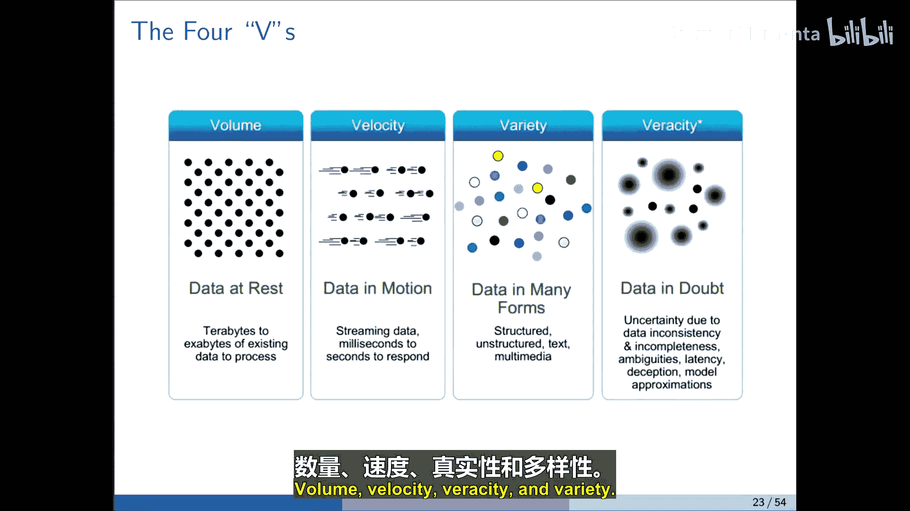

在本节课中，我们将要学习大数据集成所面临的挑战。我们将从大数据的“4V”特性出发，探讨在处理海量、高速、多样且真实性不一的数据时，数据集成会遇到哪些具体困难。

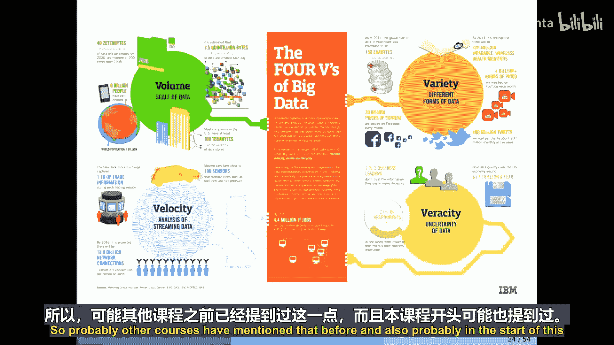

上一节我们介绍了数据集成的概念与价值，本节中我们来看看在大数据背景下进行数据集成所面临的挑战。这些挑战通常可以用大数据的“4V”特性来概括。

*   **Volume（体量大）**：数据量和数据源的数量都非常庞大。
*   **Velocity（速度快）**：数据生成和更新的速度极快。
*   **Variety（多样性）**：数据形式多样，包括结构化、半结构化和非结构化数据（如文本、数值、视频、图像等）。
*   **Veracity（真实性）**：数据的质量和可信度参差不齐。

在后续内容中，我们将讨论研究人员如何针对这些方面进行验证和应对。

---

### 大数据集成的价值与应用

基于之前的应用案例，我们知道数据集成能够创造价值，无论是商业领域还是个人层面。从大数据视角来看，人们希望构建**网络规模的知识库**。

例如，谷歌的**知识图谱**。当我们搜索“数据集成”时，如果该实体存在于知识图谱中，谷歌会展示相关信息。构建这样的知识图谱需要整合关于某个实体的所有信息：它在哪些数据中被提及，以及具体被如何描述。

其他网络规模的知识库还包括DBpedia、WikiData和YAGO。构建这类知识库的另一个目的是实现**关联数据**，以便进行推理，并支持多种应用。此外，处理数据分析（如整合多个生物信息学数据库）也是重要价值所在。

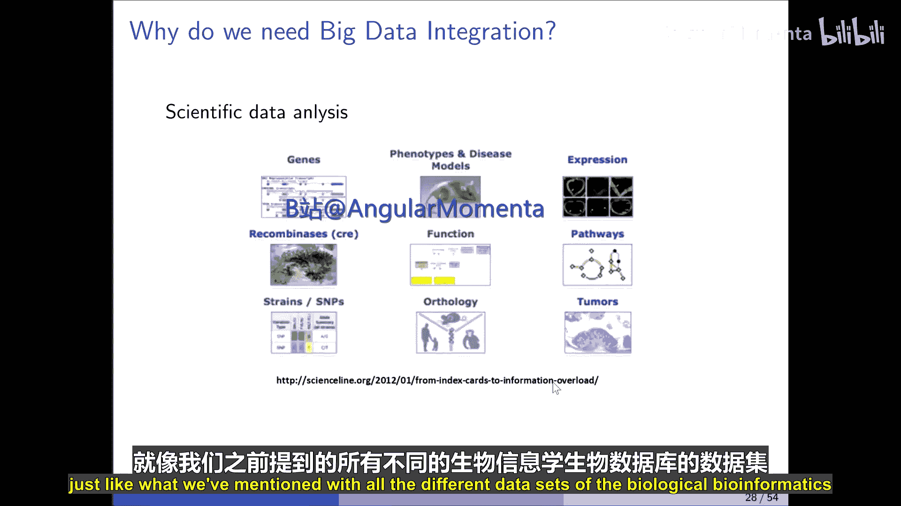

---

### 数据集成的三个核心步骤

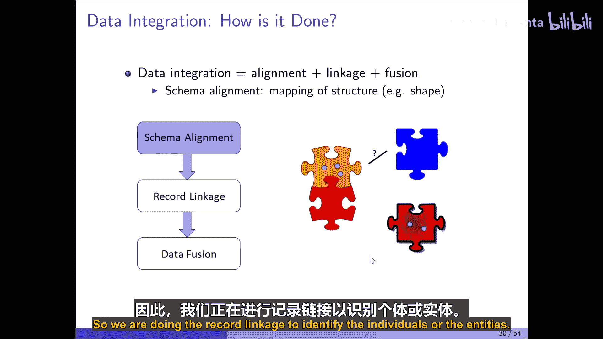

正如前面提到的，数据集成通常包含三个主要步骤：

1.  **模式对齐**：通常作为“模式映射”的替代术语。此步骤旨在根据表的设计、关系和属性，将不同数据表的列进行映射。
2.  **记录链接**：此步骤旨在识别个体或实体，将不同数据源中的记录（元组）链接在一起。
3.  **真值发现/数据融合**：此步骤旨在处理不一致的值和冲突的内容，通过集成找出“真相”。

---

### 相关研究洞察

上一张幻灯片我们谈到了**效用**问题，即投入资源集成大量数据源是否值得。以下是一些相关的基础研究，它们并非具体方法，而是提供了背景洞察。

**研究一：需要多少数据源才能构建完整的领域数据库？**

一组研究人员专注于研究需要整合多少数据源才能为特定领域（如图书、餐厅电话号码）构建完整的数据库。他们以雅虎搜索引擎的网页缓存作为参考基准，研究覆盖度。

以下是研究发现：
*   对于餐厅电话这类信息，仅整合前5个主要数据源就能覆盖约80%的实体。斜率较缓意味着不需要覆盖太多源就能获得大部分信息。
*   不同信息模式不同。电话号码通常在很多网页提供，但并非所有餐厅都有网页。

**研究二：数据之间的连接程度如何？**

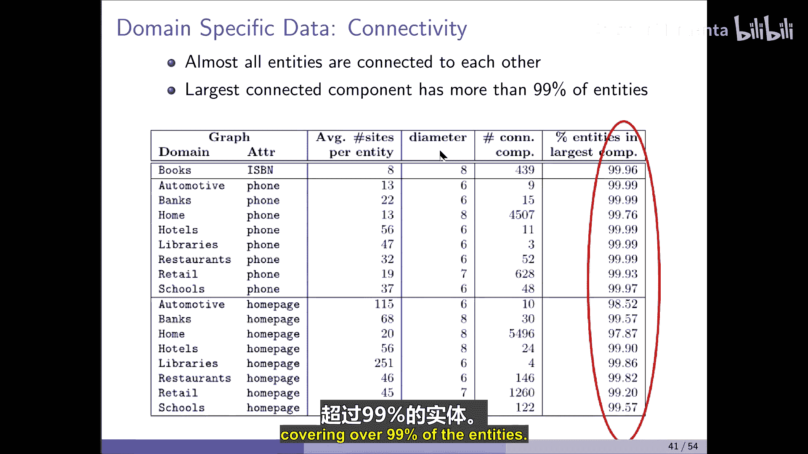

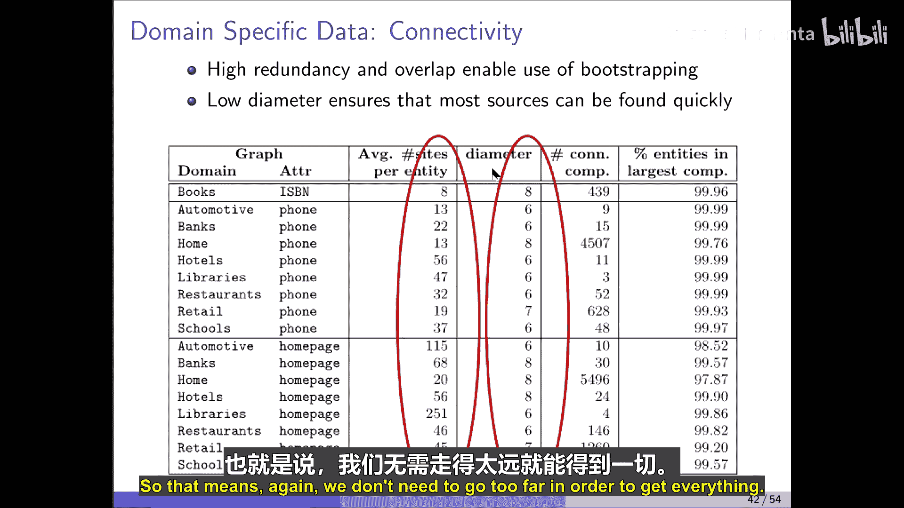

该研究还调查了数据之间的**连接性**，即能否通过一个实体或信息找到其他关联实体。

研究发现，几乎所有实体都相互连接，**最大连通分量**中的实体数量覆盖了超过99%的实体。这意味着同样不需要探索所有数据源就能将大部分信息关联起来。

这些研究表明，构建网络规模的知识图谱是可行的，我们无需覆盖所有数据源，只需整合一定数量的关键源就能获得大部分信息。

---

### 数据异质性与质量问题

另一个研究方向是**数据异质性**带来的问题。一组研究调查了数据质量。

在数据量较小的时代，保持数据集清洁相对容易。但在大数据环境下，获得高质量、清洁的数据集变得困难。数据质量一直是数据分析应用中的关键问题。

该研究调查了股票和航班两个领域，观察数据值的不一致程度。

研究发现：
*   股票领域的数据不一致性相对高于航班领域。航班数据通常非常简洁（如航班ID、航班号、时间），出错机会较少。
*   股票数据的错误来源多样，包括：
    *   **语义歧义**：例如，“当日区间”或“52周区间”的定义在不同页面可能不同。
    *   **单位错误**：不同页面使用不同的计量单位。
    *   **录入错误**：纯人为输入错误，在航班和股票领域都存在。

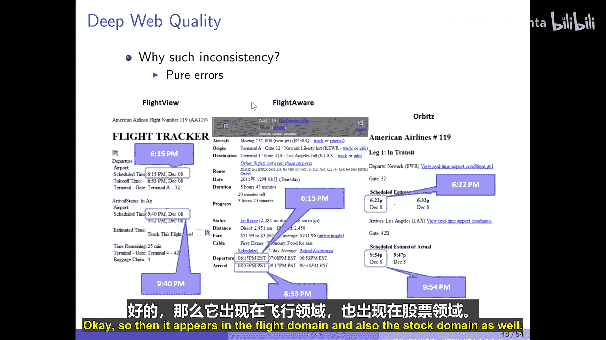

研究还分析了错误类型的分布，这非常有趣：
*   在股票领域，一个主要的错误来源是**数据过时**。这启示我们，在进行真值发现时，“真相”可能不是唯一的，它可能与时间相关。在某一时刻是真相的数据，在之后可能已被更新。
*   在航班系统中，**纯错误**（即录入错误）也很常见。
*   **语义歧义**同样存在。

这意味着在进行数据集成时，我们必须考虑错误处理。

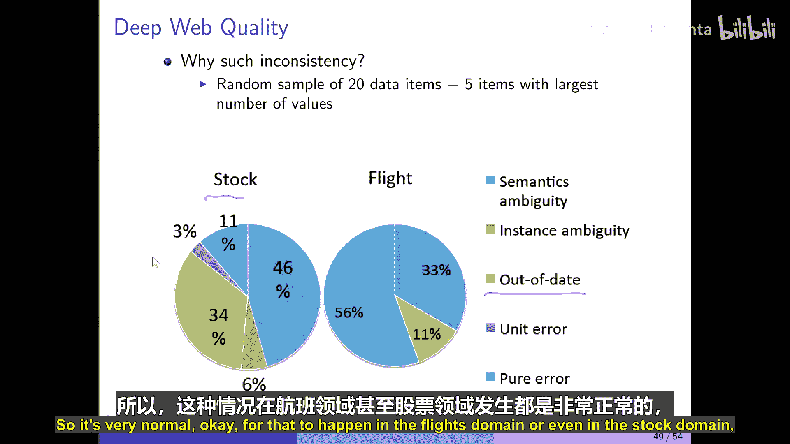

**为什么会出现错误？**

错误，尤其是重复出现的错误，很可能源于**复制传播**。就像之前提到的新闻案例，一个由某人造成的错误可能会传播开来，影响其他数据源。

因此，在处理不同数据源时，我们必须处理数据不一致性、错误和复制传播等问题。这些都将成为**数据融合**步骤中需要重点研究和解决的问题。

---

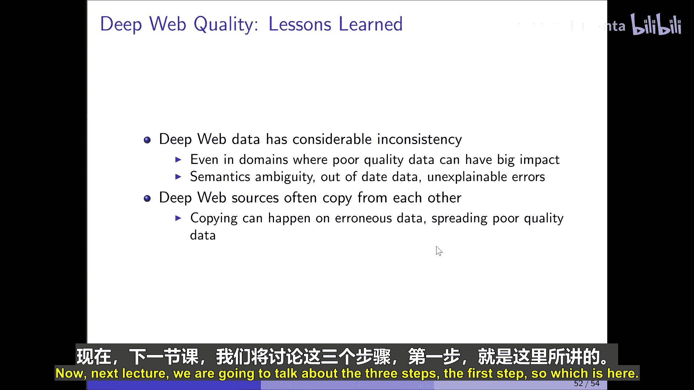

### 总结与下节预告

本节课中我们一起学习了大数据集成的挑战，包括其“4V”特性带来的困难、数据集成的价值与应用、核心的三个步骤（模式对齐、记录链接、数据融合），以及关于数据源覆盖度和数据质量的相关研究洞察。

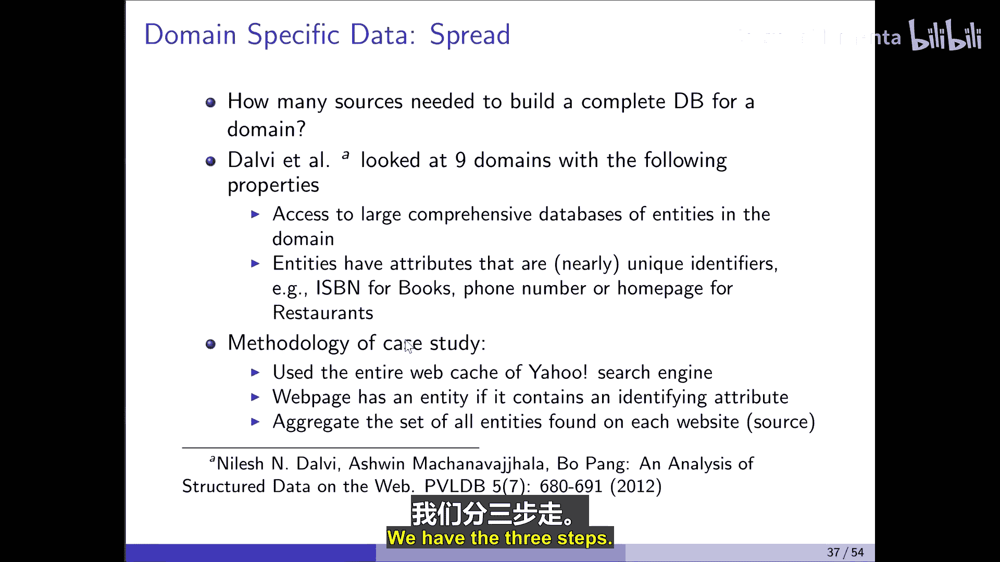

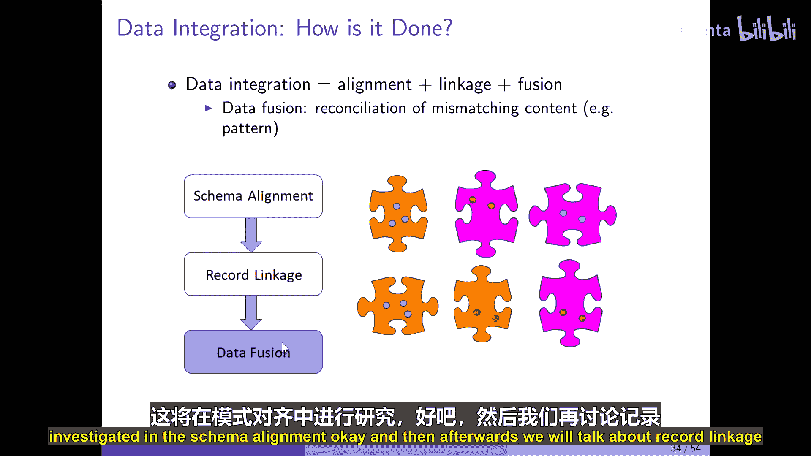

下一讲我们将开始深入探讨这三个步骤中的第一步：**模式对齐**。我们将研究当拥有两个数据源时，如何判断某一列应与另一列匹配，以及如何进行映射（例如，处理不同货币单位的价格数据）。之后，我们会继续讲解记录链接和数据融合。