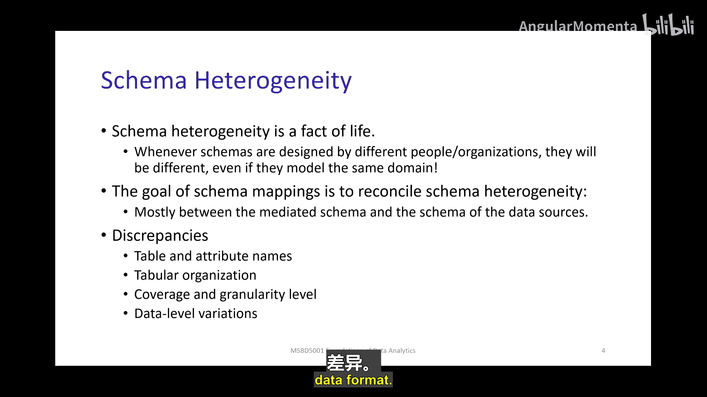
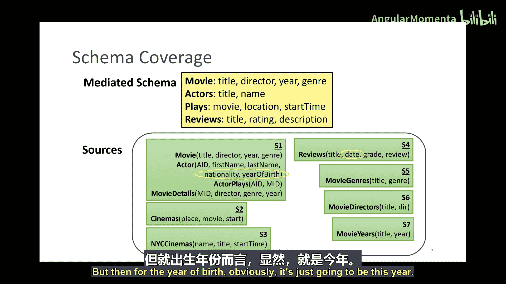
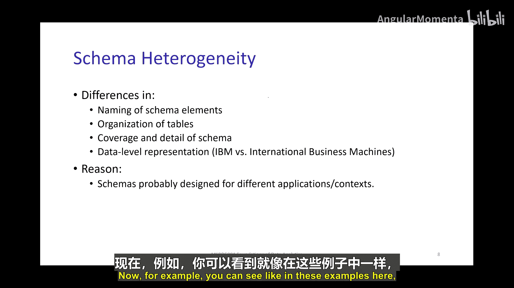
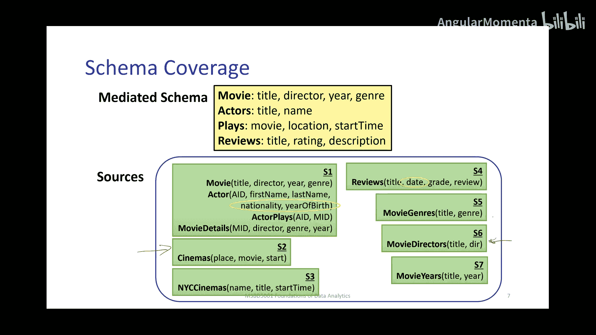
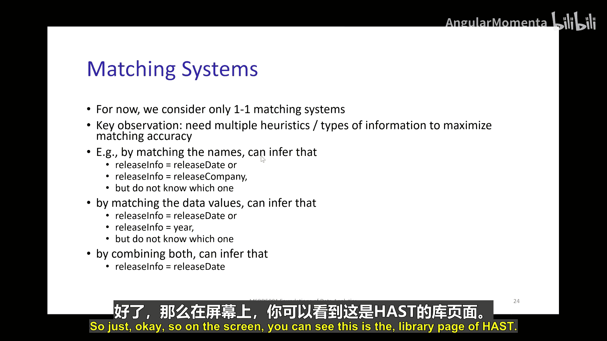
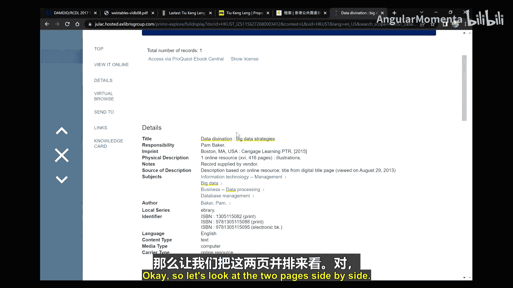
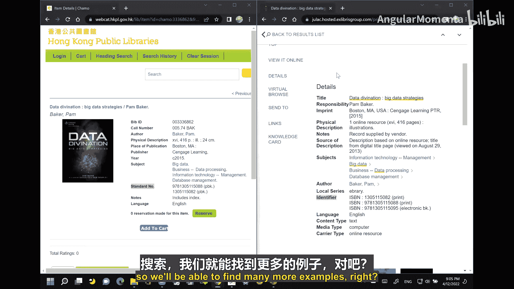
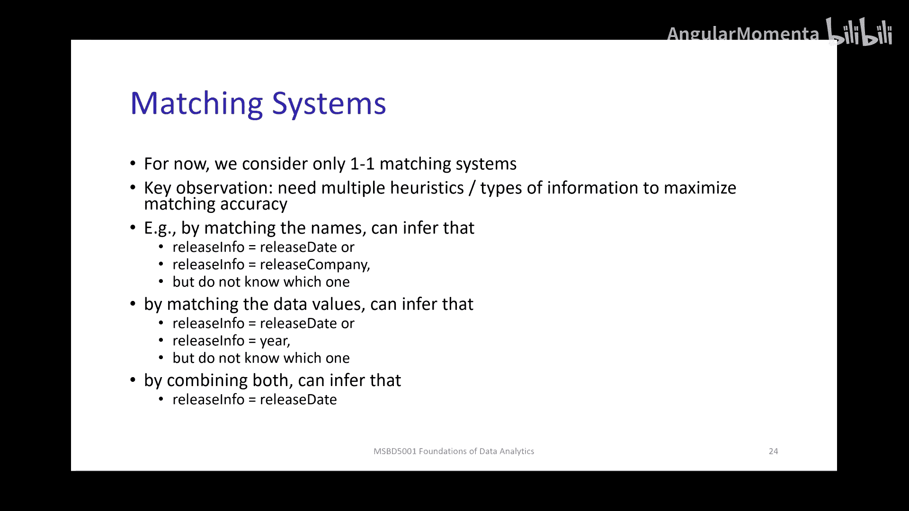

# 016：模式对齐导论 🧩

在本节课中，我们将要学习数据集成中的一个核心环节——模式对齐。模式对齐是整合来自不同数据源信息的第一步，它旨在解决不同数据源之间模式（即数据结构）的差异问题。

## 为什么需要模式对齐？

上一节我们介绍了数据集成的基本概念，本节中我们来看看为什么模式对齐是必不可少的。原因在于模式异构性。当我们进行数据集成时，面对的是来自不同数据源的数据集。这些数据集可能以不同的方式表示相同或相似的数据，这意味着它们拥有不同的模式。因此，为了能够将这些数据整合在一起，我们首先需要理解各个数据源的模式，包括它们的属性，并建立它们之间的映射关系。只有这样，我们才能将数据正确地映射和合并。

模式不同是普遍存在的现象。这源于人类的本性。即使两个人设计相同领域或主题的系统，其结果也往往不同。模式是由不同的人或组织为了不同的用途而设计的，因此它们自然会存在差异。即使讨论的是同一个领域或主题，模式也可能不同。

## 模式对齐的目标

模式对齐的目标是处理这些模式异构性。基于模式间的差异，我们需要在源模式（例如一个数据源的模式）和目标模式（例如另一个数据源的模式，或在数据集成中常指的“中介模式”）之间建立映射。

回顾数据集成过程，我们通常采用以下方式：存在多个数据源，我们创建一个中介模式来承载查询。这些查询会被重新表述为对每个数据源的查询，返回的结果再被集成，作为对中介模式查询的最终答案。因此，模式对齐可以是两个源模式之间的映射，也可以是中介模式与一个或多个数据源模式之间的映射。

## 模式异构性的表现

当讨论模式异构性时，我们指的是模式之间的差异。这些差异几乎可以出现在任何地方。

以下是几种主要的差异类型：

*   **表和属性名称差异**：不同数据库中的关系（表）可能使用不同的名称，即使它们描述相似的概念。表内的属性名称在不同数据源之间也可能有很大差异。例如，一个数据源可能用 `location` 表示地点名称，而另一个数据源可能用 `place` 或 `place_name`。虽然它们都指代地点这个概念，但属性名不同。
*   **表组织结构差异**：不同数据源设计表结构的方式可能不同。例如，一个数据源可能将演员信息和电影信息分开存储在两个表中，并通过关联表连接；而另一个数据源可能将演员姓名和电影标题直接放在一个表中。
*   **覆盖范围和粒度差异**：不同数据源覆盖的数据范围和详细程度可能不同。例如，一个关于城市的表可能包含城市级别的信息，而另一个关于地点的表可能只包含区级的信息。
*   **数据表示差异**：数据值的表示格式可能不同。例如，日期可能以“YYYY-MM-DD”格式存储，也可能只存储年份；温度可能用摄氏度或华氏度表示；价格可能包含或不包含税费。

## 模式对齐的步骤

模式对齐可以看作包含三个主要步骤：

1.  **创建中介模式**：首先，需要定义一个中介模式，作为数据集成后查询的统一视图。
2.  **属性匹配**：将中介模式中的属性与各个数据源模式中的属性进行匹配，识别出哪些属性是相互对应的。
3.  **建立映射**：基于匹配结果，创建具体的转换规则或映射，说明如何从源数据计算出中介模式所需的数据。

让我们详细看看第一步：中介模式。中介模式的设计高度依赖于具体的数据集成需求。通常，它需要我们对所处理的领域和数据源有深入的了解，因此这个过程很难完全自动化。在后续讨论中，我们将假设中介模式已经给定，并专注于如何建立它与源模式之间的映射。

接下来是属性匹配（也称为模式匹配）。这一步主要是比较和识别属性对之间的潜在对应关系，例如判断 `name` 和 `title` 是否可能指向同一概念。匹配关系可以是一对一、一对多或多对多。

然而，仅仅识别出属性匹配还不够，我们还需要处理数据层面的异构性。例如，两个属性都表示“价格”，但一个含税一个不含税，这就需要通过计算（如乘以税率）来进行转换。因此，我们需要从简单的匹配进一步“阐述”为详细的映射规则。

## 模式匹配与模式映射

模式匹配和模式映射是两个相关但不同的概念。

*   **模式匹配**：侧重于识别源模式和目标模式（或中介模式）之间潜在的属性对应关系。它是一个“建议”过程，输出可能的匹配对。
*   **模式映射**：侧重于定义如何从源数据推导出目标数据。它是一个“阐述”过程，需要指定具体的转换函数、约束条件和数据来源。

将整个过程分解为匹配和映射两步，有助于降低复杂性。先通过（相对容易部分自动化的）匹配步骤缩小候选范围，再基于这些匹配结果，利用领域知识来构建精确的映射规则，这样可以减少从头开始构建完整映射所需的工作量和专业知识。

## 面临的挑战

模式对齐之所以困难，主要有以下挑战：

*   **语义异构性普遍存在**：由于设计者、用途、背景不同，差异是不可避免的。
*   **依赖自然语言描述**：模式信息（如表名、属性名、注释）通常是自然语言文本，需要预处理和解释，且可能不完整或不可靠。
*   **名称的歧义性**：像 `name` 这样的常见属性名可以指代人、电影、地点等任何事物的名称，增加了匹配的难度。
*   **标准化不可行**：由于涉及的领域太广、需求变化太快，且不同组织难以达成一致，为所有数据建立统一的标准模式是不现实的。

## 实例观察

考虑从两个不同图书馆系统查询同一本书的记录。即使对于“书”这个相对简单的领域，两个系统的记录模式也存在明显差异：出版地在一个系统中是单独的属性，在另一个系统中则包含在“出版项”里；ISBN号在一个系统中属性名为“标识符”，在另一个系统中则叫“标准书号”。这些差异直观地展示了模式对齐在实际应用中面临的挑战。

本节课中我们一起学习了模式对齐在数据集成中的核心作用。我们了解了模式异构性的各种表现，探讨了模式对齐的三个基本步骤（创建中介模式、属性匹配、建立映射），并区分了模式匹配与模式映射的概念。最后，我们认识到由于语义差异的普遍性和标准化难以实现，模式对齐是一个复杂但至关重要的过程，通常需要结合自动化工具和领域知识来共同完成。