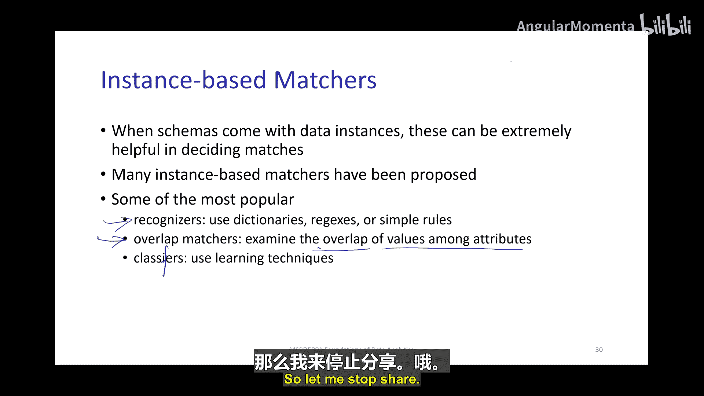
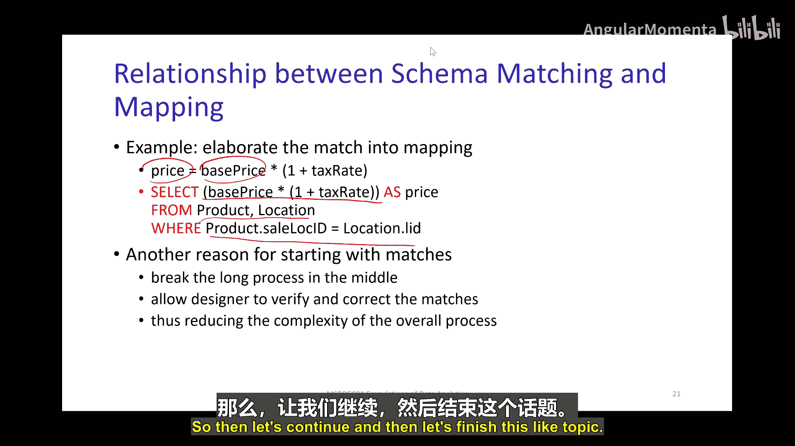

# 017：匹配系统

在本节课中，我们将学习如何构建一个匹配系统，用于识别不同数据源中可能相互对应的属性。我们将从最简单的“一对一匹配”开始，逐步探讨如何结合多种信息源来提高匹配的准确性。

---

上一节我们介绍了匹配系统的基本概念和挑战，本节中我们来看看如何具体实现一个匹配系统。首先，我们聚焦于“一对一匹配”，即识别两个数据源中可能成对的属性。

为了最大化匹配的准确性，系统需要能够处理属性之间的各种差异。我们可以通过多种方式进行匹配。

以下是几种主要的匹配方式：
*   **基于属性名的匹配**：通过比较属性名称的相似度来识别可能的匹配。
*   **基于属性值的匹配**：通过分析属性下具体数据的相似度或重叠度来辅助判断。

仅仅依赖单一信息源（如只比较名字或只比较数据）往往无法确定最佳匹配。例如，一个名为“release_info”的属性，仅通过名称可能同时与“release_date”和“release_company”相似。但通过查看其属性值，可能发现它更符合“release_date”的数据模式。因此，我们需要结合多种匹配方式的结果。

---

上一节我们讨论了结合多种匹配方式的必要性，本节中我们来看看匹配系统的整体架构。

一个完整的匹配系统通常包含多个匹配器。每个匹配器接收源模式和目标模式，并输出一个表示属性对之间相似度的**相似度矩阵**。

接下来，系统需要一个**组合器**，将多个相似度矩阵合并为一个统一的矩阵。然后，基于专家知识或背景知识定义的**约束**，对可能的匹配组合进行剪枝，得到一个精简后的矩阵。

最后，通过**匹配选择器**从精简矩阵中挑选出最可能的匹配对，并将其**具体化**为最终的匹配关系。

整个流程可以概括为：多个匹配器生成相似度矩阵 -> 组合器合并矩阵 -> 约束执行器剪枝 -> 匹配选择器挑选 -> 具体化为匹配。

---

上一节我们概述了匹配系统的流程，本节中我们深入看看核心组件“匹配器”。

每个匹配器的任务是：输入源模式和目标模式，可能结合数据实例或其他文本描述等辅助信息，输出一个**相似度矩阵**。该矩阵的每个元素代表源模式中一个属性与目标模式中一个属性之间的相似度得分，得分通常在 **0到1** 之间。

匹配器主要分为两大类：
*   **名称匹配器**：专注于比较属性名称。
*   **数据匹配器**：专注于比较属性值。

对于名称匹配器，由于属性名通常是字符串，因此会使用**字符串相似度度量**，如编辑距离、Jaccard相似度等。在实际比较前，通常需要对属性名进行预处理，例如：
*   **分词**：将“CellLocID”拆分为“Cell”, “Loc”, “ID”。
*   **词义扩展**：将缩写“Loc”扩展为“Location”，或添加同义词（如“cost”添加同义词“price”）。
*   **移除停用词**并进行词干提取等自然语言处理步骤。

这样做的目的是将原始属性名标准化为一组术语，以便更全面、准确地计算相似度。

---

上一节我们介绍了名称匹配器，本节中我们通过一个例子来看它的实际应用。

假设我们使用基于集合的相似度度量（如Jaccard相似度）来比较电影数据源中的属性。通过比较所有属性对（如“name”与“name”、“name”与“title”、“release_info”与“release_date”等），并只保留非零相似度得分，我们可能得到如下结果：
*   `name` (源) 与 `name` (目标)：相似度 **1.0**（完全匹配）。
*   `name` (源) 与 `title` (目标)：相似度 **0.2**（通过同义词关联）。
*   `release_info` (源) 与 `release_date` (目标)：相似度 **0.5**（部分匹配）。
*   `base_price` (源) 与 `price` (目标)：相似度 **0.8**（经过词义扩展后高度相似）。

这些得分构成了名称匹配器输出的相似度矩阵（此处仅展示非零部分）。

---

上一节我们看了基于名称的匹配，本节中我们转向基于属性值的匹配，即数据匹配器。

数据匹配器主要有三种实现思路：
1.  **基于识别器的匹配**：利用字典或规则来识别属性值的类型。例如，构建一个国家名称字典，如果一个属性的值大多能匹配该字典，则该属性很可能表示“国家”。同样，可以识别电话号码、颜色、基因名称等。如果两个属性都被识别为同一种类型，则它们可能匹配。
2.  **基于重叠度的匹配**：直接计算两个属性值集合的重叠程度。例如，比较“name”属性和“title”属性的值集合，如果它们包含大量相同的电影名，则重叠度高，匹配可能性大。可以使用 **Jaccard相似度** 等指标来衡量。
3.  **基于分类器的匹配**：利用机器学习技术。为源模式中的某个属性（如“address”）训练一个分类器，以其属性值作为正例，以其他属性的值作为负例。然后用这个分类器去预测目标模式中每个属性的所有实例，计算预测置信度的平均值，作为这两个属性间的相似度得分。公式可以表示为：
    `相似度(S_i, T_j) = 平均( 分类器C_S_i 对 T_j 中每个实例的预测置信度 )`
    可以双向训练分类器并合并结果以提高鲁棒性。

基于属性值的匹配可能得出与名称匹配不同的结论。例如，名称匹配可能认为“name”与“name”最相似，但数据匹配可能发现“name”与“title”的值重叠度更高。

---

上一节我们介绍了多种匹配器，本节中我们来看看如何整合它们的结果，即“组合器”的作用。

组合器的任务是将多个匹配器输出的相似度矩阵合并为一个统一的矩阵。有几种简单的合并策略：
*   **平均值**：对同一属性对在所有矩阵中的得分取平均。`合并得分 = (得分1 + 得分2 + ... + 得分K) / K`
    这表示所有匹配器被平等看待。
*   **最大值**：取同一属性对在所有矩阵中的最高得分。`合并得分 = max(得分1, 得分2, ..., 得分K)`
    这表示我们信任最强的匹配信号。
*   **最小值**：取同一属性对在所有矩阵中的最低得分。`合并得分 = min(得分1, 得分2, ..., 得分K)`
    这表示我们要求所有匹配器都给出一定的相似度证据。

也可以使用更复杂的组合方式，例如：
*   **基于规则的组合**：根据领域知识指定规则。例如，如果属性是“地址”，则直接采用数据匹配器的得分，忽略名称匹配器。
*   **加权和**：为不同匹配器分配不同的权重，权重可以通过机器学习从训练数据中习得。
*   **使用元学习器**：训练一个分类器（如决策树）来学习如何最佳地组合各匹配器的得分。

---

上一节我们讨论了如何组合匹配结果，本节中我们看看如何利用领域知识进一步优化匹配，即“约束执行器”。

在得到合并的相似度矩阵后，可能仍然存在许多可能的匹配组合。约束执行器利用领域知识定义的完整性约束来剪枝不可能的匹配。

例如，假设我们有两条匹配组合路径M1和M2，它们的总体相似度得分很接近。我们可以添加一个约束：“如果属性A匹配‘电影名’，那么A的值中单词数大于4的比例应较高”。如果M1中的对应属性是“位置名”（通常单词数少），可能不满足此约束，而M2满足，从而帮助我们选择M2。

通过应用此类约束，可以有效地减少候选匹配的数量，使结果更精确。

---

上一节我们利用约束缩小了候选范围，本节中我们进行最后的筛选与输出，即“匹配选择器”和“具体化”。

匹配选择器通常很简单，例如设置一个**阈值**，只保留相似度得分高于该阈值的属性对作为最终候选匹配。

最后一步是**具体化**，即将筛选出的属性对转化为可执行的模式映射关系。例如，我们确定了“price”和“base_price”是一对匹配，但具体的映射可能涉及复杂的转换（如单位换算、公式计算）。从简单的属性匹配到完整的模式映射，通常还需要进一步的探索和搜索。

---

本节课中我们一起学习了构建一个数据匹配系统的完整流程。我们从简单的“一对一匹配”出发，介绍了**名称匹配器**和**数据匹配器**的核心原理，了解了如何通过**组合器**整合多源信息，并利用**约束执行器**和**匹配选择器**来优化和确定最终的匹配对。这个过程体现了解决复杂数据整合问题时，结合多种证据和领域知识的重要性。