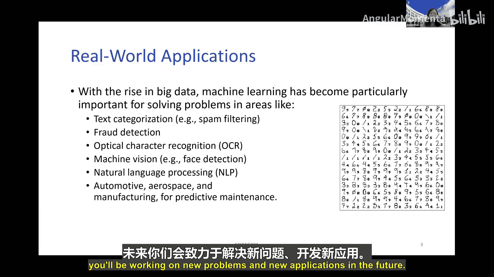
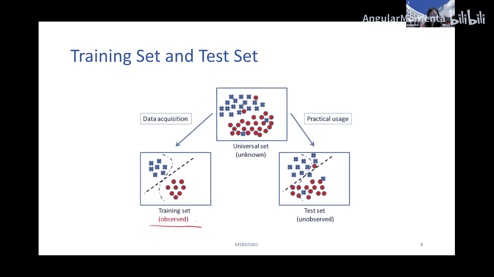

# 019：机器学习绪论

在本节课中，我们将要学习机器学习的基本概念。我们将探讨什么是机器学习，它有哪些应用，以及其核心特点和优缺点。通过本课的学习，你将建立起对机器学习的初步认识，为后续深入学习打下基础。

## 什么是机器学习？

上一节我们介绍了课程概述，本节中我们来看看机器学习的定义。机器学习，顾名思义，是研究机器如何学习的一门学科。学习对我们人类至关重要，我们每天都在学习新事物，积累经验，从而改进我们对事物的理解和处理方式。机器学习的目标与此类似，即让机器能够自动地从过去的经验中学习，从而做出准确的预测或行动。

例如，根据我们的经验，如果天空乌云密布，那么很可能会下雨。这是一个简单的观察和结果。在未来某一天，当我们再次看到天空布满乌云时，我们就会预测即将下雨。这就是我们学习和预测的方式，机器学习也是如此。给定所有的经验（即过去的观察和例子），机器如何能够自动地从这些例子中学习，并在面对新情况时预测其结果。

## 分类问题

在机器学习中，一个非常重要且经常被用来解决的问题是分类问题。分类问题意味着我们希望将样本（或事物）划分到给定的类别中。也就是说，我们有一些预定义的类别和一些项目（样本），我们需要判断每个项目属于哪个类别。

分类问题之所以常与机器学习一同提及，是因为它非常重要，几乎无处不在。我们人类实际上也一直在进行分类。例如，在街上看到一个人，你会判断是否认识他/她。这就是一个分类问题，类别是“认识”和“不认识”。再比如，在购物时挑选水果，你会判断一个苹果是否是好苹果、是否好吃，这也是一个分类。

如果能让机器帮助我们处理一些分类问题，那将非常有用。例如，让机器通过一张苹果的照片来判断其好坏。在未来，我们甚至可以实现远程挑选水果。此外，在电子化存储的今天，自动将文档、网页归类也极大地依赖于分类技术。新闻文章的分类就是一个已经应用多年的例子，图书馆或大学利用机器学习将电子文档自动归入合适的类别，方便查找和使用。

## 机器学习如何工作？

在了解了分类问题后，我们来看看机器学习是如何具体运作的。下图展示了一个很好的例子，说明了机器学习的具体用途。

我们知道，机器学习是从过去的经验中学习，以帮助我们处理各种问题，例如分类。当我们进行分类时，是观察一个样本，然后基于某些规则或模式来预测其类别。

那么，这些分类规则从何而来？当然，我们可以手动构建它们，例如通过一系列条件语句（if-else）。但这会涉及大量规则，手动编写这些规则非常麻烦。为了自动构建这些规则，机器学习就可以发挥作用。机器学习算法会查看我们所说的“过去的观察”，在机器学习领域，我们通常称之为**带标签的训练样本**。

基于这些过去的观察，机器学习算法将自动构建出分类规则。然后，我们就可以利用这些构建好的规则进行预测。这就是机器学习帮助我们学习不同模型，以进行预测和应用的方式。

## 机器学习的应用

之前我们主要看了分类问题，现在来看看机器学习具体能帮助我们做什么，有哪些现实世界的应用已经在使用机器学习。

以下是机器学习的一些应用领域，实际上这个列表非常非常长，新的应用每天都在涌现。

*   **文本分类**：这是分类问题的一种。它指的是确定一段文本（如文档）的类别。一个主要用途是电子邮件管理。我们可以利用机器学习对收到的邮件进行分类，将其归入不同的文件夹或打上不同的标签，例如“重要邮件”、“垃圾邮件”、“同事邮件”等。垃圾邮件过滤就是一个典型应用，像Gmail、Outlook等邮件服务提供商已经利用机器学习技术自动识别并将垃圾邮件放入垃圾文件夹。
*   **欺诈检测**：这与文本分类中的垃圾邮件过滤类似。例如，金融机构在处理信用卡申请时，可以利用机器学习识别虚假申请。
*   **光学字符识别**：将扫描的图片格式文档中的字符和文本自动识别出来，转换为真正的电子文本格式。这使得扫描文档更易用，并能与其他应用（如文本分类）结合。
*   **机器翻译**：自动翻译也广泛运用了机器学习。它首先利用OCR技术识别图片中的字符，然后通过自然语言处理技术理解文本含义，最后进行语言间的转换。
*   **自然语言处理**：这是机器学习的一个重要领域，用于理解人类使用的自然语言。除了翻译，它还应用于情感分析（分析人们对产品的评论是正面还是负面）、话题趋势分析（了解社交媒体上最热门的话题）等。
*   **机器视觉**：处理视觉信息。一个应用是人脸检测，即在图像或视频中定位人脸。这被广泛应用于视频通讯美化、安防监控、身份认证等。另一个应用是物体检测，识别图像中出现的物体。
*   **自动驾驶**：基于大量历史经验和实时数据，让汽车自动做出驾驶决策。类似的技术也应用于航空航天（如自动驾驶）和制造业（如缺陷检测）。
*   **预测**：预测客户行为、物流配送需求、交通拥堵情况等，帮助企业和政府提前做出安排。

我们可以看到，机器学习的应用无处不在，并且未来将在我们生活的更多方面发挥作用。

## 现代机器学习的特点

在了解了机器学习的应用之后，我们来讨论一下现代机器学习的特点。机器学习的目标是在**测试数据**（即未见过的数据）上做出高精度的预测，而不是去揭示绝对的底层真理。我们希望模型能很好地应用于未来的、未知的数据。

理想的方法应该是通用、全自动的，即需要最少的人工干预。但在现实中，获取和处理用于学习的“过去的经验”（即数据）本身就需要大量人力。数据通常并不完美，可能存在错误，需要经过清洗、预处理等步骤才能使用。此外，要选择和应用合适的机器学习算法，我们需要先理解问题本身和数据的特性，这需要人类的先验知识和背景知识。因此，尽管我们追求自动化，但实践中仍需要大量人工努力。

现代机器学习通常涉及大量理论和实践的结合。我们探索理论并将其应用于机器学习，但必须通过实践来检验模型是否有效，这取决于具体问题和数据特性。

最后，现代机器学习的一个重要特点是能够处理**大规模数据集**。在过去，由于计算能力有限，无法在大数据上运行复杂的机器学习算法。如今，计算能力已不再是瓶颈，因此处理大数据集成为现代机器学习的关键特征。大数据的“4V”特性（Volume大量， Velocity高速， Variety多样， Veracity准确）要求机器学习算法能够应对数据量大、变化快、类型多、可能存在噪声和错误等挑战。

## 机器学习的优势与劣势

我们讨论了机器学习的应用、核心思想和特点，现在来看看为什么我们要使用机器学习，即它的优势和劣势。

以下是机器学习的主要优势：

*   **通常能获得比人工制定更准确的规则**：因为机器学习由数据驱动，能够处理和分析海量数据，从而发现人类可能忽略的复杂模式。
*   **能够表达人类难以描述的知识**：人类有时凭直觉或经验知道某事，但很难详细解释原因。机器学习模型可以从数据中学习并构建出可解释的规则或模型。
*   **无需持续的人工专家或程序员干预**：一旦建立了合适的机器学习算法，它就可以自动从数据中学习，无需程序员不断调整参数或专家手动进行分类预测。
*   **自动搜索解释数据的假设**：机器学习算法会广泛探索数据，寻找能够解释数据的最佳方式（即假设）。
*   **成本低廉且灵活**：开发一个机器学习算法可能需要大量研究和实验（初始成本高），但一旦开发成功，将其应用于新的学习任务时，成本相对较低。它易于添加新样本，适应新任务，无需每次都从头开始。

以下是机器学习的主要劣势：

*   **需要大量标注数据**：大多数机器学习算法需要大量的“过去的经验”，即**带标签的数据**，才能学习并达到良好的性能。而获取和准备高质量的标注数据本身是一项耗时费力的工作。
*   **存在错误概率，难以达到完美精度**：机器学习算法由数据驱动，而现实世界的数据充满变化和噪声。模型可能无法捕捉到所有变化，或者数据中的错误会导致学习结果不准确，因此通常无法达到100%的预测准确率。

比较优势与劣势，优势显然更为突出。我们需要能够灵活、低成本地应用于各种任务和新数据的算法，这正是机器学习存在的价值。

## 带标签数据集与无标签数据集

在之前的讨论中，我们反复提到了“带标签的数据”这个概念。这对于机器学习至关重要。与带标签数据集相对的是无标签数据集。下面我们来详细讨论它们，这与机器学习中数据的表示方式有关。

在机器学习中，我们通常按以下方式表示数据：
*   **带标签数据集**：包含已知结果的观察（过去经验）。我们用 `X` 表示特征集，包含 `n` 个样本，每个样本是一个 `d` 维向量（即具有 `d` 个特征值）。同时，我们有一个标签集 `C`，包含了这 `n` 个样本对应的已知结果（标签）。因此，带标签数据集是 `(X, C)` 的组合。
*   **无标签数据集**：我们只有特征集 `X`（`n` 个样本的 `d` 维特征向量），而没有对应的标签集 `C`。我们不知道每个样本的结果。

**公式表示**：
*   带标签数据集: `{(x_i, c_i) | i = 1, ..., n}`, 其中 `x_i ∈ R^d`, `c_i` 是标签。
*   无标签数据集: `{x_i | i = 1, ..., n}`, 其中 `x_i ∈ R^d`。

**例子**：假设我们要对人们的健康状况进行分类。特征集 `X` 可以包含 `n` 个人的体检值（如身高、体重、血压、体温等，共 `d` 项指标）。标签集 `C` 则对应这 `n` 个人的健康状况（如健康、感冒、高血压等）。这就是一个带标签数据集。如果只有体检值而没有健康状况诊断，那就是一个无标签数据集。

## 训练数据集与测试数据集

机器学习中另外两个非常重要的概念是训练数据集和测试数据集。

我们假设存在一个**全体数据**，它包含了所有可能的数据对（所有可能的观察实例）以及它们在现实世界中出现的概率分布。但显然，我们不可能获得全体数据。

在实际应用中，我们只能获得全体数据的一个子集，我们称之为**训练数据集**。训练数据集用于学习全体数据的属性和知识。机器学习的目标就是利用这个子集，学习到能够解释全体数据属性的模型，从而能够预测未来的、未见过的样本。

为了检验我们学习到的模型是否真的掌握了全体数据的属性（即能否很好地预测新数据），我们需要另一组数据。这组数据被称为**测试数据集**。我们使用学习到的模型对测试数据集进行预测，并通过比较预测结果与真实标签来验证模型的性能。

因此，在机器学习中，我们通常需要将已有的数据划分为两部分：一部分用于训练模型（训练集），另一部分用于测试模型性能（测试集）。

下图展示了训练集和测试集的概念：

假设我们有一个未知的全体数据集。我们获取它的一个子集作为训练数据，通过观察学习到一些属性（例如，可以将数据分为两类）。然后，我们获取另一个子集作为测试数据，将学习到的模型应用于它，以验证模型是否能正确分类这些新样本，从而评估学习效果。

## 总结

本节课中，我们一起学习了机器学习的基础知识。我们首先探讨了机器学习的定义，即让机器从经验中自动学习以做出预测。接着，我们深入了解了分类这一核心问题及其普遍性。然后，我们通过图示理解了机器学习的工作原理：利用带标签的训练数据自动构建规则，并应用于预测。我们还列举了机器学习在文本分类、OCR、翻译、视觉、自动驾驶等多个领域的广泛应用。之后，我们分析了现代机器学习的特点、优势与劣势。最后，我们明确了几个关键概念：带标签与无标签数据集、训练集与测试集，它们是理解和实践机器学习的基石。通过本课的学习，你应该对机器学习有了一个初步而全面的认识。