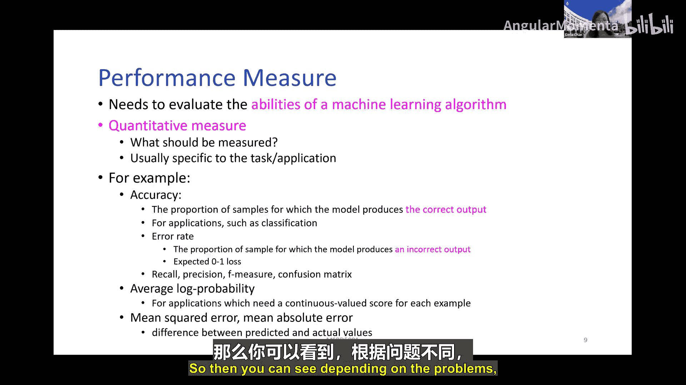
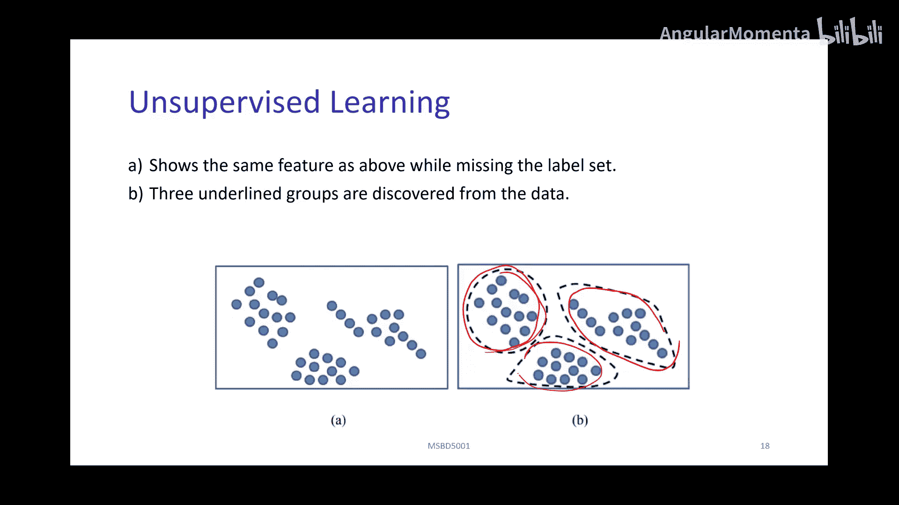

# 020：性能度量与机器学习类型

在本节课中，我们将要学习如何评估机器学习算法的性能，并了解机器学习的主要类型。我们将探讨不同的性能度量指标，理解过拟合与欠拟合问题，并介绍交叉验证这一重要技术。最后，我们将区分监督学习、无监督学习和强化学习这三种主要的机器学习范式。

## 性能度量

上一节我们介绍了训练集和测试集的作用。本节中我们来看看如何定量地衡量机器学习算法的性能。

我们需要一个定量的度量标准来评估机器学习算法的能力。具体使用哪种度量标准，取决于我们要测量的内容和任务类型。例如，对于分类任务，我们想知道模型是否能正确分类测试数据；对于预测任务，我们关心预测值是否接近真实值。不同的任务或应用需要不同的定量度量标准。

以下是针对不同任务的常见性能度量指标：
*   **分类任务**：通常使用**准确率**，即模型产生正确输出的样本比例。也可以使用**错误率**，即模型产生错误输出的样本比例（也称为0-1损失期望）。其他常用指标还包括召回率、精确率、F值、混淆矩阵等。
*   **连续值预测任务**：无法简单地用正确或错误来衡量。常用指标包括**均方误差**和**平均绝对误差**，它们衡量的是预测值与实际值之间的差异。

## 过拟合与欠拟合

在讨论性能度量时，我们常会提到过拟合和欠拟合这两个术语。让我们来理解它们的含义。

机器学习的目的是利用训练数据集学习问题的属性和知识，并用其预测未来的未知样本。我们希望模型在未知样本上也能表现良好，即模型应具有良好的**泛化**能力。我们通过最小化训练误差来学习模型，但最终目标是让模型在测试集（未知样本）上的误差（即**泛化误差**）也尽可能小。一个好的机器学习算法应能同时减小训练误差和训练误差与测试误差之间的差距（即泛化误差）。

然而，模型可能无法达到理想的泛化效果，主要会出现以下两种问题：
*   **过拟合**：模型在训练数据上表现非常好（训练误差低），但在未知数据上表现很差（测试误差高）。这意味着模型过于复杂，过度捕捉了训练数据中的噪声和细节，而未能学习到底层的普遍规律。
*   **欠拟合**：模型在训练数据和测试数据上都表现不佳（训练误差和测试误差都高）。这通常是因为模型过于简单，无法充分表示数据的特征和属性。

为了更直观地理解，可以参考下图：
*   **左图（过拟合）**：蓝色曲线（模型）完美地穿过了所有训练数据点（黑点），但对真实函数（绿线）的拟合很差。这表明模型对训练数据“死记硬背”，泛化能力弱。
*   **右图（欠拟合）**：蓝色直线（模型）过于简单，既无法很好地拟合训练数据，也无法反映真实的数据关系。

过拟合和欠拟合都是我们不希望发生的问题。

## 交叉验证

为了解决过拟合和欠拟合问题，我们可以使用交叉验证技术。

之前的方法是：用训练集学习模型，用测试集评估性能。但这样容易导致模型在测试集上表现不佳。交叉验证的核心思想是：在训练阶段就估计模型的泛化误差，从而选择出泛化能力最好的模型。具体做法是将训练数据进一步拆分。

我们通常将原始训练数据划分为两部分：
*   **训练子集**：用于实际训练模型。
*   **验证集**：用于在训练过程中或训练后估计泛化误差。验证集来自训练数据，我们知道其标签，因此可以评估模型在其上的性能，以此作为泛化误差的估计。

一个典型的划分比例是80%的数据用于训练，20%用于验证。但固定划分一次仍然可能因数据划分的偶然性导致评估不准。因此，我们使用**交叉验证**。

交叉验证的基本流程是：将训练数据多次划分，每次使用不同的部分作为验证集，最终综合多次评估结果。以下是具体步骤：
1.  将整个训练数据集平均分成K个互不相交的子集（称为“折”或“份”）。
2.  进行K轮训练和验证。在每一轮中，选取其中一个子集作为验证集，剩下的K-1个子集合并作为训练集。
3.  训练模型，并在该轮的验证集上评估性能，得到一个性能估计值。
4.  重复步骤2和3，直到每个子集都恰好被用作一次验证集。
5.  计算这K轮性能估计值的平均值，作为该算法性能的最终估计。

这种方法被称为**K折交叉验证**。K通常取5或10。对于小数据集，K折划分可能导致训练数据不足，此时可以使用**留一法交叉验证**，即每次只留一个样本作为验证集，其余全部用于训练。

我们利用交叉验证来评估不同模型的性能，并从中选择最佳模型。其目标是学习一个具有低泛化误差的模型，而不仅仅是低训练误差。

## 机器学习类型

到目前为止，我们讨论的机器学习场景都涉及带有标签的数据，这属于**监督学习**。

在监督学习中，我们拥有带标签的数据集，知道部分样本的真实类别或输出。我们利用这些样本的特征向量和标签来学习模型，目标是找到特征与标签之间的关系。这就像有导师指导的学习过程。

然而在某些情况下，我们只有**无标签数据集**。这时就需要**无监督学习**。无监督学习的目标是发现数据内在的结构和模式，例如将数据分组（**聚类**）、估计概率密度或发现特征之间的关联。无标签数据在实际中非常普遍，因此无监督学习非常重要。

除了以上两种，还有**强化学习**。强化学习不同于监督学习，它不依赖于带标签的数据集，而是用于解决决策问题。其典型模式是：智能体根据环境状态采取行动，环境给予奖励或惩罚的反馈，学习的目标是最大化累积奖励。自动驾驶和自动下棋是强化学习的典型应用。

综上所述，监督学习、无监督学习和强化学习是机器学习的三种主要类型。

## 学习场景示例

最后，让我们通过典型场景来直观理解监督学习和无监督学习的区别。

*   **监督学习场景**：我们有一个已标记的数据集，包含三个类别（图中以三种颜色表示）。我们的目标是学习一个分类边界（如图中曲线），以便根据特征将新样本划分到正确的颜色类别中。
*   **无监督学习场景**：我们拥有相同的样本点，但没有颜色标签。无监督学习算法（如聚类）的目标是自动发现数据中潜在的分组结构（如图中圈出的三个簇）。

一些典型的算法例子包括：
*   **监督学习**：逻辑回归、K近邻、朴素贝叶斯。
*   **无监督学习**：K均值聚类、主成分分析。

---

本节课中我们一起学习了评估机器学习性能的多种度量标准，深入探讨了过拟合与欠拟合的概念及其重要性，并掌握了使用交叉验证来提升模型泛化能力的方法。最后，我们明确了监督学习、无监督学习和强化学习这三种核心机器学习范式的区别与典型应用场景。理解这些基础概念是进行有效数据分析的关键第一步。