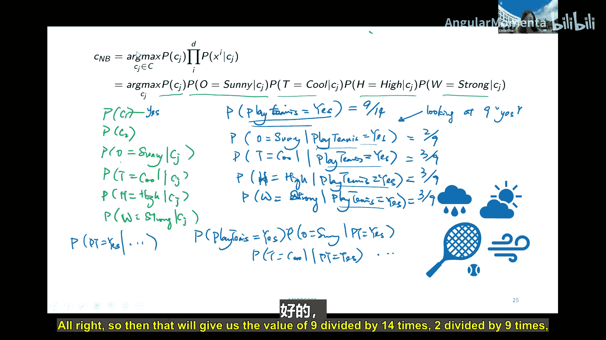
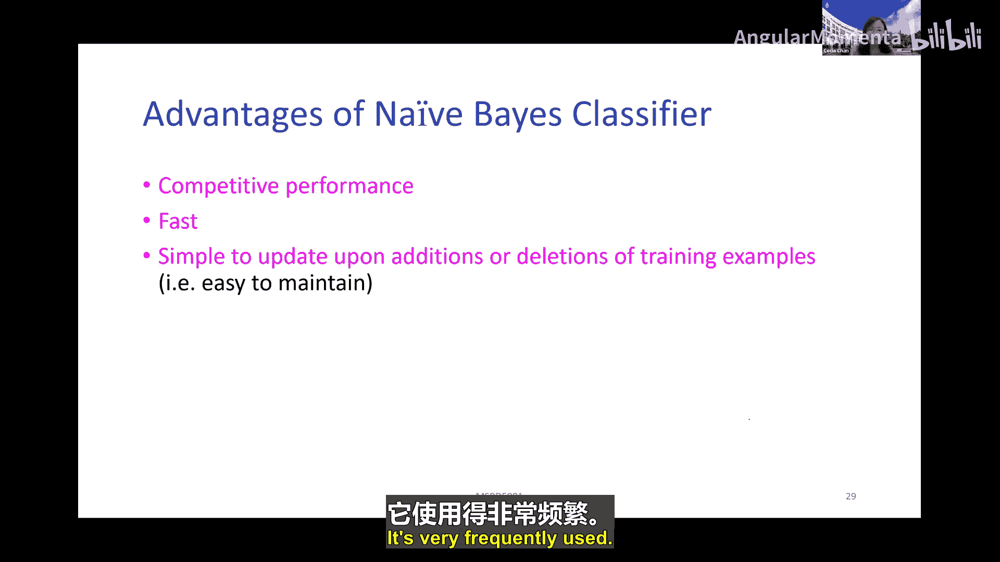

# 021：朴素贝叶斯分类

在本节课中，我们将要学习一种基础的机器学习方法——朴素贝叶斯分类。这是一种基于贝叶斯定理的简单分类方法，其核心在于一个“朴素”的假设：所有特征在给定类别下是条件独立的。我们将通过一个具体的例子，学习如何应用它来对未知数据进行分类。

## 什么是朴素贝叶斯分类？

上一节我们简要介绍了机器学习，本节中我们来看看一个具体的分类方法。

朴素贝叶斯分类是一种简单的分类方法，其思想基于贝叶斯定理。这里的“朴素”并非指算法简单，而是指一个核心假设：**所有数据特征在给定类别标签的条件下是相互独立的**。我们稍后会详细讨论这一点。

当我们使用朴素贝叶斯方法时，我们处理的是带有类别标签的训练数据。类别标签用 **C_j** 表示。假设我们共有 **N** 个类别，即 **C_1, C_2, ..., C_N**。每个数据样本都属于这些类别中的一个。

除了类别标签，训练数据本身是一系列属性值的集合。每个样本可以表示为一个 **D** 维的特征向量 **x = (x_1, x_2, ..., x_D)**。我们有很多这样的带标签向量，因此我们正在进行**监督学习**。

分类问题的目标是：给定一个没有标签的未知数据（即一个特征向量 **x**），我们希望找出最可能的类别标签 **C_j**。

## 分类问题如何求解？

我们通过计算每个类别标签在给定数据下的概率来求解。

具体来说，对于未知数据 **x**，我们计算 **P(C_1 | x)**， **P(C_2 | x)**， ...， **P(C_N | x)**。然后，我们选择概率最大的那个类别作为分类结果。例如，如果 **P(C_2 | x)** 最大，那么 **C_2** 就是该数据的预测类别。

我们可以将算法形式化地表示为寻找**最大后验概率**：
**C_map = argmax_{k ∈ {1,...,N}} P(C_k | x)**

## 应用贝叶斯定理

那么，如何计算 **P(C_j | x)** 呢？这里我们需要用到贝叶斯定理。

贝叶斯定理的公式是：
**P(Y|X) = P(X|Y) * P(Y) / P(X)**

在我们的场景中，**Y** 对应类别 **C_j**，**X** 对应观测数据 **x**。因此，我们可以将后验概率写为：
**P(C_j | x) = P(x | C_j) * P(C_j) / P(x)**

注意，对于所有类别 **C_j**，分母 **P(x)** 是相同的。由于我们只关心比较不同 **C_j** 下概率的相对大小，这个公共分母可以忽略。因此，我们的目标简化为寻找能最大化下式的类别：
**P(C_j | x) ∝ P(x | C_j) * P(C_j)**

## 朴素（条件独立）假设

现在的问题是如何估计 **P(x | C_j)**。即使有训练数据，要直接估计所有特征组合的联合概率也需要海量的样本，这通常不可行。

因此，我们引入“朴素”假设：**在给定目标类别 C_j 的条件下，所有特征属性是条件独立的**。这意味着联合概率可以分解为各特征概率的乘积：
**P(x | C_j) = P(x_1 | C_j) * P(x_2 | C_j) * ... * P(x_D | C_j)**

将这个假设代入上面的公式，我们得到朴素贝叶斯分类的核心公式：
**P(C_j | x) ∝ P(C_j) * ∏_{i=1}^{D} P(x_i | C_j)**

这个假设极大地减少了需要估计的参数数量，缓解了数据稀疏问题。

综上所述，朴素贝叶斯分类器通过计算使后验概率最大的类别来对未知实例进行分类，其中后验概率通过贝叶斯定理和条件独立假设来估计。

## 一个具体例子：是否打网球？

让我们通过一个具体例子来理解这个过程。以下是关于天气条件与是否打网球的训练数据：

| 天气 | 温度 | 湿度 | 风   | 打网球？ |
| :--- | :--- | :--- | :--- | :------- |
| 晴   | 热   | 高   | 弱   | 否       |
| 晴   | 热   | 高   | 强   | 否       |
| 阴   | 热   | 高   | 弱   | 是       |
| 雨   | 温   | 高   | 弱   | 是       |
| 雨   | 凉   | 正常 | 弱   | 是       |
| 雨   | 凉   | 正常 | 强   | 否       |
| 阴   | 凉   | 正常 | 强   | 是       |
| 晴   | 温   | 高   | 弱   | 否       |
| 晴   | 凉   | 正常 | 弱   | 是       |
| 雨   | 温   | 正常 | 弱   | 是       |
| 晴   | 温   | 正常 | 强   | 是       |
| 阴   | 温   | 高   | 强   | 是       |
| 阴   | 热   | 正常 | 弱   | 是       |
| 雨   | 温   | 高   | 强   | 否       |

现在，我们遇到一个新的未知天气情况：**天气=晴，温度=凉，湿度=高，风=强**。我们需要预测在这种情况下是否应该打网球。

**定义符号：**
*   类别 **C1**：打网球 = 是
*   类别 **C2**：打网球 = 否
*   特征 **x1 (O)**：天气 (Outlook)
*   特征 **x2 (T)**：温度 (Temperature)
*   特征 **x3 (H)**：湿度 (Humidity)
*   特征 **x4 (W)**：风 (Wind)

未知数据：**O=晴， T=凉， H=高， W=强**

我们需要比较：
**P(C1=是 | O=晴, T=凉, H=高, W=强)**
和
**P(C2=否 | O=晴, T=凉, H=高, W=强)**

根据朴素贝叶斯公式，我们需要从训练数据中估计先验概率 **P(C_j)** 和条件概率 **P(x_i | C_j)**。

以下是计算所需概率的步骤：

首先，我们计算类别先验概率 **P(C_j)**。
*   **P(是)** = (打网球为“是”的天数) / (总天数) = 9 / 14
*   **P(否)** = (打网球为“否”的天数) / (总天数) = 5 / 14

接着，我们计算在“是”的条件下，各个特征的条件概率。
*   **P(O=晴 | 是)** = (是且天气晴的天数) / (是天总数) = 2 / 9
*   **P(T=凉 | 是)** = (是且温度凉的天数) / (是天总数) = 3 / 9
*   **P(H=高 | 是)** = (是且湿度高的天数) / (是天总数) = 3 / 9
*   **P(W=强 | 是)** = (是且风强的天数) / (是天总数) = 3 / 9

然后，我们计算在“否”的条件下，各个特征的条件概率。
*   **P(O=晴 | 否)** = (否且天气晴的天数) / (否天总数) = 3 / 5
*   **P(T=凉 | 否)** = (否且温度凉的天数) / (否天总数) = 1 / 5
*   **P(H=高 | 否)** = (否且湿度高的天数) / (否天总数) = 4 / 5
*   **P(W=强 | 否)** = (否且风强的天数) / (否天总数) = 3 / 5

现在，我们可以计算后验概率（忽略分母）：
*   **P(是 | 数据) ∝ P(是) * P(晴|是) * P(凉|是) * P(高|是) * P(强|是) = (9/14) * (2/9) * (3/9) * (3/9) * (3/9) ≈ 0.0053**
*   **P(否 | 数据) ∝ P(否) * P(晴|否) * P(凉|否) * P(高|否) * P(强|否) = (5/14) * (3/5) * (1/5) * (4/5) * (3/5) ≈ 0.0206**

比较两个值，**P(否 | 数据)** 更大。因此，对于这个未知天气，朴素贝叶斯分类器的预测是 **不打网球 (否)**。

## 数值计算技巧：使用对数

在计算过程中，我们将多个介于0和1之间的小概率值相乘，可能导致结果数值下溢（变得极小而不易比较）。

一个更好的计算方法是取对数，将乘法转换为加法：
**log(P(C_j | x)) ∝ log(P(C_j)) + Σ_{i=1}^{D} log(P(x_i | C_j))**

我们最终比较的是对数概率值，数值更大（即原始概率更大）的类别即为预测结果。这解决了数值下溢问题，并且加法运算在计算机中通常更快。

## 应用与优势

朴素贝叶斯分类器有广泛的应用，一个典型例子是**文档分类**。在这里，每个文档是一个数据实例，其特征可以是文档中出现的词。类别可以是文档主题，如“科幻”、“悬疑”等。通过训练已标记的文档集，我们可以对新的未知文档进行分类。

以下是朴素贝叶斯分类器的主要优势：

*   **性能有竞争力**：尽管基于独立性假设，但在许多实际数据集和应用中表现良好。
*   **计算速度快**：训练和预测过程主要涉及概率计数和简单运算，效率很高。
*   **易于维护和更新**：当有新的训练数据加入时，只需更新相关的计数和概率估计即可，无需重新进行复杂训练。

正是由于这些优点，朴素贝叶斯分类器在实践中非常流行和常用。

## 总结

本节课中我们一起学习了朴素贝叶斯分类方法。我们了解到它是一种基于贝叶斯定理和特征条件独立假设的分类器。其核心思想是：通过计算使后验概率 **P(类别 | 特征)** 最大的类别来进行预测，其中后验概率通过先验概率 **P(类别)** 和条件概率 **P(特征 | 类别)** 的乘积来估计。我们通过“是否打网球”的例子，一步步演示了如何从训练数据中估计这些概率，并对新数据进行分类。最后，我们还探讨了其应用场景、数值计算技巧以及该方法的主要优势。