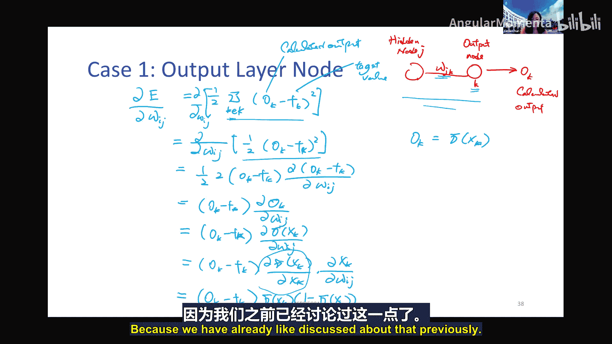
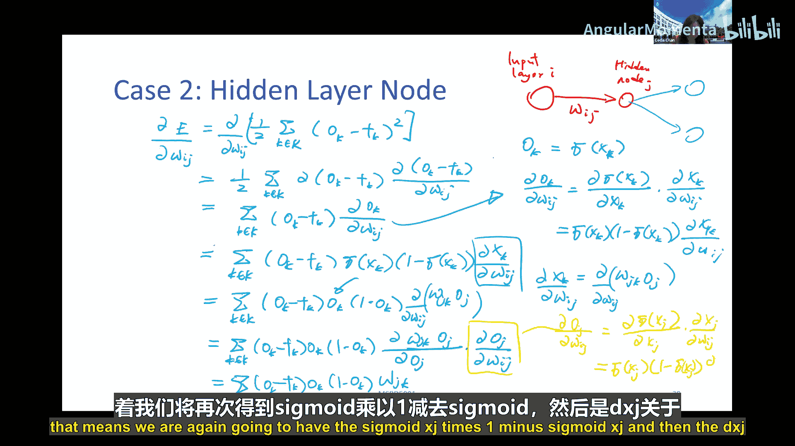
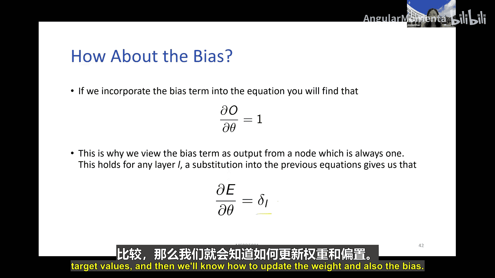
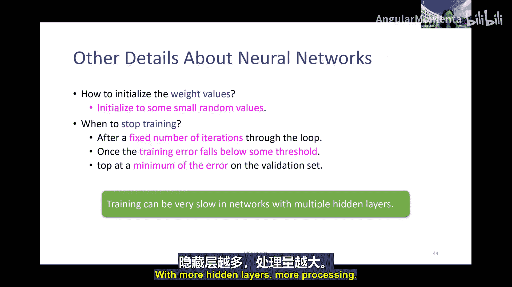
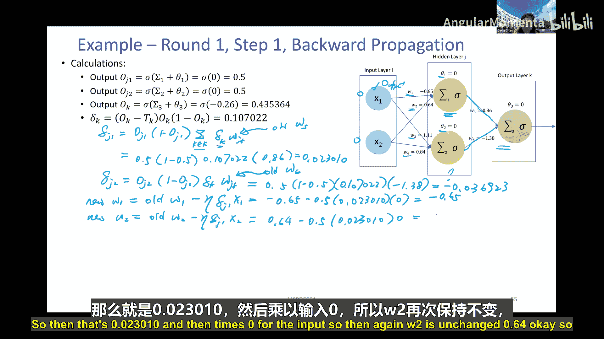
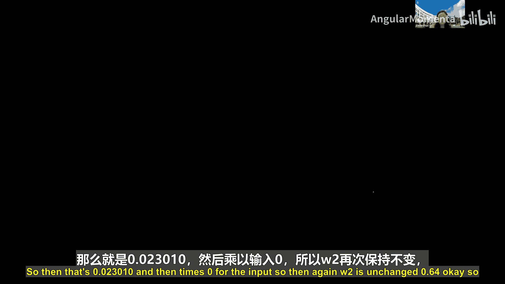
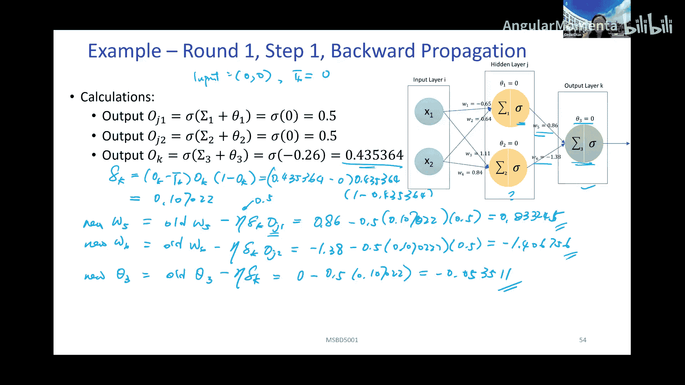
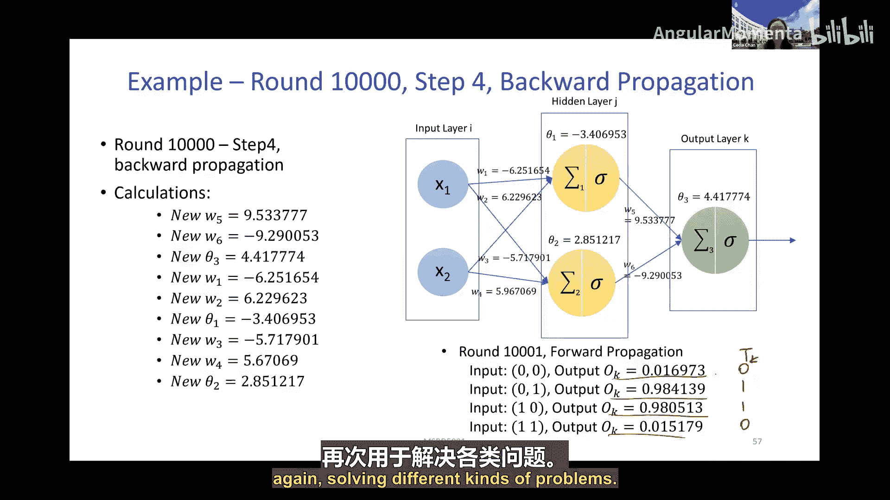

# 022：人工神经网络

## 概述
在本节课中，我们将学习人工神经网络的基本概念、结构和工作原理。我们将了解神经元如何接收输入、计算输出，以及如何通过多层网络结构进行复杂的数据处理。最后，我们将探讨如何通过训练来调整网络参数，使其能够进行准确的预测。

---

## 神经网络简介
在学习了朴素贝叶斯分类之后，我们接下来看看另一种有趣的方法，称为人工神经网络。正如其名，人工神经网络实际上受到了人类神经系统工作原理的启发。人类的神经网络系统能够学习、记忆事物并推广我们的学习经验。

这种灵感促使研究者们对生物神经系统进行算法建模。这意味着我们以人类为例子，研究人类如何学习，并试图让机器以类似的方式学习。生物神经元通过神经元之间传递信号进行通信，这些信号到达我们的感官和大脑，使我们能够学习并执行各种任务。在人工神经网络中，我们模拟了这一过程，其基本计算单元被称为神经元，也常被称为节点或单元。

---

## 神经元的结构
那么，什么是神经元呢？神经网络中的神经元实际上接收来自一个或多个节点的输入。每个输入都会关联一个权重。输入与权重相乘，权重控制着该输入相对于其他输入的重要性。因此，我们得到了加权输入。

节点会有一个传递函数或激活函数来处理这些加权输入的总和。加权输入的总和将被送入激活函数或传递函数，然后该函数会给出一个输出。因此，输入经过处理转化为输出。

除了加权输入之外，每个神经元还关联一个偏置项。偏置项也可以被视为一个权重为1的输入。

---

## 神经元的图示
让我们通过一些图示来了解人工神经网络中神经元的具体样子。左侧是一个单输入节点的神经元。它只接收一个输入，该输入乘以权重 `W`，即 `X * W`。此外，还有偏置项 `θ`。加权输入加上偏置项，得到的结果将传递给激活函数。激活函数接收这个值，并给出输出 `O`。这就是一个单节点的情况。

那么，如果我们有多个节点呢？如右侧所示，这里有三个输入。每个输入都关联一个权重。这三个输入的加权和为 `W1*X1 + W2*X2 + W3*X3`。然后，我们再加上偏置项 `θ`。偏置项允许我们调整激活函数的输入值。加上偏置项后，这个值被送入激活函数，激活函数根据加权输入和偏置项的总和给出输出 `O`。

可以看到，我们可以有一个输入，也可以有多个输入。但观察两幅图，你会发现我们只有一个输出，因为激活函数将加权输入转化为一个输出值。因此，对于每个神经元，我们只有一个输出，但可以有任意多个输入。

---

## 神经网络的多层结构
我们讨论的是神经网络，所以不会只有一个神经元，而是有许多神经元和节点。这些节点通常被组织成多层结构。通常，我们会有一个输入层，输入层的节点将外部世界的信息传递给网络。这些节点被称为输入节点。输入节点不执行任何计算，它们只是将信息传递给隐藏层。

例如，这个节点会传递一个特定的输入值给另一个节点。另一个节点可能传递另一个值，比如 `X2`，给网络中相同或不同的节点。输入节点没有计算，只是传递信息。

输入节点将信息传递给另一个节点，那个节点就是隐藏节点，位于隐藏层。这意味着隐藏节点与外部世界没有直接连接。输入层中的输入节点与外部世界有直接连接，因此它从外部世界获取数据并传递给隐藏节点。隐藏节点接收来自输入节点的输入值，执行计算，转换输入信息，然后将输出传递给输出节点。

隐藏层负责处理输入数据，并将数据发送给其他节点。隐藏节点的集合被称为隐藏层。神经网络中还有另一种层，称为输出层。输出层包含输出节点，输出节点负责计算并将信息从网络传递到外部世界。这意味着隐藏层进行大量处理，结合来自外部世界的输入信息，生成一些信息，然后传递给输出节点。输出节点集体接收来自隐藏节点的所有值，计算最终输出，并将输出发送给我们，即发送到外部世界，然后我们使用输出来做出决策。

在神经网络中，通常我们有一个输入层和一个输出层，但可能有一个以上的隐藏层。每一层都可以有任意多个节点。例如，这里我们只有两个输入节点，但可以有更多。同样，我们只有三个隐藏节点，也可以有更多。这里只有一个输出节点，我们也可以有更多。根据应用和问题的不同，我们可能希望网络具有不同数量的隐藏层和节点。

如果我们有更多的隐藏层，我们的神经网络就会变得更复杂，或者用另一个术语来描述，就是“深度”。这意味着我们拥有一个深度网络。那么，我们如何通过深度学习来学习这样一个深度网络呢？深度学习意味着我们学习一个非常复杂的网络。当然，复杂的网络可以帮助我们解决许多复杂且有用的问题或应用。

---

## 神经网络的学习过程
现在我们知道神经网络有许多节点，节点可以位于输入层（我们在此接收输入），也可以有包含隐藏节点的隐藏层。输入经过隐藏层处理后，输出层会结合这些值并给出输出，该输出将帮助我们做出决策或预测。

那么，我们究竟如何利用神经网络，以及如何学习人工神经网络呢？让我们更详细地讨论一下。神经网络的学习是寻找最小化误差的方法，这通常通过梯度下降法来实现。

我们在讨论什么呢？让我们回到神经网络的图示。我们知道我们有输入，这些输入通过神经网络最终给出输出。这意味着我们有输入和输出，现在的问题是我们如何进行这种处理。

回想一下神经元是什么。神经元接收加权输入和偏置项，然后通过激活函数。这意味着我们需要能够确定从输入节点到隐藏节点的权重，以及从隐藏节点到输出节点的权重。我们希望确定所有权重。如果我们能找到一组能给出良好预测、良好结果的权重，那将是最佳的。除了权重，神经元还有什么？还有偏置项。因此，我们也想知道每个节点的偏置项应该是什么。

通过我们找到的估计权重和偏置项，我们将能够拥有一个在输入上表现良好、并能给出准确输出的神经网络。这就是目标，也是学习如何进行的方式。但具体的步骤是什么呢？为了实现这一目标，需要哪些步骤？

首先，我们只有输入，不知道权重。我们想要计算权重，但最初我们如何计算呢？我们可以通过将权重值初始化为随机值来开始。我们为权重选择一些随机值。

然后，我们从训练样本开始。这就是我们进行学习的原因，我们使用训练样本来学习。训练样本意味着它们是带有标签的数据。我们有类别，有期望的输出。因此，我们有了输入和期望的输出。利用给定的输入和期望的输出，我们将输入拟合到输入节点中。然后，基于初始的随机权重，我们计算出输出。我们根据给定的输入和随机权重计算输出。

接着，我们将计算出的输出与给定的期望输出进行比较。我们计算误差，因为我们知道期望的输出。我们将其与计算出的输出进行比较，从而知道误差。

然后，我们从输出节点开始，即从输出层开始，向后进行。我们尝试找到误差，然后与隐藏节点通信，调整隐藏节点和输出节点之间的权重。调整权重后，我们再次返回，调整连接隐藏节点和输入节点的权重。我们向后进行，调整权重。

现在，我们有了调整后的权重集合，这意味着我们有了一组新的权重。然后，我们再次处理原始输入，再次使用训练数据，基于调整后的权重计算输出，然后将计算出的输出与目标输出进行比较，从而知道误差。

如果结果不理想，我们就再次返回。我们从输出节点开始，再次向后调整权重，调整输入节点和隐藏节点之间的权重。然后，我们再次计算输出，并持续调整权重，直到达到期望的性能。

这就是我们学习人工神经网络的粗略步骤和流程。

那么，我们何时停止呢？理论上，当误差为零时我们应该停止，因为这意味着我们得到了我们期望的精确结果。但我们知道，在现实生活和实际应用中，我们不可能使误差为零。

因此，我们试图做的是最小化误差。或者当误差足够小时，我们停止，并认为这个网络足够好，能够在大多数时候给出准确的结果。这就是我们学习人工神经网络的方式。

基本上，你可以看到，当我们学习人工神经网络时，我们试图估计权重，即我们试图估计参数，使得给定输入我们能得到输出。这就像拥有一个函数。函数接收输入并将其转换为输出。因此，人工神经网络实际上就像一个函数。我们在这里学习人工神经网络，就像在进行函数估计。我们试图找到连接输入和输出的函数。通过学习，我们试图估计该函数的参数。这意味着我们通过人工神经网络的学习来找到这个函数。

---

## 神经网络的数学表示
我们将具体看看如何做到这一点，如何找到能最小化误差的最佳权重集合。但在那之前，我们先看一些符号表示，因为这些符号将帮助我们理解接下来要做什么。

我们知道在神经网络中有神经元，我们有输入，并且有不同的层。这意味着输入节点有输入，隐藏节点有输入，输出节点也有输入。为了表示它们，我们这样说：`X_{L, j}` 表示第 `L` 层第 `j` 个节点的输入。

在神经网络中，我们还有连接两个节点之间的所有权重，可能是输入节点到隐藏节点，隐藏节点到输出节点，或者隐藏节点到隐藏节点。这意味着我们需要表示来自两个不同层的两个节点之间的权重。

如果我们讨论 `W_{L, L', i, j}`，那么我们讨论的是从第 `L` 层的节点 `i` 连接到第 `L'` 层的节点 `j` 的权重。例如，如果我们看这里的第一个节点，那么我们讨论的是从输入层 `I` 的节点连接到隐藏层 `J` 的第一个隐藏节点的权重。因此，我们有从输入层到隐藏层的权重 `W_{I, J}`。

除了输入和权重，回想一下每个节点都有一个偏置项。偏置项是我们可以应用于加权和的值，以调整激活函数或传递函数的输入值。因此，每个节点都有一个偏置项。我们可以这样表示：`θ_{L, j}` 表示第 `L` 层第 `j` 个节点的偏置项。你可以看到，这里的每个节点（这个节点、那个节点）都有一个偏置项。输入节点呢？因为输入节点不进行任何处理，只是将数据传递给隐藏节点，所以没有偏置项。

对于神经元，它将结合加权输入和偏置项，然后通过激活函数给出输出。为了表示特定节点的神经元输出，我们将其写为 `O_{L, j}`，表示第 `L` 层第 `j` 个节点的输出。

在学习过程中，我们需要将期望输出与计算输出进行比较。这意味着我们需要表示期望输出。我们说它是目标值，即期望的输出。对于特定节点，我们有期望输出，即目标值 `T_j`。通常，`T_j` 只针对输出层，因为隐藏层是处理层，我们没有它们的期望输出。因此，我们只对输出层中的输出节点有目标输出，这就是为什么用 `T_j` 表示。

好了，现在我们有了所有这些符号表示。稍后我们将讨论一个例子，展示一个示例。为了简单起见，我们可能会稍微简化符号表示，但你稍后会看到。

---

## 激活函数
我们已经多次提到激活函数，那么激活函数到底是什么？它用于结合加权输入和偏置项，然后将它们转换为输出。这就是为什么它被称为传递函数：它从某些神经元或节点接收输入，然后给出输出。

有许多激活函数可以用于神经网络，但一个非常常用的是 Sigmoid 函数。Sigmoid 函数经常被用作神经网络的传递函数或激活函数，原因是它是连续且可微的。

Sigmoid 函数会给出一个介于 0 到 1 之间的值。你可以看到这里的表示，这是 Sigmoid 函数的图示。你会看到，对于不同的输入 `x` 值，它给出介于 0 到 1 之间的值。它是连续的。

为什么 Sigmoid 函数对神经网络如此有用？因为它的导数非常简洁。求导的简便性使其成为学习神经网络时非常有用的激活函数。你可以看到，如果我们对 Sigmoid 函数关于 `x` 求导，会发现它实际上由 Sigmoid 函数本身组成。这是一个非常有趣的特性，当我们在进行学习时会非常有用。

既然我们讨论了 Sigmoid 函数的导数，那么让我们花点时间看看如何精确地对 Sigmoid 函数求导，以及如何得到这个有趣的表示。

让我们快速看一下。我们知道 Sigmoid 函数是这样的：`σ(x) = 1 / (1 + e^{-x})`。如果我们对这个 Sigmoid 函数求导，那么我们就是对 `1 / (1 + e^{-x})` 关于 `x` 求导。我们也可以将其表示为 `(1 + e^{-x})^{-1}`。

如果我们对此求导，我们将得到：`dσ/dx = -1 * (1 + e^{-x})^{-2} * d(1 + e^{-x})/dx`。计算 `d(1 + e^{-x})/dx`，这部分是常数，所以求导后为 0，剩下计算 `e^{-x}` 的导数。`d(e^{-x})/dx = -e^{-x}`。

因此，继续计算：`dσ/dx = -1 * (1 + e^{-x})^{-2} * (-e^{-x})`。负号相互抵消，得到 `dσ/dx = e^{-x} / (1 + e^{-x})^2`。

我们可以将其重写为 `[1 / (1 + e^{-x})] * [e^{-x} / (1 + e^{-x})]`。现在，第一部分已经是 Sigmoid 函数本身，即 `σ(x)`。剩下的部分如何表示呢？我们可以将其视为 `(1 + e^{-x} - 1) / (1 + e^{-x}) = 1 - 1/(1 + e^{-x})`。这意味着这是 `1 - σ(x)`。

因此，我们有 `dσ/dx = σ(x) * (1 - σ(x))`。你可以看到，Sigmoid 函数的导数给出了这个有趣的结果，这在后续学习过程中会非常有帮助。我们知道了 Sigmoid 函数的特性。

---

## 误差计算
现在一切准备就绪，下一个问题是：当我们进行学习时，我们需要计算误差。我们如何计算误差呢？这意味着我们比较计算输出和目标值。我们有目标输出 `T_k` 和计算输出 `O_k`。我们想比较这两个值，即比较 `O_k` 和 `T_k` 之间的差异。

但这可能是正值，也可能是负值。如果我们有负值，会很麻烦。这就是为什么我们要看绝对差值。我们不希望担心正负，我们希望关注差异的绝对值。

但在学习中，我们希望最小化这个误差。为了最小化误差，我们希望求误差的导数，然后找到对应的最小值。这意味着如果我们将误差定义为绝对值，求最小值会很麻烦。因此，我们改为取平方。这样我们得到正的差异，并且能更好地配合后续处理。

我们可能有多个输出，即可能有许多输出节点。因此，如果我们有许多输出，我们需要对总误差求和。这就是为什么我们对每个计算输出和相应目标输出之间的误差进行平方，然后求和所有误差，再除以 2。这里除以 2 的原因同样是为了后续求最小值时更方便。我们需要找到能最小化误差的权重集合，因此需要求导等操作。如果我们除以 2，会使后续计算更简单、更容易。

现在，我们将误差定义为计算输出值和目标值之间的总误差。然后，我们可以对误差关于相应的权重求导，因为我们想找到能最小化该误差的权重集合。这就是为什么我们对误差关于权重求导，以便最小化误差。

我们有哪些权重呢？我们有连接隐藏层和输出层的权重，连接输入层和隐藏层的权重，也可能有隐藏层之间的权重。我们有很多权重，这意味着我们需要对许多权重求导。

现在，我们有连接不同节点的不同权重，因此我们需要考虑两种情况来进行误差计算、权重更新和输出计算等。我们需要考虑两种情况：一种情况是输出层，我们关注连接隐藏层和输出层的权重；另一种情况是输入节点连接到隐藏节点，即我们关注输入节点和隐藏节点之间的权重，或者隐藏节点之间的权重。我们需要考虑这两种情况，并进行误差计算，以及以略有不同的方式定义和寻找最小化这些误差的权重。

---

## 情况一：输出层节点
让我们先看情况一，即讨论输出层节点。在这种情况下，例如，我们看输出节点 `K`，即输出层中的输出节点 `K`。这个输出节点将给出输出值，即计算输出 `O_k`。我们关注连接该节点与隐藏层节点的权重。这意味着有一个隐藏层 `J` 中的节点，该节点通过权重 `W_{J, K}` 与输出节点连接。因此，我们关注连接隐藏层中的隐藏节点和输出层中的输出节点的权重。

之前我们已经知道，在学习神经网络时，我们实际上试图最小化误差，并且我们想找到能最小化误差的权重。这意味着我们想找到能最小化误差的权重 `W_{J, K}`。我们知道误差是 `E = 1/2 * Σ_k (O_k - T_k)^2`。回想一下，`O_k` 是计算输出，`T_k` 是目标输出。我们找到这两个值之间的误差，然后对所有输出节点的误差求和。

现在，如果我们想找到对应的最小化权重，即能给出最小化误差的权重，我们需要对误差关于权重 `W_{I, J}` 求导。这意味着我们对整个表达式关于 `W_{I, J}` 求导。

我们只是泛化输出节点的情况。可能有许多连接，例如另一个权重连接另一个隐藏节点和输出节点。我们先关注这种情况，然后看如何应用。

如果我们对此求导，意味着我们看这个表达式的导数。但看这个图示，你会发现只有输出节点 `K` 与权重 `W_{J, K}` 相关。这意味着对于其他输出节点，其他计算输出和目标值之间的差异与 `W_{J, K}` 无关。因此，在求导时，我们可以忽略其他输出节点的求和。这意味着我们现在看的是 `∂E/∂W_{J, K} = (O_k - T_k) * ∂O_k/∂W_{J, K}`。

对 `(O_k - T_k)^2` 求导，提出 `1/2` 乘以 `2`，再乘以 `(O_k - T_k)`，然后对 `(O_k - T_k)` 关于 `W_{I, J}` 求导。我们知道 `T_k` 是常数，关于 `W_{I, J}` 的导数为 0。因此，步骤变为 `(O_k - T_k) * ∂O_k/∂W_{J, K}`。

那么 `O_k` 是什么？`O_k` 是通过激活函数对输出节点的输入进行处理后的输出。这意味着 `O_k` 实际上是 Sigmoid 函数作用于输出节点的输入 `X_k` 的结果。因此，`O_k = σ(X_k)`。所以，我们可以这样写：`∂O_k/∂W_{J, K} = ∂σ(X_k)/∂X_k * ∂X_k/∂W_{J, K}`。

那么它的导数是什么？我们知道 Sigmoid 函数的导数将给出其自身的表达式。这意味着它将类似于 `σ(X_k) * (1 - σ(X_k))`，因为我们之前已经讨论过。那么剩下的是 `∂X_k/∂W_{J, K}`。

接下来，`X_k` 是什么？输出节点的输入实际上是加权输出，即权重乘以该节点的输出。隐藏节点 `J` 的输出乘以权重 `W_{J, K}`，即 `X_k = W_{J, K} * O_J`。此外还有偏置项，但因为偏置项与 `W_{J, K}` 无关，为简单起见，我们可以将 `∂X_k/∂W_{J, K}` 视为 `∂(W_{J, K} * O_J)/∂W_{J, K}`。那么这意味着它只是 `O_J`。

因此，结果是 `(O_k - T_k) * σ(X_k) * (1 - σ(X_k)) * O_J`。现在，由于这部分都是关于 `O_k` 的，我们可以用 `δ_k` 来表示。`δ_k = (O_k - T_k) * O_k * (1 - O_k)`。因此，误差关于 `W_{J, K}` 的导数是 `δ_k * O_J`，即隐藏节点的输出乘以计算输出和目标输出之间变化的部分。

你可以看到，基于误差，我们求导以便最小化误差，找到能最小化误差的 `W_{J, K}`，然后得到这个结果。你可以看到求和可以被忽略，并且我们可以改变某些项的表示。如果我们将这部分表示为 `δ_k`，那么导数被重写为 `∂E/∂W_{J, K} = δ_k * O_J`。这就是情况一。

你可以看到，这对于其他输出节点也是如此。对于其他输出节点，同样有权重连接隐藏节点和输出节点，我们需要求导，也会得到这种一般表示。

---

## 情况二：隐藏层节点
接下来，让我们看看情况二。情况二意味着我们关注隐藏层节点。这里的隐藏层节点是什么？我们有节点 `J`，即隐藏层节点 `J`。我们关注例如输入层 `I` 到隐藏节点 `J` 之间的节点。这意味着这里有权重 `W_{I, J}`。我们看这种情况。

这个隐藏节点也可能连接到其他节点。抱歉，因为隐藏节点的输出将被发送到不同的输出节点。你可以看到，当我们对误差关于 `W_{I, J}` 求导时，这次我们不能忽略求和。

让我们看看导数。和之前一样，我们知道误差 `E = 1/2 * Σ_k (O_k - T_k)^2`，即计算输出和目标输出之间的差异。然后我们想对误差关于 `W_{I, J}` 求导。

这次我们不能忽略求和，因为 `W_{I, J}` 会连接到不同的输出节点，所以 `W_{I, J}` 会影响不同的输出节点。这就是为什么我们不能忽略求和。那么我们需要处理这个。我们不能去掉求和，那我们应该怎么做呢？让我们先关注计算。

我们知道有 `k` 个输出节点。我们保留求和，但我们仍然可以对平方项求导。这意味着我们这样求导：`∂E/∂W_{I, J} = Σ_k (O_k - T_k) * ∂O_k/∂W_{I, J}`。

`1/2` 和 `2` 相互抵消，所以我们有求和 `Σ_k (O_k - T_k) * ∂O_k/∂W_{I, J}`。因为 `T_k` 与 `W_{I, J}` 无关，所以我们只有 `∂O_k/∂W_{I, J}`。

和之前类似，我们知道 `O_k` 是 Sigmoid 函数作用于节点 `K` 的输入 `X_k` 的结果。因此，如果我们对 `O_k` 关于 `W_{I, J}` 求导，那么我们对 `σ(X_k)` 关于 `X_k` 求导，然后 `X_k` 关于 `W_{I, J}` 求导。我们可以这样展开：`∂O_k/∂W_{I, J} = ∂σ(X_k)/∂X_k * ∂X_k/∂W_{I, J}`。

我们知道这是 `σ(X_k) * (1 - σ(X_k))`，然后乘以 `∂X_k/∂W_{I, J}`。因此，我们可以将这部分重写为 `(O_k - T_k) * σ(X_k) * (1 - σ(X_k)) * ∂X_k/∂W_{I, J}`。

我们可以简化为 `(O_k - T_k) * O_k * (1 - O_k) * ∂X_k/∂W_{I, J}`。现在我们需要处理 `∂X_k/∂W_{I, J}`。

回想一下，`X_k` 实际上是 `W_{J, K} * O_J`。回想一下，输出节点的输入是隐藏节点和输出节点之间连接的权重乘以隐藏节点的输出。这意味着 `∂X_k/∂W_{I, J}` 实际上与 `∂(W_{J, K} * O_J)/∂W_{I, J}` 相同。我们可以这样重写：`∂(W_{J, K} * O_J)/∂W_{I, J} = W_{J, K} * ∂O_J/∂W_{I, J}`。

我们可以再次重写，像这样。那么现在因为这部分会给我们 `W_{J, K}`，然后我们有 `∂O_J/∂W_{I, J}`。我们可以再次处理这部分。

这部分是什么？`O_J` 是什么？`O_J` 是激活函数作用于节点 `J` 的输入 `X_j` 的结果。因此，`O_J = σ(X_j)`。如果我们对其关于 `W_{I, J}` 求导，那么我们对 `σ(X_j)` 关于 `X_j` 求导，然后 `X_j` 关于 `W_{I, J}` 求导。这意味着我们将再次得到 `σ(X_j) * (1 - σ(X_j)) * ∂X_j/∂W_{I, J}`。

这意味着现在这部分将给我们 `O_J * (1 - O_J) * ∂X_j/∂W_{I, J}`。到目前为止，这就是我们所有的。因为这些与 `k` 无关，所以我们可以将其从求和中取出并放在这里。

这意味着我们有 `O_J * (1 - O_J) * ∂X_j/∂W_{I, J}`，然后我们只保留后面的其他部分，这样更容易关注前面的部分。第一部分是 `Σ_k (O_k - T_k) * O_k * (1 - O_k) * W_{J, K}`。

现在让我们关注这部分。那么我们将得到什么？现在我们记得，`X_j` 可以表示为 `W_{I, J} * O_I`。这意味着 `J` 的输入实际上是连接节点的加权输出。这意味着我们看这个。

那么这里我们有什么？`∂X_j/∂W_{I, J} = O_I`。因此，我们有 `O_J * (1 - O_J) * O_I`，然后像这样。现在给定这个。

你可以看到这只是 `O_I`。因此，我们有 `O_J * (1 - O_J) * O_I`，然后像这样。和之前一样，如果我们将所有与 `J` 和 `K` 相关的部分表示为 `δ_j`，那么我们可以将其表示为 `O_I`，即放在这里，其余部分用 `δ_j` 表示。因此，我们将能够将误差关于 `W_{I, J}` 的导数表示为 `O_I * δ_j`，即节点 `J` 上的变化。

这意味着现在我们有了这部分，然后我们继续处理，我们将看到这个。因此，如果我们将这部分表示为 `δ_j`，那么我们得到的就是这样。你可以看到，对于情况一，我们能够将误差关于 `W_{J, K}` 的导数表示为 `O_J * δ_k`；类似地，在这里我们能够将误差关于 `W_{I, J}` 的导数表示为 `O_I * δ_j`。你可以看到现在非常相似。

---

## 权重与偏置的更新
现在我们需要再考虑一件事。我们看关于 `W_{I, J}` 和 `W_{J, K}` 的导数。因此，基于这两种情况，我们将能够这样总结：对于输出节点 `K`，导数将是 `O_J * δ_k`，其中 `δ_k = (O_k - T_k) * O_k * (1 - O_k)`。对于隐藏节点，我们将能够将其表示为误差的导数为 `O_I * δ_j`，其中 `δ_j` 会有所不同。它取决于节点 `J` 的输出，以及输出节点的 `δ_k` 和隐藏节点与输出节点之间的权重。

别忘了偏置项。我们之前提到过，对于每个节点（隐藏节点和输出节点），都有偏置项。我们将偏置项与加权输入相加，然后激活函数将使用该值并给出相应的输出。

如果我们像前两种情况一样对偏置项进行处理，你会发现输出关于偏置项的导数只是 1。因此，误差关于 `θ` 的导数实际上只是该层节点的 `δ`。这意味着它不依赖于输出。如果我们在讨论输出层节点，那么它就是 `δ_k`；如果是隐藏层，那么误差关于其相应偏置的导数将是 `δ_j`。

现在我们看了误差关于权重和偏置的导数，那么我们将能够知道如何更新权重和偏置。如果我们能够计算输出，然后将输出与目标值进行比较，我们将知道如何更新权重和偏置。

---

## 反向传播算法
我们如何进行更新？如何优化权重？回想一下，整个神经网络的学习过程是：我们选择随机权重，然后计算输出，将输出与实际值和目标值进行比较，然后从输出节点开始反向通信，尝试调整隐藏节点和输出节点之间的权重，然后返回调整隐藏节点的权重。现在我们已经计算了 `δ`，因此我们可以利用 `δ` 和输出来更新权重和偏置。

基于之前的计算，我们知道我们计算了 `δ_k`，它取决于目标输出和计算输出之间的差异；我们还计算了 `δ_j`，它又取决于节点 `J` 的输出以及计算出的 `δ_k` 和输出节点的权重 `W_{J, K}`。

有了 `δ_k` 和 `δ_j`，我们将能够像这样更新权重和偏置。`x` 可以是隐藏节点，`y` 是输出节点；或者 `x` 和 `y` 都是隐藏节点；或者 `x` 是输入节点，`y` 是隐藏节点，就像情况一和情况二一样。你知道，基于情况一和情况二的计算，它们可以这样泛化。你可以看到，现在如果我们讨论隐藏节点 `J` 和输出节点 `K`，那么它将取决于隐藏节点的输出乘以 `δ_k`；如果是隐藏节点和输入节点，那么是 `W_{I, J}`，它取决于 `I` 的输出乘以 `δ_j`。你可以看到模式是相同的。

这就是为什么我们可以这样泛化。回想一下偏置的 `δ`，那么它只是没有输出的 `δ`。现在我们添加一个学习率 `η` 来控制更新的量。

在我们计算了 `δ_{x, y, j}` 或偏置的 `δ` 之后，那将是我们需要应用于更新权重和偏置的变化量。然后我们取旧的权重，加上变化量，得到新的权重。类似地，对于偏置也是如此，我们有旧值，加上变化量，然后得到新值。

然后你会看到，我们将能够从输出节点开始向后更新权重。我们计算 `δ_k`，更新输出节点的偏置和权重，然后我们准备计算 `δ_j`，并更新隐藏节点的权重和偏置。

因为我们从输出节点开始，然后返回到隐藏节点，我们说这是反向传播。

现在让我们回想一下我们如何进行学习。我们首先初始化随机权重，然后输入训练样本，即基于随机权重计算输出。这意味着我们从输入节点开始，计算输出节点的输出。我们说这是前向传播，因为我们从输入节点到隐藏节点，再到输出节点，是向前进行的。

在计算误差之后，我们需要更新权重，当我们更新权重时，我们以相反的方向进行，即向后方向。这意味着我们从输出节点开始，更新那里的权重，然后返回。这就是为什么它是反向传播。我们在向后方向更新权重。在我们更新权重之后，我们将在更新后的权重上进行前向传播，然后再次计算误差，如果需要，再次进行反向权重更新。这意味着这将是一系列前向传播和反向传播。这就是我们如何利用计算出的变化量来更新权重。

---

## 学习步骤与停止条件
现在剩下的问题是，如果我们看整个学习步骤，那么现在有几个问题我们可能想问。例如，如何初始化权重值？通常初始化为一些小的随机值，但也有关于如何选择初始值的讨论。初始值会影响学习的进展。

另一个我们想问的问题是什么时候停止。我们知道，如果误差不够好，误差仍然很大，那么我们需要一次又一次地重复。但我们知道不可能没有误差，总会有一定量的误差。那么我们应该何时停止呢？

有几种停止训练的方法。一种方法是控制迭代次数，即我们调整权重的次数。我们进行一定次数的迭代后停止，那将是我们的性能或学习结果。另一种可能性是，当我们计算出的误差在一个小值以内，低于某个阈值时，我们可以停止。这个误差可以是训练误差。

回想一下，我们可以有验证集。因此，我们可以再次使用验证集来估计泛化误差。这意味着我们在验证集误差最小时停止。

但你可以看到，因为这将需要多次迭代的前向传播和反向传播，然后我们将稍微、逐渐地更新权重，并且我们还将使用所有训练样本进行前向和反向传播，所以你可以看到，如果我们的神经网络变得更复杂，有更多的隐藏层、更多的处理，训练会变得非常慢。

---

## 神经网络的函数逼近能力
好了，这些是我们在使用人工神经网络进行学习时想知道的问题。现在回想一下，我们说过神经网络就像函数估计器，我们试图找到将输入转换为输出的函数，该函数将根据我们的目标输出给出准确的结果。这意味着神经网络将能够表示布尔函数、不同类型的函数。

这里有一些例子。每个布尔函数都可以用一个只有一个隐藏层的网络来表示，但可能需要指数数量的隐藏单元。有界连续函数可以用只有一个隐藏层的网络以较小的误差近似。任何函数都可以用一个有两个隐藏层的网络以任意精度近似。这会让你对当我们试图使用神经网络作为函数时，它会是什么样子有一些了解，比如布尔函数，或表示连续函数，或表示任何函数。

---

## 示例：异或函数
让我们看一个例子。在这个例子中，我们试图用神经网络表示异或函数。我们将有以下输入和输出。对于异或函数，如果我们的输入是 `(0, 0)`，那么输出将是 `0`；如果其中一个输入是 `0`，另一个是 `1`，那么输出是 `1`；但如果两者都是 `1`，那么输出是 `0`。这就是为什么它是异或函数。

这意味着现在我们有了四个训练数据，包括输入和相应的期望目标值、期望输出。我们将使用这些数据来学习一个神经网络，该神经网络在给定这些输入时，应该给出非常接近实际输出、目标输出的估计。

让我们看看如何做到这一点。我们将首先使用前一行，即第一行，开始学习。这意味着输入是 `(0, 0)`，输出是 `0`。因此，我们期望 `x1` 为 `0`，`x2` 为 `0`，而 `O` 也为 `0`。对于我们将要学习权重的神经网络，我们实际上只有一个包含两个神经元的隐藏层。我们在这个例子中使用这个网络。

基于这个网络，我们将学习权重 `W1, W2, W3, W4, W5, W6`，因为我们连接输入层节点到隐藏层节点，以及隐藏层节点到输出层节点。对于每个隐藏层节点和输出层节点，我们还有偏置项。因此，有三个偏置项和六个权重。当我们进行前向传播和反向传播时，我们需要处理这六个权重和三个偏置项。

回想第一步是分配权重。假设我们只是随机选择一些权重值，因为我们刚刚开始。例如，我们随机选择一些值：`W1 = -0.65`, `W2 = 0.64`, `W3 = 1.11`, `W4 = 0.84`, `W5 = 0.86`, `W6 = -1.38`。这只是随机值。那么偏置项呢？对于偏置项 `θ1, θ2, θ3`，我们只是将它们初始化为 `0`。

为了进行前向传播，我们对输入与其权重的乘积求和。然后我们加上偏置项，那将是隐藏层的值，这些值将被激活函数接收，然后我们将得到该特定节点的相应输出。

例如，对于这里的第一个节点，激活函数的总值将是输入的加权和。你可以看到，这里的隐藏层节点 `J` 的第一个节点实际上有两个输入和两个权重。我们计算加权和，然后加上偏置项，那将是激活函数的值。类似地，对于隐藏层中的另一个节点也是如此。

现在对于前向传播，我们得到这些总值。然后我们将激活函数应用于这些和，正如我们提到的，激活函数的目的是进行转换。我们称之为传递函数：它将输入信号转换为输出信号，这是神经网络建模复杂模式所需的。我们一直在讨论 Sigmoid 函数，但还有许多其他类型的激活函数，如线性函数、Sigmoid（我们已经使用）、阶跃函数或双曲正切等。我们可能需要尝试或看看哪种激活函数适合。

在这个例子中，我们将使用 Sigmoid 函数作为激活函数。回想一下，Sigmoid 函数是这样的：`σ(x) = 1 / (1 + e^{-x})`。

让我们先用前向传播来处理这个例子。如前所述，我们选择第一行，输入 `x1 = 0`, `x2 = 0`。那么期望输出是 `0`，这意味着我们期望 `T_k` 为 `0`。然后我们将基于当前权重计算输入的输出。

如前所述，我们需要选择学习率。假设我们选择 `0.5`。回想一下，我们为权重随机选择了一些值。这些是随机选择的值，而我们将偏置项初始化为 `0`，并使用 Sigmoid 函数作为激活函数。让我们开始计算。

现在我们将从输入开始，然后计算这里的输出。在计算了这些输出之后，我们将能够计算输出层节点的输出。首先，让我们计算隐藏层第一个节点的输出 `O_{J1}`。

和之前一样，我们需要计算值的总和，即加权和加上偏置项 `θ1`。这将是 Sigmoid 函数作为输入并转换为输出的值。因此，`sum1 + θ1`。`sum1` 意味着我们有加权和，即 `W1 * x1 + W2 * x2`。然后加上偏置项 `θ1`。因此，我们有 `0 * (-0.65) + 0 * 0.64 + 0`，一切都是 `0`。因此，总值为 `0`。这意味着 `O_{J1}`，即 `sum1 + θ1` 的 Sigmoid 结果，是 `σ(0)`。即 `1 / (1 + e^{-0})`，也就是 `1/2`，即 `0.5`。我们计算了 `O_{J1}`。

现在让我们计算 `O_{J2}`。`O_{J2}` 是什么？同样，计算 `sum2 + θ2`。`sum2` 是 `W3 * x1 +