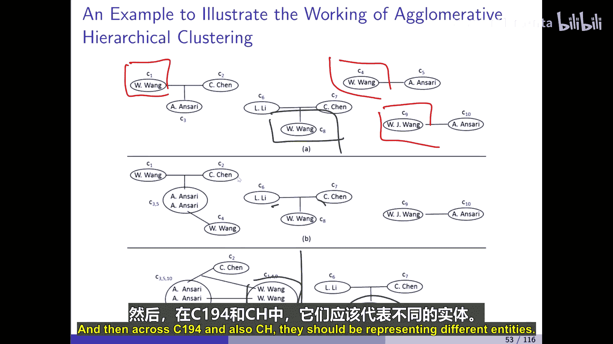

# 023：数据匹配问题定义与核心方法 🎯

在本节课中，我们将要学习数据集成中的一个核心步骤——数据匹配。我们将了解数据匹配的定义、其在不同场景下的应用，并深入探讨解决数据匹配问题的几种主要方法。

---

## 数据匹配的定义与重要性

在完成模式对齐之后，我们面临来自不同数据源的众多记录。此时，我们需要思考是否存在重复记录，或者来自不同源的记录是否实际上相关或指向同一个实体。这个过程就是记录链接。

记录链接有许多名称，它们都指向类似的概念。最常用的术语是**数据匹配**，因为它明确表示我们试图匹配数据以判断它们是否相同。在数据集成中，数据匹配意味着我们查看不同的记录，它们可能来自同一个数据库、同一个数据源，也可能来自不同的数据库或数据源。数据匹配的目标是识别那些实际上指向同一实体的记录，然后决定下一步如何处理。

其他含义相似的术语包括：
*   **记录链接**：关注不同记录之间是否存在链接。
*   **实体解析**：试图判断记录是否指向某个实体，即解析它们之间的关系。
*   **消歧**：判断两条记录是否相同，如果相同则需要合并处理，例如名称消歧或引文消歧。
*   **去重**：识别重复的记录。
*   **重复检测**和**身份不确定性**也与此相关。

---

## 数据匹配的核心问题

上一节我们介绍了数据匹配的基本概念，本节中我们来看看其具体定义和挑战。

我们使用术语“数据匹配”，它与记录链接含义相同。假设我们处理的是结构化数据，那么每条记录就是一个元组，包含多个不同的属性。

例如，一个元组可能包含姓名、电话号码和地区等属性。数据匹配就是比较两个这样的元组，判断它们是否指向同一个人（或实体）。元组可能以不同格式存在，如结构化数据库、Excel文档或RDF三元组。

数据匹配不能简单地视为字符串匹配。虽然我们之前讨论过字符串匹配，即比较两个字符串的相似度，但元组匹配涉及多个属性，每个属性都有自己的特性。因此，我们需要更复杂的技术。

数据匹配在数据集成中非常有用且重要，出现在多种集成场景中：
*   **合并具有相同模式的数据库**：这是数据集成的第二阶段。在模式对齐后，我们需要合并数据库，即识别相同的记录、去除重复项，并将所有不同的记录整合在一起。
*   **连接来自不同模式数据源的行**：例如，我们可能使用网络表格来扩展现有数据，添加新的列或行。
*   **处理用户查询**：同样需要进行某种形式的匹配。

---

## 问题形式化与示例

了解了数据匹配的应用场景后，我们接下来正式定义这个问题。

我们可以将数据匹配问题定义为：查看两个已经模式对齐（即具有相同模式）的表，并假设表中的每条记录描述一个实体（如人、地点、组织）。我们希望判断表X中的元组x与表Y中的元组y是否匹配，即它们是否指向同一个真实实体。我们的目标是识别出这两个表中所有匹配的元组对。

让我们看一个例子。假设有表X（包含x1, x2, x3三个元组）和表Y（包含y1, y2两个元组）。数据匹配需要检查所有可能的元组对：(x1, y1), (x1, y2), (x2, y1), (x2, y2), (x3, y1), (x3, y2)，并判断哪些对指向同一实体。

对人眼来说，这很容易。例如，“Dave Smith”和“David Smith”显然指向同一个人（x1, y1），因为电话号码、城市、州都相同。同样，“Dan Smith”和“Daniel Smith”也很可能指向同一个人（x3, y2），因为“Dan”是“Daniel”的简称，且电话号码相同。

然而，要让模型自动完成这项工作，我们需要应用更复杂的方法。我们需要考虑姓名匹配（可能使用姓名本体库）、电话号码规范化、城市匹配等，并且需要处理不确定性（例如x3和y2的城市不同）。接下来，我们将讨论如何系统地考虑这些因素。

目前我们只讨论了两个具有相同模式的表。显然，还存在其他更复杂的情况，例如两个表模式不同、在同一表内进行匹配，或者数据不是关系型数据库格式等。

---

## 为何不能直接使用字符串匹配？

前面提到数据匹配与字符串匹配有相似之处，但不能直接使用字符串匹配方法。理论上，我们可以将所有属性拼接成一个长字符串，然后通过字符串匹配比较记录。

例如，将元组x1记录转换为“DaveSmith1234567NYCNewYork”这样的长字符串，然后与其他记录进行字符串比较。我们可以这样做，但这只是计算有多少字符或位置不同。

这种方法没有利用领域特定知识。例如，对于姓名，姓氏通常应该相同，如果姓氏不同，则很可能不是同一个人；而名字的变体可能较多。对于电话号码，我们需要进行规范化处理；对于州名，我们需要考虑是否在同一州的不同城市，或者是否存在拼写错误。

这意味着不同的属性应该使用不同的匹配方式。因此，我们希望应用领域知识和更复杂的技术，需要将属性分开比较。

---

## 数据匹配的挑战与方法分类

数据匹配的挑战与字符串匹配类似。核心问题是如何准确地进行匹配，因为数据存在许多变体，如缩写、昵称、拼写错误、录入错误、机构名称简写等。

与字符串匹配类似，我们可以使用不同的方法来解决。主要可以分为以下几类：
1.  **基于规则的方法**
2.  **基于学习的方法**
3.  **聚类方法**
4.  **概率方法**
5.  **集体匹配方法**

另一个挑战是**可扩展性**问题，这与字符串匹配相同。

---

## 基于规则的数据匹配

让我们从基于规则的方法开始。这种方法需要应用领域知识，即编写规则来指定如何匹配元组。

通常，我们需要查看大量匹配或不匹配的元组对作为参考来制定规则，然后对规则进行测试和优化。规则可以有多种类型，例如线性组合权重：为各个属性的相似度得分分配权重，然后合并这些得分。这类似于我们在描述字符串匹配或模式对齐时使用的模型。

以下是具体步骤：
*   计算两个元组的总相似度得分。
*   判断该得分是否超过某个阈值，以确定它们是否指向同一实体。
*   总得分可以是各个属性相似度得分的加权组合。
*   对于每个属性，可以应用不同的相似度度量方法。

**示例**：假设我们比较姓名、电话、城市和州四个属性。
*   **姓名**：使用Jaro-Winkler距离计算相似度。
*   **电话**：使用编辑距离，主要处理数字录入错误。
*   **城市**：同样使用编辑距离处理拼写错误。
*   **州**：使用精确匹配。
*   最后，为每个属性的相似度得分分配不同的权重（例如，城市权重较低，其他属性权重较高），计算加权总得分。如果总分超过阈值，则判定为匹配。

**基于规则方法的优点**：
*   易于理解。
*   相对容易实现。
*   可以从训练数据中学习权重。

**基于规则方法的缺点**：
*   任何单个相似度得分的增加都会导致总分的增加，这可能并不理想。当某个得分已经足够高时，我们更希望看到其他属性也提供支持证据，即希望存在“收益递减”效应。
*   逻辑回归规则可以解决这个问题，它不要求所有信号都存在，只要有合理数量的信号支持，就能做出肯定决策。

当然，我们可以编写更复杂的多级规则。例如，如果姓名匹配，则直接判定为匹配；如果姓名相似度低于阈值，则判定为不匹配；否则，需要更多证据。

基于规则的方法易于理解，可以融入复杂的领域知识，但这也可能成为缺点，因为需要花费大量时间调查数据以获取领域知识，这是一项劳动密集型工作。有时数据可能不容易用规则描述，因此我们需要其他方法。

---

## 基于学习的数据匹配

当数据不易用规则描述时，我们可以使用基于学习的方法。这类似于模式对齐中的学习方法，可以视为一种监督学习。

我们将数据匹配问题视为一个分类问题：判断一对元组是否匹配。具体步骤如下：
1.  准备训练数据：已知哪些元组对是匹配的（标签为“是”或“否”）。
2.  提取特征：特征可以是属性之间的相似度得分，也可以是关于属性的某些规则。例如，姓名的相似度可以使用Jaro-Winkler距离作为一个特征，使用编辑距离作为另一个特征；电话、城市、州的匹配得分也可以作为特征；还可以添加启发式约束，如检查区号与城市是否矛盾。
3.  选择模型：使用训练数据拟合分类模型，如逻辑回归或决策树。
4.  应用模型：将训练好的模型应用于新的元组对，预测它们是否匹配。

**与基于规则方法的比较**：
*   **基于规则**：需要手动确定规则和权重。
*   **基于学习**：可以处理大量特征和训练样本，不需要太多领域知识（即使不确定哪种相似度度量最好，也可以全部加入让模型决定）。能够构建非常复杂的规则（如决策树）。

**基于学习方法的缺点**：
*   需要足够数量的训练样本来构建准确的模型。如果训练数据不足，模型效果会受影响。

---

## 基于聚类的数据匹配

如果训练样本不足，我们可以使用聚类方法。这种方法试图将元组分组，使得每个簇内的所有元组都指向同一个实体，而不同簇的元组指向不同实体。

可以使用多种聚类技术，如凝聚层次聚类、K均值、图论方法等。我们重点介绍凝聚层次聚类。

**凝聚层次聚类步骤**：
1.  开始时，每个元组自成一个簇。
2.  计算所有簇对之间的距离或相似度。
3.  合并最相似的两个簇。
4.  重复步骤2和3，直到满足停止条件（如达到预定簇数，或相似度低于某个阈值）。

**如何度量簇间距离**：
*   与基于规则的方法类似，我们需要计算簇的代表元组之间的相似度。这通常涉及为不同属性（如姓名、电话、城市、州）的相似度得分进行线性加权组合。
*   关键问题是如何表示一个簇（包含多个元组）以计算簇间相似度。有几种方法：
    *   **单链接**：取两个簇中所有元组对之间相似度的**最小值**。
    *   **全链接**：取**最大值**。
    *   **平均链接**：取所有元组对相似度的**平均值**。
    *   **规范元组法**：为每个簇创建一个最具代表性的元组（规范元组），然后计算两个规范元组之间的相似度。例如，一个包含“Mike Williams”和“MJ Williams”的簇，其规范元组可以是“Mike J Williams”。

聚类方法是一种迭代的、自底向上的方法，它基于当前已有的信息构建实体画像。

---

## 基于概率的数据匹配

除了上述方法，我们还可以应用概率方法。这种方法试图利用概率分布进行建模。

**优点**：
*   自然地融入了领域知识。
*   利用了概率表示和推理技术的优势。

**缺点**：
*   通常计算开销较大。
*   难以调试。

概率方法通常涉及生成式模型（有时也涉及判别式模型）。生成式模型试图描述数据是如何生成的，例如使用贝叶斯网络来表示完整的概率分布。

以朴素贝叶斯模型为例，其核心思想是：计算给定两个元组时，它们匹配的概率。如果匹配的概率大于不匹配的概率，则判定为匹配。

该模型基于特征独立性假设。我们计算在给定特征（如姓氏是否匹配、社会安全号编辑距离、首字母是否匹配等）的条件下，元组对匹配的概率。通过训练数据，我们可以学习这些条件概率表。

然而，朴素贝叶斯的独立性假设在现实中往往不成立。特征之间可能存在依赖关系。

生成式模型从另一个角度思考：假设世界中存在一组实体（如篮球运动员）。当我们选择一个实体时，它会以多种表述形式（提及）出现在文本或记录中。生成式模型就是描述从实体到各种提及的生成过程。

---

## 集体数据匹配

之前介绍的方法都是独立地看待每一对元组，假设一对元组的匹配决策不会影响另一对。但在现实中，这些匹配决策可能是相关的。集体匹配方法就是将匹配决策关联起来考虑，而不是将它们视为独立的。

**示例：引文匹配中的共作者关系**
假设我们有四篇引文，需要匹配其中的作者。作者姓名可能以不同形式出现（有或没有中间名首字母）。如果我们独立地匹配每对作者（如a1与a2，a1与a9），就不会考虑共作者关系。

共作者关系能提供额外信息。例如，如果a1和a4拥有相同的共作者（比如a3和a5是匹配的），那么a1和a4也更可能匹配。因此，我们在做决策时，不仅看a1和a4本身，还要考虑其他相关对（如a3和a5）。

**如何实现集体匹配？**
1.  **简单方法**：将共作者姓名作为额外属性加入特征。但问题在于，这仅使用了简单的字符串相似度来匹配共作者名，而不是像匹配主元组那样使用复杂的多属性相似度组合，可能无法正确贡献到最终匹配决策中。
2.  **更好的方法**：使用集体匹配方法，如改进的聚类或概率方法，同时考虑元组本身的相似度和其邻居（关系）的相似度。
    *   将数据视为图，节点是元组，边表示关系（如共作者）。
    *   在聚类时，不仅计算两个簇（节点集）本身属性的相似度，还计算它们邻居簇的相似度。例如，可以计算两个节点邻居簇集合的Jaccard相似度（重叠程度）。
    *   这样，我们就同时考虑了共作者姓名本身的相似性，以及共作者关系的模式相似性。

通过这种方式，我们能够更准确地区分不同的实体，尤其是在共作者关系模式相似的情况下。

---

## 总结

在本节课中，我们一起学习了数据匹配的核心概念。我们首先定义了数据匹配问题及其在数据集成中的重要性，并通过示例说明了其复杂性。随后，我们系统地探讨了解决数据匹配问题的五种主要方法：
1.  **基于规则的方法**：直观易懂，依赖领域知识，但可能劳动密集且难以处理复杂情况。
2.  **基于学习的方法**：将问题转化为分类任务，能处理大量特征，但需要足够的标注数据。
3.  **基于聚类的方法**：无监督或弱监督，通过迭代分组识别实体，适合训练数据少的场景。
4.  **基于概率的方法**：利用概率模型描述数据生成过程，能自然融入不确定性，但计算成本较高。
5.  **集体匹配方法**：考虑元组之间的关联关系（如共作者网络），通过同时评估多个匹配决策来提高准确性，尤其适用于关系型数据。

每种方法都有其适用场景和优缺点。在实际应用中，需要根据数据的特性、可用的领域知识以及计算资源来选择和组合适当的方法。理解这些核心方法为我们在实际数据集成项目中设计和实施数据匹配解决方案奠定了坚实的基础。