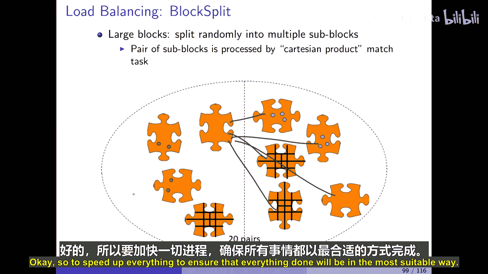

# 024：数据匹配的规模化扩展

在本节课中，我们将要学习如何应对数据匹配（记录链接）中的规模化挑战。当数据量巨大时，直接比较所有可能的记录对是不可行的。我们将探讨几种关键技术，如分块、哈希和负载均衡，来高效地处理大规模数据匹配问题。

## 数据匹配的规模化挑战

上一节我们介绍了数据匹配的基本概念。本节中我们来看看当数据量巨大时，我们面临的核心挑战。

候选记录对的数量可能非常庞大。例如，在学术文献引用或人口数据集中，记录数量可能达到数十亿级别。直接比较所有可能的记录对在计算上是不可行的。

因此，我们需要处理可扩展性问题。

## 借鉴字符串匹配的扩展方法

借鉴字符串匹配中的可扩展性方法，我们可以使用不同的技术来筛选候选对。

以下是几种关键方法：
*   **过滤**：使用索引或哈希等技术来帮助筛选候选对。
*   **哈希**：将元组哈希到桶中，只匹配同一桶内的元组。这类似于我们之前学过的**均值哈希**和**局部敏感哈希**方法。局部敏感哈希是一种分块方法，我们将字符串哈希到不同的块中，然后只比较同一块内的候选对。
*   **分组**：基于特定特征进行分组，例如仅使用邮政编码进行哈希，就能显著减少候选对数量。
*   **排序**：基于ID、姓名、声音码等特征进行排序，以缩小候选对范围。
*   **启发式规则**：应用特定规则，例如设定相似度阈值，要求记录对至少达到某种程度的相似性，或在特定约束内（如字符数）。

索引也是方法之一，例如在姓名上构建倒排索引，然后查找具有相同或最相似姓名的候选对。

我们还可以结合多种技术。例如，首先使用邮政编码将房屋哈希到桶中，然后在桶内使用街道名称对房屋进行排序，并使用滑动窗口等方法进行匹配。你可以制定一系列规则来完成匹配。

## 使用分块技术减少候选对

为了最小化匹配记录对的时间，一个核心思路是首先识别潜在的对，然后再实际计算相似度得分。这与均值哈希和局部敏感哈希的思路相似。

从大数据视角看，记录链接可以拆分为多个步骤，类似于文档处理中的降维和分块。

以下是记录链接的典型步骤：
1.  **分块**：减少可能的候选对。这类似于局部敏感哈希，是一种分块方法，旨在将元组放入不同的块中，只匹配块内的对。
2.  **成对匹配**：计算元组对之间的相似度得分。
3.  **聚类与集体匹配**：相似度得分本身可能不足以决定它们是否匹配或属于同一实体组。我们可能希望使用聚类来进行集体匹配，将提及分组以真正指向实体。

因此，我们有多个步骤：分块以减少候选对，获取成对相似度得分，最后将元组分组以指向实体。

## 大数据四维挑战下的记录链接

回到大数据的四个V（Volume, Velocity, Variety, Veracity），记录链接需要应对这些挑战。

*   **数据量**：我们有数十亿条记录，需要分布式处理。MapReduce框架可能对此有帮助。显然，分块因为减少了候选对，也是必要的。
*   **速度**：数据可能持续大量涌入，我们可能无法一次性完成所有匹配。解决方案是**增量匹配**：基于现有数据进行匹配，当有新数据到来时，继续匹配更多数据。
*   **多样性**：数据存在多种形式。之前讨论的是匹配结构化数据，但如果我们有非结构化甚至半结构化数据呢？此外，在讨论模式对齐时，我们谈到了如何匹配网络表格。
*   **准确性**：准确性涉及数据的不确定性。数据可能随时间变化，有时数据并非不准确，只是过时了。数据的时效性是否最新，可能会影响匹配结果。

可以看到，在大数据维度下进行数据匹配，需要考虑所有这些V。这意味着仅仅匹配成对的事物是不够的，我们需要考虑更多因素，问题也变得越来越复杂。

## 使用MapReduce进行并行匹配与负载均衡

对于记录链接，我们当然可以使用MapReduce来并行处理。但在使用MapReduce进行并行匹配时，也存在问题。

在并行处理元组之前，我们需要进行分块，以决定哪些匹配可以并行执行。例如，基于邮政编码将元组分割到不同的块中，然后只需要比较块内的候选对。这意味着一个块内的所有元组可以在一个MapReduce任务中处理，另一个块在另一个任务中处理，从而实现并行。

然而，这可能导致跨工作节点的**负载非常不均衡**。一个工作节点可能处理包含9个元组的块（需要匹配36对），而另一个节点只处理包含3个元组的块（只需匹配3对）。即使我们进行了并行化，加速效果也不明显，因为大块的处理将占据大部分时间。

因此，我们可能需要**负载均衡**。

以下是两种负载均衡策略：
*   **块分割**：将大块分割成子块。小块的匹配在一个任务中完成。对于大块，我们首先将其随机分割成更小的子块。每个子块的匹配在一个任务（工作节点）上执行。我们仍然需要考虑跨越两个子块的记录对，这将成为另一个任务，处理笛卡尔积匹配。通过这种方式，最耗时的任务所需处理的对数会减少，从而获得加速。
*   **对分割**：基本思想是枚举所有可能的匹配对，然后重新分配。这种方法需要事先了解所有可能的匹配并进行枚举，在消除和重新分配方面需要更多开销。

## 分块技术的问题与改进

回到分块技术，分块无疑是解决可扩展性挑战最常用的方法之一，但其本身也存在问题。

假设我们仅使用单一分块，例如仅按姓氏分块。我们将得到几个块。如果只在这些块内进行匹配，我们可能会错过某些潜在的匹配对，例如不同块中但实际上匹配的记录。因此，单一分块方法可能导致**召回率低**，即无法识别出一些潜在的匹配对。

解决方案是应用**多重分块**，例如依次按姓氏、名字、出生年份、所在州等进行分块。这样，我们不会遗漏记录，肯定会考虑所有情况。但这也意味着某些记录对会在多个块中被重复比较多次，比较次数反而增加，这显然不可取。我们提高了召回率，但使过程更耗时。

因此，我们可能需要进行**块净化**，即剔除某些块。这可以通过评估分块方法的质量来实现，例如查看块内是否包含过多元组、是否使用了不同的信息等，然后决定是否考虑该结果块。可见，解决一个问题的同时，我们可能遇到另一个问题。

## 考虑时间因素的时序记录链接

接下来讨论时序匹配。对于某些实体（如个人），信息会随时间变化。数据库中的数据可能不是最新的。不同组织整合数据时，一个可能是几年前的，另一个可能是最新的。数据本身没有错误，只是有些数据未更新。因此，时间差异也需要考虑。

例如，查看一个人在不同时间点的 affiliation（所属机构）。我们可能有多条记录。时间上的大间隔可能暗示第一条记录与其他记录不属于同一实体。在短时间内频繁更换所属机构的情况较少见，因此短时间内出现的多条不同机构记录也可能不属于同一实体。

因此，时间窗口和数据的异同可以为我们提供信息，判断不同元组是否指向同一实体。这就是链接时序记录的核心思想。

我们可以将这类考虑转化为定量评估。例如，如果在短时间内出现高度不一致，则给予高惩罚以表示可能性低；随时间推移发生变化，则给予较低惩罚以表示更可能发生；在短时间内保持一致，则给予较高奖励或分数；如果存在长时间间隔，则给予较低分数。在进行匹配时，我们可以将这些考虑纳入，这有助于将时间因素也考虑进去。

## 课程总结

本节课中我们一起学习了数据匹配在大数据环境下面临的规模化扩展挑战及其解决方案。

我们讨论了如何借鉴字符串匹配中的技术（如哈希、索引、分块）来减少候选对。重点介绍了**分块技术**作为核心方法，以及其在并行计算中可能引起的**负载不均衡问题**及相应的**块分割**和**对分割**策略。我们还探讨了单一分块可能导致低召回率，而多重分块又可能增加计算量的问题。最后，我们引入了**时序记录链接**的概念，强调了在匹配中考虑数据时效性和时间变化模式的重要性。

目前，对于复杂的数据集成问题（包括记录链接），尚无完全自动化的解决方案。我们开发的是辅助各个阶段（如模式对齐、记录匹配、数据融合）的工具。基于具体问题（如处理个人或组织随时间变化的数据，或需要集体匹配的情况），我们需要思考不同的方法，并利用分块、负载均衡等技术来加速处理，确保以最合适的方式完成工作。