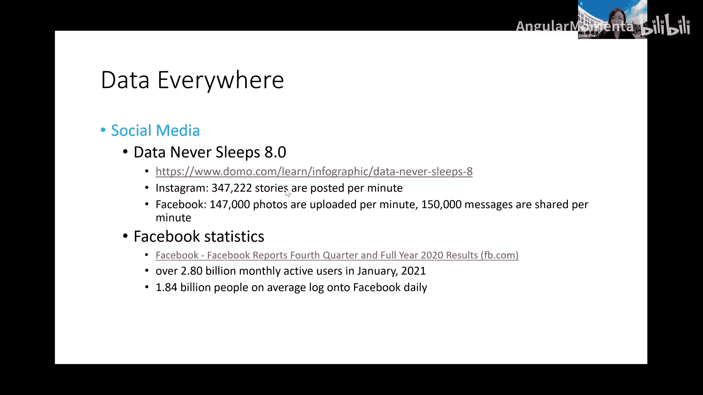
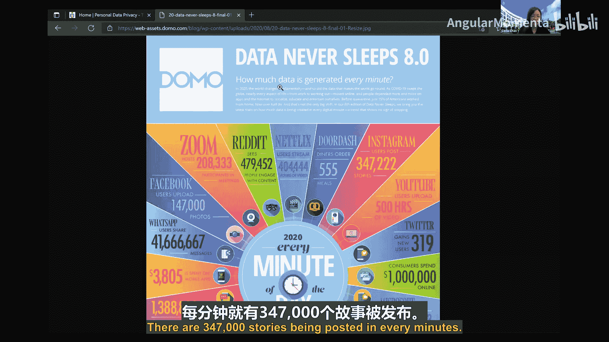
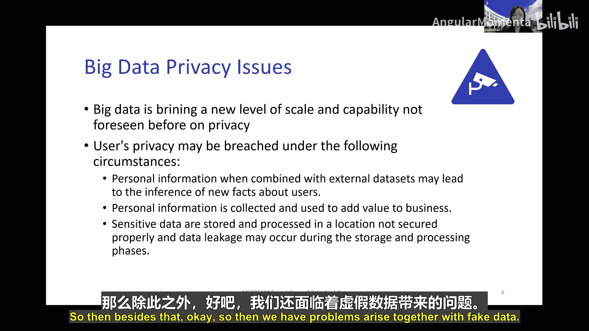
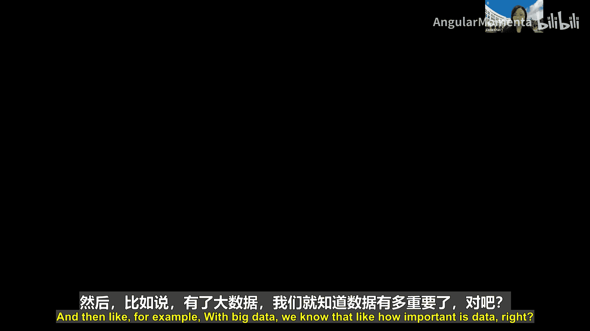
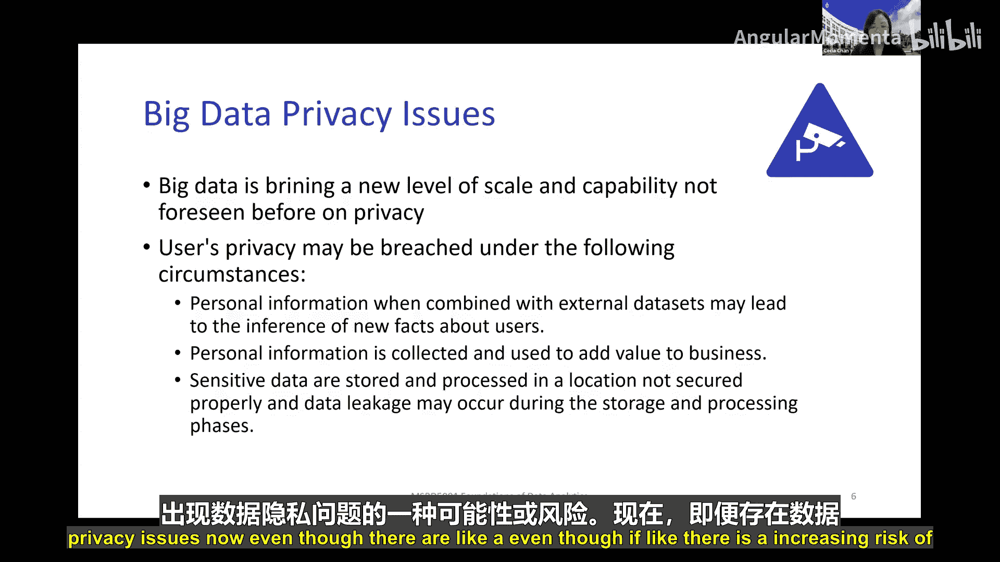
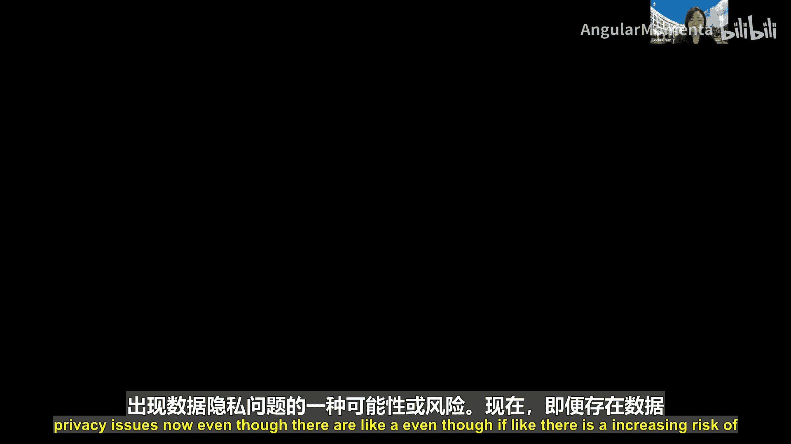
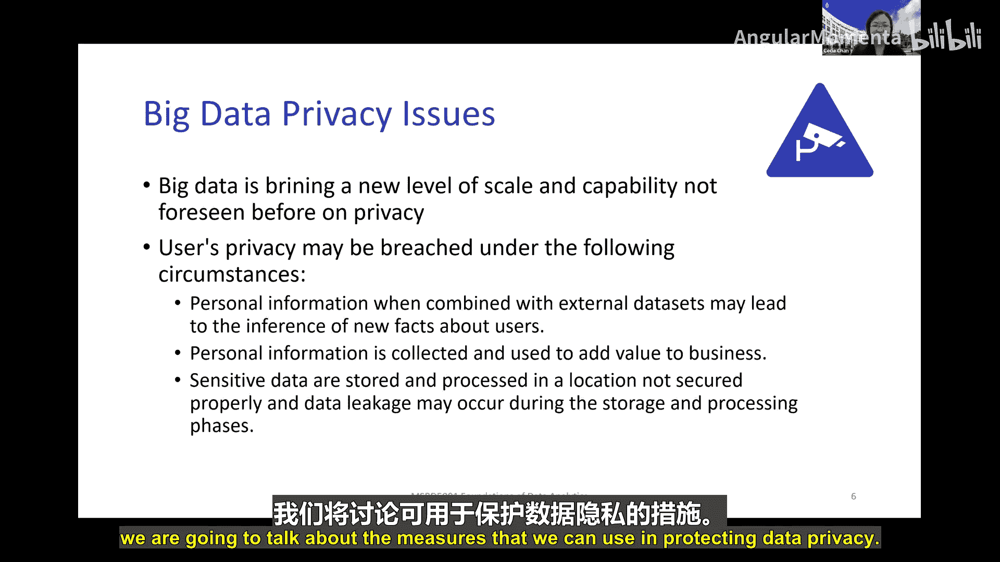
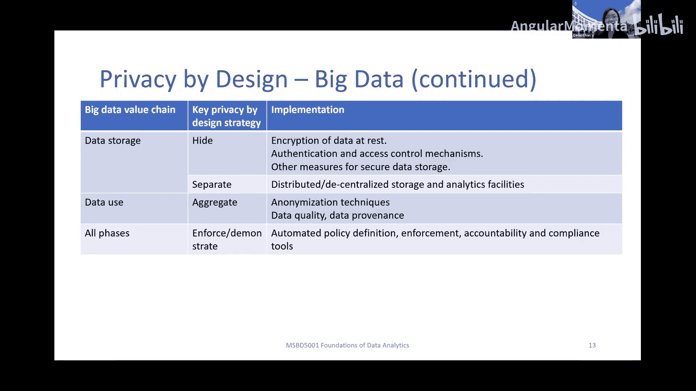

# 026：为何数据隐私至关重要 🛡️

在本节课中，我们将要学习数据隐私为何在当今大数据时代变得至关重要。我们将探讨数据无处不在的现象，理解数据隐私面临的新挑战，并初步了解保护数据隐私的基本策略。

近年来，我们越来越多地听到“数据隐私”这个词。我们从新闻中听到数据隐私，从文章中读到关于数据隐私问题的报道。同时，我们在使用各种服务时，也越来越多地看到与数据隐私相关的声明或指南。例如，在使用网上银行时，我们通常会看到许多关于数据收集和使用的指南或声明的更新。甚至在进行网上购物时，在您完成订单并让产品发货给您之前，您也需要再次同意数据收集和使用条款。同样，在我们的手机或电脑上安装应用程序时，我们也经常需要同意这些数据收集和使用的协议。

此外，许多组织也在发布关于数据隐私的信息。例如，香港科技大学也有这样一个页面，说明他们如何重视数据隐私、有哪些保护措施和指南，以及他们的数据隐私声明。我们现在看到越来越多这样的内容。为什么会这样呢？当然，这是因为技术的进步。在过去，我们的计算能力有限，数据通常以有限的规模被收集，并以小规模进行分析，由一小群人管理和处理。

因此，数据隐私在当时并不是一个非常严重的问题，它仍然是个问题，但不像现在这么严重。如今情况不同了，我们处于大数据时代，数据无处不在。我们自己也在各处生成数据。让我们快速回顾一下当今数据的规模和数量。例如，有分析显示2020年互联网用户数量。我们可以看到，2014年只有29亿，而到2020年已增至45亿。仅仅几年时间，数量几乎翻了一番。

那么，我们在互联网上做什么呢？我们经常进行搜索，使用谷歌等搜索引擎在线查找各种信息或资料。每分钟有200万次搜索，其中70%来自手机。如今，我们所有人都非常习惯于使用手机、电脑连接互联网进行搜索。当然，我们寻找的是数据，同时我们也在生产数据。例如，我们都在使用社交媒体。当我们使用社交媒体时，我们实际上在主动生成数据，因为我们发布动态、发推文、发送消息、发布照片和视频，所有这些都包含了关于我们自己的信息或数据，我们正在生成大量的数据。

除了社交媒体，还有其他的通信方式。即使我们不使用Facebook、WhatsApp、Instagram等社交媒体应用，我们也可能通过短信或WhatsApp消息发送信息进行交流。还有Zoom，我们几乎每天都在进行Zoom会议。所有这些都意味着数据。多媒体方面呢？现在我们每个人要么在看视频，要么甚至在制作视频，就像我们现在正在做的一样。例如，在YouTube上，每分钟有500小时的视频被上传。TikTok上，每天有超过10亿的视频被观看。Spotify上，每分钟有28首曲目被添加到音乐库。Netflix上被观看的内容时长呢？所有这些都意味着数据无处不在。更不用说我们简要提到的在社交媒体上发布照片。据统计，2020年拍摄了1.4万亿张照片。

那么物联网呢？据估计，到2021年将有460亿台联网设备，到2021年底全球将安装310亿台设备。你可以看到这些数字实际上增长得非常快。物联网意味着数据正在被收集，因为我们有通过互联网、Wi-Fi或蓝牙连接的设备，它们会收集数据。所以数据无处不在，每一秒、每一分钟都有数据生成和被收集。但这还不是全部。数据被收集后，会被分析、共享。数据被视为新的石油，是新的财富。正因为数据如此重要，我们才在这里讨论它。

因为数据正在被生成、收集和分析，那么我们收集、生成和分析的主要数据种类或来源是什么？是个人数据，关于我们自己的数据。这就是为什么大数据隐私问题非常重要。我认为我们没有人希望自己的数据被泄露或让所有人知道。我们希望能够保护自己的数据，这意味着我们要维护我们的数据隐私。

你可以看到，由于大数据，数据隐私问题现在达到了一个新的规模水平，这是以前没有预见到的。这就是为什么数据隐私在近年来变得越来越重要，也是为什么我们现在要讨论它。当我们作为进行数据收集、数据分析、数据处理的人时，我们需要小心并意识到我们可以做些什么来帮助保护数据隐私，不侵犯个人的数据隐私。

上一节我们介绍了数据隐私日益受到关注的背景，本节中我们来看看数据无处不在的具体表现及其带来的隐私挑战。

我们正处于大数据时代，大数据也给数据隐私带来了更多挑战。首先，让我们简要回顾一下“数据无处不在”意味着什么。

现在有一些关于互联网用户的统计和分析。例如，2020年互联网用户数量已超过45亿，与2014年的29亿相比，短短几年内几乎翻了一番。我们在互联网上的用户更多了。那么，在互联网上搜索数据呢？我们所有人都越来越习惯于在线搜索事物。例如，我们正在谈论数据隐私，可能你们中的一些人已经在尝试搜索什么是数据隐私，以及可以在线获得哪些额外信息。这显示了我们对使用互联网的适应程度。我们也越来越习惯于使用电脑以外的设备。

例如，在谷歌上进行的搜索中，有70%来自手机。你可以看到，人们连接互联网、搜索信息、通过互联网进行交流变得越来越普遍。由于互联网用户增多，意味着有更多的数据被生成和收集。当我们使用互联网时，大多数人会使用社交媒体类的应用。例如，有一个名为“数据永不眠”的信息图，它提供了一些关于每分钟生成多少数据的数据，现在已经更新到第8版。

该信息图告诉我们每分钟生成的数据量。例如，在Instagram上，每分钟有34.7万个故事被发布。在Facebook的使用上，每分钟有14.7万张照片被上传，每分钟有15万条消息被分享。实际上，我认为很多人都在分享他们的位置、他们发现的有趣事物，一点一滴地分享他们的生活。这些是我们主动生成的数据。除了使用社交网络，在线通信呢？如果我们不在Instagram或Facebook上发布内容，我们可能会发送消息，可能是短信、WhatsApp消息或其他类型的通信应用。同样，我们在发送消息时也在生成数据。

那么像在线会议这样的其他通信形式呢？近年来我们都在使用Zoom。你可以看到，实际上有大量的人也在使用这类通信应用。同样，当我们通过互联网通信时，我们每分钟、每秒钟都在生成数据。除了消息和通信，多媒体数据呢？例如，现在我们所有人要么在线观看视频，要么实际上在线生成、制作视频。例如，YouTube用户每分钟上传500小时的视频。TikTok每天有超过10亿的视频被观看。除了人们生成或观看的视频，像公司或组织生成的视频或内容呢？Spotify每分钟添加28首音乐曲目。这又是另一种形式的数据。当我们有内容被上传时，当然也有音乐被收听。同样，有数据传输。还有Netflix上的内容。如今，越来越多的用户使用这类流媒体服务观看内容。所有这些都是数据。你可以看到，要么我们在主动生成数据，要么我们的数据以不同形式被生成。

更不用说照片了。现在我们每个人都在用手机或电子相机拍摄电子照片。据估计，2020年拍摄了1.4万亿张照片。这是巨大的数据量。无论我们把数据放在哪里，很可能它们都被存储在网上。那么除了电脑或手机之外的设备呢？物联网。现在，如果我们环顾四周，越来越多的设备通过互联网连接，无论是通过Wi-Fi还是蓝牙。当设备连接时，它们连接是有原因的——它们在收集数据。例如，我们经常有测量身体状况的设备，比如体重、身高、心率等身体测量数据。我们希望能够在例如手机等设备上查看这些历史数据或身体数据。

这意味着数据被收集、存储，并在互联网上，我们将能够查看这些历史数据。同样，数据被收集。还有那些监控我们或监控资源、产品使用情况的设备，以及智能设备，所有这些实际上都在收集关于我们的数据或信息，无论我们是否知情。可以说，我们的整个生活、整个生存状态实际上都在被收集。当然，收集如此大量的数据并非没有原因。数据一旦被收集，我们就想进行分析，希望能够创造价值。这就是大数据价值链的目的。

那么，当数据被分析、被收集和分析时，数据隐私或数据安全被侵犯或泄露的可能性就更大，风险也更高。这就是为什么人们对数据隐私越来越关注，因为收集的数据是关于我们、关于个人的，是我们自己的数据。我认为没有人希望自己的数据在不知情的情况下被披露。我们希望知道我们的数据在哪里、被用于什么、谁在使用它。这就是为什么对数据隐私的关注日益增加，也是为什么我们现在要讨论这个问题。

你可以看到，通过所有这些讨论，实际上大数据是我们想要讨论数据隐私的原因。大数据实际上将隐私问题带到了一个我们以前未曾预见的新规模水平。因为大数据意味着数据无处不在，也意味着我们拥有更好的技术、更强的计算能力来进行分析、数据收集，所有这些都增加了数据隐私的风险。

上一节我们看到了数据量的爆炸式增长，本节中我们来探讨大数据具体如何带来了新的隐私风险。

数据隐私风险意味着人们的隐私可能因不同的数据收集或数据处理而被侵犯。让我们看几种个人或用户隐私可能被侵犯的情况。

例如，现在越来越有可能将不同来源的数据或外部数据结合起来，以推断更多信息。如果我们将个人数据与外部数据整合或结合，这意味着将向我们当前的数据集添加更多数据或信息，这实际上会增加关于个人或用户的新事实或新信息。因为这是实际上未被预见的，我们在添加数据，添加新东西。所以用户很可能会认为，在他们不知情、未经同意的情况下，我们了解了更多关于他们的信息。这就是个人数据、个人隐私可能被侵犯的一种可能性。

另一种情况是，数据被收集和分析以增加商业价值。例如，公司可能分析数据以便向用户发送定向广告。这意味着，在用户不知情的情况下，公司可能将数据用于其他目的。这又是一种侵犯特定个人数据隐私的可能性，因为同样，这对用户来说是一种未预见和未知的情况。

用户可能会觉得他或她的隐私受到了侵犯。现在，因为数据被收集和存储，同样由于大数据，数据存储不安全的风险也在增加。这意味着数据可能被泄露或被黑客攻击。在存储或处理阶段，当数据被泄露或黑客攻击时，就意味着数据将被不当使用。这同样是对个人隐私的侵犯。

你可以看到，随着大数据、数据收集量的巨大增长，以及分析变得更加复杂、连接不同的数据源，这些都增加了数据隐私问题的风险。

除了这些，大数据还带来了其他问题。我们知道数据有多么重要，数据实际上为我们带来价值，是数据分析和创造价值的重要燃料。因此，组织收集越来越多数据的可能性或动机也在增加。不仅收集更多数量的数据，而且组织或公司也更可能收集更深层次的数据。因为我们希望能够进行更全面的分析，组织或公司更可能将数据保留更长时间。

由于保留时间更长、数据范围更广、数据收集更深，这可能再次揭示更多关于个人的信息。这同样增加了特定个人数据隐私被侵犯的可能性。

现在，除了我们如何为商业增加价值，收集的数据更可能被用于预测性分析、规范性分析。一旦我们有了这些预测，它们很可能会被用于决策。如果决策基于这些算法，并且由于数据挖掘或其他类型的数据处理，很可能导致对用户的分类或引发关于用户的伦理问题。这也是数据隐私问题的一种可能性或风险。

上一节我们讨论了大数据带来的隐私风险，本节中我们来看看用户感知与数据质量之间的关系。

尽管数据隐私问题的风险在增加，但如果人们意识到这一点，如果人们意识到有多少关于他们自己的信息被收集，那么在用户知情、意识到被收集的数据量的情况下，可能仍然可以接受。但是，实际上现在数据正在被收集，但对于大多数用户来说，他们并不知道有多少数据被收集。

因为他们不知道有多少数据被收集，人们可能会觉得他们的隐私受到了侵犯。例如，如今我们所有人可能都在我们的社交网络应用上看到过让我们有点惊讶的广告。例如，我们昨天刚和朋友讨论了某件事，然后就开始在我们的社交网络应用上看到相关的广告。如果我们不知道这些应用收集了多少数据，我们会感到惊讶。人们会觉得他们的隐私受到了侵犯，他们的数据被收集了，例如我们的对话被记录了等等。

但对我们来说，我们知道我们的数据正在被大规模收集。例如，我们有社交网络，我们朋友的数据可能被收集，他们在社交网络上的动态当然会被分析，我们与朋友的关系因为我们连接在社交网络上，所以我们的朋友看到什么或发布了什么，都会成为被分析的数据。这就是为什么我们看到某种广告。但如果我们不知道这些，我们就会觉得我们的数据隐私受到了侵犯。如果人们觉得他们的隐私受到了侵犯，他们就会不太愿意分享他们的数据，或者提供他们的数据，他们甚至可能伪造他们的数据。这是我们不希望看到的，因为如果我们想做数据分析，就需要高质量的数据。如果我们的数据中有伪造的数据，那就意味着我们有低质量的数据，我们将无法进行准确的数据处理、数据预测或数据分析。这是我们不希望发生的事情。

这就是为什么对于我们这些进行数据生成、数据收集和数据处理的人来说，意识到数据隐私问题或数据隐私风险，以及我们可以做些什么来保护个人数据隐私非常重要。这就是为什么接下来我们将讨论保护数据隐私的措施。

本节课中我们一起学习了数据隐私为何在大数据时代变得至关重要。我们回顾了数据量的爆炸式增长，理解了大数据如何带来了前所未有的隐私挑战，包括数据整合、商业利用、安全存储和决策影响等方面。我们也认识到用户感知对数据质量的影响。在接下来的课程中，我们将深入探讨保护数据隐私的具体技术措施和设计策略。