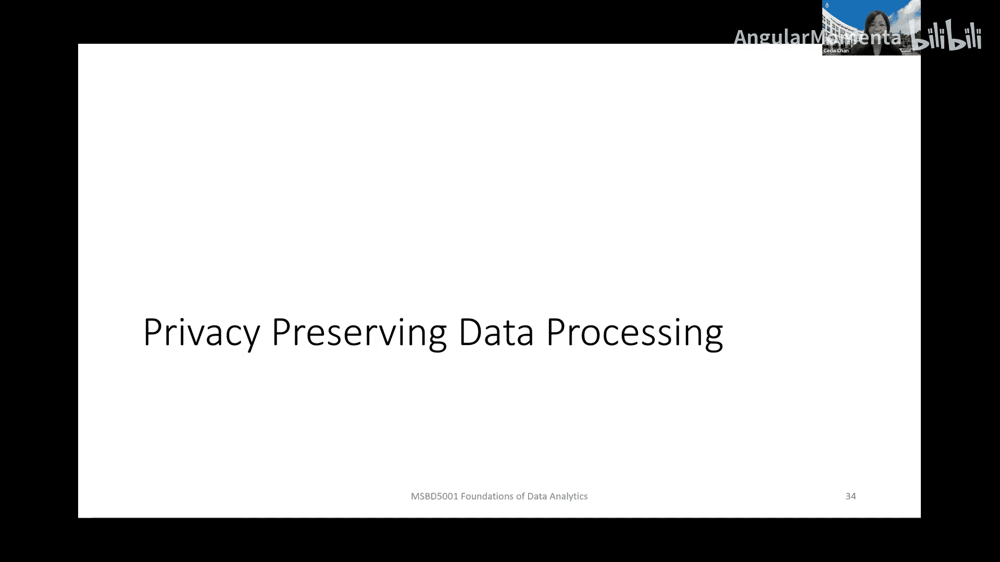

# 027：数据隐私保护方法

在本节课中，我们将要学习数据隐私保护的核心方法，特别是匿名化处理及其相关技术。我们将探讨匿名化的基本概念、常用技术、其局限性，以及如何通过更高级的方法（如K-匿名性和L-多样性）来应对重识别攻击。最后，我们也会简要了解加密等其他隐私保护手段。

## 匿名化概述 😊

上一节我们介绍了数据隐私的重要性，本节中我们来看看最常用的隐私保护方法之一：匿名化。匿名化旨在移除、隐藏或掩盖数据记录与特定个体之间的关联，使得我们无法根据数据记录识别出对应的个人。这种方法在数据收集、存储、分析和共享等数据价值链的各个阶段都可能被应用。

匿名化可以由**数据使用者**（例如进行数据分析的人员）在分析前执行，也可以由**数据提供者**在收集数据后、存储前或共享/出售数据前执行。

## 匿名化基本技术

以下是实现匿名化的几种基本技术。

**1. 移除**
对于**直接标识符**，例如姓名、邮箱地址、IP地址、生物特征信息、手机号码、医疗设备标识符等，可以直接将其从数据集中移除。因为仅凭这些信息本身就能唯一识别个体。
对于**准标识符**，例如出生日期、年龄、性别等，也可能需要考虑通过移除或省略来进行匿名化。因为当这些信息组合在一起时，仍有可能揭示个体身份。

**2. 假名化**
有时我们需要区分不同个体或将数据与其他数据集链接，但又不能暴露真实的标识符。此时可以使用假名化技术，即用代码编号（通过加密或哈希算法生成）替换个人详细信息。
*   **可逆假名化**：生成的代码可以转换回原始标识符。这在后续可能需要识别个体时有用。
*   **不可逆假名化**：生成的代码无法转换回原始标识符。这能提供更强的隐私保护，但在需要回溯识别时无法使用。

**3. 分组/聚合/分类**
通过将数据按年龄、性别、邮编等进行分组或聚合，可以降低数据粒度，使得属性值的组合不足以唯一识别出个体。

## 匿名化的局限性与重识别攻击 😊

然而，匿名化并不能完全防止重识别攻击。即使数据已经过匿名化处理，攻击者仍可能通过整合其他数据源来重新识别出个体。

重识别攻击是指故意识别个体并揭露其个人详细信息的行为。当匿名化数据集与另一个包含标识信息的数据集（可能来自不同来源）进行整合或链接时，额外的信息可能通过数据匹配揭示出个体的身份，或者产生能够唯一识别个体的属性值组合。

**著名研究案例**
拉坦娅·斯威尼博士的研究表明，将已移除标识符的医疗记录（包含准标识符如性别、出生日期、邮编）与选民登记记录（包含姓名、地址等标识符）进行匹配，仅通过出生日期和邮编就能识别出69%的选民。如果结合邮编、性别和出生日期，则有90%的个体具有唯一的组合，从而能被重识别。

**其他案例**
*   **Netflix案例**：研究人员发现，仅凭对订阅者背景的粗略了解（如大致年龄范围和地理位置），就能以高概率从50万匿名化的用户电影评分记录中识别出特定用户。
*   **AOL案例**：2006年，AOL发布了2000万用户几个月内的匿名化搜索查询记录。尽管移除了标识符，但《纽约时报》记者通过将搜索历史（包含特定关键词和地点）与电话簿列表进行交叉比对，在几小时内就成功识别出用户`4417749`对应佐治亚州一位62岁的寡妇。

## 重识别攻击的类型

重识别攻击主要可分为三种类型。

**1. 关联攻击**
通过将一个数据集与其他来源的数据集链接，以创建更细粒度、更独特的数据条目。例如，将药房的假名化客户数据与医院目录关联，以查看哪些医院从哪些药房购买了药品。

**2. 任意攻击**
无意中通过链接数据集导致个体被识别。例如AOL案例中，记者并非有意针对某人，但链接搜索记录和电话簿后意外识别出了个体。

**3. 目标识别攻击**
这是最严重的一种，攻击者拥有特定目标的背景知识，并有意利用这些知识交叉核对其他数据集，以获取关于该目标的更多信息。例如，雇主可能利用对潜在员工的了解，去匹配医疗或保险记录以探查其健康状况；保险公司也可能利用申请人的信息去其他数据库挖掘更多细节。

## 增强的隐私保护方法：K-匿名性 😊

由于匿名化不足以防止重识别攻击，我们需要其他措施来确保即使数据集与其他数据合并，也无法唯一识别个体。其中一种方法是**K-匿名性**。

K-匿名性要求：在数据集中，任何个体的记录至少在`K-1`条其他记录中是不可区分的。例如，若`K=3`，则对于任何一组准标识符组合，至少存在3条记录共享该组合，使得攻击者无法确定目标对应哪条记录。

**实现K-匿名性的技术**
*   **抑制**：用特定符号（如`*`）替换某些属性的部分或全部值。
*   **泛化**：将具体的属性值替换为一个范围或类别。例如，将年龄“28”替换为“<30”。

**K-匿名性的示例**
假设原始数据中，通过年龄和国籍的组合可以唯一识别个人并获知其疾病。通过实施`K=4`的匿名性（例如，将年龄泛化为“<30”，抑制部分邮编），使得共享相同准标识符组合（如特定邮编前缀、年龄范围、国籍）的记录至少有4条。这样，即使知道某人的年龄范围和国籍，也无法确定其对应的具体记录和疾病。

**K-匿名性的不足**
K-匿名性可能无法防御目标识别攻击。考虑上述示例中最后4条记录，它们共享相同的准标识符组合，但敏感属性“疾病”的值全部是“癌症”。如果攻击者知道目标属于这个组，即使无法确定具体是哪条记录，也能断定目标患有癌症，从而泄露了敏感信息。

## 增强的隐私保护方法：L-多样性 😊

为了解决K-匿名性的不足，提出了**L-多样性**作为增强。

L-多样性旨在减少数据表示的粒度，其核心思想是：对于共享同一组准标识符的每个记录组，其敏感属性至少应有`L`个不同的值。

**L-多样性的示例**
在`K=4`匿名性的基础上，要求`L=3`多样性。这意味着在每个由4条记录组成的组内，疾病类型至少要有3种不同的值。例如，一个组内可能包含“心脏病”、“病毒感染”和“癌症”。这样，即使攻击者知道目标属于该组，也无法确定其究竟患有何种疾病。

## 其他隐私保护方法

除了匿名化及其增强方案，还有其他多种隐私保护技术。

**1. 差分隐私**
通过向数据中添加噪声或生成合成数据集来保护隐私。其理念是：对包含某个个体的数据集进行查询的结果，与不包含该个体的数据集进行相同查询的结果，差异应该非常小，从而无法推断出个体的信息。需要在降低重识别风险和保持查询准确性之间进行权衡。

**2. 数据聚合**
在发布数据前，将记录汇总为基于报告的摘要形式（如总和、平均值）。这类似于K-匿名性中的分组，但会使得细粒度的分析变得困难，并可能产生原始数据中不存在的新关系。

**3. 数据抑制**
不发布全部数据值，部分数据被移除、保留或不披露。这会影响数据挖掘或分析的完整性。

**4. 数据交换**
交换某些选定记录的属性值，以隐藏记录的真实对应关系。但高交换率可能会破坏变量间的原始关系。

**5. 数据随机化**
向数据变量添加随机生成的数值噪声，以扭曲敏感变量的值。这会改变数据分布，可能影响后续数据分析（如回归分析）的准确性。

**6. 数据合成**
用通过模拟生成的合成值替换敏感变量。同样，这会改变原始数据，可能影响数据处理结果。

## 加密作为隐私保护手段 😊

接下来我们看看另一类非常重要的隐私保护措施：加密。

加密是通过算法将原始数据（明文）转换为另一种形式（密文）的过程。查看密文的人无法得知原始数据内容，从而保护了隐私。加密常用于保护分布式存储的大数据。

**挑战与演进**
一个关键挑战是：如何在数据保持加密的状态下进行数据分析？如果解密后再分析，则隐私保护失效。因此，隐私保护计算领域正在研究能够直接在密文上进行计算的加密方法，例如可搜索加密、同态加密等。

**几种加密方案**
*   **基于身份的加密**：访问控制基于用户的身份。允许用户访问所有资源，但难以实现细粒度的访问控制，且更改密文接收者困难。
*   **基于属性的加密**：访问控制基于用户的属性。能实现更细粒度、更安全灵活的访问控制，但同样存在计算开销大、更改接收者困难的问题。
*   **代理重加密**：可用于处理更新密文接收者的问题，可与IBE或ABE结合使用，但计算时间仍较长。
*   **同态加密**：允许直接在密文上进行计算，无需解密，安全性最高。但其算法非常复杂，计算开销极大。

## 隐私保护数据处理

之前我们探讨了适用于数据价值链不同阶段的隐私保护措施。接下来，我们将具体关注**隐私保护的数据处理**技术，这涉及到如何在保护隐私的前提下进行有效的数据分析和挖掘。

---

本节课中我们一起学习了数据隐私保护的核心方法。我们从基础的匿名化技术入手，了解了其实现方式（移除、假名化、分组）及其局限性——无法完全防止重识别攻击。接着，我们探讨了更高级的防护措施，如K-匿名性和L-多样性，它们通过抑制和泛化技术来降低重识别风险。此外，我们还简要介绍了差分隐私、数据聚合、加密等多种其他保护手段，认识到在增强隐私保护的同时，往往需要在数据效用和分析准确性之间进行权衡。理解这些方法是设计和实施负责任的数据分析流程的基础。