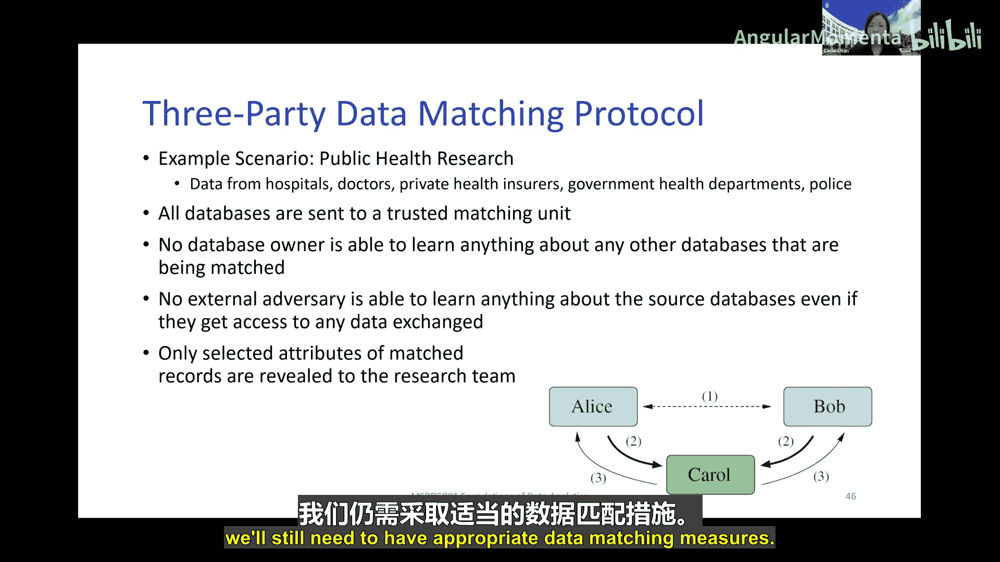
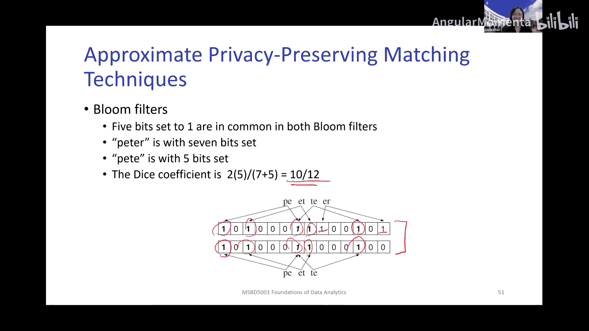

# 028：隐私保护数据处理 📊🔒

在本节课中，我们将要学习如何在数据分析过程中保护数据隐私。我们将探讨几种关键的隐私保护技术，并了解它们如何在保证数据处理准确性的同时，确保个人敏感信息不被泄露。

---

## 隐私保护技术概述

我们之前讨论了许多不同的数据隐私保护技术或措施。可以看到，许多措施需要在数据保护（隐私）与数据处理（准确性）之间进行权衡。因此，当进行数据处理时，我们确实需要一些技术或措施，以便在保护隐私的同时，允许我们进行准确的数据处理。这就是为什么近年来，相关技术的研究领域备受关注。

这些需要技术措施来保证隐私、保护并确保准确数据处理的领域包括：
*   **隐私保护数据挖掘**：专注于研究那些同时能保证隐私的数据挖掘方法，或是在保护隐私的同时进行数据挖掘的问题。
*   **隐私保护生物特征认证**：指在进行生物特征认证时，我们不希望泄露生物特征信息，而是希望能够保护隐私。
*   **隐私保护数据或记录匹配**：同样，我们希望实现隐私保护下的数据或记录匹配。

接下来，让我们更详细地讨论每一个领域。

---

## 隐私保护数据挖掘 🔍

隐私保护数据挖掘意味着，当我们进行数据挖掘时，通常希望对整合后的数据进行挖掘。我们查看来自不同数据集或数据源的数据，或将数据整合到一个集中的位置，然后在该集中的整合数据上进行挖掘。但是，如果我们想确保数据隐私，就意味着我们可能无法拥有包含私人和敏感数据的原始数据。

为了保护数据隐私，例如，我们可以对数据添加随机噪声或进行几何旋转，使数据受到扰动。然后，我们整合这些受扰动的数据，并在其上执行数据挖掘。这意味着我们将无法直接访问那些敏感信息或私人数据，从而保证了数据隐私。但问题是，如果数据被修改了，那么数据挖掘所构建的模型、我们试图发现的模式以及后续的预测是否会受到影响？如果受到影响，那就不是一个好的数据挖掘算法。因此，隐私保护数据挖掘这个领域，专注于研究如何在受扰动的数据上进行数据挖掘。

受扰动的数据应该在聚合层面上重建其分布。因为数据的分布在扰动数据中得以保持，我们就能够构建模型、提取模式，并准确地执行数据挖掘任务。

除了进行隐私保护数据挖掘，该领域的另一个关注点是：传统上，数据挖掘通常在集中的数据仓库上进行。但是，当我们收集数据、将数据整合到集中位置时，会增加数据隐私和机密性的担忧，因为多组织的数据将被合并并放在一个地方，这意味着存在未经授权使用的潜在风险。因此，数据挖掘可能更倾向于在分布式数据上进行，而不是在集中的数据仓库中。这意味着每个组织将保留自己的数据集和原始存储位置，然后通过协作数据挖掘，我们能够获得全局的数据挖掘结果。当然，你可以想象这有多困难。数据是分布式的，而我们仍然能够成功地进行数据挖掘。因此，这个领域正引起越来越多的关注，并且越来越重要。当然，这很困难、很复杂，所以这些技术目前效率仍然不高。我们需要新的方法，这些方法需要基于云计算，并且需要新的密码学原语。

---

## 隐私保护生物特征认证 👁️

在进行生物特征认证时，通常用户提供他们的生物特征信息，然后与记录或存储的用户生物特征模板进行匹配。生物特征模板代表了敏感信息，因为它们可以唯一地识别特定用户。这意味着我们不想直接访问生物特征信息。

我们希望能够在加密的生物特征信息上工作，然后基于加密的信息进行认证。这意味着我们需要结合哈希技术、编码技术以及一些零知识证明协议。零知识证明协议意味着我们能够证明这些数据、这些模板、这些生物特征信息是匹配的，而无需泄露实际的生物特征信息。

现在，如果我们在加密数据上工作，很可能会匹配失败，这可能导致错误拒绝率。对于生物特征认证来说，如果我们有错误拒绝率，人们如何被认证并访问资源呢？这是不可取的。因此，我们需要能够降低错误拒绝率的方法或措施。当然，因为我们是在加密数据上工作，所以我们需要适当的同态加密技术。同态加密技术指的是在加密数据上进行数据处理和数据分析的技术。

---

## 隐私保护记录匹配 🔗

我们知道，记录匹配是通过整合不同的数据源来执行的，我们希望识别共同的信息。例如，我们希望从不同的数据集中识别出可能指向同一个人或同一身份的记录。正如之前的例子所示，匹配来自不同数据源的记录很可能会导致数据隐私问题。例如，通过将记录匹配在一起，我们可能会遭受重新识别攻击。

因此，为了防止这些数据隐私问题，我们需要一些方法来进行数据转换。这样我们就不会直接拥有敏感数据（如社保号），而是拥有编码或转换后的数据。然后，我们仍然能够在编码或转换后的数据上进行匹配。这就是为什么许多最近的方法考虑数据转换和映射到特征空间，然后在其上进行匹配；或者考虑结合安全多方计算以及数据清理或数据匿名化技术，如差分隐私和匿名化。

现在，当我们进行记录匹配时，通常希望进行近似匹配，而不仅仅是精确匹配。但是，如果我们在匿名化数据或编码数据上工作，通常会被限制为直接精确匹配。这意味着我们将无法进行其他更复杂的匹配，例如近似匹配或模糊匹配。然而，为了获得良好和准确的记录匹配，我们通常需要进行更复杂的匹配，因为我们的数据中可能存在变化和噪声。

此外，因为要进行数据转换和数据映射等操作，所以我们还需要安全模型，并进行安全性分析，以保证数据的完整性，确保数据不被扭曲或破坏。这就是为什么我们需要新的方法、新的技术和新的安全模型等。

---

## 隐私保护数据匹配的重要性

你可以看到，我们提到的这三个领域，确实需要一些新的或更先进的方法，以实现数据处理的同时保护数据隐私。

接下来，让我们重点讨论隐私保护数据匹配。你可以看到，数据匹配在本课程中讨论过，并且在数据处理中非常重要。我们提到过在模式对齐中使用数据匹配，以对齐不同数据集或数据源之间的模式；我们也在记录链接或去重中使用数据匹配，比较来自不同数据的记录，以识别它们是否与特定对象或实体相关。

当我们进行数据匹配时，可以看到我们提到过的数据匹配技术（例如相似性度量、记录匹配方法或算法）都假设数据是原始格式的。它们不应该被加密或编码。如果数据被加密或编码，我们将无法进行匹配，因为我们查看的是实际的值或文本。

但是，我们知道我们通常匹配的数据库实际上是关于个人的记录。因此，当我们进行数据匹配时，数据隐私问题的风险会增加，因为数据匹配会给原始数据增加更多信息。当我们进行数据匹配时，通常没有跨数据集的唯一标识符来直接匹配或链接记录。我们通常查看记录的详细属性值来进行匹配，例如查看姓名、电话号码、出生日期等。这些通常是敏感数据，或者即使不是标识符，也是准标识符。那么，我们如何在确保数据隐私的同时进行数据匹配呢？这有很多需要讨论和研究的。

---

## 数据匹配的不同场景与隐私问题

数据匹配实际上可以在不同的场景下执行。我们将看看这些不同的场景，并研究不同场景下是否存在隐私问题。

首先，如果我们看单个组织内部的数据匹配，隐私通常不是问题。因为在单个组织内部，我们可以假设每个人都了解数据隐私政策，或者他们知道数据安全和数据保护的政策。在公司内部，因为我们不向他人披露数据，所以数据隐私通常不是问题。即使是匹配后的数据，它们通常也用于组织内部目的，例如，公司内部整合数据以识别欺诈，或整合数据以获取客户邮寄列表，进行一些内部研究为公司增值，或进行一些客户关系相关的调查等。在公司内部，因为数据只在公司内部使用，通常会采取措施防止未经授权的访问，并且数据不会公开给他人，所以同样没有隐私问题，只要数据安全得到维护。

但是，今天存在另一种场景，其中数据隐私会成为问题。例如，当我们与其他组织进行数据匹配时。那么，匹配后的数据可能需要与他人共享，可能需要传递给某个组织，或者匹配后的数据可能需要发布以供进一步研究，例如公共卫生研究。公共卫生研究可能由不同的大学进行，因此，由不同大学进行的公共卫生研究需要向公众发布，以引起公众对健康问题的关注。所以匹配后的数据需要公开。当然，隐私问题就出现了，因为匹配后的数据可能泄露更多关于个人的信息，并且你现在将数据发布给他人，这意味着可能存在重新识别攻击和隐私问题。因此，在发布数据时，我们需要考虑隐私和保密法规。当然，当我们发布数据时，数据应仅包含不会导致个人识别的信息，否则数据不应公开。你可以看到为什么隐私在这里很重要。

当然，当我们进行跨组织的数据匹配时，数据可能需要共享。那么，那些包含标识符或身份信息的数据在交换或共享时，隐私问题就出现了，因为其他公司或组织可能会知道更多信息，或者能够识别出他们原本无法识别的某些个人。因此，数据隐私将成为我们关注的问题。

在最后一种场景中，因为数据将被共享或传输给其他组织，这意味着一旦数据被传输或共享，我们就失去了对包含个人详细信息的敏感数据的控制，因为它们被他人共享了。因此，我们失去了对数据将如何被其他方使用的控制。所以，为了保护数据隐私，这意味着我们希望数据被加密。但是，我们提到大多数现有方法要求数据是原始未加密的。你可以看到这里存在矛盾。那么，我们如何在保护隐私的同时进行匹配呢？这就是为什么我们需要隐私保护数据匹配。理想情况下，我们希望进行准确的数据匹配，而不需要提供身份识别数据。这意味着我们既不需要数据是原始未加密格式，也不需要将数据直接共享给其他组织。

---

## 隐私保护数据匹配的挑战与协议

除了之前关于控制数据、不希望失去数据控制权以及希望数据加密等担忧之外，另一个担忧是：匹配后的数据，即组合信息，通常高度敏感。例如，如果我们匹配或组合不同的健康数据库，我们可能能够进行重新识别攻击。这意味着某个特定的个人，例如高知名度的人物（如政治家、政府官员或名人），如果患有严重的健康问题（例如传染病），那么通过匹配健康数据库，这些信息可能会被泄露给公众，我们可能识别出这些个人，这将破坏数据隐私。

其他例子包括：如果我们将患者的医疗详细信息与社会经济信息进行匹配，可能会出现我们发现特定种族或特定文化背景的人群与某种疾病高度相关的情况。因为它与特定种族或特定文化背景的人群相关联，所以需要谨慎处理，这可能引发伦理问题，可能导致歧视或对人群的刻板印象。

还有一些例子可能是：当我们进行数据匹配以识别可能涉及犯罪或恐怖袭击的潜在个人时，如果我们使用隐私保护数据匹配，那么错误匹配的几率会增加。错误匹配对会对个人生活产生严重影响，如果错误地将某人匹配为潜在的恐怖分子或罪犯，那将毁掉那个人的生活。因此，这同样是不可取的。所有这些都是在匹配数据中我们需要防止的情况。

因此，为了实现隐私保护数据匹配，人们已经提出或采用了不同的措施和协议。其中一种建议的协议是**两方数据匹配协议**。两方数据匹配协议可以应用于商业合作的场景，例如两家公司计划合并业务，他们希望识别共同的客户和供应商。这意味着，因为是两家公司合并业务，他们肯定不希望涉及第三方进行匹配，他们希望在两公司之间进行匹配。

这意味着他们要做的是识别来自两家公司两个数据库中相似的记录，并且只有那些匹配记录的标识符会透露给两个组织。这里的目标是，我们不希望任何一方了解对方公司的机密数据。这意味着公司会试图保护自己的数据，他们不想向他人泄露机密数据。那么，两方数据匹配协议如何实现呢？你可以在这里看到。

在两方组织中，我们用两个人名Alice和Bob来代表两个组织，以便于解释。但你可以想象Alice代表一家公司，Bob代表另一家公司。那么，Alice和Bob拥有的两个数据库首先会相互通信，决定使用哪些属性进行匹配，以及使用哪些技术进行预处理。因为预处理步骤必须相同、必须标准化，匹配才能成功。同时，因为他们将要共享数据，他们应该如何加密数据，以及是否需要任何编码或加密密钥。当然，我们不希望对方能够解密数据。我们希望保护数据免受对方侵害。因此，加密或编码密钥不应被其他组织知晓。

然后，每家公司将数据编码后发送给对方，双方通过计算记录之间的相似度来进行匹配。然后，被分类为匹配的记录（即彼此具有高相似度的记录）的标识符将发送回两个数据库所有者。之后，数据库所有者可以决定是否要交换匹配记录的详细信息，或者他们希望向对方发送哪些属性值，以进行进一步的操作或分析。

总的来说，在两方数据匹配协议下，通常更安全，因为公司通常希望向对方隐藏私人和机密数据。因此，由于数据将更安全，计算也将更复杂。

除了两方数据匹配协议，在某些情况下，我们可能希望**三方数据匹配协议**来帮助确保或增加数据隐私的保护。例如，在公共卫生研究场景中。我们提到，来自不同医院、医生、私人健康保险公司甚至政府卫生部门或警察的数据集希望提供数据并进行数据匹配，以便为后续分析提供匹配结果。

因此，由于涉及多方，数据库必须发送给一个受信任的匹配单元，这个受信任的匹配单元就是第三方。这就是为什么现在我们有两个组织和一个第三方，所以是三方数据匹配协议。在这个协议场景中，任何数据库所有者都无法了解正在匹配的其他数据库的任何信息，因为所有数据都发送给了第三方。同样，我们不希望任何外部对手了解源数据库，即使他们能够访问任何数据交换。是的，匹配后，只有匹配记录的选定属性会透露给研究团队。

那么，三方数据匹配协议通过三个主要步骤完成。第一步，两个数据库所有者交换详细信息，就像前面的两方数据匹配协议例子一样，交换用于预处理的技术、使用的属性、使用的编码或加密方法以及所需的任何编码或加密密钥。同样，加密密钥或编码应与对方分开保存。

然后，编码后的数据库应发送给匹配单元（这里我们多了一个参与方Carol）。编码后的数据库被发送给Carol，Carol通过计算记录之间的相似度来进行匹配，Carol是在加密记录之上进行计算的。然后，被识别为匹配的记录对的标识符将发送回两个数据库所有者。同样，数据库所有者Alice和Bob可以讨论他们希望如何交换数据、如何使用数据。

现在，这个三方数据匹配协议存在一个缺点。缺点是，即使Carol没有接收任何未编码的数据（Carol只处理所有编码数据，因此Carol不知道两个数据集的内容），但Carol有可能与另一方（例如，一个数据库所有者，比如Bob）串通。那么Carol将能够解码数据，并能够了解有关数据的更多信息。这就是三方数据匹配协议的潜在风险。

在两方和三方数据匹配协议下，我们仍然需要适当的数据匹配措施。

---

## 隐私保护匹配技术

接下来，我们将讨论一些可以在两方或三方数据匹配协议中使用的隐私保护匹配技术。

首先，我们来看**精确隐私保护匹配技术**。这些技术将确保数据隐私，但只对数据进行精确匹配。例如，其中一种技术是使用单向哈希编码函数，如SHA（安全哈希算法）或消息摘要MD函数，来编码我们想要匹配的消息。

例如，你可以看到这里，字符串“Peter”将被编码成一个代码。如果我们使用SHA-1哈希编码函数，可以看到不同的字符串会被哈希成不同的代码。即使只有一个字符的差异（例如，缺少一个额外字符），也会产生完全不同的协议（代码）。甚至大小写字符的不同（例如，首字母大写的“Peter”和首字母小写的“peter”）也会给我们不同的哈希码。这意味着，如果我们使用这些哈希码进行匹配，我们只能进行精确匹配，甚至精确到字母大小写。

那么，使用单向哈希编码函数意味着我们只能在哈希码上进行精确匹配。显然，仅靠精确匹配是不可行的。我们可以做的增强匹配的方法可能是进行预处理，例如词干提取，并将输入标准化为某种基本形式以进行匹配。这样，我们或许能够增强匹配。

但是，对于这种匹配的使用，它可以用于三方协议。它可以与三方协议一起使用，因为匹配是由第三方Carol完成的，而Carol只基于哈希码进行匹配。因此，第三方Carol不会从两个数据库所有者那里了解到更多关于数据的信息。但是，如果我们讨论的是两方协议，那么它不会向数据库所有者隐藏信息。这意味着单向哈希编码函数不适用于两方场景，只适用于三方场景。但是，即使对于三方协议，单向哈希编码匹配仍然容易受到字典攻击或频率攻击。因为攻击者可以对字典中的术语进行哈希，然后将这些代码与提供的数据集进行比较，从而揭示编码后的实际术语。我们实际上可以比较其频率，例如，特定哈希码在数据中的频率，然后与真实数据中术语的频率进行比较，频率的相似性实际上会揭示术语或字符串。这就是为什么单向哈希编码函数可能无法防止字典攻击或频率攻击。那么，解决方案是在三方协议中添加一个秘密密钥。

之前的单向哈希编码函数措施是针对精确匹配的。我们知道，对于数据匹配，仅仅进行精确匹配并不能让我们识别相似的记录。因为数据中经常存在错误和变化，我们需要能够处理这些错误，这意味着我们需要进行近似匹配。这就是为什么我们需要一些**近似隐私保护匹配技术**。我们将讨论几种不同的技术。

我们要讨论的第一个技术是用于安全计算编辑距离的两方协议。当我们计算编辑距离时，会有一个编辑距离矩阵（距离矩阵），填充完矩阵后，我们就能识别出两条记录或两个字符串之间的编辑距离。

那么，近似隐私保护匹配技术使用编辑距离。编辑距离进行的是近似匹配。但是，正如我们提到的，我们不希望对方了解对方数据的更多信息。因此，我们不希望距离矩阵被双方看到。这意味着我们希望距离矩阵以共享的方式存储在两个数据库所有者之间，同时距离矩阵的生成是迭代进行的，而不泄露每个数据库所有者的实际计算。显然，这必须通过同态加密方法来完成，这意味着我们必须在加密数据之上进行数据处理和分析。

另一种技术是**盲记录链接**。它用于三方设置，用于计算Dice系数。什么是Dice系数？Dice系数是取两个字符串之间共同标记（token）的数量，然后乘以2，再除以字符串x中的标记数和字符串y中的标记数。

对于盲记录链接，我们考虑的是标记（例如n-gram，n元语法）。这意味着我们首先处理n-gram，而不是完整的字符串值。我们对n-gram进行哈希和引用。让我们看一个例子。

假设我们试图匹配两个字符串：“Peter”和“Pete”。我们称Alice是一个组织，Bob是另一个组织。首先，Alice和Bob分别为他们的字符串生成n-gram列表。例如，Alice为“Peter”生成不同的2-gram列表或可能的2-gram列表，比如完整的2-gram列表：`[PE, ET, TE, ER]`。同时它也生成了子2-gram列表。Bob也为“Pete”做类似的事情。“Pete”有三个2-gram，所以完整列表是三个2-gram。Bob也生成了子列表，例如，三个2-gram中的两个，另外两个2-gram中的两个等。

对于匹配，Alice将发送哈希码形式的2-gram列表，连同记录ID、列表中的2-gram数量以及原始字符串中的2-gram总数。Alice会为完整的2-gram列表和其他子2-gram列表生成这些信息。这就是整个列表：四个2-gram的哈希码，以及标记数量、记录身份标识和原始字符串中的2-gram总数，发送给第三方Carol。同样，Bob也做类似的事情，将哈希码连同该列表中的2-gram数量以及要匹配的字符串中的2-gram总数发送给Carol。

然后，Carol会比较这两个列表，并找到匹配的项（如下划线的项）。基于这个匹配的2-gram列表，就能够计算Dice系数。匹配的2-gram数量是3。因此我们乘以2得到6。Alice字符串中的2-gram数量是4，Bob字符串中的2-gram数量是3。因此，Dice系数是6除以7。这意味着当Carol进行匹配时，Carol不知道实际的2-gram，也不知道实际的字符串。Carol只是盲目地比较和匹配代码。但是，通过匹配2-gram，我们能够获得相似度分数。

另一种技术是使用**布隆过滤器**来计算Dice系数。每个数据库所有者将n-gram哈希到布隆过滤器中。例如，对于“Peter”，有5个位被设置为1；对于“Pete”，也有5个位被设置为1（其中有共同设置的位）。那么，Dice系数就是共同设置为1的位数（5）乘以2，除以“Peter”字符串设置的位数和“Pete”字符串设置的位数。这将给我们Dice系数10/12。因为我们在布隆过滤器上进行匹配，而不是直接在原始字符串上匹配。同样，这是盲记录链接，意味着我们不知道原始文本。同样，布隆过滤器，就像盲记录链接一样，应该应用于三方协议。

这些方法是关于如何实现近似隐私保护匹配的一些例子。因为我们在n-gram上进行匹配，并且实际上获得了相似度分数，所以我们不是在精确匹配，而是近似匹配。你可以看到，因为我们没有匹配原始文本，我们没有匹配原始的敏感属性值或标识属性值，这就是它如何在保证隐私的同时进行匹配的。

---

## 总结与思考

我们已经看到了许多不同的算法，实际上还有更多。在本节中，我们想要做的是，在进行数据处理时，能够意识到数据隐私的重要性。因为当我们面对大数据时，存在多样性、体量、变化性等问题，这意味着我们面临着日益增长的数据隐私挑战。因此，在进行数据分析时，在进行分析的同时保护数据隐私非常重要。这就是为什么这是最后一个主题，也是为什么我们想在这里介绍和讨论它。这样，如果你将来要进行进一步的数据处理，并且要管理、收集、分析和处理大量数据，那么有很多问题需要我们注意，我们可能需要考虑不同类型的技术，如常见的匿名化技术及其增强版本（如K-匿名、L-多样性）。当然，当我们进行不同的数据处理时，我们也必须思考如何在数据处理（如隐私保护数据挖掘、隐私保护数据匹配等）的同时保护数据隐私。这就是我们要讨论的内容，也是我们已经讨论过的关于数据隐私的内容。

当然，由于时间有限，我们无法涵盖所有内容。但我希望这节课能给你一些关于大数据和数据隐私问题以及数据处理的思考和启示。