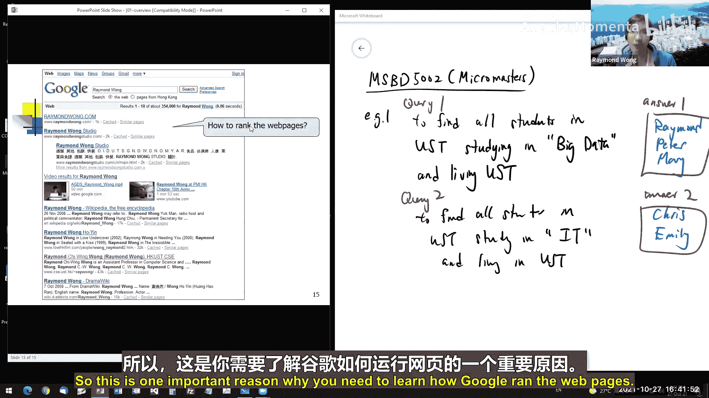
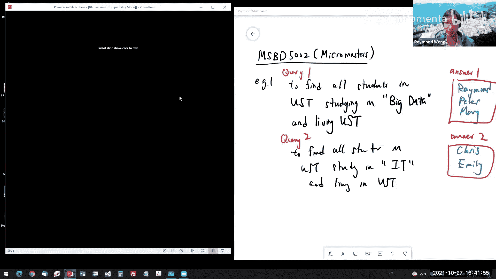

# 001：课程概览 🗺️

在本节课中，我们将对《数据挖掘与知识发现》这门课程进行整体概览。我们将了解课程的基本信息、参考书籍，并初步认识数据挖掘的五大核心主题。

本课程是香港科技大学的一门课程。主要的参考书籍包括论文以及两本教材：《数据挖掘：概念与技术》和《数据挖掘导论》。

## 五大主题介绍

接下来，我们将逐一介绍本课程涵盖的五个主要主题。

### 1. 关联分析

关联分析旨在发现数据集中项之间的有趣关系。一个经典的例子是超市购物篮分析。

假设我们有三位顾客：Raymond、Aid 和 Grace。他们的购物记录如下：
*   Raymond 购买了苹果和橙子。
*   Aid 购买了橙子和牛奶。
*   Grace 购买了苹果和橙子。

我们可以统计商品的出现频率。例如，苹果被购买了2次，橙子被购买了3次，而“苹果和橙子”这个组合被购买了2次。如果我们设定一个最小频率（例如2次），那么满足条件的商品或商品组合被称为**频繁项集**。

关联分析的另一个重要输出是**关联规则**，其形式为 `X -> Y`（例如，苹果 -> 橙子）。规则 `苹果 -> 橙子` 的**置信度**计算如下：在所有购买了苹果的顾客中，也购买了橙子的顾客比例。在这个例子中，购买苹果的顾客有2位（Raymond 和 Grace），其中2位也购买了橙子，因此置信度为 `2/2 = 100%`。同理，规则 `橙子 -> 苹果` 的置信度为 `2/3 ≈ 67%`。本主题的目标就是找出所有频繁项集和有意义的关联规则。

### 2. 聚类分析

上一节我们介绍了如何发现项之间的关联，本节我们来看看如何将相似的对象分组。聚类是一种无监督学习方法，目的是将数据点分组成不同的簇，使得同一簇内的点彼此相似，而不同簇的点相异。

假设我们有三位学生：Raymond、Lewis 和 Wman。他们的计算机科目和历史科目成绩如下：
*   Raymond: 计算机 100分，历史 40分。
*   Lewis: 计算机 20分，历史 90分。
*   Wman: 计算机 10分，历史 80分。

如果我们将这些成绩绘制在二维坐标系中（X轴为计算机成绩，Y轴为历史成绩），每个学生对应一个点。我们可以直观地看到数据点形成了两个组：一组计算机成绩高、历史成绩低；另一组历史成绩高、计算机成绩低。聚类的任务就是自动地发现这些分组（簇）。

### 3. 分类分析

在了解了如何对无标签数据进行分组后，本节我们学习如何根据已有数据对新的对象进行预测。分类是一种有监督学习方法，用于预测离散的类别标签。

假设一家保险公司想要预测一位新客户是否会购买保险单。已知该客户的属性为：种族=白人，收入=高，有无子女=无。公司根据历史数据训练出了一个**决策树**模型。

以下是使用决策树进行预测的步骤：
1.  从根节点开始，检查“有无子女”属性。该客户“无”子女，因此走向右子节点。
2.  在下一个节点，检查“收入”属性。该客户收入“高”，因此走向左子节点。
3.  到达叶节点，该节点显示预测结果为“是”（购买保险）的概率为100%。

因此，模型预测这位客户会购买保险单。决策树是分类方法中的一种，我们将在后续课程中学习更多细节。

### 4. 数据仓库

前面介绍的都是数据挖掘的具体技术，本节我们来看一个提升数据查询效率的系统概念——数据仓库。当数据库非常庞大且查询非常复杂时，直接查询可能需要很长的响应时间（例如一天到一周），用户体验很差。

数据仓库的核心思想是**预计算**。系统会预先估计用户可能提出的复杂查询，提前执行这些查询并将结果存储在硬盘上。这个存储预计算结果的系统就是数据仓库。

例如，查询1：“找出所有就读于UST大学、学习大数据专业并住在UST校园的学生。” 这是一个复杂查询。数据仓库会提前计算好这个查询的结果（假设结果是Raymond, Peter, Mary），并存储起来。

当用户真正提交这个查询时，系统无需重新进行复杂的计算，而是直接从数据仓库中检索已存储的结果，从而在极短时间（如一秒内）返回答案，大大提升了查询性能。

### 5. 网络数据库

最后，我们探讨一个与互联网紧密相关的主题——网络数据库，其典型应用是搜索引擎（如Google）的网页排名。

当我们搜索“Raymond Wong”时，搜索引擎会返回一系列相关的网页。本课程将学习搜索引擎如何对这些网页进行排序。了解网页排名算法非常重要，例如，如果你毕业后创业，你会希望自己公司的网站在相关搜索中能排在结果页的前列，而无需向搜索引擎支付广告费用。通过学习这些知识，你可以优化网站，使其更符合排名规则，从而获得更好的自然搜索排名。

## 课程总结

本节课我们一起学习了《数据挖掘与知识发现》课程的概览。我们介绍了课程的五⼤核心主题：
1.  **关联分析**：发现数据集中项之间的有趣联系，如频繁项集和关联规则。
2.  **聚类分析**：将相似的数据对象自动分组。
3.  **分类分析**：根据已有数据构建模型，用于预测新数据的类别。
4.  **数据仓库**：通过预计算和存储查询结果来优化复杂查询的性能。
5.  **网络数据库**：理解搜索引擎的网页排名原理。

这些主题构成了数据挖掘领域的基础，在后续课程中我们将对每个主题进行深入探讨。