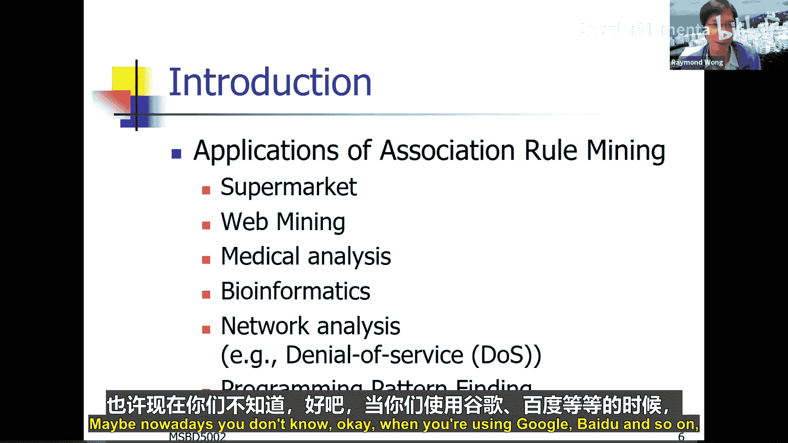
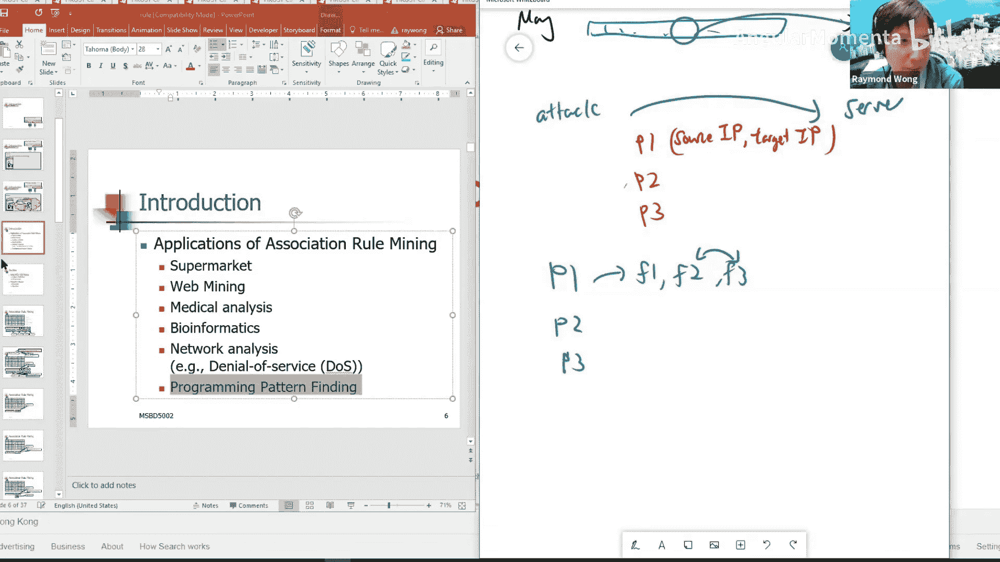

# 002：关联规则挖掘导论

在本节课中，我们将学习关联规则挖掘的基本概念。这是一种从数据中发现物品之间有趣关联的技术，例如在超市购物数据中发现“尿布”和“啤酒”经常被一起购买。我们将通过一个超市场景的例子来理解其核心思想，并探讨其在不同领域的应用。

## 超市场景示例

上一节我们介绍了数据挖掘的基本概念，本节中我们来看看一个具体的应用场景——关联规则挖掘。

这是一个超市场景。我们知道有四位顾客：Raymond、David、Emily 和 Derek。
我们知道 Raymond 购买了苹果、可乐、咖啡。其中每一样东西被称为一个**项**。
顾客在某个时间点购买的所有东西，我们称之为一次**历史记录**或**交易**。
David 购买了尿布（婴儿用品）和可乐。
Emily 购买了牛奶和饼干。
Derek 购买了可乐和牛奶。
在这个主题中，我们想要发现物品之间的一些关联。我想告诉大家的是，我们可以发现一个有趣的关联：尿布（婴儿用品）和啤酒（成人饮品）经常被一起购买。
这看起来很奇怪。你能猜出原因吗？
一种可能的解释是，一些父亲不想照顾婴儿，所以他们想喝点啤酒来释放压力。这是一个合理的解释。
另一个由其他人给出的解释是：这个模式经常在工作日傍晚出现。白天，父亲在办公室工作。傍晚下班时，他记得早上妻子嘱咐他要为婴儿买尿布。当然，当他离开办公室寻找尿布时，也会顺便购买他喜欢的啤酒。因此，尿布和啤酒通常会一起被购买。

## 超市经理的策略

假设我是一名超市经理。如果我们知道尿布和啤酒总是一起被购买，你知道我应该做什么促销吗？
以下是可能的策略：
*   将尿布和啤酒放在相近的位置。
*   进行捆绑促销，例如购买尿布时啤酒打折。

另一种策略是，将尿布和啤酒放在超市里相距很远的位置。这样，当丈夫购买其中一样后，为了找到另一样，他需要走过很长的路程，途中可能会看到并购买其他商品。这与宜家的策略类似。
也有人认为，如果这两样商品总是一起购买，那么提供折扣可能会降低超市的收入。相反，可以提供“购买这两样商品，免费获得另一样商品”的促销来提升销售额。
不同的人对此有不同的策略和想法。最重要的是，超市经理可以根据发现的模式来设计促销方案。

## 关联规则挖掘的应用

现在让我们看看关联规则挖掘的一些应用。我已经阐述了一个关于超市经理的真实例子。我认为这已经很清楚了。接下来，我将举例说明，以便你理解这项技术在现代的广泛应用。

### 网络挖掘

例如，当你使用谷歌或百度时，实际上网络挖掘也在使用关联规则挖掘技术。
假设我在谷歌搜索“电脑”。你可以看到“电脑”和“尺寸”、“电脑”和“显示器”等关联词。实际上，你可以将这些词视为项。这些项在所有互联网网页文档中频繁共同出现。因此，“计算机科学”是最频繁的项，“大数据”是第二频繁的项。如果你输入“大数据”，你会看到“大数据分析”等。实际上，谷歌和百度也在使用关联规则挖掘技术进行推荐，只是你可能没有发现。

### 医学分析

在医学分析中，例如当前的情况，假设我们有病人 Raymond，我们知道他的性别是男性，我们还知道关于 Raymond 的其他信息，比如他是否吸烟等。我们有许多与 Raymond 相关的属性。同时，我们知道这位病人是否患有肺癌。我们还有病人 Mary，女性，吸烟等，可能她没有患肺癌。我们拥有大量记录。在关联规则挖掘中，我们可以发现某些属性之间的相关性，例如吸烟与癌症之间的相关性。这对于理解医学分析中的相关性非常容易。

### 生物信息学

在生物信息学中，情况也类似。例如，我们有病人 Mary，这次我们有一些 DNA 数据。在生物信息学中，人们已经发现某些基因与某些癌症相关。这就是生物信息学中的关联规则挖掘。

### 网络分析

在网络分析中，例如拒绝服务攻击，可能有些同学不了解。让我解释一下，这是攻击者使用的一种行为。假设我们有一个网络服务器或邮件服务器。如果我是攻击者，我不喜欢这个服务器，我想让它瘫痪，那么我会发起拒绝服务攻击。我的意思是，作为攻击者，我向服务器发送大量流量，导致服务器无法处理如此多的流量，从而使服务器瘫痪。攻击者的这种行为被称为拒绝服务攻击。我想说的是，在网络流量中，我们知道当攻击者向服务器发送数据时，我们使用的是数据包。数据包包含源 IP 地址和目标 IP 地址。源 IP 地址是攻击者的 IP 地址，目标地址是目标服务器的 IP 地址。因此，在服务器端，如果我们发现大量来自同一源地址的数据包频繁到达，那么这个源地址就会被识别为攻击者，服务器将屏蔽来自该攻击者的所有访问。

### 程序模式发现

程序模式发现也非常容易，但我不想详述程序一、程序二、程序三等细节。根据一些机器学习和数据挖掘技术，我们可以提取一些特征，如特征一、特征二、特征三。基于这些，我们可以发现某些特征之间的相关性，例如某些人的写作风格特征，然后根据这些模式进行一些分析。

---

本节课中我们一起学习了关联规则挖掘的基本概念。我们通过一个超市购物篮的例子，理解了如何从交易数据中发现物品之间的关联（如“尿布 -> 啤酒”）。我们还探讨了超市经理如何利用这些发现制定营销策略，并了解了关联规则挖掘在网络搜索、医学分析、生物信息学和网络安全等多个领域的广泛应用。关联规则挖掘的核心在于从大量数据中自动发现有价值的、潜在有用的模式。