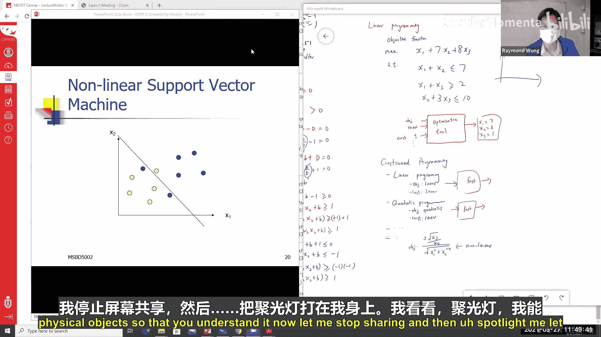
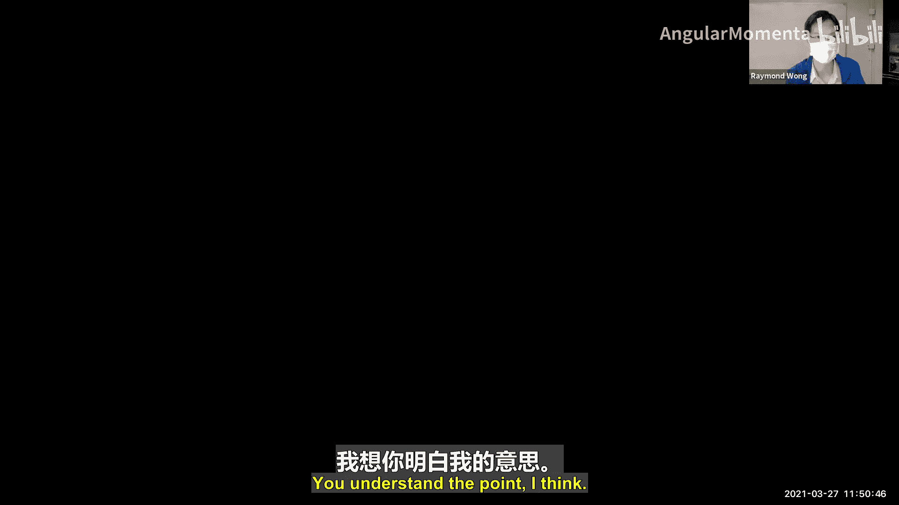

# 013：线性支持向量机（第一部分）

在本节课中，我们将学习支持向量机（SVM）的基本概念，特别是线性支持向量机。我们将了解其工作原理、核心公式以及如何通过优化方法找到最佳分类边界。

---

## 概述

我们已经学习了决策树和最近邻分类器。今天，我们将讨论支持向量机，并初步介绍神经网络。支持向量机有两种变体：线性支持向量机和非线性支持向量机。本节我们将从简单的线性支持向量机开始。

线性支持向量机的优点在于其结果可以可视化，并且如果原始数据能够被很好地划分，其分类准确率会非常高。

## 线性支持向量机的基本思想

假设我们有一个数据集，包含两个输入属性 `x1` 和 `x2`，以及八个数据点。其中，蓝色点代表目标属性值为“是”（例如，+1），黄色点代表目标属性值为“否”（例如，-1）。

在这个二维空间中，我们可以画一条直线将整个数据集分成两部分：一部分包含所有蓝点，另一部分包含所有黄点。这就是线性可分的情况。

这条直线的方程可以表示为：
**W1 * x1 + W2 * x2 + B = 0**

其中，`W1`、`W2` 和 `B` 是常数。对于所有蓝点，将其坐标代入方程左侧，结果会大于或等于0；对于所有黄点，结果会小于或等于0。

## 选择最佳分割线

实际上，我们可以画出多条直线来分割数据，例如分割线1、2、3、4。那么，我们应该选择哪一条呢？

上一节我们介绍了分割线的概念，本节中我们来看看如何选择最优的分割线。理想情况下，我们应选择那条使“间隔”最大化的直线。

间隔是指分割线到其两侧最近数据点的距离之和。最大化间隔的好处是，即使数据中存在一些噪声或轻微重叠，分类器也能保持较好的鲁棒性。

以下是最大化间隔的直观原因：
*   间隔小的分割线对噪声敏感，容易导致错误分类。
*   间隔大的分割线为数据点的分布留出了缓冲空间，容错能力更强。

## 间隔的数学表示

设我们的分割线方程为 **W1*x1 + W2*x2 + B = 0**。我们可以定义两条平行的边界线：
*   上边界线：**W1*x1 + W2*x2 + B = +1**
*   下边界线：**W1*x1 + W2*x2 + B = -1**

所有蓝点应满足 **W1*x1 + W2*x2 + B >= +1**。
所有黄点应满足 **W1*x1 + W2*x2 + B <= -1**。

为了统一表示，我们引入数据点的标签 `y`（蓝点为+1，黄点为-1）。那么，对于每一个数据点 `(x1, x2, y)`，都需要满足：
**y * (W1*x1 + W2*x2 + B) >= 1**

这个约束条件对于数据集中的每一个点都成立。如果有8个数据点，我们就有8个这样的不等式约束。

两条边界线之间的垂直距离，即“间隔”，可以通过公式计算：
**间隔 = 2 / sqrt(W1² + W2²)**

## 优化问题

我们的目标是最大化这个间隔。由于最大化 **2 / sqrt(W1² + W2²)** 等价于最小化 **sqrt(W1² + W2²)**，进而等价于最小化 **（W1² + W2²）/ 2**。

因此，线性支持向量机的核心优化问题可以表述为：
**最小化目标函数：(1/2) * (W1² + W2²)**
**约束条件：对于每一个数据点 i，满足 y_i * (W1*x1_i + W2*x2_i + B) >= 1**

这是一个带线性约束的二次规划问题。我们将其转化为这种标准形式的原因是，对于二次规划问题，存在大量成熟、高效的优化求解器（如某些数学软件或编程库中的工具），我们可以直接利用这些工具快速找到最优的 `W1`、`W2` 和 `B`，而无需自己从头设计复杂的优化算法。

## 从二维到高维

我们刚刚描述的是二维空间的情况，使用一条直线（一维超平面）进行分割。

对于n维空间（n>2），我们可以使用一个（n-1）维的超平面来分割空间。例如，在三维空间中，我们使用一个平面进行分割。线性支持向量机的原理可以完美地推广到高维空间。

## 线性不可分与非线性SVM简介

然而，有时即使在二维空间中，蓝色点和黄色点也会混杂在一起，无法用一条直线完美分割。

下一节我们将简要介绍非线性支持向量机。其核心思想是：
1.  **步骤一**：通过一个非线性映射函数，将原始数据从当前维度变换到一个更高维度的空间。
2.  **步骤二**：在这个更高维的空间中，数据可能变得线性可分。此时，我们再应用之前所学的线性支持向量机方法，找到一个超平面来进行分割。

这就好比在二维平面上交织在一起的两类点，当我们将它们“抬升”到三维空间后，或许就能用一个平面轻松分开了。关于非线性映射的具体细节，大家可以在专门的机器学习课程中深入学习。

---

## 总结

本节课中我们一起学习了线性支持向量机的基础知识。我们了解了其目标是寻找一个最大化分类间隔的超平面，并将该问题形式化为一个二次规划优化问题。我们还简要提到了当数据线性不可分时，可以通过映射到高维空间来处理，这引出了非线性支持向量机的概念。