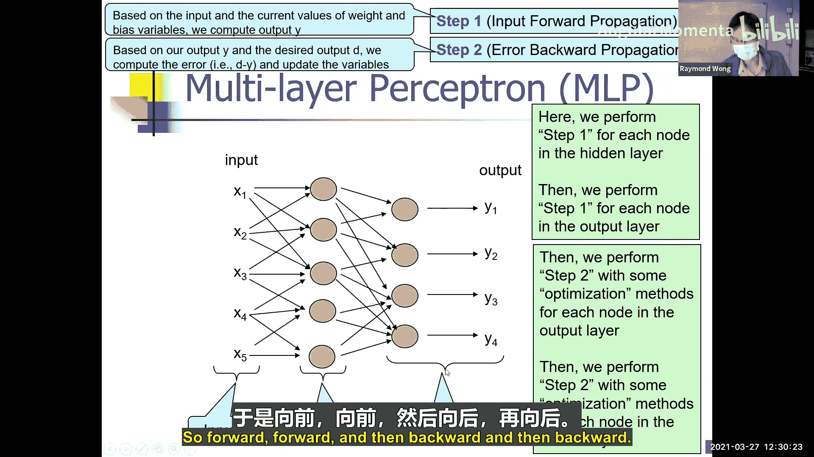

# 014：神经网络（第1部分）

在本节课中，我们将要学习神经网络的基本概念。神经网络是一种受人类大脑启发的计算模型，它由大量相互连接的简单处理单元（神经元）构成。我们将从单个神经元的工作原理开始，逐步理解其如何通过调整连接权重来学习和记忆信息，并最终介绍多层感知机的基本思想。

## 从人脑到人工神经元

上一节我们介绍了支持向量机等分类模型，本节中我们来看看神经网络。

神经网络是一种由简单且高度互连的处理元素组成的计算系统。这些处理元素被称为神经元或单元。这种方法受到大脑处理信息方式的启发，与我们之前学习的决策树等传统计算机处理方式完全不同。

信息处理发生在许多相同且简单的处理单元（神经元）中。神经元之间的连接具有权重，这些权重用于存储知识，类似于大脑中化学物质的含量。

神经网络有两个主要优势：
*   **并行处理**：每个神经元可以独立且同时地操作。
*   **容错性**：即使少量神经元失效，整个系统仍能运行，只是性能略有下降。

## 单个神经元的结构与激活函数

了解了神经网络的灵感来源后，本节中我们来看看单个神经元是如何工作的。

一个神经元通常分为前侧和后侧。前侧接收输入并进行计算，后侧则通过一个激活函数产生输出。

以下是神经元前侧的计算公式：
`net = w1*x1 + w2*x2 + b`
其中，`x1` 和 `x2` 是输入，`w1` 和 `w2` 是连接权重，`b` 是偏置项。计算得到的 `net` 值将传递给激活函数。

激活函数将 `net` 值映射到最终的输出 `y`。常见的激活函数包括：

*   **阶跃函数（硬极限函数）**：如果 `net > 0`，则 `y = 1`；否则 `y = 0`。
*   **线性函数（恒等函数）**：`y = net`。
*   **修正线性单元**：`y = max(0, net)`。这是目前非常常用的激活函数。
*   **Sigmoid函数**：`y = 1 / (1 + e^(-net))`。其输出值在0到1之间。
*   **双曲正切函数**：`y = (e^(2*net) - 1) / (e^(2*net) + 1)`。其输出值在-1到1之间。

选择哪种激活函数通常取决于我们希望输出值落在哪个范围内。

## 神经元的训练：权重更新

知道了神经元如何计算输出后，本节中我们来看看它如何通过学习来调整自己。

训练过程就是根据预测输出与期望输出之间的误差，来更新权重 `w1`、`w2` 和偏置 `b` 的过程。这模拟了大脑中化学物质（记忆）根据经验增强或减弱的过程。

权重更新遵循以下公式：
`w1_new = w1_old + α * (d - y) * x1`
`w2_new = w2_old + α * (d - y) * x2`
`b_new = b_old + α * (d - y)`
其中：
*   `α` 是学习率，控制每次更新的幅度。
*   `d` 是期望输出（目标值）。
*   `y` 是神经元的实际输出。
*   `(d - y)` 是误差。

如果预测正确（`y` 等于 `d`），则误差为0，权重不会更新。如果预测错误，权重就会根据误差大小和输入值进行相应调整。

## 训练过程示例：学习“或”运算

为了更直观地理解，本节我们通过一个具体例子来演示神经元如何学习简单的“或”逻辑运算。

假设我们的训练数据如下：

| x1 | x2 | 目标输出 (d) |
|----|----|-------------|
| 0  | 0  | 0           |
| 0  | 1  | 1           |
| 1  | 0  | 1           |
| 1  | 1  | 1           |

我们使用Sigmoid函数作为激活函数，并设置初始权重 `w1 = 1`， `w2 = 1`， 偏置 `b = 0`，学习率 `α = 0.1`。

训练一个“周期”的步骤如下：
1.  **输入前向传播**：取第一条数据 `(0, 0, 0)`。
    *   计算 `net = 1*0 + 1*0 + 0 = 0`。
    *   计算输出 `y = sigmoid(0) ≈ 0.5`。
2.  **误差反向传播**：比较输出 `y≈0.5` 与期望输出 `d=0`。
    *   误差 `(d - y) = 0 - 0.5 = -0.5`。
    *   更新权重：
        *   `w1_new = 1 + 0.1 * (-0.5) * 0 = 1`
        *   `w2_new = 1 + 0.1 * (-0.5) * 0 = 1`
        *   `b_new = 0 + 0.1 * (-0.5) = -0.05`
3.  用更新后的参数，对数据集中剩下的 `(0,1)`， `(1,0)`， `(1,1)` 重复步骤1和2。

完成对所有数据的一次处理称为一个“周期”。我们可以设置停止条件，例如：
*   达到最大周期数（如100次）。
*   总体误差（如所有数据误差平方和）低于某个阈值（如0.001）。

通过多次周期的学习，神经元的权重会逐渐调整，使其输出越来越接近正确的“或”运算结果。

## 从单层到多层感知机

我们已经看到单个神经元可以工作，但它有局限性。本节中我们来看看更强大的多层神经网络。

单个神经元只能解决**线性可分**问题（即可以用一条直线或一个平面将不同类别的点分开）。对于“异或”等非线性可分问题，单个神经元无法解决。

幸运的是，通过组合多个神经元形成**多层感知机**，我们可以解决非线性问题。一个典型的多层感知机包括：
1.  **输入层**：接收原始数据。
2.  **一个或多个隐藏层**：进行复杂的特征变换。隐藏层通常使用ReLU等激活函数。
3.  **输出层**：产生最终结果。对于分类问题，输出层常使用Sigmoid或Softmax函数。

理论研究证明，具有至少一个隐藏层的多层感知机是一个**通用函数逼近器**，理论上可以拟合任何复杂的函数。

当网络层数非常多（例如超过10层）时，我们称之为**深度网络**。使用深度网络进行训练和学习的过程，就是**深度学习**。深度学习因其强大的能力，在学术界和工业界都备受关注。

## 多层网络的前向与反向传播

对于多层网络，训练的核心思想仍然是前向传播和反向传播，只是过程更复杂。

以下是多层网络训练一个周期的流程：
1.  **前向传播**：
    *   从输入层开始，数据依次通过每个隐藏层，最终到达输出层，计算出预测值 `y`。
    *   在每一层，每个神经元都执行我们之前介绍过的 `net` 计算和激活函数映射。
2.  **反向传播**：
    *   计算输出层的预测值 `y` 与目标值 `d` 之间的误差。
    *   这个误差从输出层开始，**反向**逐层传播回前面的网络层。传播过程中，会使用链式法则等优化方法计算每一层神经元对总误差的“贡献度”（梯度）。
    *   根据计算得到的梯度，按照 `权重 = 权重 + 学习率 * 梯度` 的规则，从输出层到输入层依次更新**所有权重和偏置**。

通过反复迭代这个过程，整个网络的参数得到优化，从而能够学习输入和输出之间复杂的映射关系。

本节课中我们一起学习了神经网络的基本原理。我们从人脑的启发开始，理解了单个神经元的结构、激活函数以及通过权重更新进行学习的过程。通过示例，我们看到了神经元如何训练。我们也认识到单个神经元的局限性，并由此引出了强大的多层感知机模型，了解了其基本结构和前向/反向传播的训练思想。神经网络，特别是深度学习，是当前数据挖掘和机器学习领域的核心工具之一。